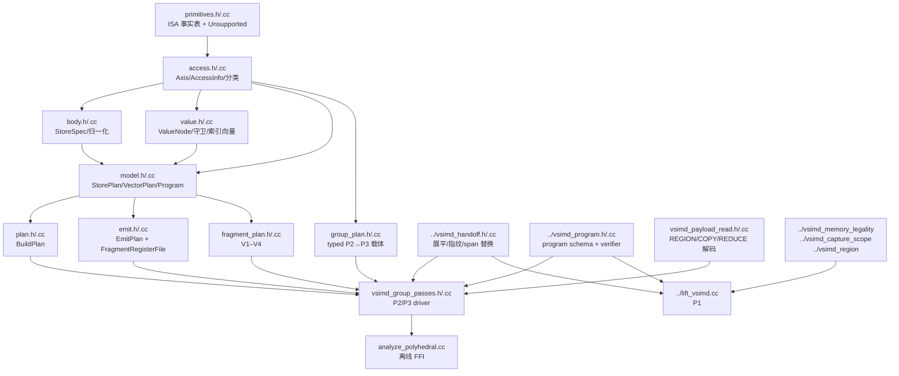
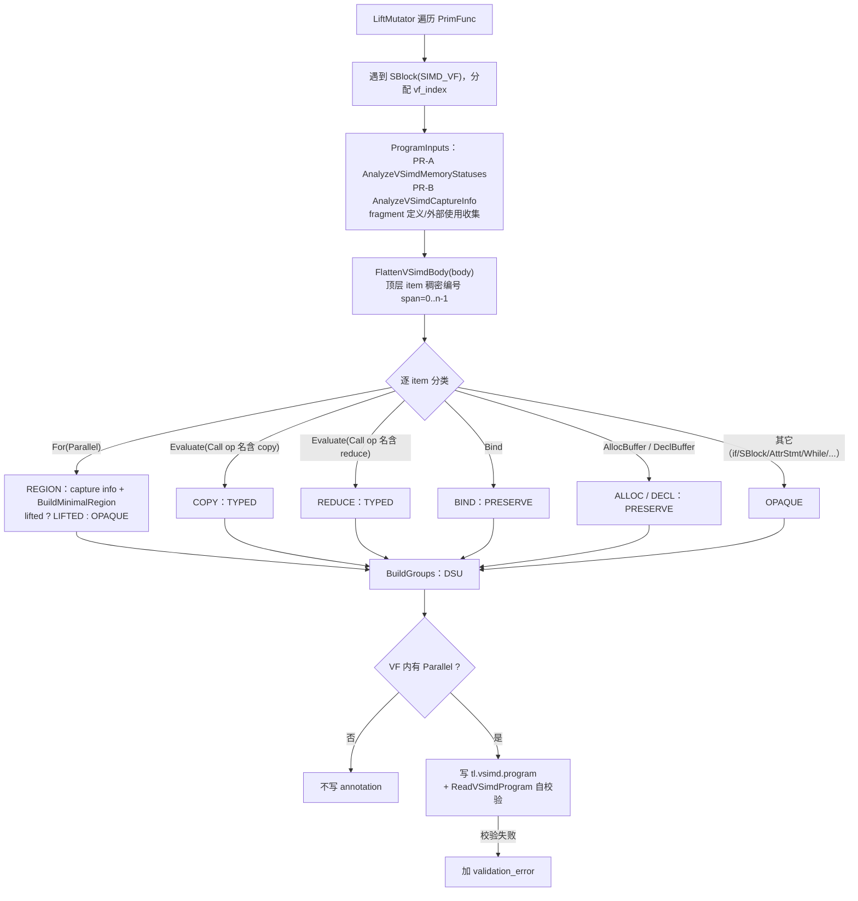
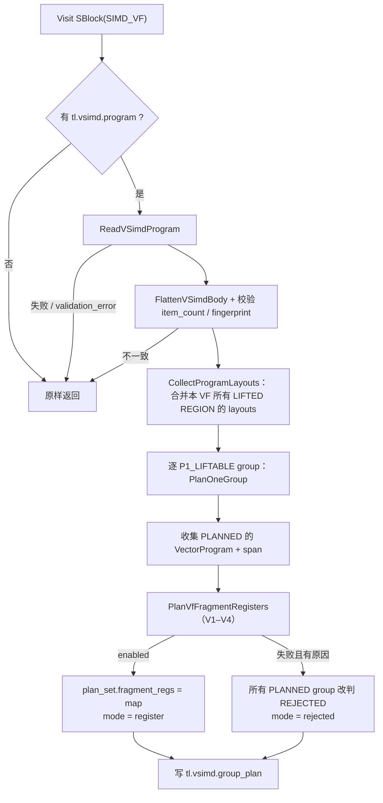
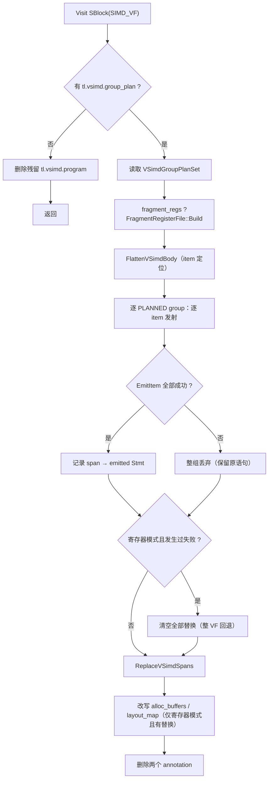

# Ascend `T.Parallel` 三阶段（P1→P2→P3）实现报告

> **对齐对象（唯一事实来源，均对应当前工作树）**
>
> - 分支：`p_123_parallel`
> - P1：`src/ascend/transform/lift_vsimd.cc`、`vsimd_program.{h,cc}`、`vsimd_handoff.{h,cc}`
> - P1 分析库：`vsimd_memory_legality.{h,cc}`、`vsimd_capture_scope.{h,cc}`、`vsimd_region.{h,cc}`、`vsimd_analysis_common.h`
> - P2/P3：`src/ascend/transform/polyhedral/`（23 个文件）
> - 运行时兜底：`src/ascend/transform/ascend_simdvf_lower_parallel.cc`
> - 流水线接入：`tilelang/ascend/pipeline.py:120-128`
> - 测试：`testing/ascend/transform/test_ascend_vsimd_group_passes.py`（11 例）等 6 个文件
> - 关联文档：`p2_p3_vsimd_program_integration_design.md`（设计与状态）、`vsimd_p1_analysis.md`（P1 详解）

本文是**实现报告**，只描述“代码现在实际做了什么”，并在第 11 节列出与旧
`array_region` 实现的变化。旧调研文档 `p2_p3_cpp_port_survey.md` 中关于
「`tl.vsimd.array_region` 载体」「`P2` 反展开 region」「legacy 被注释、无兜底」的表述
均已失效，以本文为准。

---

## 0. 结论速览

1. **三阶段全部是 C++**，并且是流水线中 `T.Parallel` 的**唯一向量化路径**：
   `pipeline.py:125-127` 在同一个开关下执行 `AscendLiftVSimd` → `AscendVectorizeVSimd`（P2+P3）；
   随后 `AscendSimdVFLowerParallel` 作为 legacy 兜底，只处理被拒的 nest。
2. **载体从 `AttrStmt` 换成 SBlock annotation**：
   P1 写 `tl.vsimd.program`，P2 写 `tl.vsimd.group_plan`；**两者都不改 body**，
   因此 P1 记录的 item span 在 P2 规划期间始终有效，失败时也不需要“解载体”。
3. **P1 是 metadata-only**：按 `SIMD_VF` body 的顶层语句稠密编号成 item，
   给出 `REGION/COPY/REDUCE/BIND/ALLOC/DECL/OPAQUE` 七类事实、依赖组、
   captures、fragments、assumptions，并写入 `item_count` 与 `body_fingerprint`。
4. **P2 是 group 事务**：只处理 `P1_LIFTABLE` group；任一 item 失败整组 `REJECTED`，
   **绝不发布部分 item 计划**。规划输入是**原始 span 语句**，region 只作为布局/假设上下文。
5. **COPY/REDUCE Phase B 已落地**：COPY 合成 UB↔UB 的 `T.Parallel` copy nest；
   REDUCE 合成源域 `T.Parallel` 归约 nest（`clear=true` 额外发射单位元 init），
   两者都复用现有 `BuildPlan`/`EmitPlan`。
6. **fragment 采用 VF 原子策略**：group 内用到 `OUTSIDE_VF` fragment → 该 group 直接拒绝；
   其余 fragment 由 `PlanVfFragmentRegisters`（V1 escape / V2 预算 / V3 一致性 / V4 生命周期）
   做 VF 级判定，通过后 P2 写 `fragment_regs`，P3 生成 `local.var` 寄存器文件。
7. **旧路径已删除**：`stage_passes.{h,cc}`（`LiftParallelToArray` / `PlanArray` /
   `LowerArrayPlan` / `VSimdRegionRef` / `array_region` / `array_plan`）及其 FFI、
   Python 包装全部移除；`TL_ASCEND_VSIMD_VECTORIZE` 开关一并删除。
8. **回归结果**：`testing/ascend/transform` 582 例、`testing/ascend/auto_schedule` 639 例，
   合计 **1221 passed / 31 skipped**；`testing/ascend/target` 19 + `cache` 8 = 27 passed。

---

## 1. 代码规模与文件清单

### 1.1 P1 与交接层

| 文件 | 行数 | 职责 | 关键符号 |
| --- | ---: | --- | --- |
| `lift_vsimd.cc` | 1039 | P1 pass：VF 遍历、item 构造、group 划分、annotation 写入与自校验 | `BuildProgram`（728）、`BuildGroups`（635）、`LiftMutator`（973）、FFI `AscendLiftVSimd`（1033） |
| `vsimd_program.h` | 99 | P1 program schema（typed）与 reader 声明 | `VSimdProgram`、`VSimdProgramItem/Group/Capture/Fragment` |
| `vsimd_program.cc` | 326 | annotation 解析与不变量校验 | `ReadVSimdProgram`（102）、`VerifyVSimdProgram`（214） |
| `vsimd_handoff.h/.cc` | 53 + 129 | P1/P2/P3 共用的展平、指纹、span 替换 | `FlattenVSimdBody`（`.cc:115`）、`FingerprintVSimdBody`（104）、`ReplaceVSimdSpans`（122） |
| `vsimd_memory_legality.{h,cc}` | 48 + 1252 | PR-A：per-nest 内存合法性 | `AnalyzeVSimdMemoryStatuses` |
| `vsimd_capture_scope.{h,cc}` | 104 + 614 | PR-B：capture/scope 闭包 | `AnalyzeVSimdCaptureInfo` |
| `vsimd_region.{h,cc}` | 133 + 416 | PR-C/D：最小 region 构造与自校验 | `BuildMinimalRegion`、`VerifyExpandedRegion` |
| `vsimd_analysis_common.h` | 312 | VF/nest 索引与公共类型 | `VSimdCaptureInfo`、`VSimdMemoryRegionStatus` |

### 1.2 P2/P3（`src/ascend/transform/polyhedral/`）

| 文件 | 行数 | 职责 | 关键符号 |
| --- | ---: | --- | --- |
| `emit.cc` | 2665 | P3 发射：value/store/归约/pack2/NZ/寄存器文件 | `Emitter`、`EmitStore`、`EmitElementwiseChunks`、`EmitReduce*`、`FragmentRegisterFile`、`EmitPlan` |
| `plan.cc` | 2307 | P2 规划：nest 切分、轴打分、归约、布局、pack2、多段 program | `SplitNest`、`SerialIsClean`、`BuildPlanForAxis`、`ClassifyReduce`、`ClassifyStoreLayout`、`ClassifyFragmentRegisters`、`BuildPlan` |
| `value.cc` | 875 | value DAG：标量表达式 → 逐 lane 向量值 | `BuildValue`、`LoadNode`、`IndexValue`、`GuardFreeBounds` |
| `primitives.cc` | 471 | ISA 事实表、`Unsupported`、dtype/掩码工具 | `ReducePrimitives`、`VRegLanes`、`MaskBits`、`ReduceIdentity` |
| `vsimd_group_passes.cc` | 861 | **P2/P3 driver**：group 规划、COPY/REDUCE Phase B、fragment 判定、span 替换 | 见 §4/§5 |
| `fragment_plan.cc` | 291 | VF 级 fragment register 判定（V1–V4） | `PlanVfFragmentRegisters`（172） |
| `group_plan.cc` | 121 | typed group plan 构造器 + 反射注册 | `MakeVSimdGroupPlanSet` 等 |
| `access.cc` | 277 | SCoP 建模：线性化、有限差分、访存分类 | `ClassifyAccess`、`FiniteDifference`、`ClassifyDelta` |
| `model.cc` | 184 | 计划数据结构构造器 + 反射 + 累加器判据 | `MakeStorePlan`、`AccumulatorCandidate` |
| `body.cc` | 170 | body 归一化 | `NormalizeBodyInto`、`ApplyAliases` |
| `analyze_polyhedral.cc` | 297 | **离线唯一入口**：FFI（`build_plan`/`emit_plan`/`render_plan`）+ plan 文本渲染 | `AscendPolyhedralBuildPlan`（247）等、`RenderPlanText`（198） |
| `vsimd_payload_read.cc` | 405 | **P2 专用** payload 解码：REGION/COPY/REDUCE → typed 输入 | `ReadVSimdRegion`（135）、`ReadVSimdCopy`（361）、`ReadVSimdReduce`（377）、`VSimdCopyReducePayload`、`VSimdReducePayload` |
| 头文件 | 1577 | `group_plan.h` 248、`model.h` 317、`primitives.h` 224、`access.h` 220、`value.h` 182、`body.h` 91、`vsimd_payload_read.h` 72、`emit.h` 72、`plan.h` 66、`fragment_plan.h` 54、`vsimd_group_passes.h` 31 | — |

> 规模集中度：`emit.cc` + `plan.cc` + `value.cc` 共 5847 行，占 P2/P3 库（10501 行）的 56%。

### 1.3 运行时兜底

| 文件 | 行数 | 说明 |
| --- | ---: | --- |
| `ascend_simdvf_lower_parallel.cc` | 999 | `AscendSimdVFLowerParallel`：P2/P3 拒绝的 `T.Parallel` / `T.copy` / `T.reduce_*` 由它按原语义降到 SIMD 指令 |

### 1.4 测试规模

| 文件 | 用例数 | 覆盖 |
| --- | ---: | --- |
| `test_ascend_polyhedral_vectorize.py` | 158（4516 行） | 离线 `build_plan`/`emit_plan` 全场景 + 新链路 + fragment + FA |
| `test_ascend_vsimd_group_passes.py` | 11（370 行） | P1→P2→P3 契约、COPY/REDUCE Phase B、fragment、默认流水线 |
| `test_ascend_vsimd_lift.py` | 15 | P1 annotation 内容与放行场景 |
| `test_ascend_vsimd_memory_legality.py` | 23 | PR-A |
| `test_ascend_vsimd_capture_scope.py` | 15 | PR-B |
| `test_ascend_vsimd_region.py` | 17 | PR-C/D |
| **`testing/ascend/transform` 合计** | **582** | — |

---

## 2. 架构与数据流

### 2.1 模块依赖



要点：

- polyhedral 内部依赖仍严格向下（`primitives → access → {body,value} → model → plan/emit`）。
- **P1 交接层不再住在 polyhedral 里**：`vsimd_handoff`、`vsimd_program` 在
  `src/ascend/transform/` 下，polyhedral 通过 `../vsimd_*` 单向引用。
  `vsimd_program.*` 只保留 P1 的 schema 与结构校验；REGION/COPY/REDUCE 的
  payload 解码在 `polyhedral/vsimd_payload_read.*`，由 P2 消费。
- 旧的 region 反展开交接（`vsimd_p2_input.*`）与 `render.*` 已移除：离线入口
  全部收敛到 `analyze_polyhedral.cc`（含 `RenderPlanText`）。
- `group_plan` 是 P2 与 P3 之间唯一的类型化载体，P3 不需要知道 P1 annotation 的结构。

### 2.2 阶段契约

| 阶段 | 入口 | 输入 | 输出 | 载体 | 失败语义 |
| --- | --- | --- | --- | --- | --- |
| P1 | `AscendLiftVSimd` | `PrimFunc` | 同一 `PrimFunc`，body 不变 | `SBlock("SIMD_VF").annotations["tl.vsimd.program"]` | 不抛异常；无 `T.Parallel` 的 VF 不写 annotation；结构自校验失败写 `validation_error` |
| P2 | `AscendPlanVSimd` | 带 `tl.vsimd.program` 的 `PrimFunc` | 同一 body，新增 group plan | `...annotations["tl.vsimd.group_plan"]`（typed `VSimdGroupPlanSet`） | 整组 `REJECTED`；不写部分 item plan；body 不变 |
| P3 | `AscendEmitVSimd` | 带 `tl.vsimd.group_plan` 的 `PrimFunc` | item span 被替换为 `T.simd.*` | 直接改 body；删除两个 annotation | 整组回滚（保留原语句）；其它 group 不受影响 |
| 组合 | `AscendVectorizeVSimd` | `PrimFunc` | `PrimFunc` | — | = P2 + P3 |
| 兜底 | `AscendSimdVFLowerParallel` | 残留的 `T.Parallel` / `T.copy` / `T.reduce_*` | SIMD 指令 | — | 原有语义 |

### 2.3 载体协议

| 载体 | key | 载荷 | body | 生产者 | 消费者 |
| --- | --- | --- | --- | --- | --- |
| program | `tl.vsimd.program`（`lift_vsimd.cc:47`） | `Map<String,Any>`（`version/vf_index/provenance/item_count/body_fingerprint/items/groups/captures/fragments/assumptions/attrs`） | 原 VF body | P1 | P2；P3 在 P2 未规划时负责删除 |
| group plan | `tl.vsimd.group_plan`（`vsimd_group_passes.cc:54`） | `VSimdGroupPlanSet`（typed FFI 对象） | 原 VF body | P2 | P3 |

> 两个 annotation 最终都不会进入 codegen：P3 无条件删除。

### 2.4 共享展平规则（`vsimd_handoff.cc`）

`FlattenVSimdBody` 是 P1/P2/P3 唯一的“item 定义”：

- `SeqStmt` 递归展开；
- 透明 wrapper **不占 item**：`tl.simdvf_scope`、`tilelang_assume` / `tl.assume`、
  `tl.buffer_version`、`tl.manual_multi_buffer`（`.cc:20-24`）；
- 其余顶层语句各占一个 item（`AllocBuffer`、`DeclBuffer`、`Bind`、`For`、`Evaluate`…）。

`FingerprintVSimdBody` 对展平后的语句序列做结构指纹；P1 把 `item_count` 与
`body_fingerprint` 写进 annotation。**P2 在规划前重新展平并逐项比对**：不一致就不写
group plan（P3 随后只删 annotation，nest 交 legacy）。P3 自己不再比对——它只消费
P2 在一致性校验之后写出的 group plan，并按 span 替换；因此 P2 → P3 之间同样不允许
插入改 body 的 pass。这保证了跨 pass 组合时不会静默错位替换。

---

## 3. P1：`AscendLiftVSimd`

### 3.1 入口与契约

- FFI：`tl.transform.AscendLiftVSimd`（`lift_vsimd.cc:1033`）。
- Python：`tilelang.ascend.transform.AscendLiftVSimd`。
- 输入/输出都是同一个 `PrimFunc`；**P1 只读 body**，唯一副作用是给
  `SBlock("SIMD_VF")` 加 annotation（`lift_vsimd.cc:984`）。
- `TL_ASCEND_SIMD_LIFT`（默认 `True`）控制是否运行；关掉即整条新链路停用，
  `T.Parallel` 全部交给 legacy。

### 3.2 处理流程



### 3.3 item 分类

| 顶层语句 | kind | analysis_status | p1_liftable |
| --- | --- | --- | --- |
| `For(kind=Parallel)` 且 `nest_index` 有 capture info、`BuildMinimalRegion.lifted` | `REGION` | `LIFTED` | true |
| `For(kind=Parallel)` 但未 lift | `REGION` | `OPAQUE` | false |
| `Evaluate(Call)`，op 名含 `copy` | `COPY` | `TYPED` | true |
| `Evaluate(Call)`，op 名含 `reduce` | `REDUCE` | `TYPED` | true |
| `Bind` | `BIND` | `PRESERVE` | false |
| `AllocBuffer` / `DeclBuffer` | `ALLOC` / `DECL` | `PRESERVE` | false |
| 其它（`if` / 嵌套 `SBlock` / `AttrStmt` / `While` / 未识别 `Evaluate`） | `OPAQUE` | `OPAQUE` | false |

- COPY 的识别是 op 名子串匹配（`IsCopyOp`，`lift_vsimd.cc:628`），因此 P2 必须重新
  校验 `src_region`/`dst_region`/scope（见 §4.4）。
- `REDUCE clear=false` 时 P1 把 dst 同时记入 `reads`，依赖组因此能连上 dst 的 producer
  （`AddCopyReduceItem`，`lift_vsimd.cc:546`）。

### 3.4 group 规则（`BuildGroups`，`lift_vsimd.cc:635`）

- 用并查集把 item 合成 group，边有三类：
  1. **读后写**：item 读某 buffer 且此前有 writer；
  2. **fragment 使用**：所有读写同一 fragment 的 item 强制同组（fragment 是跨语句值）；
  3. 其余无依赖的 item 保持独立 group。
- group 状态：
  - 只含 metadata（BIND/ALLOC/DECL）→ `PRESERVE`；
  - 混入 metadata 或任一 item 不可 lift → `OPAQUE`；
  - 全部 item 可 lift 且无 metadata → `P1_LIFTABLE`。
- item 的 `status`/`effective_status` 由 group 状态覆盖：
  `PRESERVE` / `OPAQUE` / 否则等于 `analysis_status`（`LIFTED` 或 `TYPED`）。

> `P1_LIFTABLE` 只表示“允许 P2 尝试”，不是发射许可。

### 3.5 annotation 字段

| 字段 | 说明 |
| --- | --- |
| `version` | 固定 1 |
| `vf_index` | 按 VF 出现顺序编号 |
| `provenance` | 固定 `LIFTED` |
| `item_count` | 展平后顶层 item 数 |
| `body_fingerprint` | 展平语句序列的结构指纹 |
| `items[]` | 公共字段 + `kind` 专属 payload（`region`、`src/dst/src_region/dst_region/reduce_kind/reduce_dim/clear`、`var/value`、`buffer/storage`） |
| `groups[]` | `{id, status, items}` |
| `captures[]` | `{buffer, name, storage}` |
| `fragments[]` | `{buffer, name, definition_vf, definition_scope, use_vfs, cross_vf, escapes_vf, uses_outside_vf}` |
| `assumptions[]` / `attrs[]` | 锚点（`anchor`/`anchor_end`）与 `T.assume` 条件 |
| `validation_error` | 自校验失败时出现，P2 见到即整 VF 拒绝 |

### 3.6 边界与不变量

1. **无 `T.Parallel` 的 VF 不写 annotation**（`lift_vsimd.cc:834`）：例如只有
   `T.copy` / `T.reduce_*` 的 VF，P1 不产出 program，legacy 直接处理。
2. 只有**嵌套** Parallel（无顶层 item）时会写一个全 `OPAQUE` 的 program 并 `LOG(WARNING)`
   （`lift_vsimd.cc:838`）；P2 不会规划它。
3. P1 不修改 body，因此可以重复运行：重复 lift 只覆盖同一 annotation。
4. P1 的 `ReadVSimdProgram` 自校验会把结构不一致写进 `validation_error`，而不是抛异常。

---

## 4. P2：`AscendPlanVSimd`

### 4.1 入口与 group 事务

- FFI：`tl.transform.AscendPlanVSimd`（`vsimd_group_passes.cc:848`）→ `PlanVSimd`（827）。
- 只读 `tl.vsimd.program`，写 `tl.vsimd.group_plan`；**body 一个字节都不改**。
- 事务粒度 = P1 的 group：
  - `P1_LIFTABLE` → 尝试规划；
  - 任一 item 失败 → 整组 `REJECTED`，`items` 为空数组；
  - `PRESERVE` / `OPAQUE` group 不产生 entry。

### 4.2 主流程



### 4.3 REGION 规划（`PlanRegionItem`，124）

- 前置：`item.status == LIFTED`、span 为单条语句。
- 解码：`ReadVSimdRegion(item.meta, vf_index, &region)` 取
  `layouts / assumptions / bindings / shape_syms / domain / accesses`。
- `PlanOptions`：
  ```text
  layouts        = region.layouts        // NZ 目标由 ClassifyStoreLayout 处理
  assumptions    = region.assumptions    // 进入 Analyzer 约束
  bindings       = region.bindings       // 进入 Analyzer Bind
  shape_syms     = region.shape_syms
  vf_alloc_scope = vf->alloc_buffers     // fragment G0 校验
  ```
- **规划输入是原始 span 语句** `body.stmts[item.span_begin]`，而不是 region 反展开：
  保留 `Bind`、别名、前后语句，`BuildPlan` 的 serial 吸收 / pre-post 能力仍然可用。

### 4.4 COPY Phase B（`PlanCopyItem`，224）

**payload 解码**（`ReadVSimdCopy`）：`src/dst`（buffer + storage scope）与
`src_region/dst_region`（`buffer/indices/extents/access_type`）。缺字段即整组拒绝。

**支持范围**：

| 约束 | 说明 |
| --- | --- |
| 两端 scope | 只接受 UB：`shared` / `shared.dyn`（`IsUbScope`，70） |
| rank | src/dst 必须同 rank、非 0 |
| extent | 逐维 `src == dst`，或 `src extent == 1`（广播） |
| layout | 取自同 VF 的 REGION item（`CollectProgramLayouts`） |

**合成规则**（`BuildCopyNest`，181）：

```text
for idx in T.Parallel(dst_extents):
    dst[dst_indices + idx] = src[src_indices + (extent==1 ? 0 : idx)]
```

然后 `BuildPlan(nest, nullopt, options)`。`VSimdCopyPlan.kind` 记录 `ND` 或 `BROADCAST`。
跨 scope（GM / FRAGMENT / L1）不做，整组拒绝并交 legacy。

### 4.5 REDUCE Phase B（`PlanReduceItem`，430）

**payload 解码**（`ReadVSimdReduce`）：在 COPY 的字段上增加
`reduce_kind / reduce_dim / clear`。

**支持范围**：

| 项 | 支持 |
| --- | --- |
| `reduce_kind` | `max` / `sum` / `min`（`ReduceRecipeOf` → `vcmax` / `vcadd` / `vcmin`） |
| `dim` | `[0, src_rank)` |
| dst 形状 | 去掉归约维（rank-1），或保留该维且 extent 为 1（`MapReduceDims`） |
| 其它维 | `src extent == dst extent`，或 src extent 为 1（广播） |
| scope | 两端都必须 UB |

**合成规则**（`BuildReduceNest`，352）——源域 Parallel 归约：

```text
for idx in T.Parallel(src_extents):
    dst[dst_indices + idx'] = op(dst[dst_indices + idx'], src[src_indices + idx])
```

- 该形状正是 `ClassifyReduce` 识别的“lane 变化读 + lane 均匀写”，可直接发射
  `vcadd/vcmax/vcmin`；轴打分也可能选输出轴做向量轴、把归约维留成串行循环，
  两种都是合法发射（由规划器决定）。
- `clear=false`：上式直接累加旧 dst 值。
- `clear=true`：额外生成一个 `init` program（`BuildReduceInitNest`，405）：
  ```text
  for idx in T.Parallel(dst_extents):
      dst[dst_indices + idx] = identity(dtype, recipe)
  ```
  单位元由 `ReduceIdentity` 按 dtype 给出（max→-inf、min→+inf、sum→0），
  避免把“旧 dst 值”当初始值。P3 先发射 `init` 再发射归约。

`VSimdReducePlan` 记录 `reduce_kind / dim / clear / init? / program`。

### 4.6 fragment 策略

**第一层：group 级（`GroupUsesOutsideFragment`，500）**

P1 的 `fragments[]` 中 `definition_scope == OUTSIDE_VF` 且被本 group 任一 item
读写的 fragment，直接让该 group `REJECTED`：

```text
fragment 'x' is allocated outside this VF (cross-VF fragment); stage it through UB first
```

> 约定：fragment 在 VF 外定义、VF 内使用 = 跨 VF fragment，P2 直接拒绝；
> “一个 VF 定义、另一个 VF 使用”的形态不会出现，未做任何设计。

**第二层：VF 级（`PlanVfFragmentRegisters`，`fragment_plan.cc:172`）**

对**已 PLANNED group 的全部 VectorProgram** 做一次 VF 原子判定：

| 检查 | 内容 | 失败后果 |
| --- | --- | --- |
| V1 escape | 用 `FlattenVSimdBody` 扫描**未被规划**的 item，若访问了 register-managed fragment | 整 VF 禁用 register mode |
| V2 预算 | Σ slots ≤ `kManualVRegPool`(24)，且 + auto reserve ≤ `kMaxVRegsPerVf`(32) | 整 VF 拒绝 |
| V3 一致性 | 同一 fragment data Var 的 `slots/lanes/dtype` 必须一致（同名不同 data Var 是两条） | 整 VF 拒绝 |
| V4 生命周期 | 按 program 顺序模拟 `init[data][slot]`：读未初始化 chunk、掩码部分写未初始化 chunk | 整 VF 拒绝 |

- 通过：`VSimdGroupPlanSet.fragment_regs = FragmentRegisterMap`，
  `fragment_mode = "register"`。
- 失败：所有 `PLANNED` group 改判 `REJECTED`（`fragment_mode = "rejected"` +
  `fragment_reason`），P3 不替换任何语句，整 VF 交 legacy。
- 单条 nest 内部的 G0–G8 仍由 `BuildPlan` 的 `ClassifyFragmentRegisters` 决定
  （例如 fragment 必须由当前 VF 分配、identity layout、非 packed store 等）；
  这些失败表现为“该 group 拒绝”，不是 VF 级。

### 4.7 失败语义与诊断

- `group.status` 只有 `PLANNED` / `REJECTED`。
- `REJECTED` 时：`reason` 记录第一个失败原因，`diagnostics` 逐 item 追加；
  `items` 为空，**绝不发布部分计划**。
- 典型 `reason`：
  - `REGION item is not effectively LIFTED`
  - `invalid region payload: ...`
  - `copy source 'x' is not UB (scope FRAGMENT)`
  - `copy dimension 0 has unequal extents ...`
  - `reduce kind 'absmax' is not supported yet (max/sum/min)`
  - `fragment 'x' is allocated outside this VF (cross-VF fragment); ...`
  - `fragment registers rejected: <V1–V4 原因>`
- P2 不删除 P1 annotation：body/annotation 的一致性由“P2 不改 body”保证。

---

## 5. P3：`AscendEmitVSimd`

### 5.1 入口

- FFI：`tl.transform.AscendEmitVSimd`（`vsimd_group_passes.cc:851`）→ `EmitVSimd`（834）。
- 消费 typed `tl.vsimd.group_plan`；没有 group plan 但有 P1 annotation 时，只删除
  P1 annotation（P2 跳过的情形）。

### 5.2 主流程



### 5.3 item 发射与整组回滚

`EmitItem`（724）：

| item | 发射 |
| --- | --- |
| `REGION` | `EmitPlan(region_plan, registers)` |
| `COPY` | `EmitPlan(copy_plan->program, registers)` |
| `REDUCE` | `SeqStmt([EmitPlan(init?, registers), EmitPlan(program, registers)])` |

- 每组的 item 先在内存中全部发射成功，才写入替换表；
- 任一 item 抛 `Unsupported` → `LOG(WARNING)` + 整组回滚，其它组不受影响；
- 若 VF 处于寄存器模式且有组回滚 → 清空**所有**替换（一个回滚组可能仍以内存身份
  使用 fragment，保留寄存器文件会破坏它）。

### 5.4 span 替换

`ReplaceVSimdSpans(body, replacements)`（`vsimd_handoff.cc:122`）：

- 按 `span_begin` 定位第 i 个**规范 item**（与 P1 完全相同的展平规则）；
- 保留透明 wrapper（`tl.simdvf_scope` / `tl.assume` / `tl.buffer_version` /
  `tl.manual_multi_buffer`），替换发生在 wrapper 内部的子语句上；
- group 的 item 可以不连续（中间夹着 `PRESERVE` metadata），逐项替换不会误伤其它 group。

### 5.5 寄存器模式下的分配改写

`RewriteFragmentAllocations`（698）：

- 从 `SBlock.alloc_buffers` 里删除被寄存器化的 fragment；
- 追加 `FragmentRegisterFile::Buffers()`（每个 slot 一个 `local.var` 向量 buffer）；
- 同步从 `layout_map` 删除这些 fragment 的条目，避免 `AscendLowerTileOp` 再次重映射。

只有在“寄存器模式 + 确实发生了替换”时才改写，未发射任何语句时保持原分配。

### 5.6 annotation 清理

P3 结束时无条件删除 `tl.vsimd.program` 与 `tl.vsimd.group_plan`；如果 P2 因 body
变化/非法 program 跳过了某个 VF，P3 也会在该 VF 上删除 P1 annotation。
因此最终 IR 中不存在 `tl.vsimd.*`。

---

## 6. 跨阶段一致性

### 6.1 三层保障

| 层 | 机制 | 失败后果 |
| --- | --- | --- |
| item 定义 | 唯一的 `FlattenVSimdBody` | 三阶段对 span 的理解必然一致 |
| 条数/内容 | `item_count` + `body_fingerprint` | P2 跳过整 VF、P3 只删 annotation |
| 结构合法性 | `ReadVSimdProgram` + `validation_error` + `VerifyVSimdProgram` | P2 整 VF 拒绝 |

### 6.2 typed reader 与 payload 解码

| 入口 | 位置 | 作用 |
| --- | --- | --- |
| `ReadVSimdProgram`（102） | `vsimd_program.cc` | 解析公共字段、items、groups、captures、fragments、assumptions、attrs |
| `VerifyVSimdProgram`（214） | `vsimd_program.cc` | 校验 index/span/group 引用、状态词表、fragment 事实 |
| `ReadVSimdRegion`（135） | `polyhedral/vsimd_payload_read.cc` | REGION payload → `VSimdRegion`（含 layouts/assumptions/bindings） |
| `ReadVSimdCopy`（361） | `polyhedral/vsimd_payload_read.cc` | COPY payload → `VSimdCopyReducePayload` |
| `ReadVSimdReduce`（377） | `polyhedral/vsimd_payload_read.cc` | REDUCE payload → `VSimdReducePayload` |

### 6.3 回退矩阵

| 失败点 | 处理 | 最终由谁发射 |
| --- | --- | --- |
| P1 无 `T.Parallel` | 无 annotation | legacy |
| P1 item 不 lift（内存非法等） | `OPAQUE`，group 非 `P1_LIFTABLE` | legacy |
| P1 自校验失败 | `validation_error` | legacy（P2/P3 跳过） |
| body 指纹不一致 | P2 不写 group plan | legacy |
| REGION/COPY/REDUCE 任一 item 不支持 | 整组 `REJECTED` | legacy |
| VF fragment V1–V4 失败 | 整 VF 所有 group `REJECTED` | legacy |
| P3 发射失败 | 整组回滚；寄存器模式下整 VF 回滚 | legacy |

---

## 7. 流水线接入与开关

`tilelang/ascend/pipeline.py:120-128`：

```python
mod = ascend_transform.NormalizeBufferVersion()(mod)
if pass_ctx.config.get(tilelang.PassConfigKey.TL_ASCEND_SIMD_LIFT, True):
    mod = ascend_transform.AscendLiftVSimd()(mod)
    mod = ascend_transform.AscendVectorizeVSimd()(mod)
mod = ascend_transform.AscendSimdVFLowerParallel()(mod)
```

| 配置 | 默认 | 作用 |
| --- | --- | --- |
| `tl.ascend_simd_lift` | `True` | P1/P2/P3 总开关；关闭后三个阶段全部不运行，`T.Parallel` 全部交给 legacy |
| `tl.ascend_vsimd_vectorize` | **已删除** | 新路径恒开，不再需要独立开关 |

顺序约束：P1 → P2 → P3 必须连续；legacy 放在 P3 之后，只处理被拒的 statement。

---

## 8. 测试与验收

### 8.1 分层用例

| 层 | 代表用例 | 断言 |
| --- | --- | --- |
| P1 | `test_ascend_vsimd_lift.py` | item/group/状态/fragments/assumptions 字段；无 Parallel 不写 program |
| P1 交接 | `test_staged_passes_exchange_annotations` | P1 不改 body；P2 保留 P1 annotation；P3 清空两者 |
| P2 REGION | `test_simple_group_is_planned_and_emitted` | `PLANNED`、`region_plan` 有 1 段、P3 出 `vld/vsts` |
| P2 事务 | `test_one_rejected_region_rejects_the_whole_group` | 一个 REGION 被拒 → 同组 producer 也不发射 |
| P2 COPY | `test_copy_reduce_group_is_planned_and_emitted`、`test_partial_region_copy_uses_the_region_indices` | 组内 COPY/REDUCE/REGION 全部 `PLANNED`；region 起点被保留 |
| P2 REDUCE | `test_reduce_clear_true_emits_an_identity_init`、`test_reduce_along_dim0_is_planned` | `clear` 语义、`init` program、`dim=0` |
| fragment | `test_in_vf_fragment_uses_the_register_file` | `fragment_mode == "register"`、`local.var`、无 `local.fragment` |
| 跨 VF fragment | `test_fragment_allocated_outside_the_vf_is_rejected` | group `REJECTED` 且理由明确，body 不变 |
| 一致性 | `test_body_change_rejects_the_whole_vf` | 指纹变化 → 无 group plan |
| 流水线 | `test_pipeline_uses_the_new_group_path_by_default`、`test_disabling_the_lift_skips_the_whole_chain` | 默认配置即出 `simd_inst::`，最终源码无 annotation；关闭 `tl.ascend_simd_lift` 时 P2/P3 不再构造 |

### 8.2 回归结果

```text
testing/ascend/transform            : 582 passed
testing/ascend/auto_schedule        : 639 passed, 31 skipped
testing/ascend/target + cache       : 19 + 8 = 27 passed
```

`auto_schedule/test_schedule_integration.py` 的 4 个 subcore 用例同时覆盖了
fragment/寄存器路径的端到端产物。当前实现已删除 `codegen_ascend.cc` 中的 S4
防御性守卫：它只识别 `tl.access_ptr` 或裸 `BufferLoad`，而流水线在 codegen 前
已执行 `LowerAccessPtr`（地址实参已变成 `tvm_access_ptr`），该分支实际不可达；
“`vld/vsts` 只访问 UB”由 P2 的 group 规划与 V1–V4 判定保证。

---

## 9. 能力矩阵

| 场景 | P1 | P2/P3 |
| --- | --- | --- |
| 1-D 连续逐元素 | `REGION LIFTED` | `BuildPlan` → `vld/vsts` |
| 多维 / 仿射偏移 / 逆序 / 转置 / 步长 / 间接读 | `REGION LIFTED` | 支持；不可构造索引 → 整组拒绝 |
| 值级条件 / `if` 谓词化 | `REGION LIFTED` | `vsel` / predicated store |
| 多 store | 同一 `REGION` | 多 store 段 |
| NZ 目标 | `REGION LIFTED`（带 layout） | `vsstb` |
| fragment（VF 内定义） | `REGION LIFTED` + `fragments[]` | 寄存器文件（G0–G8 + V1–V4） |
| fragment（VF 外定义、VF 内使用） | `definition_scope=OUTSIDE_VF` | **group 直接拒绝**，legacy |
| 顶层 `T.copy`（UB↔UB） | `COPY TYPED` | Phase B 合成 Parallel copy |
| 顶层 `T.copy`（跨 scope） | `COPY TYPED` | 整组拒绝，legacy |
| 顶层 `T.reduce_max/sum/min` | `REDUCE TYPED` | Phase B 合成归约 nest（`clear` 两种语义） |
| `T.reduce_abs*` / bit 类 | `REDUCE TYPED` | 整组拒绝 |
| `BIND` / `ALLOC` / `DECL` | `PRESERVE` | 不感知、原样保留 |
| 无 `T.Parallel` 的 VF | 不写 program | legacy |

---

## 10. 已知限制与后续工作

| # | 限制 | 影响 | 建议 |
| ---: | --- | --- | --- |
| 1 | 跨 scope copy（UB↔L1、GM）不支持 | 这类 `T.copy` 的 group 整组回退 | Phase C 增加独立 `CopyPlan` |
| 2 | `T.copy` 的 transpose/annotations 没有结构化字段 | 只能按 region 语义处理等 extent/广播 | P1 增加 `copy_transpose` 等 payload |
| 3 | REDUCE 只支持 max/sum/min，无 `batch` | abs/bit/批量归约回退 | P1 结构化 `batch` 后再扩 |
| 4 | fragment 跨 VF 永久拒绝 | 跨 VF 值必须经 UB 中转 | 有真实算例再做 staging |
| 5 | P1 语句模型仍不含 serial/if/Bind 体内元素 | P2 的 serial 吸收/谓词能力在 VF 顶层不可达 | 独立阶段扩 P1 |
| 6 | 全 `OUTSIDE_VF` fragment 的 VF 由 legacy 降级：生成的 CCE 会把局部数组 `frag[N]` 强转成 `__ubuf__` 指针 | 设备端是否被 bisheng 接受未验证 | P1 前置拒绝或 legacy 支持 fragment |
| 7 | L4（pre/post 未纳入段级 lane/NZ/pack2 校验）未修 | 极端形状可能 build 成功、emit 失败 | 段级校验统一扫 `pre ∪ stores ∪ post` |

---

## 11. 与旧实现的变化清单

| 项 | 旧（`p2_p3_cpp_port_survey.md` 描述） | 现在 |
| --- | --- | --- |
| P1 pass | `LiftParallelToArray`，包 `AttrStmt("tl.vsimd.array_region")` | `AscendLiftVSimd`，写 `SBlock.annotations["tl.vsimd.program"]`，body 不变 |
| P1 输出 | 只有 `status + region` | item/group/状态/fragments/assumptions/fingerprint 全套事实 |
| P2 载体 | `AttrStmt("tl.vsimd.array_plan", VectorProgram)` | typed `VSimdGroupPlanSet`（含 COPY/REDUCE/fragment_regs） |
| P2 输入 | `RegionToPlanInput(region)` 反展开成 For 链 | **原始 span 语句**；region 只提供 layouts/assumptions |
| P2 粒度 | 单 nest 独立替换 | group 事务（任一失败整组拒绝） |
| P2 对 COPY/REDUCE | 无路径，整组拒绝 | Phase B：合成 nest 后规划 |
| fragment 规划 | 独立 pass `PlanFragmentRegisters`（AttrStmt 载体） | 合并进 P2（`PlanVfFragmentRegisters`），P3 消费 `fragment_regs` |
| P3 入口 | `LowerArrayPlan`（遍历 `array_plan` marker） | `AscendEmitVSimd`（遍历 typed group plan，按 span 替换） |
| legacy 兜底 | 被注释，无第二 emitter | 恢复为 P3 之后的固定一步 |
| 组合 pass | `AscendPolyhedralVectorize` | `AscendVectorizeVSimd`（P2 + P3），不再包含 P1 |
| 开关 | `TL_ASCEND_VSIMD_VECTORIZE` 默认 off | 删除；新链路默认开启，`TL_ASCEND_SIMD_LIFT` 为总开关 |
| 一致性 | 依赖 item 顺序隐式对齐 | `item_count` + `body_fingerprint` 显式校验 |

---

## 附录 A：typed group plan 字段

```text
VSimdGroupPlanSet {          // 一个 VF 的全部计划
  version: int,
  vf_index: int,
  groups: [VSimdGroupPlan],
  fragment_regs: FragmentRegisterMap?,   // VF 级寄存器文件
  fragment_mode: "none" | "register" | "rejected",
  fragment_reason: string
}

VSimdGroupPlan {
  group_id: int,
  status: "PLANNED" | "REJECTED",
  reason: string,
  diagnostics: [string],
  items: [VSimdItemPlan]      // 仅 PLANNED 时非空
}

VSimdItemPlan {
  item_index: int,
  span_begin: int, span_end: int,
  kind: "REGION" | "COPY" | "REDUCE",
  plan_kind: "REGION" | "COPY" | "REDUCE",
  region_plan: VectorProgram?,
  copy_plan: VSimdCopyPlan?,
  reduce_plan: VSimdReducePlan?
}

VSimdCopyPlan {
  kind: "ND" | "BROADCAST",
  src_scope, dst_scope,
  src_extents, dst_extents,
  program: VectorProgram
}

VSimdReducePlan {
  reduce_kind: "max" | "sum" | "min",
  dim: int, clear: bool,
  init: VectorProgram?,       // clear=true 的单位元初始化
  program: VectorProgram
}
```

## 附录 B：文件/函数索引

| 位置 | 符号 |
| --- | --- |
| `lift_vsimd.cc:635` | `BuildGroups` |
| `lift_vsimd.cc:728` | `BuildProgram` |
| `lift_vsimd.cc:973` | `LiftMutator` |
| `lift_vsimd.cc:1033` | FFI `AscendLiftVSimd` |
| `vsimd_handoff.cc:104/115/122` | `FingerprintVSimdBody` / `FlattenVSimdBody` / `ReplaceVSimdSpans` |
| `vsimd_program.cc:102/214` | `ReadVSimdProgram` / `VerifyVSimdProgram` |
| `polyhedral/vsimd_payload_read.cc:135/361/377` | `ReadVSimdRegion` / `ReadVSimdCopy` / `ReadVSimdReduce` |
| `vsimd_group_passes.cc:124` | `PlanRegionItem` |
| `vsimd_group_passes.cc:181/224` | `BuildCopyNest` / `PlanCopyItem` |
| `vsimd_group_passes.cc:299/352/405/430` | `MapReduceDims` / `BuildReduceNest` / `BuildReduceInitNest` / `PlanReduceItem` |
| `vsimd_group_passes.cc:500/533` | `GroupUsesOutsideFragment` / `PlanOneGroup` |
| `vsimd_group_passes.cc:608/741` | `GroupPlanner` / `GroupEmitter` |
| `vsimd_group_passes.cc:698/724` | `RewriteFragmentAllocations` / `EmitItem` |
| `vsimd_group_passes.cc:827/834/841` | `PlanVSimd` / `EmitVSimd` / `VectorizeVSimd` |
| `fragment_plan.cc:172` | `PlanVfFragmentRegisters` |
| `group_plan.h:38–214` | typed plan 对象 |
| `emit.h:28/65` | `FragmentRegisterFile` / `EmitPlan` |
| `pipeline.py:120-128` | 新链路接入 |

## 附录 C：复现命令

```bash
cd /home/cjl/workspace/tilelang

# 构建（新增/删除源文件后先 reconfigure）
cmake -S . -B build && cmake --build build -j$(nproc)

# P1→P2→P3 契约（11 例）
python -m pytest testing/ascend/transform/test_ascend_vsimd_group_passes.py -q

# 三阶段全场景 + 离线 plan/emit（158 例）
python -m pytest testing/ascend/transform/test_ascend_polyhedral_vectorize.py -q

# 整个 Ascend 变换域（582 例）
python -m pytest testing/ascend/transform -q

# 自动调度 + 变换域（含 4 个 subcore 端到端用例）
python -m pytest testing/ascend/auto_schedule testing/ascend/transform -q
```
