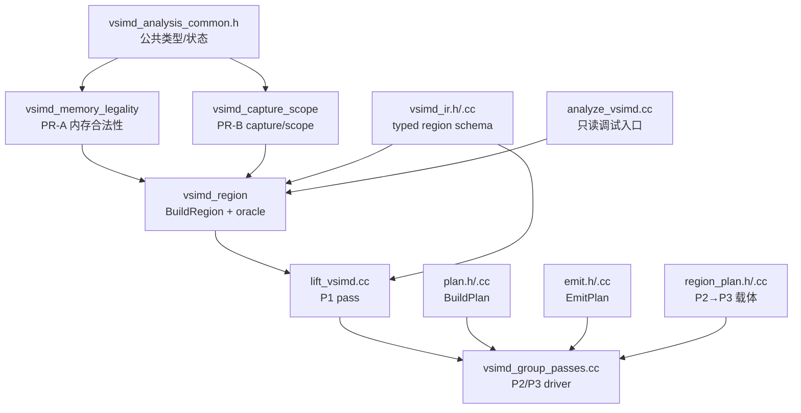

# Ascend `T.Parallel` 三阶段（P1→P2→P3）实现报告

> **对齐对象（唯一事实来源，均对应当前工作树）**
>
> - 分支：`p_123_parallel_new_p1`
> - P1：`src/ascend/transform/lift_vsimd.cc`、`vsimd_ir.{h,cc}`、`vsimd_region.{h,cc}`
> - P1 分析库：`vsimd_memory_legality.{h,cc}`、`vsimd_capture_scope.{h,cc}`、`vsimd_analysis_common.h`
> - P2/P3：`src/ascend/transform/parallel_vectorize/vsimd_group_passes.{h,cc}`、`region_plan.{h,cc}`
> - 交接载体：`src/ascend/transform/parallel_vectorize/region_plan.{h,cc}`
> - 规划/发射核心：`src/ascend/transform/parallel_vectorize/{plan,emit,value,model,access,body,primitives}.{h,cc}`
> - 流水线接入：`tilelang/ascend/pipeline.py:149-150`
> - 测试：`testing/ascend/transform/test_ascend_vsimd_*.py` 与 `test_ascend_parallel_vectorize_*.py`
> - 关联文档：`vsimd_p1_analysis.md`（P1 逐文件详解）、`p1_region_p2_p3_integration_report.md`（对接过程与验收记录）、`p123_vs_pto_parallel_comparison.md`（与 PTO PR-1/PR-2 的能力/方案/设计对比）、`p123_parallel_lowering_real_defects.md`（设备实测缺陷与修复记录）、`p123_simdvf_parallel_device_test_report.md`（设备测试报告）

本文是**实现报告**，只描述“代码现在实际做了什么”。第 11 节给出与旧
`tl.vsimd.program` 实现的变化清单；旧调研文档中关于「`tl.vsimd.array_region`
载体」「P2 反展开 region」「item/group/fragment」的表述均已失效，以本文为准。

---

## 0. 结论速览

1. **三阶段全是 C++，是流水线中 `T.Parallel` 的唯一向量化路径**：
   `pipeline.py:125-131` 在同一个开关（`tl.ascend_simd_lift`，默认 True）下执行
   `AscendLiftVSimd`（P1）→ `AscendVectorizeVSimd`（P2+P3 组合入口）。
2. **载体是类型化 FFI 对象，都挂在同一个 `T.Parallel` 上**：
   P1 写 `For.annotations["tl.vsimd.region"]`（`tl.vsimd.Region`），
   P2 写同一 `For` 的 `annotations["tl.vsimd.plan"]`
   （`tl.parallel_vectorize.VSimdRegionPlan`）。**两者都不改 body**，P3 按节点身份直接
   替换，不需要 span / 展平下标 / fingerprint。
3. **P1 是 per-Parallel 的 metadata pass**：给每个顶层 `T.Parallel` 挂一个 region，
   记录折叠后的 axes、有序 ops、captures/outer_vars/shape_syms/local_views/
   assumptions/bindings，以及 `LIFTED`/`OPAQUE` 状态与 reason。它不做任何
   lane、layout、指令选择。
4. **P1 拒绝是 per-Parallel 的**：只有两类 VF 级拒绝仍然存在——`ManualDetector`
   命中的手工 SIMD/local.var VF，以及 VF 内没有任何顶层 Parallel。语法不支持
   （`while`、非常量边界的串行循环、sibling Parallel、opaque `Evaluate`）
   只把**该 nest** 判 `OPAQUE`，同 VF 的其他 nest 仍独立分析/规划。
   触碰到 `local.fragment`（`T.alloc_fragment`）的 Parallel 同样单独判 `OPAQUE`；
   fragment 向量化在本分支**不支持**（§1.4）。
5. **P2 是逐 loop 独立事务**：每个 `T.Parallel` 独立规划、独立回退，
   一个 loop 失败不影响同 VF 的其他 loop。单 nest 内 recipe 族冲突
   （例如 elementwise + NZ + 行归约没有共同向量轴）时，P2 先按语句组
   **源序拆段**再逐段规划（§3.8b）。
6. **P1/P2/P3 只处理 Parallel**：Parallel 之外的 tile-op（SimdVF 顶层的
   `T.copy` / `T.reduce_*`）不属于本条链路，P2 不规划、P3 不替换，语句原样保留
   给常规 tile-op 降级。**Parallel 体内的 tile-op 不由本链路处理**：前端语义检查
   （`nested_loop_checker.py`）在 P1 之前就拒绝该程序，P1/P2/P3 中不存在任何
   tile-op 建模/展开代码（§3.8）。
7. **P3 按 loop 替换**：带 `tl.vsimd.plan` 的 `For` 交给 `EmitPlan`，失败只回滚
   该 loop。无论是否替换，P3 都无条件清理全部 `tl.vsimd.region` / `tl.vsimd.plan`。
8. **fragment 全链路已移除**：`vsimd_fragment.{h,cc}`、`fragment_plan.{h,cc}`、
   `AscendSimdVFallocFragment` pass、离线 planner 的 fragment 寄存器文件逻辑
   （`vf_alloc_scope`、`FragmentRegisterFile`、`fragment_regs`、`kRegLoad`）全部删除。
9. **回归结果**：`testing/ascend/transform` **982 passed / 8 skipped**（共 999 例，
   其中 P1/P2/P3 相关 302 例；另有 9 例 PTO VMI 用例在本机 CANN 9.2 下失败，
   与本链路无关）；设备数值回归
   `testing/ascend/language/test_tilelang_ascend_simdvf_parallel*.py` **85 例**，
   在没有 NPU 的环境整体 skip。
10. **能力边界**：P1 放行 `T.Parallel` 体内的**语句级 `if`**（含 else）与
    **常量边界的 `T.serial` shell**，并把它们建成 region 的 `if` / `serial` op；
    sibling Parallel、非常量边界的 shell 与 `while` 仍是 **per-nest** 的
    `UNSUPPORTED` 回退。P2 的条件建模覆盖：两臂同址 → `vsel`，
    单臂 / 两臂异址（异 buffer） / 一臂自带谓词 → 谓词化 store，mask 的
    `and/or/not/==/!=` → `pand/por/pnot/pxor`；lane-uniform 条件（含裸 scalar
    bool）一律走**向量谓词**（`vdup` 广播 + `vcmps`），不发射标量 select /
    `update_mask`；掩码粒度跟随条件的元素宽度，与写入宽度不一致时显式拒绝。
    同 buffer 的两臂异址只有在 guard 参与后能证明地址互不相交时才放行
    （§9 访存合法性）。P2 无法规划的形态只让该 item 回退，P3 保留原语句交 legacy。

---

## 1. 代码规模与文件清单

### 1.1 P1 与交接层

| 文件 | 行数 | 职责 | 关键符号 |
| --- | ---: | --- | --- |
| `lift_vsimd.cc` | 669 | P1 pass：VF 遍历、per-Parallel region 构造、annotation 写入、未 lift 的 Parallel 诊断 | `RegionBuilder`、`AttachRegion`、`NestTouchesFragment`、`ParallelCounter`、`LiftMutator` |
| `vsimd_ir.h` | 314 | region/op/access/capture 类型化 schema + 校验/打印声明（op 只有 parallel/serial/store/if/opaque） | `VSimdRegion`、`VSimdOp`、`VSimdAccess`、`VSimdCapture`、`VSimdAxis`、`VSimdVarBinding`、`VSimdView`；`VerifyRegion`、`DumpRegion` |
| `vsimd_ir.cc` | 934 | schema 构造、反射注册、verifier、稳定 dump、printer | `VerifyRegion`、`DumpRegion`、`StorageKindOf` |
| `vsimd_region.h` | 120 | region 构造与结构 oracle 声明 | `BuildRegion`、`ExpandVSimdRegionToLoops`、`VerifyExpandedRegion`、`CompareRegionWithOriginal`、`AnalyzeVSimdRegionReport` |
| `vsimd_region.cc` | 991 | 六道闸门 + 参考展开 + 展开校验 + 原 body 结构比较 | `BuildRegion` |
| `vsimd_capture_scope.h/.cc` | 113 + 636 | PR-B：capture/scope 闭包分析（含 serial shell 计数器） | `AnalyzeVSimdCaptureInfo`、`VSimdCaptureInfo`、`CaptureInfoToFFI` |
| `vsimd_memory_legality.h/.cc` | 57 + 1400 | PR-A：per-nest 内存合法性（LEGAL/UNPROVEN/ILLEGAL） | `AnalyzeVSimdMemory`、`AnalyzeVSimdMemoryRegions`、`VSimdMemoryRegionStatus` |
| `vsimd_analysis_common.h` | 668 | VF/nest 索引、公共类型与状态常量、nest 语法白名单 | `VSimdCaptureInfo`、`VSimdMemoryRegionStatus`、`ParallelNest::shell_vars`、`NestCollector` |
| `analyze_vsimd.cc` | 91 | P1 只读调试入口（三个阶段报告 + 合并 dump pass） | `AscendAnalyzeSimdVFMemoryReport`、`AscendAnalyzeSimdVFCaptureReport`、`AscendAnalyzeVSimdRegionReport`、`AscendDumpVSimd`、`AscendDumpVSimdReport` |

### 1.2 P2/P3 与规划库（`src/ascend/transform/parallel_vectorize/`）

| 文件 | 行数 | 职责 | 关键符号 |
| --- | ---: | --- | --- |
| `vsimd_group_passes.h` | 37 | P2/P3 入口声明 | `PlanVSimd`、`EmitVSimd`、`VectorizeVSimd` |
| `vsimd_group_passes.cc` | 276 | **P2/P3 driver**：per-Parallel 规划、plan 挂载、按 loop 替换与注解清理 | `CollectVfLayouts`、`MakeRegionOptions`、`VfRegionPlanner`、`RegionPlanner`、`RegionEmitter` |
| `region_plan.h` | 81 | P2→P3 类型化载体与反射 | `VSimdRegionPlan`（version/vf_index/region_index/program） |
| `region_plan.cc` | 112 | 载体构造器 + TVMScript printer | `MakeVSimdRegionPlan`、`RegionPlanDoc` |
| `plan.h/.cc` | 58 + 2885 | 规划核心：nest 切分、轴打分、归约、布局、pack2、多段、8-bit/加宽装载校验 | `BuildPlan`、`SourceOrderSegments`、`PlanStatementSplit`、`PlanSources`、`ClassifyStoreLayout`、`ClassifyReduce`、`ValidateByteGatherSegment`、`ValidateWideningLoads` |
| `emit.h/.cc` | 38 + 2948 | 发射核心：value/store/归约/pack2/NZ/多段/字节 gather | `EmitPlan`、`Emitter`、`EmitSegmentStmts`、`EmitParallelAxisParts`、`IsByteGatherValue` |
| `value.h/.cc` | 320 + 1129 | value DAG：标量表达式 → 逐 lane 向量值（含 mask 真值表） | `BuildValue`、`LoadNode`、`IndexValue`、`GuardFreeBounds`、`Compare` |
| `model.h/.cc` | 297 + 183 | 计划数据结构构造器 + 反射 + 累加器判据 | `MakeStorePlan`、`VectorPlan`、`VectorProgram`、`AccumulatorCandidate` |
| `access.h/.cc` | 221 + 277 | SCoP 建模：线性化、有限差分、访存分类 | `ClassifyAccess`、`FiniteDifference`、`ClassifyDelta`、`StorageClass` |
| `body.h/.cc` | 109 + 284 | body 归一化（if/两臂/predicate/serial shell 展开）；**不含任何 tile-op 展开** | `NormalizeBodyInto`、`MakeStoreSpec`、`kShellUnrollLimit` |
| `primitives.h/.cc` | 206 + 419 | ISA 事实表、`Unsupported`、dtype/掩码工具 | `ReducePrimitives`、`VRegLanes`、`MaskBits`、`ReduceIdentity` |
| `analyze_parallel_vectorize.cc` | 277 | 离线唯一入口：`build_plan`/`emit_plan`/`render_plan` FFI + 文本渲染 | `AscendParallelVectorizeBuildPlan`、`AscendParallelVectorizeEmitPlan`、`AscendParallelVectorizeRenderPlan` |

### 1.3 常规降级路径

| 文件 | 行数 | 说明 |
| --- | ---: | --- |
| `ascend_simdvf_lower_parallel.cc` | 999 | `AscendSimdVFLowerParallel`：把 `T.Parallel` 降为 MicroAPI 向量指令。**在当前 pipeline 中被注释**，所以被 P2/P3 拒绝的 nest 实际由常规 codegen 生成标量循环 |

### 1.4 本分支删除的 fragment 相关文件

| 文件 | 原因 |
| --- | --- |
| `src/ascend/transform/vsimd_fragment.{h,cc}` | fragment 事实收集/分组/VF 表；本分支不支持 `T.alloc_fragment` |
| `src/ascend/transform/parallel_vectorize/fragment_plan.{h,cc}` | VF 级 fragment 寄存器（V1–V4）校验 |
| `src/ascend/transform/simdvf_alloc_fragment.cc` | `AscendSimdVFallocFragment`：把 fragment 切成寄存器数组的前置 pass；下游已不存在 |
| `src/ascend/transform/vsimd_program.{h,cc}` | 旧 P1 `tl.vsimd.program` schema reader/verifier |
| `src/ascend/transform/parallel_vectorize/vsimd_payload_read.{h,cc}` | 旧 item-map payload 解码；改为在 `vsimd_group_passes.cc` 直接解码 `Call` |
| `src/ascend/transform/analyze_simdvf_capture.cc` / `analyze_simdvf_memory.cc` / `analyze_vsimd_region.cc` | 合并进 `analyze_vsimd.cc` |

离线 planner 中的 fragment 寄存器文件逻辑也一并删除：`PlanOptions::vf_alloc_scope`、
`ClassifyFragmentRegisters`、`FragmentReg`/`FragmentRegisterMap`、
`FragmentRegisterFile`、`ValueRecipe::kRegLoad`、`VectorPlanNode::fragment_regs`、
`StorePlanNode::storage/storage_id`、`primitives.h` 的寄存器预算常量。
保留的只有**防御性守卫**：`plan.cc` / `value.cc` 遇到 `local.fragment` 操作数时抛
`Unsupported`（否则会生成对寄存器瓦片的 `vld`/`vsts`，无法编译）。

> Parallel 体内的 tile-op 全链路已不再建模：`ExpandParallelTileOps`、
> `TileOpExpander`、`ReduceStagingFuser`、`IsSupportedParallelTileOp` 与
> `VSimdBufRegion` 均已删除。前端语义检查（`nested_loop_checker.py`）在 P1 之前
> 就以 “Only elementwise operations are allowed inside a parallel loop” 拒绝
> 这类程序，因此不再需要 per-nest 的 tile-op 展开/逆融合。

### 1.5 测试规模

| 文件 | 用例数 | 行数 | 覆盖 |
| --- | ---: | ---: | --- |
| `test_ascend_parallel_vectorize_delta.py` | 71 | 1733 | Δ(offset) 分类、访问形态、if/select、归约、多 store、serial 吸收、多段程序、诊断 |
| `test_ascend_parallel_vectorize_plan.py` | 48 | 1267 | transform 入口、chunk/尾块/对齐、缺陷回归（D1–D13）、壳与 carry、谓词宽度 |
| `test_ascend_parallel_vectorize_emit_dtypes.py` | 19 | 446 | 混合宽度段、同宽符号重解释、加宽 cast、8-bit 尾块 |
| `test_ascend_parallel_vectorize_nz.py` | 12 | 299 | NZ 散射（`vsstb`）、pack2、配对形态、P1 布局交接 |
| `test_ascend_parallel_vectorize_pipeline.py` | 7 | 224 | P1 交付、三段 pass annotation 交接、幂等、pipeline 开关 |
| `test_ascend_vsimd_group_passes.py` | 23 | 822 | P1→P2→P3 契约：plan 挂载与 metadata-only、顶层 tileop 不介入、if（select/谓词/异址/同 buffer 异址 guard）、mask EQ、serial shell（吸收成轴 / 逐迭代展开 / 壳屏障）、分支下的 Parallel 不 lift、符号尾块、多 VF、降级、幂等、pipeline/config |
| `test_ascend_vsimd_lift.py` | 27 | 818 | P1 annotation 位置/状态/门控/配置开关、if 放行、extent-1 死轴拒绝、tile-op 按 nest OPAQUE |
| `test_ascend_vsimd_ir.py` | 19 | 322 | region schema、构造器、verifier、dump、参考展开（含 `serial` op） |
| `test_ascend_vsimd_region.py` | 23 | 550 | region 报告、N-D/广播/view/layout/oracle、合并 dump |
| `test_ascend_vsimd_capture_scope.py` | 14 | — | PR-B 状态、捕获分类 |
| `test_ascend_vsimd_memory_legality.py` | 27 | — | PR-A 状态、快速通道/Z3、别名、去重、if guard |
| **`testing/ascend/transform` 合计** | **999（982 passed / 8 skipped；9 例 PTO VMI 失败与本链路无关）** | — | 其中 P1/P2/P3 相关 302 例；另 `testing/ascend/analysis` 22 例 |

---

## 2. 架构与数据流

### 2.1 模块依赖



### 2.2 阶段契约

| 阶段 | 输入 | 输出 | 是否改 body |
| --- | --- | --- | --- |
| P1 `AscendLiftVSimd` | 含 `SBlock("SIMD_VF")` 的 PrimFunc | 每个顶层 `T.Parallel` 上的 `tl.vsimd.region` | 否（只加 annotation） |
| P2 `AscendPlanVSimd` | P1 输出 | 每个已规划 `T.Parallel` 上的 `tl.vsimd.plan` | 否 |
| P3 `AscendEmitVSimd` | P2 输出 | 替换带 plan 的 `T.Parallel`；清理全部 annotation | 是（按节点替换） |
| `AscendVectorizeVSimd` | — | P2 + P3 连续执行 | 是 |

### 2.3 载体协议

```text
P1:  For.annotations["tl.vsimd.region"] = tl.vsimd.Region
P2:  For.annotations["tl.vsimd.plan"]   = tl.parallel_vectorize.VSimdRegionPlan
```

两个载体都挂在**同一个 `T.Parallel`** 上，都是 `TVM_FFI` 反射注册的对象，字段名与
C++ 字段一致，Python 侧可直接读取：

```python
for node in walk(func):
    if isinstance(node, tvm.tirx.For) and "tl.vsimd.plan" in node.annotations:
        plan = node.annotations["tl.vsimd.plan"]
        print(plan.version, plan.vf_index, plan.region_index, len(plan.program.segments))
```

`VSimdRegionPlan` 字段：

| 字段 | 类型 | 说明 |
| --- | --- | --- |
| `version` | int | 载体协议版本（当前 1）；P3 版本不符时忽略并保留原语句 |
| `vf_index` | int | 来自 P1 region，仅用于诊断 |
| `region_index` | int | 来自 P1 region，仅用于诊断 |
| `program` | `VectorProgram` | P3 `EmitPlan` 的唯一输入（axes/segments/diagnostics） |

### 2.4 作用域与定位规则

- **只处理 `T.Parallel`**：P1 只标注顶层 Parallel；P2 只规划带 `tl.vsimd.region`
  的 `For`；P3 只替换带 `tl.vsimd.plan` 的 `For`。Parallel 之外的 tile-op
  （VF 顶层的 copy/reduce）不属于本条链路，语句原样保留，由常规 tile-op
  降级处理。
- **按节点定位，不按序号**：plan 就挂在被规划的 loop 上，因此 P3 不需要
  span / 展平下标 / body fingerprint；中间 pass 若重建该 loop 并丢掉注解，
  P3 自然什么都不做（不会替换错语句）。
- **per-loop 事务**：每个 Parallel 独立规划、独立发射、独立回退。

---

## 3. P1：`AscendLiftVSimd`

### 3.1 入口与开关

```cpp
tvm::transform::Pass AscendLiftVSimd();   // lift_vsimd.cc:460
```

- 开关：`tl.ascend_simd_lift`（默认 `true`）；
- 结构 oracle 开关：`tl.ascend_simd_region_verify`（默认 `true`），关闭只跳过
  “重建 vs 原 body”比较，**不改变** annotation；
- 早退：函数里没有 `SBlock("SIMD_VF")`，或 VF 内没有任何 `T.Parallel`，直接返回原函数。

### 3.2 处理流程

```text
AscendLiftVSimd
  ├─ SimdVFCollector            收集 found(SIMD_VF) / has_parallel
  ├─ AnalyzeVSimdCaptureInfo    每个 nest 的 capture/scope 闭包（PR-B）
  ├─ AnalyzeVSimdMemoryRegions  每个 nest 的内存合法性（PR-A）
  └─ LiftMutator
       └─ 每个 SBlock(name_hint == "SIMD_VF")：vf_index 递增
            └─ RegionBuilder::Build(body)
                 ├─ SeqStmt       → 逐子节点递归
                 ├─ 透明 AttrStmt → 穿透后递归
                 ├─ Parallel For  → AttachRegion(loop)
                 └─ 其他          → 原样返回（不进入）
```

`AttachRegion` 的关键点：**只加 annotation，不重建 body**，
`For annotated = ffi::GetRef<For>(loop); annotated.CopyOnWrite()->annotations.Set(...)`。

### 3.3 透明 wrapper

下列 AttrStmt 不引入控制流/作用域，可以包住顶层 Parallel 而不改变“顶层”的含义：

```text
tl.simdvf_scope, simdvf, tl.assume, tirx::attr::tilelang_assume,
tl.buffer_version, tl.manual_multi_buffer
```

遇到其他 AttrStmt（例如 `thread_extent` 之外的未知包装）不向内穿透，
其内部的 Parallel 不会被标注。

### 3.4 每个 nest 的判定顺序

`AttachRegion` 严格按以下顺序判定，**第一条命中即定**：

| # | 条件 | 结果 |
| --- | --- | --- |
| 1 | `NestTouchesFragment(loop)`：子树内 `SBlock.alloc_buffers` 或 BufferLoad/BufferStore 命中 `local.fragment` | `OPAQUE` / `UNSUPPORTED`，reason 含 `fragment` |
| 2 | 找不到该 nest 的 capture info（manual VF 等 VF 级失败） | `OPAQUE` / `UNSUPPORTED`，reason 为 `VF-level rejection: ...` 或 `no capture info for this Parallel loop` |
| 3 | `BuildRegion` 六道闸门 + 自校验 | `LIFTED`，或 `OPAQUE` + `ReasonCodeFor(...)` |

注意第 2 条现在只在 **VF 级**失败时发生：nest 自己的语法不支持（`while`、
非常量边界的串行循环、sibling Parallel、未建模 tile-op、opaque `Evaluate`）由
`NestCollector` 记为 `ParallelNest.unsupported`，PR-B 为该 nest 产出一条
`status=OPAQUE / message=<nest reason>` 的 capture info，因此第 2 条不命中，
由第 3 条带着该 message 回退——同 VF 的其他 nest 不受影响。
边界 **lane 不变** 的 `T.serial`（常量或运行期、体内或体外）不再被记为不支持：它
进入 `shell_vars` / `outer_shells`（capture 分析不再报 `unbound var`），体内壳被建成
region 的 `serial` op（§3.8），体外壳留在原位继续绑定计数器。

`BuildRegion` 的闸门：

| # | 闸门 | 失败 reason |
| --- | --- | --- |
| G1 | `info.status == "CLOSED"` | nest message（语法不支持）或 `capture/scope is not CLOSED` |
| G2 | `memory_status == "LEGAL"` | `memory legality is <status>`（per-nest 的 `UNSUPPORTED` 也走这里） |
| G3 | `info.domain` 非空 | `region requires at least one T.Parallel axis` |
| G4 | 无 `local.var` 访问 | `local.var access is not liftable` |
| G5 | 每个 access 的 index rank == buffer rank | `access rank does not match buffer rank` |
| G6 | 语句结构可建成 ops（`store` / `if` / `serial`） | 具体语句的拒绝原因（如 `unsupported tile-op inside T.Parallel: ...`） |
| G7 | ops 中至少有一个写（store 的写访问或结构化 op 的目标区域） | `nest has no BufferStore` |

> PR-A 的 store 级单射检查对**累积写**（store 的值里读同一 buffer 的同一地址，如 `c[i] = c[i] + a[i, j]`）不再判 `ILLEGAL`：它天然非单射，未用到的轴就是被归约的轴，只记一条 `reduction along an unused axis` 说明并放行；是否真按归约向量化由 P2 决定（能选到兼容向量轴就发 `vcadd`/寄存器累加器，否则 P2 拒绝、原 nest 走 legacy 标量）。非累积的非单射写（lane 不变地址 + lane 变化值）仍判 `ILLEGAL`。同址 R/W 对规则同步放行。

通过 G1–G7 后还要过三道**编译器自检**（失败记为 `INTERNAL`，不是用户回退）：

1. `VerifyRegion`：op kind、必填字段、index rank、`dep_axes` 范围、capture 覆盖、
   local-view 一致性；
2. 参考展开：`ExpandVSimdRegionToLoops` 重建 serial/结构化 IR
   （`if` → `IfThenElse`，`serial` → 原 `For`）；
3. 结构 oracle：`VerifyExpandedRegion` + `CompareRegionWithOriginal`
   （Parallel→Serial、丢 annotation、摊平 SeqStmt、DeclBuffer 按集合比较、
   `if` 递归比较条件与两个分支）。

### 3.5 reason_code 映射

```cpp
internal_error == true   → INTERNAL
memory_status == "ILLEGAL"  → ILLEGAL
memory_status == "UNPROVEN" → UNPROVEN
其他                        → UNSUPPORTED
```

`LIFTED` region 的 `reason_code` 为空字符串。词表是封闭的
（`ILLEGAL`/`UNPROVEN`/`UNSUPPORTED`/`INTERNAL`），新增类别必须先改
`vsimd_ir.h::reason_code`。

### 3.6 region 字段

| 字段 | 类型 | 说明 |
| --- | --- | --- |
| `vf_index` | int | VF 序号（`SBlock("SIMD_VF")` 出现顺序） |
| `region_index` | int | **挂载序**（该 VF 内第几个被标注的 Parallel），不是 `nest_index` |
| `axes` | `Array<VSimdAxis>` | 连续单 body Parallel 链折叠后的 `(var, min, extent)` |
| `ops` | `Array<VSimdOp>` | 最内层 body 的有序 op：`store` / `if` / `serial`（OPAQUE region 为单个 `opaque`） |
| `captures` | `Array<VSimdCapture>` | buffer + kind（param/alloc/view/local/unknown）+ storage + layout |
| `outer_vars` | `Array<VSimdVarBinding>` | 捕获的 `thread` / `outer_loop` 变量 |
| `shape_syms` | `Array<Var>` | 符号 shape 变量 |
| `local_views` | `Array<VSimdView>` | `T.view` 别名 → base buffer |
| `assumptions` | `Array<PrimExpr>` | `T.assume` 条件 |
| `bindings` | `Array<VSimdVarBinding>` | 标量定义（`kind == "bind"`，带 value） |
| `status` | string | `LIFTED` / `OPAQUE` |
| `reason_code` | string | OPAQUE 时非空 |
| `reason` | string | 人读诊断 |

OPAQUE region 携带：

- `axes`（照常折叠）；
- 一个 `opaque` op，其 `reads`/`writes` 为保守 footprint；
- `captures`：分析可达时来自 `info.captures`（kind 为真实分类 + layout），
  否则来自 `FootprintCollector`（kind 统一为 `unknown`，且未知副作用 call 会把
  读到的 buffer 也记为写）。

### 3.7 不变量

1. P1 **从不修改** Parallel body；`For` 节点只在 `CopyOnWrite` 后加一个 annotation。
2. 一个 `T.Parallel` 最多一个 region annotation；`region_index` 严格递增。
3. `LIFTED` region 的 `ops` 按语句结构生成：每个 `BufferStore` 一个 `store` op
   （写访问 + 该语句用到的 load），每个语句级 `if` 一个 `if` op（`guard` 为条件，
   `ops`/`else_ops` 为两个分支），每个 `T.serial` shell 一个 `serial` op。
4. `LIFTED` region 不访问 `local.fragment`（第 1 条判定保证）。
5. 结构 oracle 失败一定记 `INTERNAL`，不会降级成普通用户拒绝。
6. 语法不支持只影响当前 nest：`ParallelNest.unsupported` → 该 nest 的 capture
   info 为 `OPAQUE`、memory legality 为 `UNSUPPORTED`，其他 nest 照常。

### 3.8 `if` 的建模与降级

| 语句 | P1 建模 | P2 | 失败时的结果 |
| --- | --- | --- | --- |
| `if`（含 `else`） | `op.kind="if"`，`guard`=条件，`ops`/`else_ops` 为分支 op 列表 | `BuildPlan` 的 `NormalizeBody`：单臂 → 谓词化 store（mask），同址双臂（两臂都无掩码）→ 惰性 `if_then_else`（`vsel`），其余（异址双臂 / 一臂自带谓词）→ 每臂各自谓词化 store | 该 item 被 REJECTED，P3 保留原 Parallel，legacy 标量路径 |
| 条件表达式 | 原样保留在 `guard` 里 | `value.cc::Compare`：数值比较 → `vcmp`/`vcmps`；两侧都 lane-uniform 且依赖内存时 → **向量谓词** `vcmps(广播一侧, 标量一侧)`（`vdup` + `vcmps`，全 0/全 1 掩码），不再折成标量比较、也不发 `update_mask`；只有编译期常量才折成常量掩码。bool 操作数的 `==`/`!=` → `pnot(pxor)`/`pxor`（排序比较 `Unsupported`） | 该 item REJECTED |
| `T.serial`（嵌套在 Parallel 体内，边界 lane 不变） | `op.kind="serial"`，`axes=[counter]`（**不是 region 轴**）+ `ops` | `SingleSegmentSource` 优先吸收成候选轴（归约 shell）；小于等于 `kShellUnrollLimit=8` 的常量壳逐迭代展开；其余（运行期边界 / 末写覆盖 / 多地址写）保留为 **plan 级 `shells` 标量壳**，壳包住 chunk 程序 | 写标量地址、bound 依赖 lane var 或读 buffer → `body.nested_loop`，整条语句 legacy |
| `T.serial` **包围** Parallel（VF 内） | 照常 lift：Parallel 即 nest root，`outer_shells` 记录外壳；外壳计数器判为已绑定 | 规划的是 Parallel 体，外壳连计数器留在原位（地址里作为 lane 均匀值） | 仅当 Parallel 本身不可规划时回退 |
| Parallel 体内 tile-op（`copy`/`reduce`/`fill`/atomic…） | **不建模**：任何非空 `Evaluate` → 该 nest OPAQUE | 不进入 inventory（region 为 OPAQUE） | 该 nest 走 legacy；同 VF 其他 nest 照常。注意：正常 pipeline 里前端语义检查会更早拒绝整个程序 |
| if 臂内嵌 tile-op / 嵌套并行循环 | **P1 即判 OPAQUE**：`NestCollector` 递归进入两臂，命中 `tl.tileop.*` 或嵌套非 serial `For` 就记 unsupported | 不进入 inventory（region 为 OPAQUE） | 该 nest 走 legacy；同 VF 其他 nest 照常 |

关键点：region 的 op 只是**结构描述**，P2 永远从原始 `For` 语句重新规划
（`PlanRegionEntry` 只读 region 的 assumptions/bindings/shape_syms/layouts），
因此建模的精细程度不影响规划结果；它保证的是 `VerifyRegion` 与结构 oracle 能
证明“region 忠实描述了原 body”。

### 3.8b 单 nest 内 recipe 族冲突：P2 源序拆段

一个 `T.Parallel` 体内可能同时出现需要不同向量轴的语句组，例如
elementwise（沿最内轴）+ NZ 打包写 + 行归约（沿外层轴）。它们没有共同向量轴，
单段规划会被拒绝，或把某个语句降级成标量（例如 NZ 打包 store 落在 `pre` 兄弟位置，
P3 无法用 paired emitter 发射）。

`BuildPlan` 的策略：

1. 先按原分段（sibling serial chain）规划；失败则整段重试；
2. 单段仍失败时，用 `SourceOrderSegments` 把 body 按**语句组 / 循环链**切成
   多段（`PlanStatementSplit`），每段独立选轴、独立规划；
3. 每段成功后 `AssembleProgram` 按**源序**发射，内存序与原程序一致；
   任一段仍失败则整体回退（保留单段的完整诊断）。

这样 elementwise+NZ 段沿内轴整段向量化（paired NZ emitter），归约段沿外层/归约轴
向量化，不再依赖 `pre` 兄弟位置。`HasNzStore` 现在会扫描 `pre/main/post` 三组
store，保证“NZ 段不能带兄弟语句”的契约在 P2 就生效，而不是拖到 P3 才拒绝。

---

## 4. P2：`AscendPlanVSimd`

### 4.1 入口与 inventory

```cpp
tirx::PrimFunc PlanVSimd(tirx::PrimFunc func);   // vsimd_group_passes.cc:941
```

对每个 `SBlock("SIMD_VF")`：

```text
CollectVfLayouts(body)        // 该 VF 内 LIFTED region 的 capture layout，按 data var 去重
VfRegionPlanner(body)
  ├─ For 带 tl.vsimd.region 且 status == LIFTED
  │    ├─ BuildPlan(For, nullopt, MakeRegionOptions(region, layouts))
  │    ├─ 成功 → For.annotations["tl.vsimd.plan"] = VSimdRegionPlan
  │    └─ Unsupported → 打 WARNING，不写 plan（该 loop 交 legacy）
  ├─ For 带 region 但 status != LIFTED（OPAQUE）→ 跳过
  └─ 其他语句（含 VF 顶层 tileop）→ 不进入本条链路
```

- 只有 Parallel 是规划单元；VF 顶层的 `T.copy` / `T.reduce_*` 不在 P2 的职责内，
  语句保持原样，由常规 tile-op 降级处理。
- 每个 Parallel 独立规划、独立回退：一个 loop 被拒不影响同 VF 的其他 loop。

### 4.2 规划上下文

`MakeRegionOptions` 把 region 的上下文真正传进规划器：

- `layouts`：VF 内所有 LIFTED region 的 capture layout（按 data var 去重）；
- `assumptions`：region 的 `T.assume` 条件；
- `bindings`：标量定义；
- `shape_syms`：符号 shape 变量。

### 4.3 失败语义

```text
region->status != LIFTED            → 不规划，不写 plan（P1 已判 OPAQUE）
BuildPlan 抛 Unsupported            → 不写 plan；WARNING:
                                      [vsimd] P2 left region <i> to legacy: <reason>
region 注解损坏（类型不对）          → 打 WARNING，跳过该 loop
```

P2 从不发射指令，也从不修改 body；它只在可规划的 `For` 上追加一个注解。

---

## 5. P3：`AscendEmitVSimd`

### 5.1 入口

```cpp
tirx::PrimFunc EmitVSimd(tirx::PrimFunc func);   // vsimd_group_passes.cc
```

### 5.2 主流程

```text
遍历全函数
  ├─ For 带 tl.vsimd.plan 且版本匹配
  │    ├─ EmitPlan(plan.program)
  │    └─ 失败（Unsupported / 版本不符）→ WARNING + 保留原 loop（per-loop 回滚）
  ├─ 其他 For：递归，并删除其上的 tl.vsimd.region / tl.vsimd.plan
  └─ 发射成功的 loop 整体替换为该 program 的发射结果
```

### 5.3 定位与回滚

plan 就挂在被规划的 loop 上，因此 P3 不需要 span、展平下标或 kind 校验：
注解存在即代表“这个 loop 执行这个 program”。中间 pass 若重建该 loop 并丢掉注解，
P3 自然跳过（不会替换成不相关语句）。

`EmitPlan` 抛 `Unsupported` 时只回滚**该 loop**
（`[vsimd] P3 left region <i> to legacy: <reason>`），其他 loop 不受影响。

### 5.4 annotation 清理

无论是否发射，P3 都会删除每个 `For` 上的 `tl.vsimd.region` / `tl.vsimd.plan`，
保证 P1/P2 元数据不泄漏到 codegen。

### 5.6 段级发射（`emit.cc`）

P3 只是 driver；真正的 TIR 生成在 `EmitPlan`：

- 每个 `VectorProgram` 的 segments 依次发射；
- chunk 循环用 strip-mine 展开，`tail` 用 mask/`vsel` 处理；
- 归约在 emit 层退化为寄存器累加器（`vld` + `vsts` 各一次每输出向量）；
- pack2 / NZ 目标由 `StorePlan.layout_kind` 决定（`nd` 之外的走 `vsstb` 等 scatter 形态）；
- 标量壳（`plan.shells`）与**外层串行壳**的每次迭代末尾发一条
  `simd_inst::mem_bar(VST_VLD)`（`emit.h::VstVldBarrier`）：壳迭代按内存序执行，
  读改写体不能让下一轮的 `vld` 越过上一轮的 `vst`。没有壳的 nest 不发；
- 循环不变的值只建一次：`vdup` 走 `ScalarHoistable` 提到 prologue（按
  `(scalar, elem)` 去重）；lane 索引 / 常量 `ramp` 在 `lane_base_` 不含自由变量
  （单 chunk，例如行循环内）时走 `PrologueBind`；其余循环不变绑定由
  `SplitLoopInvariant` 提到外层轴 / 壳之外；
- 8-bit 字节源的**掩码载入**在 **b16** 宽度建谓词：`vgather2` 每字节扩成一个
  16 位 lane，所以尾掩码是 `update_mask(n, 16)`，b8 尾掩码不会被声明；
  `vcvt` 仍用 b8 `PAT_ALL`，多余 lane 的转换结果由 store 掩码丢弃。

---

## 6. 跨阶段一致性

### 6.1 三层保障

| 层 | 保障 | 失败表现 |
| --- | --- | --- |
| P1 结构 oracle | region 重建必须逐语句复现原 Parallel 子树 | `INTERNAL` + `WARNING`，不降级成用户拒绝 |
| P2/P3 节点身份 | plan 挂在被规划的 `For` 上，无需 span | 注解丢失 → P3 跳过（保留原语句） |
| P3 版本校验 | `VSimdRegionPlan.version` 必须匹配 | 忽略该 plan + `WARNING`，保留原语句 |

### 6.2 typed 载体

两个载体都是反射注册的对象，因此：

- Python 测试直接断言 `region.status`、`plan.version`、`plan.program.segments` 等字段；
- `print(mod)` 时两个载体都会**内联展开**，不再是 `metadata["tl.vsimd.Region"][0]`：
  - `vsimd_ir.cc` 的 `RegionDoc`：`status` / `reason(_code)` / `axes` / `ops`
    （store 的 `W/R` 行、`if` 的 guard 与两个分支、copy/reduce 的 src/dst）/
    `captures` / `bindings` / `assumptions` / `local_views`；
  - `region_plan.cc` 的 `RegionPlanDoc`：`version` / `vf_index` / `region_index` / `program`；
- P3 不需要重新解析 `Map<String, Any>`。

### 6.3 回退矩阵

| 情形 | P1 | P2 | P3 | 最终形态 |
| --- | --- | --- | --- | --- |
| 正常 nest | `LIFTED` | `PLANNED` | 替换 | `tl.simd.*` 调用 |
| 触碰到 `local.fragment` | `OPAQUE`（UNSUPPORTED） | 跳过 | 不替换，清理 | 原 `T.Parallel` → 标量循环 |
| 内存非法 / 无法证明 | `OPAQUE`（ILLEGAL/UNPROVEN） | 跳过 | 不替换 | 原 `T.Parallel` → 标量循环 |
| VF 级语法不支持（manual VF / 无顶层 Parallel） | 同 VF 全部 `OPAQUE` | 跳过 | 不替换 | 同上 |
| 语法不支持（per-nest，如 `while` / 体内 tile-op / 非常量边界 shell） | 该 nest `OPAQUE` | 跳过 | 不替换 | 该 loop 交 legacy，同 VF 其他 loop 照常 |
| 规划器拒绝（能力不足，如 8-bit 尾块超过半寄存器、异址读 stencil、shell 超 8 次） | `LIFTED` | 不写 plan + `WARNING` | 不替换 | 原 `T.Parallel` → 标量循环 |
| `T.Parallel` 位于 branch / `while` / 非并行循环下 | 不挂 region（`WARNING`：stay on legacy） | 不介入 | 不介入 | 原 `T.Parallel` → 标量循环 |
| Parallel 外的 tile-op（VF 顶层 copy/reduce） | 无 region | 不介入 | 不介入 | 原 tileop 交 `AscendLowerTileOp` |
| plan 注解丢失 / 版本不符 | — | — | 跳过该 loop | 原语句 |

---

## 7. 流水线接入与开关

`tilelang/ascend/pipeline.py`（`NormalizeBufferVersion` 之后）：

```python
if pass_ctx.config.get(tilelang.PassConfigKey.TL_ASCEND_SIMD_LIFT, True):
    mod = ascend_transform.AscendLiftVSimd()(mod)       # P1
    mod = ascend_transform.AscendVectorizeVSimd()(mod)  # P2 + P3
# mod = ascend_transform.AscendSimdVFLowerParallel()(mod)   # 当前注释
mod = ascend_transform.AscendLowerTileOp()(mod)
```

| 开关 | 默认 | 作用 |
| --- | --- | --- |
| `tl.ascend_simd_lift` | `True` | P1/P2/P3 总开关；关闭后整条链路不运行 |
| `tl.ascend_simd_region_verify` | `True` | P1 结构 oracle；关闭只跳过比较，annotation 不变 |

注意：`AscendSimdVFLowerParallel` 当前被注释，因此被拒绝的 `T.Parallel`
不是降级到 MicroAPI 向量指令，而是由常规 codegen 生成标量循环。

调试入口（`analyze_vsimd.cc`，全部只读）：

```python
at.AscendAnalyzeSimdVFMemoryReport(func)   # PR-A 报告
at.AscendAnalyzeSimdVFCaptureReport(func)  # PR-B 报告
at.AscendAnalyzeVSimdRegionReport(func)    # region lift/dump 报告
at.AscendDumpVSimdReport(func)             # 三段合并报告
at.AscendDumpVSimd()(mod)                  # 只打印、不改 IR 的 pass
```

---

## 8. 测试与验收

### 8.1 分层用例

| 层次 | 文件 | 关键 fixed behaviors |
| --- | --- | --- |
| region schema | `test_ascend_vsimd_ir.py` | 构造器字段、verifier 拒绝路径、`DumpRegion` 稳定性、参考展开 |
| PR-B | `test_ascend_vsimd_capture_scope.py` | `CLOSED`/`OPEN`、capture 分类、只读性 |
| PR-A | `test_ascend_vsimd_memory_legality.py` | `LEGAL`/`UNPROVEN`/`ILLEGAL`、快速通道/Z3、别名 |
| region lift | `test_ascend_vsimd_region.py` | N-D/广播/转置/view/layout/动态 shape、oracle、合并 dump |
| P1 pass | `test_ascend_vsimd_lift.py` | annotation 位置与 body 不变、状态、门控、配置开关、pipeline |
| P2/P3 | `test_ascend_vsimd_group_passes.py` | 见下表 |
| 离线 planner | `test_ascend_parallel_vectorize_*.py` | `build_plan`/`emit_plan` 全场景（含 NZ layout 与整条链路） |
| 设备数值回归 | `testing/ascend/language/test_tilelang_ascend_simdvf_parallel*.py`（85 例） | 1-D 元素级 / 原地 RMW / 多 VF、max/min 的 NaN/±0 契约、tail chunk、8-bit 整块与尾块（字节 gather + `PK_B16`）与 `i8↔u8`、N-D 折叠 / 外层广播 / 展平下标、stride / 反转 / 间接 gather / 转置 scatter、单臂谓词化 / 同址 `vsel` / 异址互补掩码 / mask EQ-NE、**lane-uniform 条件的向量谓词**、行归约与串行壳（含壳屏障）、窄化/加宽 cast 全矩阵（含 `bf16→f16` 溢出为 `±inf`）、NZ / pack2；无 NPU 时整体 skip |

`test_ascend_vsimd_group_passes.py` 的用例：

| 用例 | 覆盖 |
| --- | --- |
| `test_plan_is_attached_to_the_parallel_it_planned` | plan 挂在同一 `For` 上，字段/版本/发射 |
| `test_lift_and_plan_are_metadata_only` | P1/P2 只加注解，剥掉注解后 body 与源码一致 |
| `test_top_level_tileops_are_left_to_the_tileop_lowering` | VF 顶层 copy/reduce 不被本链路消费 |
| `test_guarded_same_address_arms_become_a_select` | 同址 if/else → 惰性 select |
| `test_guarded_single_arm_with_a_sibling_store_is_predicated` | 单臂 if → mask，store 顺序与谓词 |
| `test_guarded_divergent_arms_keep_no_plan` | 异 buffer 的异址分支不写 plan，P3 保留原 loop |
| `test_symbolic_tail_context_reaches_the_planner` | bindings/assumptions/符号 extent 到达 planner |
| `test_multiple_vfs_and_parallels_are_planned_independently` | 多 VF、多 Parallel 各自一份 plan |
| `test_partial_lift_plans_only_the_lifted_parallel` | 同 VF 非法 + 合法：只规划合法 loop |
| `test_fragment_access_is_left_to_legacy` | fragment kernel 零 plan |
| `test_fragment_rejection_is_per_parallel` | fragment nest OPAQUE、兄弟 loop 仍被向量化 |
| `test_unplanned_annotated_loop_is_not_emitted` | 注解丢失 → P3 不替换 |
| `test_p3_without_p2_only_cleans_annotations` | P3 单独运行只清理，链路幂等 |
| `test_pipeline_uses_the_region_path_by_default` | 默认 config 走新链路，注解不泄漏 |
| `test_p1_disabled_leaves_the_legacy_path` | 关掉开关后保留原 `T.Parallel` |

### 8.2 回归结果

```bash
cd /home/cjl/workspace/tilelang
./build.sh -j8                                   # 干净通过
TILELANG_CACHE_DIR=/tmp/tilelang_cache \
  python -m pytest testing/ascend/transform -q   # 982 passed / 8 skipped（9 例 PTO VMI 失败与本链路无关）
TILELANG_CACHE_DIR=/tmp/tilelang_cache \
  python -m pytest testing/ascend/analysis -q    # 22 passed
```

设备套件（`test_tilelang_ascend_simdvf_parallel*.py`，85 例）最近一次上板
**84 passed / 1 failed**：失败项是 `bf16→f16` 用例的 golden 假设（误以为该对
转换会饱和），实测溢出为 `±inf`，已按硬件契约修正并改名为
`test_parallel_bf16_to_f16_overflow_is_inf`，待复跑。其余 84 例（含 lane-uniform
向量谓词、8-bit 尾块、串行壳屏障、NZ/pack2、cast 矩阵）全部通过。把 84 个
`__simd_vf__` 生成体与 84 个用例逐一对上后可以确认：**没有静默回退**，每个
nest 都真的走了 P1→P2→P3。

### 8.3 全链路 lower 验证

| Kernel | 结果 | 关键输出 |
| --- | --- | --- |
| 1-D 元素级（shared → shared） | OK | `simd_inst::` 存在 |
| fragment 两段（fill/consume） | OK（回退） | 1327 字符；无 `simd_inst::`；`float frag[64]` + 朴素循环 |
| fragment + 非 fragment Parallel 同 VF | OK（部分向量化） | 1743 字符；fragment nest 标量，兄弟 nest 为 `vlds_norm`/`vmuls`/`vsts_norm` |
| FA 闭环（已移除） | — | 示例 `examples/ascend/flash_attention/parallel_fa.py` 与对应离线/设备测试已从本分支删除；VF 顶层 tile-op 的限制仍见 §10 L9 |

字节级回归：把 P1 的 fragment 拒绝临时改成 `if (false && ...)` 重新构建后，
上述 kernel 的 `kernel_source` 与改动后**逐字节一致**，说明 P1 拒绝与
planner 守卫拒绝产生相同的最终代码。

---

## 9. 能力矩阵

| 能力 | 状态 | 位置 |
| --- | --- | --- |
| 顶层 `T.Parallel` 元素级向量化 | 支持 | P1 region + P2 `BuildPlan` |
| 多轴 / 多维折叠 | 支持，但“折叠”指 **P1 region 折叠**：单链 `T.Parallel` 折成一个 region（`axes` 保留各轴）。P2 只选一个轴做向量轴，其余轴在外层保留为串行循环（`T.Parallel(2,4,64)` → `for i { for j { 64-lane chunk } }`，**不是**把 512 元素整体展平成 8 个 chunk） | `CollapseAxes` + `PlanSources` + `emit.cc::InnerAxes` |
| 广播 / strided / 置换 / gather-scatter | 支持 | `access.cc` 分类 + `value.cc` |
| Parallel 体内的任何 tile-op（`copy` / `reduce_*` / `fill` / atomic） | **不支持且不由本链路处理**：前端 `nested_loop_checker.py` 在 P1 之前报
 “Only elementwise operations are allowed inside a parallel loop”；P1 对直接分析调用给出 per-nest `OPAQUE` | 语义检查 + `NestCollector` |
| Parallel 外（VF 顶层）copy/reduce | **不介入** | 交 `AscendLowerTileOp`（shared→shared reduce 尚未实现） |
| 单 nest 多 recipe 族冲突（elementwise + NZ + 行归约无共同轴） | 支持：P2 先按语句组**源序拆段**，逐段选轴；任一段失败才整体回退 | `plan.cc::SourceOrderSegments` + `PlanStatementSplit`（§3.8b） |
| NZ / 标注 layout 目标 | 支持 | `ClassifyStoreLayout` + `vsstb` 等 |
| pack2（`vld2` + `vintlv`/`vcvt`） | 支持 | `emit.cc` paired emitter |
| `T.Parallel` 体内 `if`（含 else） | 支持（可规划则向量化，否则按 item 回退） | P1 `if` op + P2 `NormalizeBody` |
| `if` 两臂同址 | 支持：`vsel`（`if_then_else` 惰性合并） | `body.cc::NormalizeBodyInto` |
| `if` 单臂 | 支持：谓词化 store（`vsts` 带 mask，无读回） | 同上 |
| `if` 两臂异址（**异 buffer**） / 一臂自带谓词（嵌套 else-if） | 支持：每臂各自谓词化 store（互补掩码） | 同上（不再抛 `body.divergent_branch`） |
| `if` 两臂异址（**同 buffer**） | **需证明两臂地址集跨 lane 不相交**：P1 把 `guard_then(i) ∧ guard_else(j)` 加入违例查询后才判 LEGAL（例如 `c[2i]` / `c[2i+1]`、`i<64` / `i>=64` 放行；`c[2i]` / `c[i]` 仍 `ILLEGAL`，因为不同 lane 可能写同一地址） | `vsimd_memory_legality.cc::GuardConjunction` |
| 条件：lane-varying 比较 / lane-uniform 比较 / 裸 scalar bool | 支持：lane-varying → `vcmp`/`vcmps`；lane-uniform → **向量谓词**（`vdup` 广播 + `vcmps`，全 0/全 1 掩码），裸 bool 叶子同样广播后 `vcmps(≠0)`；只有编译期常量才折成常量掩码。不再发射标量 select/`update_mask`（`__simd_vf__` 内禁止标量指令，bisheng 报 `Unsupported scalar instruction in AIV loop`）。掩码粒度跟随**条件**元素宽度，与写入元素宽度不一致时拒绝（`vcmps` 无法跨宽度产出掩码） | `value.cc::Compare` + `emit.cc::Predicate`/`UniformLeafMask`/`PredicateDataBits` |
| 条件：`and` / `or` / `not` | 支持（`pand` / `por` / `pnot`） | `ValueRecipe::kPand/kPor/kPnot` |
| 条件：mask `==` / `!=`（bool 操作数） | 支持（真值表：`pnot(pxor)` / `pxor`；排序比较拒绝） | `value.cc::Compare` + `emit.cc::Predicate` |
| Parallel 轴形状：`min == 0` / `step == 1` | **要求**：不满足则该 nest `OPAQUE`（reason 指到具体形状）；P2 `RequireZeroMin` 只作纵深防御 | `NestCollector` + `plan.cc::RequireZeroMin` |
| `T.serial` shell 的 `step` | **要求** `step == 1`（P2 按 `min + iter` 展开，步长非 1 会静默错编译） | `NestCollector` |
| `vcvt` 覆盖的转换对 | 支持窄化/同宽：f32→{i32,i16,f16,bf16,fp8}、f16→{i32,i16,i8,u8,fp8,bf16,f32}、bf16→{i32,f16,f32,fp8}、i32→{f32,i16,u16,u8}、u32→{i16,u16,u8}、i16→{f32,f16,i32,u32,u8}、u16→u8；加宽：f16/bf16→f32、i16→{i32,u32,f32}、u16→u32、i8→{i16,i32}、u8→{u16,u32}、i8/u8→f16、fp8→f32 | `emit.cc::Vcvt` |
| `bf16→f16` 的溢出语义 | **无饱和**：设备实测溢出得到 `±inf`（与 `torch`/IEEE 一致）。`simd.py` 的 `sat` 适用列表只含 `f32→f16/bf16`、fp8 对与整数对，`bf16→f16` 不在其中；`emit.cc::Vcvt` 仍按该对的 CCE 签名传 `RS_ENABLE`，但无语义效果。设备用例 `test_parallel_bf16_to_f16_overflow_is_inf` 锁定该契约 | 设备实测（84 passed） |
| 同宽整数换符号（`i32↔u32`、`i16↔u16`、`i8↔u8`） | 支持：`reinterpret` recipe（寄存器位型重解释，**零指令**；PTO `vinterpret_cast` 的对应物） | `value.cc` 分类 + `emit.cc::kReinterpret` |
| 加宽转换的装载（`UNPK_*`） | 支持：按**加宽倍数**选 dist——2 倍：8 位源 `UNPK_B8` / 16 位源 `UNPK_B16` + `PART_EVEN`；4 倍：8 位源 `UNPK4_B8` + `PART_P0`。加宽 load 只允许无谓词形态；唯一的例外是 8→16 的尾部/谓词块，由 `vgather2` 直接给出 16 位 lane | `emit.cc::UnpkDist` + `Emitter::Build` + `simd_inst.h::vlds_unpack`（既有宏生成模板，8 位走 `asc_loadalign_unpack(vector_s8/u8&, ...)`） |
| `i8/u8→i16/f16`（8→16 位加宽） | 支持：`UNPK_B8` + `vcvt(PART_EVEN)`；有 tail/谓词时改用 `vgather2`（零扩展出 16 位 lane），`int8` 需再补 `vcvt(PART_EVEN)` 做符号扩展，`uint8→uint16` 无需转换，`f16` 走 `s16→f16` | `emit.cc::Vcvt` + `Emitter::Build` |
| `i32/f32→i64` | **不支持**：ISA 没有 64 位 `NORM` store（`vsts` 不支持 `NORM_B64`），转换结果没有可用写端口；P2 在 `body.widening_load` 处拒绝，P3 保留防御性拒绝 | `plan.cc::ValidateWideningLoads` + `emit.cc::UnpkDist` |
| `i64→f32` / `i64→i32` | **不支持**：64 位源寄存器没有对应的 store/加宽配方 | `emit.cc::Vcvt` |
| 8-bit 源的尾部块 | 支持：掩码字节装载走 `vgather2`（每字节扩到 16 位 lane，**CANN 契约为零扩展**），写回用 `PK_B16` 把低字节压紧；要求静态 tail ≤ 128（半寄存器）且无语句谓词，否则 P2 以 `body.byte_gather` 回退。strided/indirect 的 8-bit 源没有全寄存器 gather 形态，同样回退 | `plan.cc::ValidateByteGatherSegment` + `emit.cc::IsByteGatherValue` |
| 8-bit 源的尾部**加宽**（`i8/u8 → i16/u16/f16`） | 支持：`vgather2` 给出零扩展的 16-bit lane；`uint8→uint16` 即为结果，`int8` 再补一条 `vcvt(PART_EVEN)` 做符号扩展（与整块 `UNPK_B8` 配方一致） | `emit.cc::Vcvt` 的 `gather_widened` 分支 |
| 8-bit 字节源的**掩码载入谓词宽度** | 支持：`vgather2` 每字节扩成一个 16 位 lane，所以尾掩码按 **b16** 建（`update_mask(n, 16)`），b8 尾掩码不再被声明（此前会在 prologue 留下未使用的 `update_mask_b8`）。`vcvt` 仍用 b8 `PAT_ALL`，多余 lane 的转换结果由 store 掩码丢弃 | `emit.cc::Emitter::Build`（`byte_source` 分支） |
| lane 索引 / 常量 ramp 的建立位置 | 支持：`lane_base_` 不含自由变量（单 chunk，例如行循环内）时在 prologue 建一次 `vci`，不再逐外层迭代重建；逐 chunk 变化时仍按 chunk 建 | `emit.cc::kLaneIndex` + `PrologueBind` |
| 访存声明面（`access_ptr` extent） | 连续访问=一个寄存器（8-bit `PK_B16` 写为半寄存器）；常量 stride = `(lanes-1)*stride+1` 包络；gather/scatter/NZ 散射 = **整个 allocation owner**（may-access，与 PTO descriptor 契约一致） | `emit.cc::AccessPtr` |
| 连续流的基址 32B 对齐（`vlds`/`vsts` 整块路径） | **要求**：chunk 起始元素偏移必须是 `32B / elem_size` 的整数倍（f32=8、f16=16、i8=32）。不满足时 P2 以 `plan.alignment` 拒绝该轴；nest 还有其它可向量化轴时换轴为 gather/scatter 形态（正确但更慢）。gather/scatter（按元素寻址）与单元素 `ONEPT` 不受限 | `plan.cc::ValidateStreamAlignment`；设备证据见 `p123_parallel_lowering_real_defects.md` §7 |
| `T.Parallel` 的 extent 太小（`extent == 1`，nest 只能标量） | **不支持**：`Simplify` 在 P1 之前把该轴折叠进 body（`i`→0），nest 没有 lane 可向量化，`__simd_vf__` 内的标量循环会被 bisheng 拒绝；P1 直接报错（不再落到"axis 从未使用"的提示） | `vsimd_analysis_common.h::NestCollector::RejectDeadParallelAxes`（`IsOneExtent`） |
| `T.Parallel` 体内 `T.serial`（常量边界） | 支持：归约 shell 吸收成轴；≤8 次逐迭代展开；其余保留为 plan 级 `shells` 标量壳（壳内向量化） | P1 `serial` op + P2 `SingleSegmentSource` / `NormalizeBodyInto` + P3 `plan.shells` |
| `T.Parallel` 体内 `T.serial`（运行期边界） | 支持：bound 须 lane 不变且不含 buffer 读，按标量壳保留 | P1 `IsLaneInvariantBound` + P2 `single_segment` |
| 归约语句忽略某个并行轴（死并行轴） | **不支持**：P1 直接报错并中止编译（不再回退标量——`SIMD_VF` 内的标量回退会被 bisheng 以 `Unsupported scalar instruction in AIV loop` 拒绝）。否则该轴会被 P2 当成外层循环，把同一次累加重复 `extent` 次（设备报告 D3）；累加 store 的索引与值里都不出现该轴即属此类，纯写语句的整段死轴同样报错 | `vsimd_analysis_common.h::NestCollector::RejectDeadParallelAxes` |
| `T.Parallel` 体内多个 sibling shell | 支持：P1 按 shell 边界做循环分布，每壳一个 nest | `lift_vsimd.cc::NestFission` |
| `T.Parallel` 体内 `T.serial` 写共享标量（`cnt[0] += 1`） | **按 nest 回退**（`body.nested_loop`） | `NormalizeBodyInto` 的 `WritesScalarAddress` |
| `T.Parallel` 位于**serial 循环**下（VF 内） | 支持：照常 lift，serial 循环留作外层标量壳 | `lift_vsimd.cc::RegionBuilder` + `outer_shells` |
| `T.Parallel` 位于 branch / `while` 下 | **不 lift**（不向量化，给出 WARNING 诊断） | `lift_vsimd.cc::ParallelCounter` |
| 用户 `T.alloc_fragment` | **不支持**（per-Parallel OPAQUE） | P1 `NestTouchesFragment` |
| 跨 VF fragment / VF 外 fragment | 不适用（fragment 已整体移除） | — |
| 嵌套 `SIMD_VF` | 不支持 | P1 只处理最外层 |
| 符号 extent + tail | P1 可 LIFTED，P2 视 analyzer 能力 | `plan.cc` |
| GM / 非 UB 访问 | 前置语义检查拒绝（`tilelang/ascend/analysis/vf_checker.py`：SIMD_VF 内的 `BufferLoad`/`BufferStore`/`T.copy` 命中 `global` 直接报错），P1/P2 不再重复判定 | `vf_checker.py::_VFCheckVisitor` |

---

## 10. 已知限制与后续工作

| 编号 | 限制 | 影响 | 处理 |
| --- | --- | --- | --- |
| L1 | P1 语法拒绝已改为 per-nest | 只有该 nest 回退，同 VF 其他 region 不受影响 | 已实现（`ParallelNest.unsupported`）；剩余 VF 级拒绝只有 manual VF |
| L2 | ~~P1 只建模 planner 可展开的 tile-op~~ | 已删除：Parallel 体内 tile-op 由前端语义检查拒绝，P1/P2/P3 不再建模 | 无死代码；直接分析调用得到 per-nest `OPAQUE` |
| L12 | 8-bit 尾部块只支持静态 tail ≤ 128 且无语句谓词 | 超限（如 extent=200）或带 `if` 谓词的 8-bit nest 回退标量 | `body.byte_gather` 诊断；strided/indirect 8-bit 源同样回退 |
| L13 | `i32/f32→i64` 不可用 | 64 位目的没有 `NORM` store，转换无写端口 | P2 以 `body.widening_load` 拒绝，文档不再声称支持 |
| L14 | 同 buffer 两臂异址需要证明跨 lane 不相交 | guard 未参与前会过度拒绝；`c[2i]`/`c[i]` 这类真实重叠仍按 `ILLEGAL` 回退 | P1 guard-aware 查询；矩阵已限定“异 buffer” |
| L2b | `if` 臂内嵌 tile-op / 嵌套并行循环 | P1 递归进入两臂时即记 unsupported，该 nest `OPAQUE`，同 VF 其他 nest 不受影响 | `NestCollector`；不再需要 P2 的 segment 级 if 支持 |
| L3 | ~~顶层 COPY/REDUCE 解码~~ | 已移出 P2：Parallel 外的 tile-op 不再由本条链路处理 | — |
| L4 | P2/P3 之间插入重建 loop 的 pass | plan 注解丢失 | P3 跳过该 loop（保留原语句），不会有错位替换 |
| L9 | Parallel 外的 tile-op（VF 顶层 copy/reduce）没有承接者 | copy → codegen `Generic vector BufferStore ... inside SimdVF`；reduce → `Reduce for buffers in scope (shared.dyn, shared.dyn) is not implemented`。FA 示例因此已从本分支移除 | 设计取舍（P1/P2/P3 只处理 Parallel）；后续由 tile-op 降级补齐或加前置展开 pass |
| L5 | fragment 不支持 | 触碰到 `T.alloc_fragment` 的 Parallel 走标量 | 已删除全部 fragment 代码；P1 按 Parallel 粒度判 OPAQUE |
| L6 | `region_index` 与 `nest_index` 语义不同 | 误用会错位 | P2/P3 只用 `For` + `region_index` |
| L7 | `AscendSimdVFLowerParallel` 在 pipeline 中被注释 | 被拒 nest 生成标量循环而非 MicroAPI 向量指令 | 属既有配置状态；恢复该 pass 可重新启用兜底向量化 |
| L8 | 结构 oracle 关闭 | 失去最后一层语义保护 | 生产默认开启，只在调试时关 |
| L10 | ~~serial shell 的逐迭代展开上限为 8 次~~ | 已关闭：超过上限或运行期边界的壳改由 plan 级 `shells` 保留为真实循环 | `model.h::VectorPlan.shells` + `emit.cc` 壳包 chunk |
| L11 | `T.Parallel` 位于 branch / `while` 下时不 lift | 该 Parallel 完全不被 P1/P2/P3 处理，走 legacy 标量路径 | 只给 WARNING（`ParallelCounter`）；serial 包围的形态已支持，branch/while 仍需在 `RegionBuilder::Build` 里下钻控制流 |
| L15 | 连续流的基址必须 32B 对齐 | 行距不是 32B 倍数（如 f32 `k=100` → 400B）时，`vlds_norm`/`vsts_norm` 在非首行解错 32B 块（设备实测 507035，`k=104` → 416B 通过）。P2 以 `plan.alignment` 拒绝该轴；若 nest 还有其它轴可向量化，换轴后得到 gather/scatter 的正确代码 | 已实现拒绝（`plan.cc::ValidateStreamAlignment`）；后续可在发射侧把残余元素偏移放进 ISA 的 offset 形参（`vlds_norm(src, offset)` / `vsts_norm(data, base, offset, mask)` 已就绪，`simd_inst.h` 无需改动），届时解除限制 |
| L16 | 并行 extent 不能退化到 1 | `T.Parallel(1)` 在 P1 之前被 `Simplify` 折叠（`i`→0），整个 nest 变标量；`__simd_vf__` 内的标量被 bisheng 以 `Unsupported scalar instruction in AIV loop` 拒绝 | P1 直接报错（`RejectDeadParallelAxes` 的 `IsOneExtent` 分支），要求该 nest 可向量化；后续可让 codegen 把标量代码移出 `__simd_vf__` |
| L17 | 相邻两个 `T.SimdVF` 块之间的 VST→VLD 没有屏障 | 前一个 VF 原地写、后一个 VF 读同一 UB 时（`test_parallel_two_vfs_in_one_kernel`）只依赖发射顺序；当前 2-chunk 规模通过，规模变大后存在竞态风险（与设备报告 §F 的串行壳屏障缺陷同类），尚未上板复现 | 待设备复现（扩 chunk 数 / VF 数）后，对“前一 region 写过、后一 region 读过”的 VF 边界补 `VstVldBarrier()`；单 VF 内核不受影响（`test_parallel_in_place_update_without_a_shell` 的“无屏障”契约保持不变） |
| L18 | 掩码粒度跟随**条件**的元素宽度 | lane-uniform 条件（`vcmps`）与裸 bool 叶子（`vdup` + `vcmps ≠ 0`）只能产出与条件同宽的掩码；当写入元素宽度不同（如 f32 条件守卫 int8 store）时没有合法形态，`emit.cc::PredicateDataBits` 显式拒绝 | 拒绝而非错编译；需要跨宽度守卫时请在 DSL 侧显式 `T.Cast` 条件 |

---

## 11. 与旧实现的变化清单

| 维度 | 旧（`p_123_parallel` @ `a8fe5586`） | 新（`p_123_parallel_new_p1`） |
| --- | --- | --- |
| P1 载体 | `SBlock("SIMD_VF").annotations["tl.vsimd.program"]`（Map/items/spans/groups） | `For.annotations["tl.vsimd.region"]`（每个顶层 Parallel 一个 typed region） |
| 规划单元 | per-VF program，item + group | **每个顶层 `T.Parallel` 一个独立规划单元** |
| group 语义 | buffer 级 def-use + fragment DSU，带 `P1_LIFTABLE/PRESERVE/OPAQUE` | **无 group**：plan 直接挂在被规划的 `For` 上 |
| fragment | `vsimd_fragment` 收集 + `fragment_plan` V1–V4 + P3 寄存器文件 | **全部删除**；触碰 fragment 的 Parallel 直接 OPAQUE |
| fragment 前置 pass | `AscendSimdVFallocFragment` | **已删除**（含 FFI/Python/测试） |
| COPY/REDUCE | P1 item + `vsimd_payload_read` 解码 | **不处理**：Parallel 内 tile-op 由前端语义检查拒绝，链路内无 tile-op 代码 |
| P2/P3 交接 | span + `body_fingerprint` + `item_count` | `For.annotations["tl.vsimd.plan"]`（节点身份，无 span） |
| 离线 planner fragment | `vf_alloc_scope` / `fragment_regs` / `FragmentRegisterFile` / `kRegLoad` | **全部删除**，只保留 `Unsupported` 守卫 |
| 调试入口 | `AscendAnalyzeSimdVFMemory` / `Divide` 等分散文件 | 合并为 `analyze_vsimd.cc` 一套只读入口 |
| 测试 | 依赖 program items/spans/groups | 重写为 region/plan 字段断言 |

---

## 附录 A：typed 载体字段

### A.1 `tl.vsimd.Region`（P1 → P2）

| 字段 | 类型 | 备注 |
| --- | --- | --- |
| `vf_index` | int | VF 序号 |
| `region_index` | int | VF 内挂载序 |
| `axes` | `Array<tl.vsimd.Axis>` | `var/min/extent` |
| `ops` | `Array<tl.vsimd.Op>` | op kind: `parallel/serial/store/if/opaque` |
| `captures` | `Array<tl.vsimd.Capture>` | `buffer/kind/storage/layout?` |
| `outer_vars` | `Array<tl.vsimd.VarBinding>` | `thread` / `outer_loop` |
| `shape_syms` | `Array<Var>` | 符号 shape |
| `local_views` | `Array<tl.vsimd.View>` | `view/base` |
| `assumptions` | `Array<PrimExpr>` | `T.assume` |
| `bindings` | `Array<tl.vsimd.VarBinding>` | 标量定义 |
| `status` | string | `LIFTED` / `OPAQUE` |
| `reason_code` | string | `ILLEGAL`/`UNPROVEN`/`UNSUPPORTED`/`INTERNAL` |
| `reason` | string | 人读诊断 |

### A.2 `tl.parallel_vectorize.VSimdRegionPlan`（P2 → P3，挂在 `For` 上）

| 字段 | 类型 | 备注 |
| --- | --- | --- |
| `version` | int | 当前为 1；P3 版本不符时忽略该 plan |
| `vf_index` | int | 来自 P1 region，仅用于诊断 |
| `region_index` | int | 来自 P1 region，仅用于诊断 |
| `program` | `VectorProgram` | `axes` + `segments` + `diagnostics`，P3 `EmitPlan` 的输入 |

---

## 附录 B：文件/函数索引

| 关注点 | 位置 |
| --- | --- |
| P1 入口 | `lift_vsimd.cc:460` `AscendLiftVSimd` |
| per-Parallel 判定 | `lift_vsimd.cc:366` `RegionBuilder::AttachRegion` |
| fragment 拒绝 | `lift_vsimd.cc:255` `NestTouchesFragment` |
| OPAQUE region 构造 | `lift_vsimd.cc:194` `MakeOpaqueRegion` |
| region 六道闸门 | `vsimd_region.cc:426` `BuildRegion` |
| 结构 oracle | `vsimd_region.cc` `CompareRegionWithOriginal` |
| P2 入口 | `vsimd_group_passes.cc` `PlanVSimd` |
| VF 枚举 | `vsimd_group_passes.cc` `RegionPlanner` |
| per-loop 规划/挂载 | `vsimd_group_passes.cc` `VfRegionPlanner` |
| layout 收集 | `vsimd_group_passes.cc` `CollectVfLayouts` |
| P3 入口 | `vsimd_group_passes.cc` `EmitVSimd` |
| P3 替换/回滚 | `vsimd_group_passes.cc` `RegionEmitter` |
| 载体构造/打印 | `region_plan.cc` `MakeVSimdRegionPlan`、`RegionPlanDoc` |
| 调试入口 | `analyze_vsimd.cc:34-88` |

---

## 附录 C：复现命令

```bash
# 构建（新增/删除源文件后先 reconfigure）
cd /home/cjl/workspace/tilelang
./build.sh -j8

# 测试（绕过 editable install，指向当前工作树）
TILELANG_CACHE_DIR=/tmp/tilelang_cache PYTHONPATH=$PWD python - <<'PY'
import sys
sys.meta_path = [f for f in sys.meta_path
                 if "ScikitBuild" not in type(f).__name__
                 and "_editable" not in type(f).__module__]
import pytest
raise SystemExit(pytest.main(["testing/ascend/transform", "-q"]))
PY

# P1→P2→P3 契约（23 例）
python -m pytest testing/ascend/transform/test_ascend_vsimd_group_passes.py -v

# 离线 plan/emit 全场景（169 例）
python -m pytest testing/ascend/transform/test_ascend_parallel_vectorize_*.py -q

# 设备数值回归（需 NPU；内核源码变更后必须绕开 kernel cache）
TILELANG_DISABLE_CACHE=1 python -m pytest \
  testing/ascend/language/test_tilelang_ascend_simdvf_parallel*.py -q
```

> 本机只有 CANN 9.2，bisheng device-compile 会被 `__float128 is not supported`
> 卡住（baseline 空核同样失败，与实现无关）。验证发射形态请用离线
> `build_plan`/`emit_plan`，或从异常消息的 `Source:` 段取生成的 CCE 源；
> 数值验证必须在 CANN 9.3 的设备上跑。
