# Ascend `T.Parallel` 三阶段（P1→P2→P3）实现调研

> **对齐对象（唯一事实来源）**
>
> - 实现：`src/ascend/transform/polyhedral/`（21 个文件，8332 行）
> - 测试：`testing/ascend/transform/test_ascend_polyhedral_vectorize.py`（160 个 `def test_`，165 个 collected case）
> - 流水线接入：`tilelang/ascend/pipeline.py:120-126`
> - Python 门面：`tilelang/ascend/analysis/polyhedral/{__init__,_cpp,_contract}.py`
>
> 本文替换旧版「Python 原型 + C++ 迁移目标」调研。旧版中所有关于「P2/P3 仍是 Python」「默认流水线未接入」
> 「`impl` 开关」「113 用例」「性能基线 750 µs / 门槛 150 µs」的表述均已失效，见第 10 节逐条对照。
>
> 文中所有结论都以 `文件:行号` 为佐证；行号对应当前工作树。

---

## 0. 结论速览

1. **P1/P2/P3 已全部是 C++**，且是流水线里 `T.Parallel` 的**唯一**降级路径
   （`pipeline.py:124` 无条件运行 `AscendPolyhedralVectorize`；legacy `AscendSimdVFLowerParallel`
   在 `pipeline.py:125` 已被注释，**没有第二个 emitter 兜底**）。
2. 三阶段通过两个 `AttrStmt` 载体交接：`tl.vsimd.array_region`（P1→P2，载荷是 `VSimdRegion`）
   与 `tl.vsimd.array_plan`（P2→P3，载荷是 `VectorProgram`），见 `stage_passes.h:36-39`。
3. **P2 只消费 P1 的 `region` 字段**，把 region 反向展开成 TIR 再重新分析
   （`stage_passes.cc:195` 调 `RegionToPlanInput`，其实现是
   `AsParallelNest(ExpandVSimdRegionToLoops(region))`，`vsimd_p2_input.cc:113-116`）。
   因此 **P1 放行不代表 P2 能规划**（文档化的 Branch B）。
4. **P2 成功不 100% 蕴含 P3 成功**：已经定位到一条可达的 build-ok/emit-reject 缺口
   （pack2 + 内层轴，见 §9.4 L3），以及一条越界访问/UB 缺口（zero-extent，见 §9.4 L2）。
   旧文档「P2 成功 ⇒ P3 必成功」的不变量需降级为「除 §9.4 列出的两条外成立」。
5. 规模高度集中：`emit.cc`（2340 行）+ `plan.cc`（1967 行）占全包 52%；
   加上 `value.cc`（861 行）后三文件占 62%。主要维护成本在此。

---

## 1. 代码规模与文件清单

### 1.1 文件级清单（实测 `wc -l`）

| 文件 | 行数 | 职责 | 关键符号 |
| --- | ---: | --- | --- |
| `emit.cc` | 2340 | P3 全部实现：SSA 绑定、结构键缓存、value 发射、store 发射、strip-mine、归约、pack2 配对、LICM、program 发射 | `Emitter`、`Emitter::Build`、`EmitStore`、`EmitElementwiseChunks`、`EmitPackedNzStore`、`StripMine`、`EmitReduce*`、`EmitProgram`、`EmitPlan` |
| `plan.cc` | 1967 | P2 全部实现：nest 切分、串行吸收、展平、轴打分、单段规划、归约、布局分类、pack2 校验、多段 program | `SplitNest`、`SerialIsClean`、`TryFlatten`、`RankVectorAxes`、`BuildPlanForAxis`、`ClassifyReduce`、`ClassifyStoreLayout`、`ValidatePackedNzSegment`、`TryBuildProgram`、`BuildPlan` |
| `value.cc` | 861 | value DAG：标量表达式 → 逐 lane 向量值节点；装载守卫；索引向量 | `BuildValue`、`BuildCall`、`LoadNode`、`IndexValue`、`GuardFreeBounds`、`UniformGuarded` |
| `primitives.cc` | 471 | ISA 事实表（recipe/归约/dtype）、`Unsupported`、dtype 缓存、小工具 | `ReducePrimitives`、`VRegLanes`、`MaskBits`、`SameBuffer`、`SameIndices`、`CallTail` |
| `stage_passes.cc` | 290 | 三阶段 driver + region 载体 FFI 包装 + 组合 pass | `LiftParallelToArray`、`PlanArray`、`LowerArrayPlan`、`VectorizeParallelNests`、`VSimdRegionRefNode` |
| `model.h` | 247 | 计划数据结构（FFI 反射对象） | `StorePlan`、`ReduceInfo`、`VectorPlan`、`VectorProgram`、`AccumulatorCandidate` |
| `access.cc` | 249 | SCoP 建模：线性化、有限差分、访存分类 | `ClassifyAccess`、`FiniteDifference`、`ClassifyDelta`、`IndexVectorReason` |
| `ffi_polyhedral.cc` | 228 | FFI 入口 + pass 工厂 + 离线 driver | `AscendPolyhedralBuildPlan/EmitPlan/RenderPlan/VectorizeNests`、`MakeStagePass` |
| `vsimd_p2_input.cc` | 220 | P1→P2 交接：region→并行 For 链、Bind 内联、离线报告 | `BuildP2PlanInputs`、`AsParallelNest`、`RegionToPlanInput`、`RestoreBindings` |
| `primitives.h` | 210 | 上述事实表的声明 + 常量 | `Unsupported`、`kPredicateMaskBits`、`kReduceUnrollLimit`、`kGuardCutLimit` |
| `access.h` | 198 | `Axis` / `AccessInfo` / `AccessClass` 与分类接口 | `AccessClass`（7 值） |
| `value.h` | 179 | value 节点 + 上下文 + 守卫接口 | `ValueNode`、`ValueContext`、`WithGuard` |
| `body.cc` | 170 | body 归一化：SeqStmt/BufferStore/if/Bind/Evaluate → 有序 StoreSpec | `NormalizeBodyInto`、`CollectAliases`、`ApplyAliases` |
| `model.cc` | 156 | 结构体构造器 + 反射注册 + 累加器判据 | `MakeStorePlan`、`ReduceOf`、`IsPrivateScope`、`AccumulatorCandidate` |
| `render.cc` | 146 | 计划文本渲染（测试/诊断 oracle） | `RenderPlan` |
| `vsimd_p2_input.h` | 125 | 交接记录结构 | `VSimdP2Input{vf_index,nest_index,status,reason,region,stmt}` |
| `body.h` | 91 | `StoreSpec` / `AliasMap` | `StoreSpec` |
| `stage_passes.h` | 72 | 三阶段与组合 pass 声明 + 载体常量 | `kArrayRegionAttr`、`kArrayPlanAttr` |
| `plan.h` | 58 | `PlanOptions` + `BuildPlan` | `PlanOptions` |
| `emit.h` | 28 | 唯一导出 `EmitPlan` | `EmitPlan` |
| `render.h` | 26 | 唯一导出 `RenderPlan` | `RenderPlan` |
| **合计** | **8332** | | |

> 说明：`emit.h` / `render.h` 只暴露一个自由函数，其余全部实现落在 `.cc` 的匿名命名空间，
> 外部无法单测（见 §9.3 D8）。

### 1.2 测试规模

| 项 | 数值 | 佐证 |
| --- | ---: | --- |
| `def test_` 函数 | 160 | `grep -c "^def test_" test_ascend_polyhedral_vectorize.py` |
| parametrize 展开后的用例 | 165（3 个 parametrize：4 + 2 + 2） | 文件内 `@pytest.mark.parametrize` 3 处 |
| 文件行数 | 4481 | `wc -l` |
| P1→P2 交付契约用例 | 第 3788 行起「P1 -> P2 交付契约」整段 | `test_p1_lift_contract_1d` 等 |
| 三段 pass 用例 | 第 4365 行起 | `test_staged_passes_exchange_carriers`（4383）、`test_rejected_nests_fall_through_every_stage`（4417） |
| 流水线接入用例 | 第 4450 行起 | `test_pipeline_vectorizes_by_default`（4469） |

> 旧文档引用的 `testing/ascend/transform/test_ascend_vsimd_p2_input.py` **在当前树中不存在**；
> 其 P1→P2 契约断言已并入本文件。

---

## 2. 模块依赖关系

### 2.1 头文件依赖（实际实现，无 include 环）

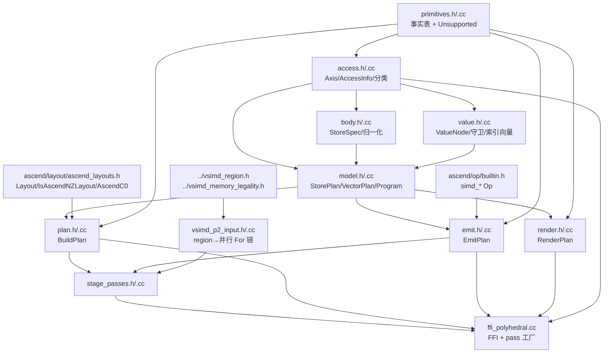

要点：

- 头文件依赖严格向下（`primitives → access → {body,value} → model → plan/emit/render`），**没有 include 环**。
- 但**目录级存在跨层反向依赖**：`polyhedral/vsimd_p2_input.h:27` 直接 `#include "../vsimd_region.h"`，
  `vsimd_p2_input.cc:17` 又依赖 `../vsimd_memory_legality.h`。即「传输层」代码住在 P2/P3 库里，
  使 `polyhedral/` 无法作为独立的 P2/P3 库复用（见 §9.3 D3）。
- `stage_passes.cc` 把 P1 载体对象 `VSimdRegionRefNode` 定义在自己的 `.cc` 里（`stage_passes.cc:41-63`），
  只有 `RegisterReflection` 对外注册，其他模块/测试无法构造该节点。

### 2.2 外部依赖（实际调用）

| 依赖 | 使用点 | 说明 |
| --- | --- | --- |
| `tvm::arith::Analyzer` | `plan.cc:1912`（每 `BuildPlan` 一个）、`value.cc:61-63`（每次 `ProveGuard` 新建） | 用于 `Simplify` / `const_int_bound` / `CanProve` |
| `tirx::PostOrderVisit` / `Substitute` / `ExprDeepEqual` | `access.cc`、`body.cc`、`value.cc`、`plan.cc`、`emit.cc` | 遍历顺序即诊断顺序 |
| `tvm::ffi` 反射 | `model.cc:143-152`、`stage_passes.cc:286`、`ffi_polyhedral.cc:202-224` | 8 个 plan 对象 + 1 个 region 载体 + 12 个全局函数 |
| `ascend/op/builtin.h` 的 `simd_*` | `emit.cc:40-297` | P3 只做指令选择，不新增 ISA 事实 |
| `Layout::Forward` / `OutputShape` | `plan.cc:1344-1353` | NZ 块步长由布局前向映射推导，不硬编码 |
| `AscendC0(bits)` / `IsAscendNZLayout` | `plan.cc:1404`、`plan.cc:1384` | C0 = 256 / elem_bits（`ascend_layouts.cc:113-117`） |

---

## 3. 全链路总体执行流程

### 3.1 总体流程图

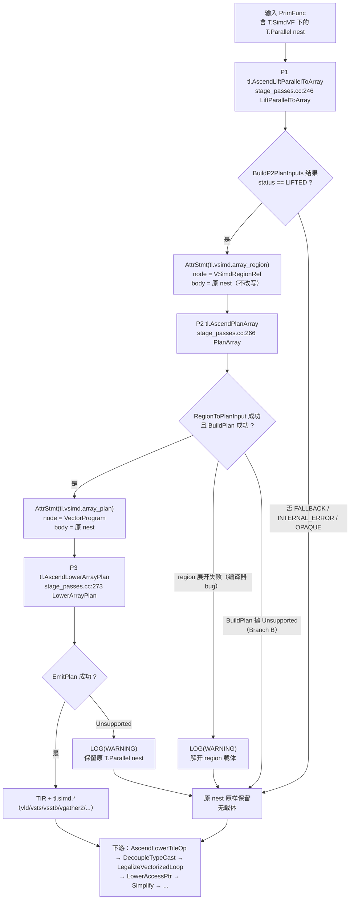

### 3.2 阶段契约速查表

| 阶段 | 入口（C++ / Python pass） | 实际入参 | 实际出参 | 上游依赖 | 下游消费者 | 失败语义 |
| --- | --- | --- | --- | --- | --- | --- |
| P1 | `LiftParallelToArray` / `AscendLiftParallelToArray`（`transform/__init__.py:193`） | `tirx::PrimFunc` | 同一 `PrimFunc`，仅新增 `tl.vsimd.array_region` 载体；nest **不改写** | `vsimd_memory_legality.cc`（PR-A）、`vsimd_capture_scope.cc`（PR-B）、`vsimd_region.cc`（PR-C/D） | P2 | 不抛 `Unsupported`；非 LIFTED 不标载体；已存在任一载体时整体跳过（幂等） |
| P2 | `PlanArray` / `AscendPlanArray`（`transform/__init__.py:204`） | 含 `array_region` 载体的 `PrimFunc` | `array_plan` 载体（node 为 `VectorProgram`），body 仍是原 nest | `BuildPlan`（`plan.cc:1910`）、`RegionToPlanInput`（`vsimd_p2_input.cc:113`） | P3 | `Unsupported` → 解开载体、保留 nest；region 展开失败 → `LOG(WARNING)` + 保留 nest |
| P3 | `LowerArrayPlan` / `AscendLowerArrayPlan`（`transform/__init__.py:214`） | 含 `array_plan` 载体的 `PrimFunc` | 纯 `T.simd.*` TIR（无 `T.Parallel`） | `EmitPlan`（`emit.cc:2323`） | 下游 pass | `Unsupported` → `LOG(WARNING)` + 保留 nest；残留 `array_region` 载体被解开 |
| 组合 | `VectorizeParallelNests` / `AscendPolyhedralVectorize`（`transform/__init__.py:219`） | `PrimFunc` | `PrimFunc` | P1→P2→P3 | `pipeline.py:124` | 同上；`P1→P2→P3` 顺序执行（`stage_passes.cc:280-284`） |
| 离线 | `AscendPolyhedralVectorizeNests`（`ffi_polyhedral.cc:161`） | `tirx::Stmt` + `lanes` + `layouts` | `Stmt` | `NestVectorizer`（pre-order，`ffi_polyhedral.cc:115-135`） | 测试 `vectorize_parallel_nests` | 内层 `Unsupported` 被吞，保留原 nest；只把最外层 `Unsupported` 转成 Map 错误 |

### 3.3 载体协议

| 载体 | attr key | node 载荷 | body | 产生者 | 消费者 |
| --- | --- | --- | --- | --- | --- |
| region | `tl.vsimd.array_region`（`stage_passes.h:37`） | `VSimdRegionRef`（仅 C++ 结构，`stage_passes.cc:41-63`） | 原始 `T.Parallel` nest | `LiftParallelToArray` | `PlanArray`；`LowerArrayPlan` 兜底解开 |
| plan | `tl.vsimd.array_plan`（`stage_passes.h:39`） | `VectorProgram`（FFI 反射对象） | 原始 `T.Parallel` nest | `PlanArray` | `LowerArrayPlan` |

---

## 4. P1：`AscendLiftParallelToArray`

### 4.1 契约

- **入参**：`tirx::PrimFunc`。
- **出参**：同一 `PrimFunc`，仅为 `LIFTED` 的 nest 包一层 `AttrStmt(VSimdRegionRef, "tl.vsimd.array_region", 1, nest)`。
- **调用依赖**：
  - `BuildP2PlanInputs(func)`（`vsimd_p2_input.cc:152-204`）= PR-A 内存合法性（`AnalyzeVSimdMemoryStatuses`）
    + PR-B capture/scope 分析（`AnalyzeVSimdCaptureInfo`）+ `BuildMinimalRegion`（PR-C/D，含自校验
    `VerifyExpandedRegion`）+ `RegionToPlanInput` + `RestoreBindings`。
  - 每 nest 一条记录，`status` 取值：`LIFTED` / `FALLBACK` / `INTERNAL_ERROR` / `OPAQUE`（`vsimd_p2_input.h:46`）。
- **幂等**：`MarkerFinder` 发现任何 `array_region` / `array_plan` 载体即整体返回（`stage_passes.cc:255-258`），
  不叠加载体（测试 `test_passes_are_idempotent`，4407）。
- **异常**：该阶段不抛 `polyhedral::Unsupported`；region 展开失败只 `LOG(WARNING)`（`vsimd_p2_input.cc:188-193`）。

### 4.2 流程图

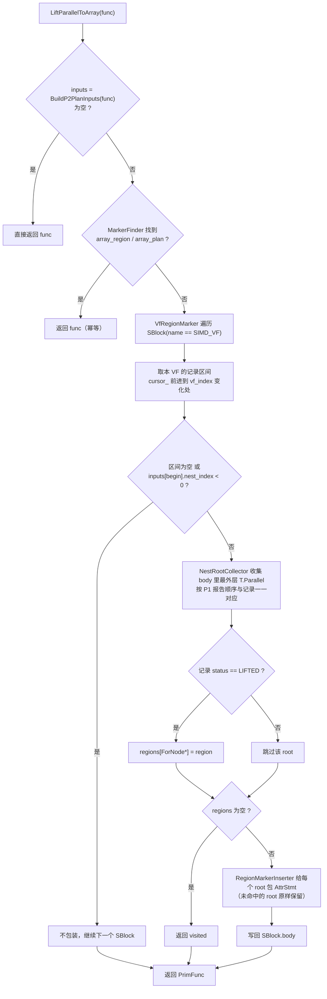

### 4.3 边界条件

| 条件 | 行为 | 佐证 |
| --- | --- | --- |
| 无 `T.SimdVF` / 无 nest | `BuildP2PlanInputs` 返回空 → 直接返回 | `stage_passes.cc:253-254`；测试 `test_p1_no_vf_returns_empty`（4355） |
| 同一 VF 多个 nest | 逐 nest 一条记录，`(vf_index, nest_index)` 递增 | `vsimd_p2_input.cc:158-202`；测试 `test_p1_multi_nest_single_vf`（4224） |
| 整个 VF 内存非法 | PR-A 按 VF 聚合，同 VF 全部 `FALLBACK` | 测试 `test_p1_mixed_legality_marks_whole_vf`（4313） |
| region 展开不是单条并行链 | `INTERNAL_ERROR` + `LOG(WARNING)`，不携带 `stmt` | `vsimd_p2_input.cc:187-194` |
| nest 内有非 vector 化语句（`local.var`、opaque call） | `OPAQUE`，无 `stmt` | 测试 `test_p1_opaque_statement_keeps_its_status`（4273） |
| 外层 `Bind` 变量（如 `tail = T.min(n - bx*bn, bn)`） | 离线交接用 `RestoreBindings` 内联；P3 就地替换时保留自由变量 | `vsimd_p2_input.h:88-98`、`RestoreBindings`（118-150）；测试 `test_p1_tail_bind_is_inlined_known_boundary`（4195） |
| `T.view` 的 `DeclBuffer` | 交接 `stmt` 丢弃 `DeclBuffer`，store 仍引用 view 名 | `AsParallelNestImpl`（`vsimd_p2_input.cc:53-62`）；测试 `test_p1_view_region_drops_decl_buffer`（4169） |

---

## 5. P2：`AscendPlanArray` / `BuildPlan`

### 5.1 入口与契约

- **Pass 入口**：`PlanArray(PrimFunc)` → 每个 `array_region` 载体：
  1. 先递归访问 body（得到原 nest，**即零变化兜底**）；
  2. `RegionToPlanInput(carrier->region, &input, &error)`（`stage_passes.cc:195`）；
  3. 用 region 的 `layouts / assumptions / bindings / shape_syms` 组 `PlanOptions`（`stage_passes.cc:199-203`）；
  4. `BuildPlan(input, std::nullopt, options)`；
  5. 成功 → `AttrStmt(program, "tl.vsimd.array_plan", 1, nest)`；`Unsupported` → 返回未包装的 `nest`。
- **库入口**：`TVM_DLL VectorProgram BuildPlan(const tirx::Stmt&, std::optional<int64_t> lanes,
  const PlanOptions&)`（`plan.h:50-52`）。
- **恒返回 `VectorProgram`**（1..N 段），单段时 `program.axes` 是「向量轴之前的并行轴前缀」
  （`BuildPlan` 结尾 `OuterAxes`，`plan.cc:1947-1955`）。

### 5.2 输出对象字段（即 FFI 反射字段，测试直接读取）

| 对象 | 字段（顺序 = `def_ro` 注册顺序） | 备注 |
| --- | --- | --- |
| `VectorProgram` | `axes: Axis[]`、`segments: VectorPlan[]`、`diagnostics: string[]` | `axes` 只放「提层的 `T.Parallel` 轴」，`EmitProgram` 断言必须 parallel（`emit.cc:2292-2295`） |
| `VectorPlan` | `axes`、`vector_axis`、`lanes: int`、`chunks: int?`、`tail: int?`、`stores: StorePlan[]`、`pre_stores`、`post_stores`、`reduce: ReduceInfo?`、`guard_boundaries: int[]`、`diagnostics: string[]` | `chunks/tail` 为 `None` 表示符号 extent |
| `StorePlan` | `spec`、`access`、`value`、`mask: ValueNode?`、`kind_value: string`、`index: ValueNode?`、`reduce: ReduceInfo?`、`promote: ValueNode?`、`mask_free_until: int`、`mask_free_from: int?`、`store_lanes: int`、`store_lane_mode: string`、`store_pack_bits: int?`、`layout_kind: string`、`nz_block_stride: int?`、`nz_elem_stride: int?` | **C++ 字段名是 `kind_value`（字符串）**；Python 门面用只读属性 `kind` 转成枚举（`_cpp.py:65-69`） |
| `StoreSpec` | `buffer`、`indices`、`value`、`mask: Expr?` | `body.cc` |
| `ReduceInfo` | `axis`、`op`、`recipe`、`varying: ValueNode?`、`accumulate: bool` | `op ∈ {vadd,vmax,vmin}`，`recipe ∈ {vcadd,vcmax,vcmin}` |
| `AccessInfo` | `buffer`、`indices`、`offset`、`is_store`、`indirect`、`in_global`、`reason` | `per_axis` **不反射**（`access.h:113-114`），只能经 `axis_class()` 读 |
| `ValueNode` | `recipe`、`dtype`、`args`、`access?`、`scalar?`、`detail`、`predicate?`、`predicate_free_until`、`predicate_free_from?`、`is_uniform` | |
| `Axis` | `var`、`extent`、`index`、`kind: int`（`ForKind` 整数）、`name`、`is_parallel` | `name/is_parallel` 在 C++ 侧已是派生只读字段 |

`store_lane_mode` / `layout_kind` 的取值集合（枚举语义在代码里以字符串比较实现）：

| 字段 | 取值 | 含义 | 产生点 |
| --- | --- | --- | --- |
| `store_lane_mode` | `"full"` | store 寄存器宽度 == 段 chunk 宽度，普通写 | `plan.cc:1524-1530` |
| | `"pk_half"` | store 寄存器是 chunk 的 2 倍（窄化），用 `PK_B{pack_bits}` 打包写 | 同上 |
| | `"pk_quarter"` | 4 倍，`PK4_B{pack_bits}`；NZ 目标直接拒绝 | 同上 / `plan.cc:1390-1394` |
| `layout_kind` | `"nd"` | 默认连续写（`vsts`） | `plan.cc:1369-1382` |
| | `"nz"` | 显式 Ascend NZ 布局，`vsstb` 散射 | `plan.cc:1374-1440` |

### 5.3 P2 完整执行流程图

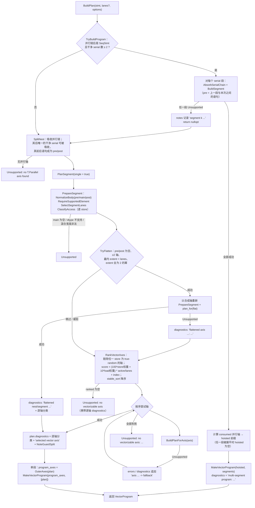

`BuildPlanForAxis` 内部（`plan.cc:1442-1692`）是 P2 的第二层核心，单独成图：

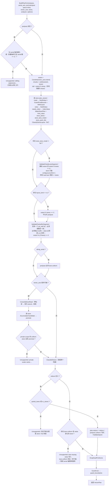

### 5.4 P2 的终止条件

| 出口 | 条件 | 结果 |
| --- | --- | --- |
| 提前成功（多段） | `TryBuildProgram` 识别出 ≥2 个干净 serial 段且每段都规划成功 | 返回 `VectorProgram`（`segments.size() >= 2`） |
| 提前成功（展平） | `TryFlatten` 通过全部门禁且 `plan_for(flat_axis)` 成功 | 返回单段 `VectorProgram`，不再尝试其它轴（`plan.cc:1725-1747`） |
| 成功（轴回退） | `RankVectorAxes` 顺序中第一个 `BuildPlanForAxis` 不抛 `Unsupported` 的轴 | 返回单段 `VectorProgram`（`plan.cc:1756-1781`） |
| 拒绝（无候选轴） | 所有 store 在所有轴上都 `true_random`，`ranked` 为空 | `Unsupported("no vectorizable axis: every store is true-random ...", diagnostics)`（`plan.cc:1751-1755`） |
| 拒绝（全部轴失败） | 每个候选轴都抛 `Unsupported` | `Unsupported("no vectorizable axis: <逐轴原因>", diagnostics)`（`plan.cc:1782-1784`） |
| 拒绝（nest 不可建模） | 无并行轴 / 嵌套 serial 未通过 `SerialIsClean` / body 非法 | `Unsupported`；若多段路径留下 `notes` 则合并进 `diagnostics`（`plan.cc:1931-1945`） |
| 不变量 | 成功路径**必然**返回 1..N 段；不存在“返回空 program” | `MakeVectorProgram` + `segments.push_back(plan)`（`plan.cc:1953-1955`） |

### 5.5 输入前置条件（P2 真实可接受形状）

| 条件 | 说明 | 佐证 |
| --- | --- | --- |
| 迭代域中必须至少有一层 `T.Parallel` | `AbsorbParallelChain` 只吸收**起始连续**的并行链；`SplitNest` 末尾若没有任何并行轴 → `Unsupported("no T.Parallel axis found")` | `plan.cc:188-200`、`plan.cc:367-369` |
| 每层 `min` 必须可证为 0 | 并行链与后续 serial 都检查 | `plan.cc:178-186`、`plan.cc:324` |
| body 允许 `SeqStmt` / `BufferStore` / 单臂 `if` / 同址双臂 `if` / `Bind` | 其它形态显式拒绝 | `body.cc:75-160` |
| `Evaluate(Call(atomic_*))` 拒绝 | 无 vector+scalar 原子配方 | `body.cc:90-98` |
| `Evaluate` 非原子调用 | **静默丢弃**（不报错），见 §9.4 L5 | `body.cc:90-98` |
| body 内出现 `For` | `Unsupported("nested ... loop inside T.Parallel ...")` | `body.cc:148-153` |
| 允许 `Bind` 别名（非 `Call` 值） | 最多 8 轮内联，防循环 Bind | `body.cc:47-73` |
| store 元素 dtype | 必须命中 `_ELEM_BITS`；`bool` 在 `MaskBits` 抛错后被包装成 `Unsupported` | `plan.cc:723-733`、`primitives.cc:317-325` |
| 不支持 GM 操作数 | `LoadNode` 直接拒绝 | `value.cc:780-784` |

### 5.6 边界矩阵（P2 侧）

| 维度 | 限制 | 拒绝措辞（测试匹配用） | 佐证 |
| --- | --- | --- | --- |
| lane 宽度 | `lanes = min(store 寄存器 lane, 实际产出 lane)`；override 必须能被每个 store 的寄存器宽度整除且倍数 ≤ 4 | `cannot cover (split the nest)` | `plan.cc:808-871` |
| 混合宽度 | 只允许「窄化 cast」的宽 store；不允许 tail、谓词、pre/post、更宽 load、归约 | `tails are not supported yet` 等 | `plan.cc:1234-1269`、`plan.cc:1562-1565`、`plan.cc:1631-1636` |
| NZ 目标 | chunk 必须是 C0 的整数倍；`cols` 静态且 `cols % lanes == 0`；不允许 tail / pre/post / 谓词；store 必须 contiguous；`pk_quarter` 不支持 | `whole number of chunks`、`statement predicate` 等 | `plan.cc:1374-1440`、`plan.cc:1567-1579` |
| 窄化 + NZ | 至多一条 `pk_half` NZ；必须是段内最后一条；必须独占 buffer；value 必须是 `vcvt`；`extent % (2*lanes) == 0` | `whole chunk pairs`、`must be the last store` | `plan.cc:1291-1331` |
| 归约 | dst 必须 lane-uniform；表达式必须是 `dst = dst <op> x`，op ∈ Add/Max/Min；旧值必须恰好出现一次且在累加位 | `accumulate position`、`appears more than once`、`conditional reduction` | `plan.cc:985-1067`、`plan.cc:1036-1045` |
| 私有标量 | 沿并行轴必须可提升为寄存器累加器，否则拒绝 | `needs a promotable accumulator` | `model.cc:75-141`、`plan.cc:1609-1628` |
| stencil | 沿向量轴对同 buffer 跨址读 → 拒绝 | `is a stencil along vector axis` | `plan.cc:1111-1153` |
| flatten | 2 的幂 extent 链；合成轴后 store 全 contiguous 且 load 只需 contiguous/uniform；多写同 buffer 禁止；写后读禁止 | `flatten rejected: ...` | `plan.cc:599-717` |
| guard 切分 | 内部切点 > `kGuardCutLimit = 6` 时**整体丢弃切分**（只损失优化，无诊断） | — | `plan.cc:1155-1190` |
| 符号 extent | `chunks/tail = None`，emit 走运行期循环 + peel 尾块 | — | 测试 `test_defect_d9_symbolic_extent_is_not_silently_truncated`（2604） |

### 5.7 异常处理

- P2 内部**只用** `polyhedral::Unsupported`（`primitives.h:38-51`）表达拒绝，禁止 `LOG(FATAL)`。
- `PlanMarkerReplacer` 只捕获 `Unsupported`（`stage_passes.cc:207-209`）；`TVM_FFI_ICHECK`
  类断言（如 `MakeVectorPlan` 的 `ffi::make_object` 失败）会直接崩溃，不属于可恢复路径。
- FFI 入口统一把 `Unsupported` 转成 `{ok:false, message, diagnostics}`（`ffi_polyhedral.cc:38-58`），
  Python 侧 `_raise` 还原成同文本、同顺序的诊断列表（`_cpp.py:87-88`）。

---

## 6. P3：`AscendLowerArrayPlan` / `EmitPlan`

### 6.1 契约

- **入参**：`VectorProgram`（常见）或裸 `VectorPlan`；`EmitPlan(const ffi::ObjectRef&)` 运行期分发
  （`emit.cc:2323-2336`），非两种类型 → `TVM_FFI_ICHECK`。
- **出参**：单个 `tirx::Stmt`；对 `VectorProgram` 先按 `program.axes` 包一层 serial 循环，
  再顺序拼接各段。
- **只读**：plan 不被修改；SSA 命名 `v{prefix}{n}`、`mask{prefix}{bits}`、`lane0{prefix}{bits}`、
  `ramp_{stride}`、`acc{prefix}{n}`、`chunk` / `chunk_s{i}`（`emit.cc:623-628`、`658-690`、`951-952`、`1967-1970`、`2301`）。
- **异常**：`Unsupported` 由 `PlanMarkerLower` 捕获并 `LOG(WARNING)`（`stage_passes.cc:228-233`），
  其余 `ICHECK` 直接终止。

### 6.2 P3 完整执行流程图

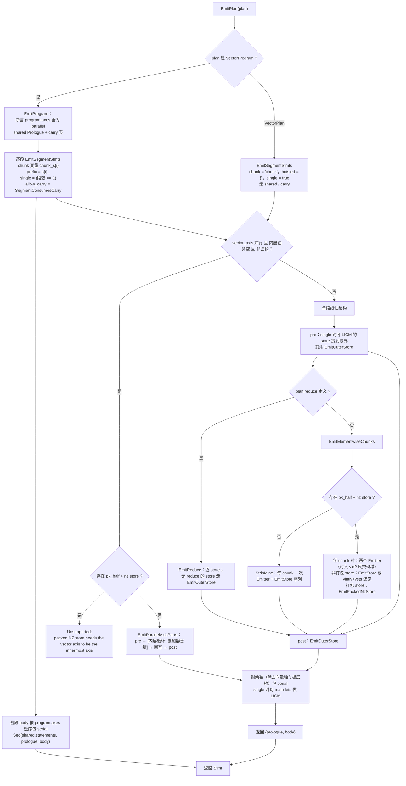

**P3 的终止条件**

- 正常结束：`EmitProgram` 发射完所有段 → `Seq(shared.statements, prologue, body)`（`emit.cc:2314-2318`）；
  裸 `VectorPlan` → `Seq(prologue, body)`（`emit.cc:2332-2335`）。
- 无循环出口：`chunks == 1` 或 `pairs == 1` 时完全展开为直线代码，不产生 `for`（`emit.cc:1543-1546`、`1628-1630`）。
- 空归约出口：`chunks == 0` 的归约直接返回、不发射（`emit.cc:2017-2020`）。
- 符号 extent 出口：主循环 `extent / lanes` 次 + `if extent % lanes > 0` 的直线尾块（`emit.cc:1505-1519`）。
- 异常出口：任一 `Unsupported` 由 `PlanMarkerLower` 捕获，`LOG(WARNING)` 后保留原 nest（`stage_passes.cc:228-233`）。

### 6.3 strip-mine 骨架（`StripMine`，`emit.cc:1480-1557`）

| 情形 | 发射形态 |
| --- | --- |
| `chunks` 未知（符号 extent） | 主循环 `for chunk in [0, extent / lanes)`；`if extent % lanes > 0` 时再发一个**直线**尾块（`chunk = extent / lanes`，`masked_tail = true`） |
| `chunks == 1` 且无尾块 | 完全展开为直线代码（不发 `for range(1)`） |
| `tail == 0`，`chunks > 1` | 按 `guard_boundaries` 切分成若干段，每段一个 `for`（单迭代退化为直线） |
| `tail != 0` | 整块部分覆盖 `[0, chunks-1)`，最后一块单独展开为带尾块掩码的直线代码 |

### 6.4 value recipe 分发表（`Emitter::Build`，`emit.cc:1048-1198`）

| recipe | 发射 | 备注 |
| --- | --- | --- |
| `imm` | 直接返回标量表达式 | 非 uniform 上下文里由 `VectorOperand` 先 `Dup` |
| `lane_index` | `vci(lane_base, INC_ORDER)` | 绝对 lane 值 = chunk 基址 + lane id |
| `vload` | 有 forward/carry 命中则复用；无掩码 → `vld(NORM)`；有掩码或无尾块保护 → `vgather2(vci(0), mask)` | pair 域内无掩码 → `PairStream`（`vld2`） |
| `vload_strided` | `vgather2` + `Ramp(stride)` | 正步长；负步长在 plan 期已改 `gather` |
| `gather` | `vgather2(IndexAddr, index, mask)` | 索引寄存器按 unsigned 重解释 |
| `uniform_load` / `uniform_expr` / `vbrc` | `Dup` → `vdup`（可提升到 prologue 或按 key 去重） | |
| `vadds/vmuls/vmaxs/vmins/vshrs/vshls` | 标量-向量 op；若标量侧已被提升为向量寄存器 → 自动退回 `vadd/vmul/...` | `emit.cc:1117-1144` |
| 一元 `vneg/vabs/vexp/vsqrt/vln` | 一元 op | |
| 二元 `vadd/vsub/vmul/vdiv/vmax/vmin/vand/vor/vxor/vshl/vshr` | 二元 op | |
| `vcmp` / `vcmps` | `vcmp` / `vcmps`，dtype = `boolx256` | mask 宽度取数据元素宽度 |
| `vsel` | `vsel(true, false, pred)` | 参数顺序与 Python 版一致 |
| `pand` / `por` / `pnot` | 谓词运算，mask 宽度固定 `kPredicateMaskBits = 8` | `primitives.h:72` |
| `vcvt` | `Vcvt(src, target, AllMask(min(bits)))`，默认 `ROUND_R / RS_ENABLE / PART_EVEN` | `emit.cc:236-297` |
| 其它 | `Unsupported("no emitter for value recipe ...")` | |

### 6.5 store 形态（`EmitVectorWrite` / `EmitStore` / `EmitOuterStore`）

| 输入形态 | 发射 | 佐证 |
| --- | --- | --- |
| contiguous（或 uniform） | `vsts`，`dist = NORM_B{bits}` / `ONEPT_B{bits}` | `emit.cc:1243-1256` |
| `pk_half` / `pk_quarter` | `dist = PK_B{pack_bits}` / `PK4_B{pack_bits}` | `emit.cc:1244-1250` |
| `layout_kind == "nz"` 且 `full` | `vsstb(value, addr, mask, (block << 16) &#124; elem)` | `emit.cc:1225-1242` |
| `layout_kind == "nz"` 且非 `full` | `Unsupported("a half-register NZ store must be emitted in the paired form")` | `emit.cc:1226-1230` |
| strided 正步长 | `vscatter` + `Ramp(stride)` | `emit.cc:1405-1416` |
| 其余（permute/piecewise/indirect/负步长） | `vscatter` + 索引向量 | `emit.cc:1418-1427` |
| pre/post 且 uniform + 无掩码 + 标量可取 | 直接 `BufferStore`（退化成一次标量写，不再 `vdup` + `ONEPT`） | `emit.cc:1432-1453` |

### 6.6 归约发射（`EmitOneReduce`，`emit.cc:2013-2026`）

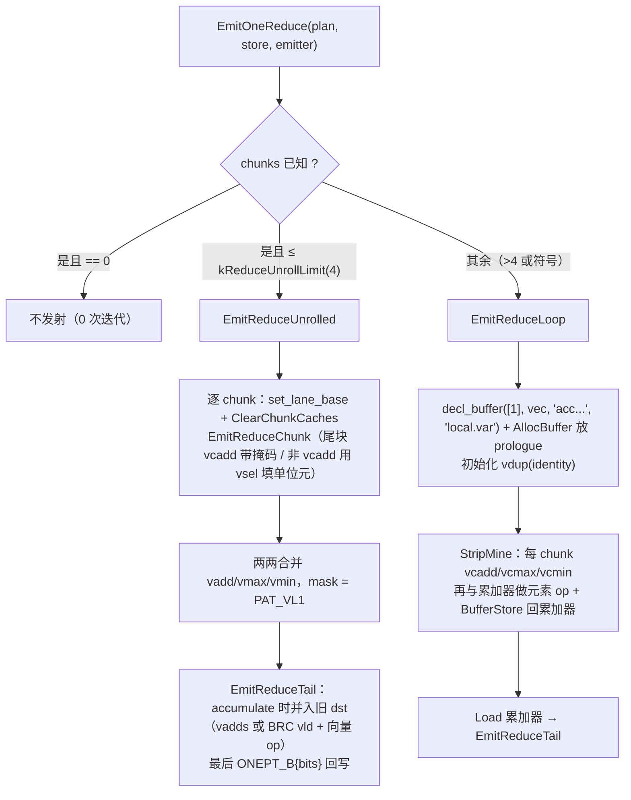

### 6.7 pack2 配对形态（`EmitElementwiseChunks` 的 packed 分支 + `EmitPackedNzStore`）

- 触发条件：plan 里存在 `layout_kind == "nz"` 且 `store_lane_mode == "pk_half"` 的 store
  （`PackedNzStore`，`emit.cc:1266-1273`），plan 期已由 `ValidatePackedNzSegment` 保证
  “唯一、最后一条、独占 buffer、value 是 `vcvt`、extent 覆盖整对”（`plan.cc:1291-1331`）。
- 每次循环覆盖**两个 chunk**（`pairs = chunks / 2`，`emit.cc:1578-1580`）。
- 若 `PairDomainAllowed`（所有 store contiguous、无掩码、非打包 store 为 full、值满足 `LaneLocalValue`）
  → 进入反交织域：一条 `vld2(DINTLV_B32)` 取一对 chunk 的偶/奇流；否则回到两条 `vld` + `vdintlv`。
- 打包 store 的输出链：`vcvt(PART_EVEN)` / `vcvt(PART_ODD)` → `reinterpret<uint16>` → `vor` →
  `reinterpret<bf16>` → 一条 `vsstb`（`emit.cc:1291-1321`）。
- 同段其它 contiguous store 在写回处用 `vintlv` 还原成两个连续 chunk 再各发一条 `vsts`
  （`EmitPairContiguousStore`，`emit.cc:1375-1391`）。
- 该分支要求 `chunks` 静态（`TVM_FFI_ICHECK`，`emit.cc:1578-1579`）。

### 6.8 P3 边界与异常

| 条件 | 行为 | 佐证 |
| --- | --- | --- |
| `program.axes` 含非 parallel 轴 | `TVM_FFI_ICHECK` 终止（计划契约被破坏） | `emit.cc:2291-2295` |
| `chunks == 0`（零次迭代）的归约 | 直接返回，不发射 | `emit.cc:2017-2020` |
| 零次迭代的 elementwise 段 | **未处理**：`StripMine` 返回空 body，后续 `SeqOfVec(...)[0]` 越界（见 §9.4 L2） | `emit.cc:1541-1549`、`2323-2336` |
| 符号 extent 的尾块 | `update_mask(min(remaining, lanes), bits)`，不会超过 lane 宽度 | `emit.cc:694-709` |
| guard 切点 > 6 | plan 已把 `guard_boundaries` 清空，P3 不感知 | `plan.cc:1188-1189` |
| 段间寄存器直通 | 仅当段 `chunks == 1`、无尾块、无谓词、contiguous、向量轴之前的轴全部提层 | `emit.cc:2282-2289`、`2230-2236` |
| 中间写 | `NoteWrite` 清空该 buffer 的 forward / carry（按 BufferKey 前缀匹配） | `emit.cc:833-855` |
| P3 拒绝 | `LOG(WARNING)` + 原 nest（`T.Parallel`）留在 IR 中 | `stage_passes.cc:228-233`；`pipeline.py:125` 无兜底 |
| P3 拒绝后 nest 的归宿 | 该 nest 不带 `kParallelLoopLayout` 注解，`AscendLowerTileOp` 对未注解的并行循环直接跳过（`lower_tile_op.cc:1386-1388`），因此没有第二个消费者 | `pipeline.py:124-126` |

---

## 7. 分模块细分流程图

> 每张图都标注对应文件与核心函数，可作为单模块评审/重构的索引。

### 7.1 访存建模与分类（`access.cc`）

对应：`ClassifyAccess`（194-245）、`LinearElementOffset`（109-123）、`FiniteDifference`（125-135）、
`ClassifyDelta`（137-144）、`IndexVectorReason`（146-174）。

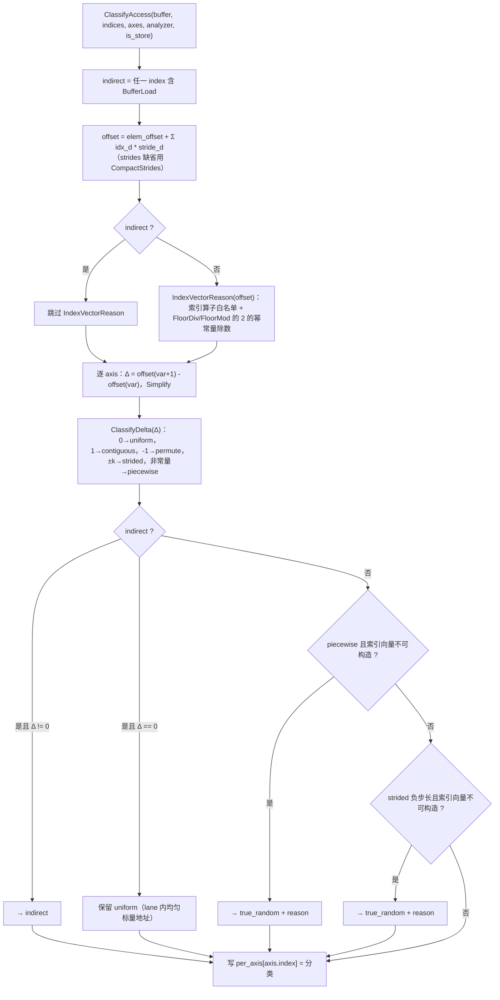

### 7.2 body 归一化（`body.cc`）

对应：`NormalizeBodyInto`（75-160）、`CollectAliases`/`ApplyAliases`（47-73）。

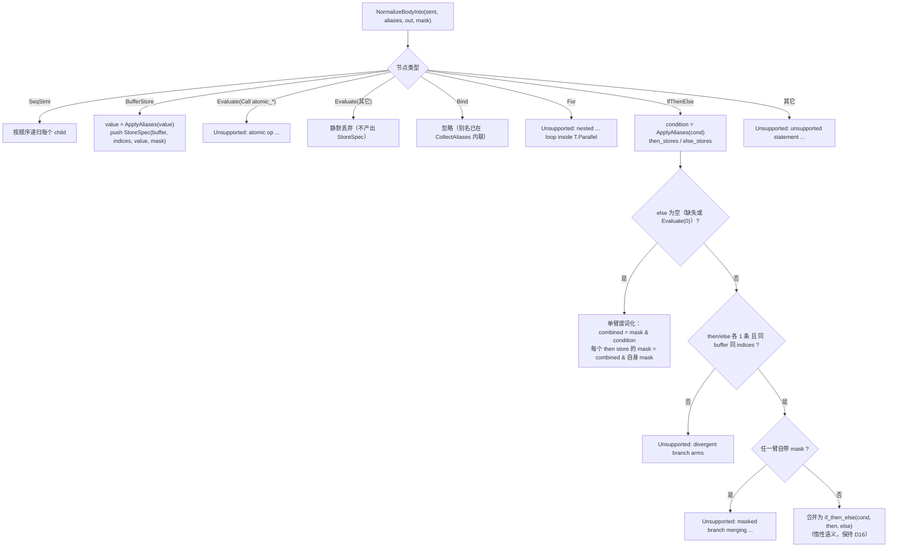

### 7.3 value DAG（`value.cc`）

对应：`BuildValue`（616-766）、`BuildCall`（315-380）、`LoadNode`（780-857）、
`GuardFreeBounds`（462-480）、`UniformGuarded`（508-527）、`IndexValue`（768-778）。

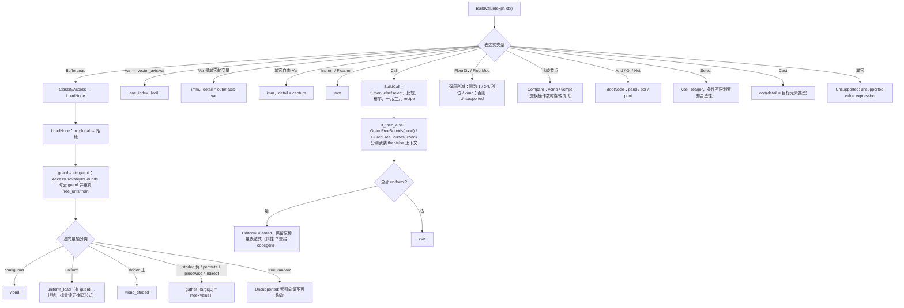

### 7.4 P2 nest 切分与多段（`plan.cc`）

对应：`AbsorbParallelChain`（188-200）、`SerialIsClean`（234-302）、`SplitNest`（313-374）、
`AbsorbSerialChain`（377-397）、`TryBuildProgram`（1801-1906）。

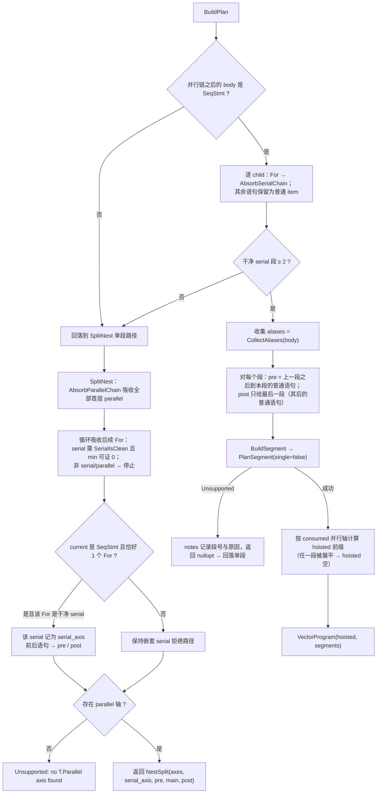

`SerialIsClean` 的判据（保守拒绝，不做静默降级）：

1. 沿 serial 轴不变的写必须是归约（`IsCumulativeWrite`）且取值随轴变化（`ValueVariesAlong`）；
2. 同一 buffer 的多条写必须目的地址相同（否则 `may alias` 拒绝，R6）；
3. 凡读被写 buffer 的 load，必须与某条写同址（否则 `cross-iteration read`）。

### 7.5 P2 展平通道（`plan.cc`）

对应：`FlattenAxes`（599-641）、`TryFlatten`（649-717）。

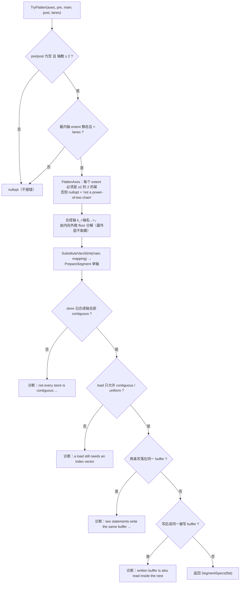

### 7.6 P2 轴打分与回退（`plan.cc`）

对应：`AxisWeight`（102-120）、`ActiveLanes`（403-407）、`AxisScore`（415-420）、
`RankVectorAxes`（422-446）、`AxisDiagnostics`（448-494）。

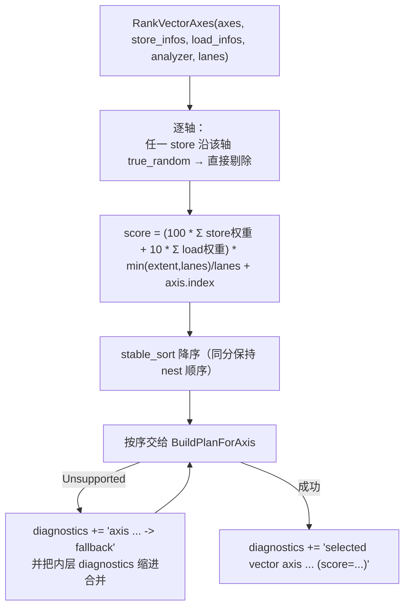

权重表（`AxisWeight`）：`contiguous 8 / piecewise 4 / strided 3 / permute 3 / indirect 2 / uniform 1 / true_random 0`。

### 7.7 P2 布局与 pack2 校验（`plan.cc`）

对应：`LookupStoreLayout`（1334-1341）、`PhysicalOffset`（1344-1353）、
`ClassifyStoreLayout`（1374-1440）、`ValidatePartialLaneSegment`（1234-1269）、
`ValidatePackedNzSegment`（1291-1331）、`SelectSegmentLanes`（808-871）。

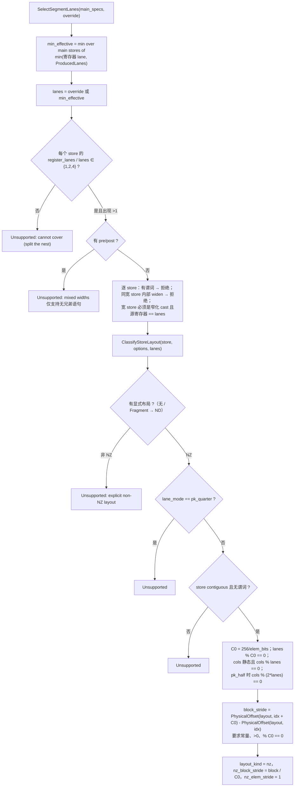

pack2 段级校验（在 `BuildPlanForAxis` 末尾执行，`plan.cc:1582`）：

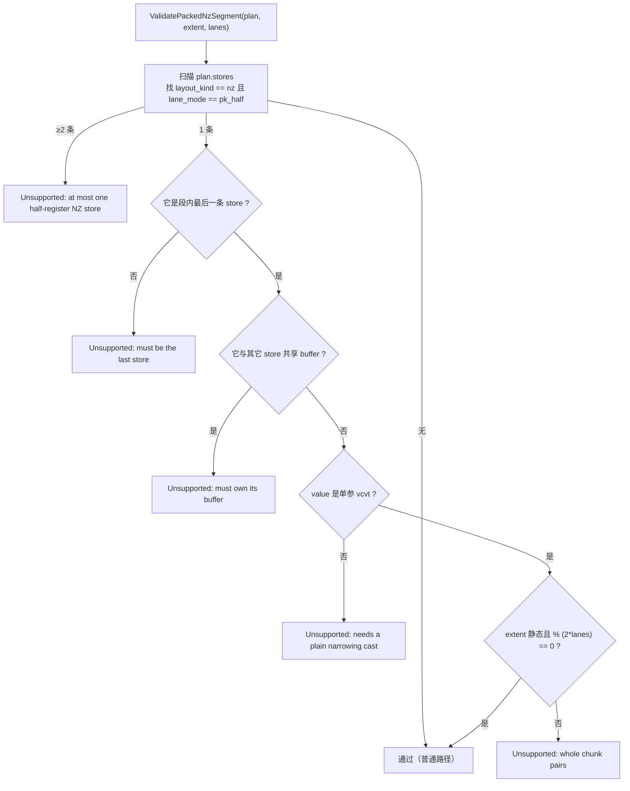

### 7.8 P3 掩码与 strip-mine（`emit.cc`）

对应：`AllMask`/`Lane0Mask`/`TailMask`（654-709）、`Predicate`（715-740）、
`LoadGuard`（752-764）、`StoreMask`（1204-1218）、`StripMine`（1480-1557）。

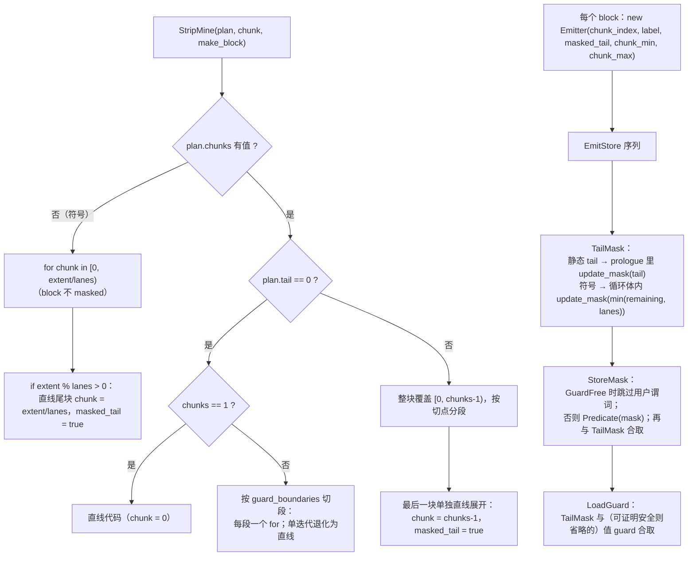

### 7.9 P3 归约（已在 §6.6 给出主图）

补充：`EmitReduce`（2028-2037）对段内每条 store：无 reduce → `EmitOuterStore`（广播写）；
有 reduce → `EmitOneReduce`。段级 `plan.reduce` 只用于选择 `EmitReduce` 入口，逐 store 的
`ReduceInfo` 才是真正的配方来源（支持一段多归约，测试 `test_defect_d6_two_reductions_in_one_nest_are_both_emitted`，2330）。

### 7.10 P3 pack2 配对（`emit.cc:1559-1636`）

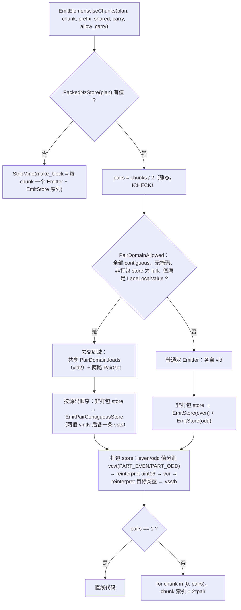

### 7.11 三段 pass 与 FFI 桥（`stage_passes.cc` / `ffi_polyhedral.cc`）

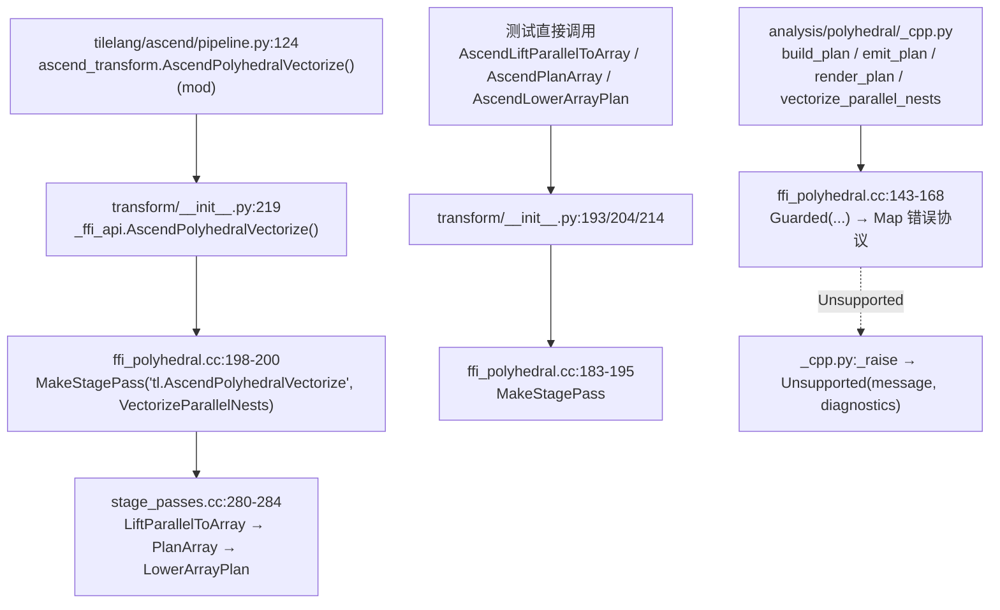

---

## 8. 测试场景与实现分支对照

| 测试分组（文件内小节） | 代表用例（行号） | 覆盖的 P2/P3 分支 |
| --- | --- | --- |
| 实现绑定（C++ only） | `test_cpp_implementation_is_the_only_one_loaded`（327） | FFI 门面、`polyhedral_reference` 不被导入 |
| Δ 数学核心 | `test_finite_difference_*`（375-424） | `FiniteDifference` / `ClassifyDelta` |
| §0 基本形状 | `test_copy`（432）、`test_scalar_broadcast`（453）、`test_global_operand_rejected`（469） | `vload`、`uniform_load`、GM 拒绝 |
| §1 分支/三元 | `test_if_else_merges_into_select`（488）、`test_if_single_arm_is_predicated_store`（510）、`test_statement_if_arm_load_is_guarded`（533） | body 归一化、`vsel`、谓词装载 |
| §1 guard 切分 | `test_guard_boundaries_cut_prefix_and_suffix_independently`（585） | `GuardFreeBounds`、`guard_boundaries`、`StripMine` 切分 |
| §2 归约 | `test_reduction_detected`（948）、`test_reduction_with_tail_fills_identity`（988） | `ClassifyReduce`、`vcadd`、尾块单位元 |
| §3 多 store / 别名 / 强度削减 | `test_multi_store`（1018）、`test_scalar_alias_folds_into_value`（1083）、`test_floordiv_value_operator_strength_reduced`（1101） | `NormalizeBody`、`ApplyAliases`、`FloorDivMod` |
| §4 下标/展平/gather | `test_highdim_flatten`（1223）、`test_block_tiled_fragment_layout_is_piecewise_gather`（1243）、`test_strided_access`（1268）、`test_indirect_gather_is_expressed`（1286）、`test_reversal_is_permute_gather`（1308） | `ClassifyAccess` 的 piecewise/indirect/permute、`vgather2` |
| §6 第一步（serial 吸收） | `test_direct_serial_copy_absorbed`（1439）、`test_direct_serial_reduction_absorbed`（1519）、`test_serial_shared_scalar_rejected`（1579）、`test_serial_stencil_rejected`（1600） | `SerialIsClean`、`SplitNest`、轴打分（active/lanes） |
| §6 第二步（pre/post） | `test_serial_pre_statement_absorbed`（1622）、`test_serial_post_statement_absorbed`（1650）、`test_serial_sandwiched_statements_absorbed`（1677） | `SplitNest` 的 SeqStmt 分支、`DropDeadPreStores`、累加器提升 |
| §6 第三步（多段） | `test_multi_serial_independent_segments`（1740）、`test_multi_serial_reduce_then_use`（1779）、`test_multi_serial_one_unclean_is_rejected`（1855） | `TryBuildProgram`、hoisted 轴 |
| 统一返回/等价性 | `test_build_plan_always_returns_vector_program`（1880）、`test_single_segment_program_emits_identically_to_single_plan`（1907） | 单段 vs program 发射等价（`structural_equal(map_free_vars=True)`） |
| 诊断 | `test_diagnostics_list_every_candidate_axis_on_success`（1354）、`test_multi_segment_failure_reason_is_preserved`（2001） | `AxisDiagnostics`、notes 合并 |
| 缺陷回归 D1-D13 / R1-R7 | `test_defect_d1...`（2227）至 `test_parallel_axis_reduction_with_non_uniform_pre_falls_back`（3069） | 归约误判、负步长、符号 extent、尾块越界、谓词宽度、私有标量 |
| 寄存器转发/carry | `test_multi_segment_shares_prologue_and_passes_the_accumulator_register`（3096）、`test_carry_is_invalidated_by_an_intermediate_write`（3158） | `ProgramPrologue`、`EmitParallelAxisParts` 的 Promote/RegisterCarry |
| 阶段一：混合宽度 | `test_mixed_width_segment_uses_min_lane_width`（3250）、`test_mixed_width_segment_emits_packed_store_with_part_even`（3272） | `SelectSegmentLanes`、`vcvt(PART_EVEN)`、`PK_B32` |
| 阶段二：NZ 目标 | `test_compact_nz_store_is_classified_with_layout_block_stride`（3463）、`test_compact_nz_store_emits_vsstb_with_block_stride`（3476）、`test_nd_destination_keeps_the_contiguous_store`（3511） | `ClassifyStoreLayout`、`vsstb`、ND 零差异护栏 |
| 阶段 2b：pack2 | `test_half_register_nz_store_is_paired_into_a_full_register`（3554）、`test_paired_store_loops_over_chunk_pairs`（3616）、`test_paired_store_must_be_the_last_store`（3662） | `ValidatePackedNzSegment`、`PairDomain`、`EmitPackedNzStore` |
| FA 闭环 | `test_parallel_fa_vectorizes_the_softmax_nest`（3753） | P1→P2→P3 整段替换、NZ 块步长 129 |
| P1→P2 交付 | `test_p1_lift_contract_1d`（4070）、`test_p1_stmt_plans_like_the_original_nest`（4124）、`test_p1_tail_bind_is_inlined_known_boundary`（4195）、`test_p1_gm_operand_branch_b`（4336） | `BuildP2PlanInputs`、`RestoreBindings`、Branch B |
| 三段 pass | `test_staged_passes_exchange_carriers`（4383）、`test_passes_are_idempotent`（4407）、`test_rejected_nests_fall_through_every_stage`（4417） | 载体交接、幂等、被拒 nest 逐字节不变 |
| 流水线 | `test_pipeline_vectorizes_by_default`（4469） | `pipeline.py:124` 无条件运行、设备源码含 `simd_inst::` |

---

## 9. 架构深度分析

### 9.1 规模与集中度

| 指标 | 数值 |
| --- | ---: |
| 文件数 | 21（10 个 `.h` + 11 个 `.cc`） |
| 总行数 | 8332 |
| 头文件行数 | 1234（14.8%） |
| 实现行数 | 7098（85.2%） |
| Top-3 文件 | `emit.cc` 2340 + `plan.cc` 1967 + `value.cc` 861 = **5168（62.0%）** |
| 单文件 > 800 行 | 3 个（占 62%） |
| `polyhedral::` 自由函数（`.cc` 匿名命名空间内） | `plan.cc` 约 40 个、`emit.cc` 约 35 个 |

结论：维护成本几乎全部落在 `emit.cc` / `plan.cc`。评审时这两个文件无法在一屏内建立上下文，
且所有 emitter 状态（memo / predicates / ramps / forward / promoted / carry / pair）都压在
同一个 `Emitter` 类里（`emit.cc:586-1046`，461 行，约 30 个成员字段、17 个缓存与语句容器）。

### 9.2 职责划分与依赖评估

| 层 | 文件 | 评估 |
| --- | --- | --- |
| 事实层 | `primitives.*` | 合理；但 `MaskDtype()/ModeZeroing()` 用函数返回 `static const std::string&`，且把 `kGuardCutLimit`（计划策略）也放进「ISA 事实」头，职责略混（`primitives.h:72-78`） |
| 分析层 | `access.*` / `body.*` / `value.*` | 单一职责；`value.cc` 同时承担 DAG 构造与 guard 证明，偏重 |
| 模型层 | `model.*` | 需调整：`AccumulatorCandidate`（141 行判据）住在 `model.cc:75-141`，是**规划策略**而非数据结构；建议迁到 `plan_accumulator.cc` |
| 规划层 | `plan.*` | 需拆分：1967 行、约 40 个自由函数，nest 切分、串行依赖分析、lane 选择、展平、打分、单轴规划、归约、布局、pack2、多段 program 全在一个 TU |
| 发射层 | `emit.*` | 需拆分：2340 行，承担 value 选择、地址计算、SSA 缓存、掩码、strip-mine、归约、pack2、LICM、program 组装 |
| 传输层 | `vsimd_p2_input.*` / `stage_passes.*` | 需调整：传输层与 P2/P3 库同包，且**反向依赖** `../vsimd_region.h`、`../vsimd_memory_legality.h`（`vsimd_p2_input.h:27`、`vsimd_p2_input.cc:17`） |
| 门面层 | `ffi_polyhedral.cc` | 需调整：同时承担「7 个 FFI 函数」「4 个 pass 工厂」「1 个离线 pre-order driver」三种职责 |

**没有 include 环**，但存在**概念上的双向依赖**：

- `polyhedral`（P2/P3 库）→ `transform`（P1 分析）；
- `transform/pipeline` → `polyhedral`（pass）。

这使 `polyhedral/` 不能作为独立组件编译/单测。

### 9.3 设计缺陷（结构性）

| ID | 缺陷 | 佐证 | 影响 |
| --- | --- | --- | --- |
| D1 | `emit.cc` 单文件 2340 行，`Emitter` 类 461 行 / 约 30 个成员字段（含 17 个缓存与语句容器） | `emit.cc:586-1046` | 增量编译慢、冲突率高、无法分层评审 |
| D2 | `plan.cc` 单文件 1967 行，混合 5 类职责 | `plan.cc` 全文 | 同上；策略（打分/展平）与硬约束（拒绝）混在一起，难以定位 |
| D3 | 传输层反向依赖 P1 头文件 | `vsimd_p2_input.h:27`、`vsimd_p2_input.cc:17` | `polyhedral` 无法脱离 `transform` 单测；依赖方向与 `model.h:8-10` 声明的层次相反 |
| D4 | region 载体 FFI 类型私有在 `.cc` | `stage_passes.cc:41-63` | 无法在其他 TU/测试中构造或检查；P1→P2 载体协议不可复用 |
| D5 | 双 driver：`NestVectorizer`（pre-order 离线）与三段 pass 各自实现「规划+发射」循环 | `ffi_polyhedral.cc:115-135` vs `stage_passes.cc:182-240` | 两条路径必须手动保持语义一致（测试 `test_combined_pass_matches_offline_driver`，4370 只是在守这一点） |
| D6 | `PlanOptions` 三个字段只写不读 | 写入：`stage_passes.cc:199-203`；读取：仅 `options.layouts`（`plan.cc:1335`）；`assumptions/bindings/shape_syms` 无读取点 | 死接口，误导调用方以为支持算术契约 |
| D7 | `EmitPlan`/`RenderPlan` 以 `ffi::ObjectRef` 为参数做运行期类型分发 | `emit.cc:2323-2336`、`render.cc:101-110` | 类型不安全；错误只能通过 `TVM_FFI_ICHECK` 暴露，无法在编译期约束 |
| D8 | 公共头只导出单个自由函数，内部 helper 全部匿名 | `emit.h:22`、`render.h:20`、`plan.h:50` | 无法为 `StripMine`、`ClassifyStoreLayout`、`GuardCuts` 等写单元测试 |
| D9 | 字符串化枚举参与热路径 | `kind_value` / `store_lane_mode` / `layout_kind` 均为 `ffi::String`，每次比较都构造 `std::string`（`plan.cc:1205`、`1274`、`1296-1297`、`1389`；`emit.cc:858-859`、`1222-1225`、`1268-1269`、`1397`、`1430`），部分还走 `AccessClassFromName` 线性查表 | 每次 store 发射都有额外分配与查表；拼写错误无编译期检查 |
| D10 | `primitives.h` 30+ 个全局声明（表查询 + 工具 + 常量） | `primitives.h:90-205` | 任何新 recipe 都要改这个「万能头」，放大重编译面 |
| D11 | ISA 事实双处：`vcvt` 的参数协议（round/sat/part/mode 的 13 分支）与 `vld/vsts` 的 `dist → extent` 规则写在 P3，而不是事实层 | `emit.cc:236-297`、`emit.cc:57-86` | 与 `primitives.h:6-9` 声明的「事实只在 primitives，P2/P3 不得自造」冲突；新增 dtype 转换要改发射层 |

### 9.4 逻辑错误 / 边界遗漏（按严重度）

| ID | 级别 | 问题 | 佐证 | 说明与触发条件 |
| --- | --- | --- | --- | --- |
| **L1** | **P0 正确性** | `FoldIdentityInit` 的 `CopyOnWrite` 写丢失 | `plan.cc:919-945`（尤其 933-939） | `ReduceInfo reduce = ReduceOf(store)` 使节点引用计数 ≥2，`reduce.CopyOnWrite()->accumulate = false` 只改本地副本，`store->reduce` 仍是 `accumulate=true`；同时对应 pre store 被丢弃。结果是「初始化写被删掉、归约仍并入旧内存值」→ 结果多加一份旧 dst。触发：向量轴是 serial 轴、段内有同址 `dst = identity` 的 pre store。现有 160 个用例未覆盖该组合（`test_serial_pre_statement_absorbed` 的向量轴是并行轴，`reduce is None`）。修复：由调用方用 `copy → CopyOnWrite → Set` 写回（见 §9.6 A1，与 `plan.cc:1094-1101` 正确写法一致）。 |
| **L2** | **P0 稳定性** | 零次迭代（`extent == 0`）时 `EmitPlan` 越界访问 | `emit.cc:1541-1549`（`chunks == 0` → `split_range(0,0)` 返回空）、`emit.cc:2323-2336`（`SeqOfVec(all)[0]`）、`emit.cc:2310`（`SeqOfVec(bodies)[0]`） | `SeqOfVec` 对空/未定义序列返回空 vector，`[0]` 即 UB。触发：`for i in T.Parallel(0)`（P2 会正常产出 `chunks == 0` 的计划）。修复：P2 直接拒绝 `extent == 0`，或 P3 显式返回空语句。 |
| **L3** | **P0 契约** | pack2 + 内层轴：build 成功、emit 拒绝 | 拒绝点在 `emit.cc:1758-1762`；`ValidatePackedNzSegment`（`plan.cc:1291-1331`）未检查「无内层轴」 | 违反「P2 成功 ⇒ P3 成功」不变量。触发：`T.Parallel(i, j, k)` 且 NZ 目标、`pk_half` store、被选向量轴非最内。修复：在 `ValidatePackedNzSegment` 增加 `vector_axis` 必须是最内轴的门禁。 |
| **L4** | **P1 边界** | pre/post store 绕过段级 lane/NZ 门禁 | `SelectSegmentLanes` 只扫 `main_specs`（`plan.cc:811-815`）；`HasPartialLaneStore` / `HasNzStore` / `ValidatePackedNzSegment` 只扫 `plan->stores`（`plan.cc:1203-1207`、`1272-1277`、`1294`） | pre/post 若写窄 dtype，会被静默标成 `pk_half` 并以 `PK_B*` 发射，却不经过 `ValidatePartialLaneSegment`；pre/post 的 NZ store 也绕过 tail / sibling 检查。修复：所有段级校验统一遍历 `pre ∪ main ∪ post`。 |
| **L5** | **P1 语义** | 非原子 `Evaluate` 被静默丢弃 | `body.cc:90-98` | `T.evaluate(side_effect())` 不会进入 `StoreSpec`，也不会报错 → 直接使用 `build_plan` 的调用方会丢副作用。P1 用 `OPAQUE` 挡住了流水线路径，但离线 API 没有。修复：非 `Evaluate(0)` 且非原子调用 → `Unsupported`。 |
| **L6** | **P2 文档** | `StoreMask` 注释与代码相反 | `emit.cc:1204-1211`（注释「provably true → all-lane mask」却写在 `!GuardFree` 分支里） | 只是注释错误，但会误导后续维护者改反逻辑。 |
| **L7** | **P2 稳定性** | `vshrs/vshls` 解引用空 `optional` | `emit.cc:1138-1144`（`*node->scalar`） | 目前只有 `FloorDivMod` 产出这两个 recipe 且必带 `scalar`，但手工构造的 plan（FFI 可直达）会 UB。修复：先 `if (!node->scalar.has_value()) throw Unsupported(...)`。 |
| **L8** | **P2 可观测性** | guard 切点 > 6 时静默放弃切分 | `plan.cc:1188-1189` | 只损失性能，但没有任何 diagnostic；用户无法知道「为什么尾块/谓词仍然逐 chunk 判」。修复：追加一条 `diagnostics`。 |
| **L9** | **P2/P3 契约** | int16/uint16 `vcadd` 累加路径类型不匹配 | `emit.cc:215-227`（vcadd 把 int16 拓宽成 int32x64）、`emit.cc:1864-1893`（`acc` int32x64 与 `old_vec` int16x128 直接做 `vadd`） | 未列入测试；若真的可发射，codegen 期会因向量 dtype 不一致失败。建议 P2 直接拒绝「窄整型 vcadd + accumulate」，或 P3 先 `vcvt` 拓宽 old 值。 |
| **L10** | **P3 诊断** | `TryBuildProgram` 的 `already_merged` 用「notes 是否为 diagnostics 前缀」判断 | `plan.cc:1935-1943` | 启发式脆弱：任何长度巧合都会误判，导致段级原因重复或丢失。建议显式传一个 `merged` 标志。 |
| **L11** | **P1 边界** | VF 记录与 nest root 按**下标**配对 | `stage_passes.cc:146-154` | 同一 VF 内若出现 `nest_index < 0` 的混合记录，`roots[i]` 与 `inputs[begin+i]` 会错位（当前 `OPAQUE` 只在整个 VF 不可分析时出现，风险低）。建议按 `nest_index` 显式匹配。 |
| **L12** | **性能** | `Ramp` 以 `mask.get()` 指针为缓存键 | `emit.cc:938-967` | 相同 stride 但不同 mask 实例（未共享）时会重复绑定 `vmuls`；功能正确，只是失去跨段复用。 |
| **L13** | **性能/正确性低风险** | `NoteWrite` 用「BufferKey 前缀」失效 forward/carry | `emit.cc:833-855` | 若两个 buffer 的键互为前缀会误删；当前键包含 data 名 + dtype + scope + shape，实际碰撞概率极低，但应改为 `key + "^"` 精确前缀。 |

> 说明：L1/L2/L3/L4 是本次调研新定位的真实缺陷；L5-L13 为健壮性/可维护性问题。
> 因为本环境加载的是另一棵工作树的 `tilelang`（`/home/cjl/workspace/tilelang-mlir-ascend`，
> 不含 `src/ascend/transform/polyhedral`），本次**未执行**测试套件；上述结论均来自静态代码路径，
> 建议在能编译当前树的机器上先补 L1-L4 的回归用例再修改。

### 9.5 冗余实现清单

| ID | 冗余 | 位置 | 建议 |
| --- | --- | --- | --- |
| R1 | `PyStrList` 两份实现 | `plan.cc:31-37`、`render.cc:31-35` | 抽到 `polyhedral/text_util.{h,cc}` |
| R2 | Bind 别名内联两份（8 轮、跳过 `Call`） | `body.cc:59-73`、`vsimd_p2_input.cc:118-150` | 统一为一个 `InlineValueAliases`，P1 交接与 P2 归一化共用 |
| R3 | 「lane-uniform load 在惰性条件下不可谓词化」错误文本两份 | `value.cc:520-524`、`value.cc:819-822` | 抽一个 `ThrowUnpredicableUniformLoad(buffer)` |
| R4 | 零值判据两份（字面量 / 带 analyzer） | `body.cc:21-25`、`access.cc:37-40` | 统一为 `IsZero(expr, analyzer=nullptr)` |
| R5 | `IndexValue` 逐字段复制 `ValueContext` | `value.cc:768-778` | 直接 `BuildValue(info->offset, ctx)` |
| R6 | `EmitParallelAxisParts` 第一轮 `loop_pre` 是死写（随后 `loop_pre = remaining_pre` 覆盖） | `emit.cc:2072-2088` | 删除第一轮 else 分支，只保留 `invariant_pre` 计算 |
| R7 | packed stride 编码 `(block << 16) &#124; elem` 两份 | `emit.cc:1233-1235`、`emit.cc:1314-1316` | 抽 `MakeNzStride(store)` |
| R8 | 未使用的导出 API | `MakeValue`（`value.h:103` / `value.cc:417`）、`Broadcast`（`value.h:150` / `value.cc:529`）、`ElemDataType`（`primitives.h:156` / `primitives.cc:350`）、`PrintStmt`（`primitives.h:201` / `primitives.cc:447`） | 直接删除（全仓无调用点） |
| R9 | `PlanOptions.assumptions / bindings / shape_syms` 死字段 | `plan.h:33-41`、`stage_passes.cc:199-203` | 删除，或在 `BuildPlan` 里真正接入 `Analyzer` 约束 |
| R10 | 双 driver | `ffi_polyhedral.cc:115-135`、`stage_passes.cc:182-240` | 让离线 API 直接调 `VectorizeParallelNests`（语义已等价，测试 4370 可保留作为护栏） |
| R11 | strip-mine 的 `range_blocks` / `split_range` / 符号分支三处重复 `For` 包装 | `emit.cc:1492-1552` | 抽 `MakeSerialLoop(var, lo, hi, body)` |
| R12 | `render.cc` 的 `store_lanes={mode}/{lanes}` 标签语义颠倒 | `render.cc:69-72` | 改为 `lane_mode=..., register_lanes=...` |
| R13 | `Vsts`/`Vld` 用字符串前缀判断 `dist` 语义 | `emit.cc:60-86` | 改为 `enum class Dist`，字符串只在最终 `StrImm` 出现 |

### 9.6 可落地的优化方案

#### 阶段 A：正确性修复（先做，改动小、收益最大）

1. **L1**：把 `FoldIdentityInit` 改成「先 `StorePlan copy = plan->stores[j]`，在 copy 上
   `copy.CopyOnWrite()->reduce = ...`（此时 copy 是独占节点），再 `plan.CopyOnWrite()->stores.Set(j, copy)`
   写回」——与 `ClassifyReduce` 已验证正确的写法完全一致（`plan.cc:1094-1101`）。
   加回归：向量轴为 serial、`dst = identity` 的 pre + `dst op= x`。
2. **L2**：`PrepareSegment` 增加 `extent == 0` 的显式拒绝（`Unsupported("zero-extent parallel axis")`），
   或在 `EmitPlan` 里对空 body 返回 `Evaluate(0)`；两者都加用例。
3. **L3**：`ValidatePackedNzSegment` 增加 `vector_axis == 最内轴` 门禁，与 `emit.cc:1758-1762` 对齐。
4. **L4**：把段级校验的遍历集合从 `plan->stores` 改为 `AllStorePlans(plan)`（新增 helper，返回
   `pre + stores + post`），`SelectSegmentLanes` 也纳入 pre/post 的寄存器宽度。
5. **L5/L7**：`NormalizeBodyInto` 对未知 `Evaluate` 抛 `Unsupported`；`Emitter::Build` 的
   `vshrs/vshls` 先检查 `scalar.has_value()`。

#### 阶段 B：低风险清理（纯删除/抽取，不改变语义）

- 删除 R8 的 4 个死 API、R9 的死字段、R6 的死分支、R12 的错误标签。
- 新建 `polyhedral/text_util.{h,cc}`（R1）与 `polyhedral/alias_inline.{h,cc}`（R2）；
  `polyhedral/nz_encoding.h`（R7）；`polyhedral/dist.h`（R13）。
- 修正 R3/R4 的重复错误文本与零值判据；R5 直接复用 ctx。
- 为 L8 补一条 diagnostic。

预期：净减 150-250 行，消除 5 处「同一语义两种实现」。

#### 阶段 C：大文件拆分（不改语义，只移动 + 建内部头）

建议拆分（每个新文件 ≤ 700 行，内部头承载 `Emitter` / `ProgramPrologue` / `PairDomain` 声明）：

| 新文件 | 从 `emit.cc` 迁出的内容 | 估算行数 |
| --- | --- | ---: |
| `emit_internal.h` | `Emitter`、`ProgramPrologue`、`PairDomain`、`Block`、`MakeBlock` 声明 | ~300 |
| `emit_value.cc` | `ExprKey/BufferKey/ValueKey` + `Emitter::Build` + `Scalar/Dup/Ramp` | ~500 |
| `emit_store.cc` | `StoreMask`、`EmitVectorWrite`、`EmitStore`、`EmitOuterStore` | ~280 |
| `emit_segment.cc` | `StripMine`、`EmitElementwiseChunks`、`EmitSegmentStmts`、`EmitParallelAxisParts`、`EmitProgram` | ~600 |
| `emit_reduce.cc` | `EmitReduce*` 全部 | ~200 |
| `emit_pack.cc` | `PackedNzStore`、`EmitPackedNzStore`、`PairDomainAllowed`、`EmitPairContiguousStore` | ~260 |

`plan.cc` 同理：

| 新文件 | 迁出内容 |
| --- | --- |
| `plan_nest.cc` | `RequireZeroMin`、`AbsorbParallelChain`、`SerialIsClean`、`SplitNest`、`AbsorbSerialChain` |
| `plan_lane.cc` | `StoreRegisterLanes`、`ProducedLanes`、`NarrowingSourceLanes`、`SelectSegmentLanes`、`ValidatePartialLaneSegment` |
| `plan_axis.cc` | `AxisWeight`、`ActiveLanes`、`AxisScore`、`RankVectorAxes`、`AxisDiagnostics` |
| `plan_flatten.cc` | `FlattenAxes`、`TryFlatten` |
| `plan_reduce.cc` | `StripReduce`、`PlanReduce`、`ClassifyReduce`、`FoldIdentityInit` |
| `plan_layout.cc` | `LookupStoreLayout`、`PhysicalOffset`、`ClassifyStoreLayout`、`ValidatePackedNzSegment` |
| `plan_store.cc` | `plan_store` lambda + `BuildPlanForAxis` |
| `plan_program.cc` | `TryBuildProgram`、`BuildPlan` |

#### 阶段 D：接口与分层重构

1. **传输层出包**：把 `vsimd_p2_input.*` 与 `VSimdRegionRefNode`/region 载体迁到
   `src/ascend/transform/vsimd_handoff.{h,cc}`（命名空间 `tvm::tl::vsimd`），
   `polyhedral/stage_passes.*` 只依赖其接口。收益：`polyhedral/` 变成不依赖 P1 的纯 P2/P3 库，
   可单独编译、单独 fuzz。
2. **类型化入口**：新增
   `tirx::Stmt EmitPlan(const VectorPlan&)` / `EmitPlan(const VectorProgram&)`（现有 `ObjectRef`
   版本保留为非模板薄包装）；`RenderPlan` 同理。收益：编译期类型检查，去掉 `ICHECK`。
3. **枚举化热路径**：在 C++ 侧给 `StorePlan` 增加**非反射**的派生缓存或 `KindOf(store)` 静态内联，
   `store_lane_mode`/`layout_kind` 改为内部 `enum`，只在 FFI 边界转字符串
   （**不要改反射字段名**，否则 160 个用例的 `.store_lane_mode` 断言全部失效）。
4. **策略参数外置**：`kGuardCutLimit`、`kReduceUnrollLimit` 从 `primitives.h` 移到
   `PlanOptions`（或 `PlanLimits` 结构），让「策略」与「ISA 事实」分离，也便于测试不同阈值。
5. **单测钩子**：把 `ClassifyStoreLayout`、`GuardCuts`、`ValidatePackedNzSegment`、`SplitNest`
   提升为 `TVM_DLL` 内部 API 并注册只读 FFI 诊断入口，允许 `testing/ascend/transform/` 直接断言
   「某个 nest 为什么被拒/被展平」，而不是只能通过 `plan` 字段间接推断。
6. **ISA 事实归位（D11）**：把 `Vcvt` 的转换协议与 `Vld/Vsts` 的 `dist → extent` 规则搬到
   `primitives` 的只读查表（`CvtProtocol(src_elem, dst_elem)`、`DistExtent(dist, lanes)`），
   P3 只查表不再内嵌分支。

#### 阶段 E：测试与评审负担

- 为 L1-L4、L8、L9 各补 1-2 个用例（放在文件末尾「架构修复回归」段，命名 `test_fix_l1_*`）。
- 增加一个 property test：随机生成仿射 nest（1-3 轴、1-3 store、可含 if/归约），断言
  `render_plan(build_plan(x))` 不抛非 `Unsupported` 异常，且 `emit_plan` 对已成功计划必须成功
  （即守住 §9.4 的不变量缺口）。
- 加 clang-tidy 规则：单文件 ≤ 700 行、单函数 ≤ 80 行、`#include` 层次检查
  （`polyhedral/*` 不得包含 `../vsimd_*`）。
- 评审模板按「§4/§5/§6 的入参-出参-边界表」逐项核对，避免再出现注释与代码相反（L6）这类问题。

---

## 10. 旧文档中已删除的过时结论

| 旧描述 | 当前事实 | 佐证 |
| --- | --- | --- |
| P2/P3 是 Python 原型，C++ 是「目标」 | P2/P3 已全部 C++；Python 只剩 FFI 门面 | `src/ascend/transform/polyhedral/*`、`analysis/polyhedral/_cpp.py` |
| 默认流水线未接入，`T.Parallel` 仍由 `AscendSimdVFLowerParallel` 降级 | `AscendPolyhedralVectorize` 已无条件运行在 `NormalizeBufferVersion` 之后 | `pipeline.py:120-124` |
| 存在 `impl = "cpp"` / Python 双实现开关 | 无开关；`polyhedral_reference` 不被导入，且测试运行时断言 | `_cpp.py`、`test_cpp_implementation_is_the_only_one_loaded`（327） |
| `AscendSimdVFLowerParallel` 作为兜底 | 已注释；被拒 nest 保持 `T.Parallel`，无第二 emitter | `pipeline.py:125` |
| 113 个 P2 用例、33 个全链路用例、55 个 P1 用例 | 本文件 160 个 test 函数 / 165 collected；P1 交付与三段 pass 用例已并入 | 第 1.2 节 |
| `testing/ascend/transform/test_ascend_vsimd_p2_input.py` | 当前树不存在，契约用例已迁入本文件第 3788 行起 | `ls testing/ascend/transform/` |
| 性能基线 750.2 µs / 门槛 150 µs | 未复测，旧数字作废；本文不给出性能结论 | — |
| 字段契约「40+ 处访问」 | 字段名/类型仍是硬契约，但规模已随用例增长；`kind` 由 `kind_value` + Python 属性提供 | `model.h:84-89`、`_cpp.py:65-69` |
| `chunks/tail` 为 `Optional<IntImm>` | 实际为 `ffi::Optional<int64_t>`（Python 侧 `int` 或 `None`） | `model.h:143-144` |
| `AccessInfo.axis_class` 是反射方法 | 反射不包含 `per_axis`；方法由 Python 门面转发到 FFI `AscendPolyhedralAxisClass` | `access.h:113-114`、`_cpp.py:40-43` |

---

## 11. 复现与回归命令

```bash
# P2/P3 场景 + P1 交付 + 三段 pass + 流水线接入（160 个 test）
python -m pytest testing/ascend/transform/test_ascend_polyhedral_vectorize.py -q

# 打印每个用例的 plan 渲染与发射 IR
TL_POLYHEDRAL_DUMP_IR=1 python -m pytest \
  testing/ascend/transform/test_ascend_polyhedral_vectorize.py -q -s

# P1 侧回归（不受本次改动影响）
python -m pytest testing/ascend/transform/test_ascend_vsimd_{capture_scope,memory_legality,region}.py -q

# 只跑 P1→P2 交付契约
python -m pytest testing/ascend/transform/test_ascend_polyhedral_vectorize.py -q -k "p1_"

# 只跑 NZ / pack2
python -m pytest testing/ascend/transform/test_ascend_polyhedral_vectorize.py -q -k "nz or paired"
```

> 注意：本仓库的 Python 入口会按 `tilelang` dev root 解析库路径；若加载到不含
> `src/ascend/transform/polyhedral` 的其他工作树，`AscendPolyhedralBuildPlan` 等 FFI 符号会缺失。
> 跑测试前先确认 `import tilelang; print(tilelang.__file__)` 指向当前树。
