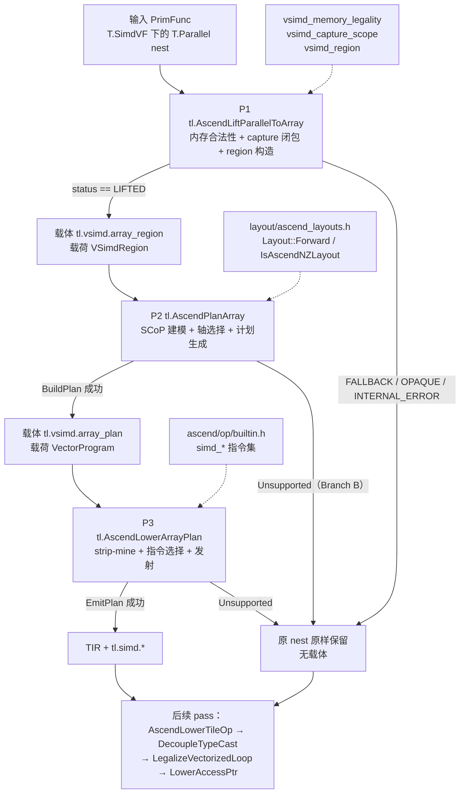
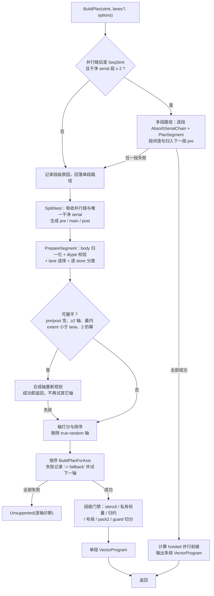
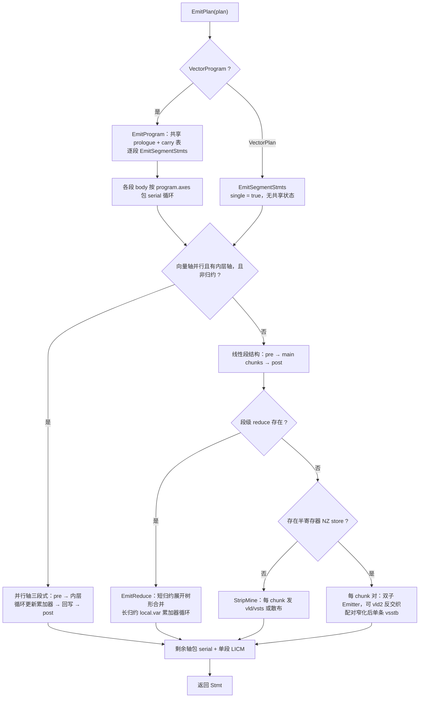
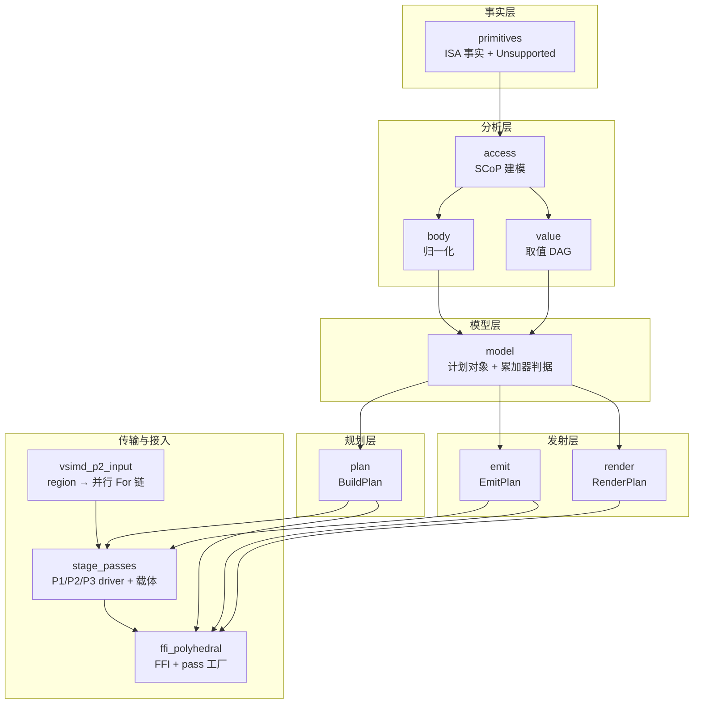
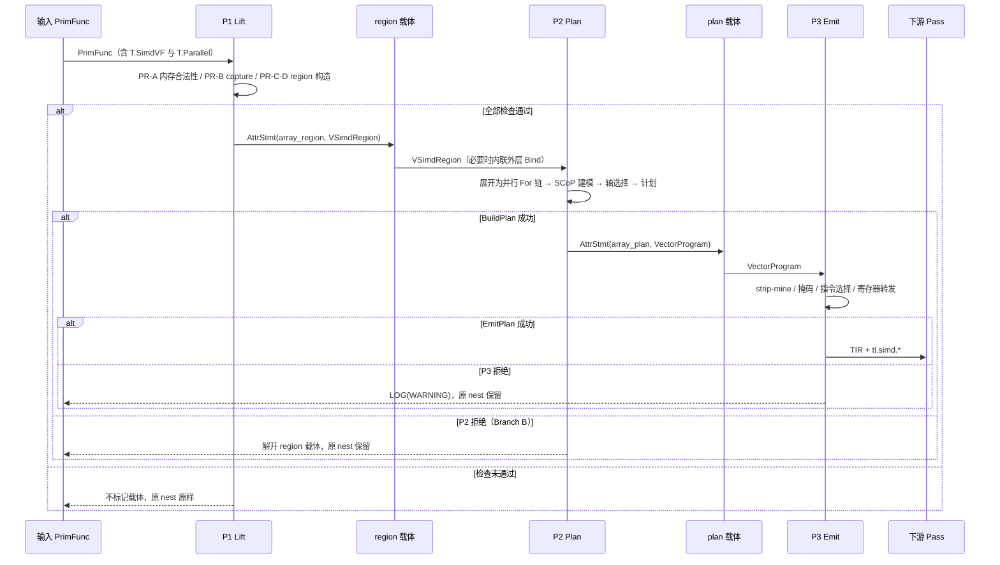

# Ascend `T.Parallel` 向量化 P2/P3 设计—实现方案（汇报稿）

| 项目 | 内容 |
| --- | --- |
| 文档名称 | P2/P3 现有落地实践梳理与设计—实现方案 |
| 版本 | V1.0 |
| 日期 | 2026-10-30 |
| 适用场景 | 内部正式汇报、方案评审、后续迭代基线 |
| 范围 | `src/ascend/transform/polyhedral/`（P2/P3 实现）、三阶段 pass 接入、P1→P2→P3 协同、配套测试 |
| 代码基线 | 分支 `p2_p3_based_stable-parallel`，提交 `6d46c9bf fix: vcvt narrowing`（功能提交 `ce363f57 feat: add p2, p3`） |
| 详细实现索引 | [p2_p3_cpp_port_survey.md](p2_p3_cpp_port_survey.md)（逐文件、逐函数、逐分支） |

**数据口径与表述边界（重要）**

1. 本文所有数字均来自当前工作树的静态清点（文件行数、测试函数数、拒绝点数量），不含推算值。
2. 本模块是编译器的前端 pass，不存在服务端“线上流量”“灰度百分比”“QPS”等概念。本文中的“上线”指**合入默认编译流水线**，“运行指标”指**编译期可观测指标**；未接入的指标明确标注“未聚合”，不以旧基线或估计值替代。
3. 本次未在当前工作树执行测试套件（本机 `import tilelang` 指向不含本目录的另一工作树），因此本文**不声明通过率**，只说明验证机制、用例规模与执行命令。
4. 文中“已落地”仅指代码与流水线现状；“待优化项”指已识别的现存问题，尚未修复，不作为已完成能力对外表述。

---

## 0. 执行摘要

1. **P2/P3 已完成 C++ 化并接入默认流水线**：`pipeline.py:124` 无条件执行组合 pass `AscendPolyhedralVectorize`，
   原 legacy 降级 pass 已在 `pipeline.py:125` 停用，`T.Parallel` 目前只有这一条降级路径。
2. **三阶段通过两个 IR 载体解耦**：P1 产出 `tl.vsimd.array_region`（`VSimdRegion`），P2 产出
   `tl.vsimd.array_plan`（`VectorProgram`），P3 消费计划并发射 `tl.simd.*`；任一阶段拒绝都保留原 nest，
   不产生半成品 IR。
3. **能力面已覆盖到“窄化 + NZ 直写 + 配对打包”**：从基础 copy/broadcast/branch，到归约、展平、索引向量、
   serial 吸收、多段 program、混合元素宽度、NZ 目标直写与 FA softmax 闭环，均有对应实现与离线结构测试。
4. **质量保障以“可解释拒绝 + 离线结构断言”为核心**：统一拒绝类型 `Unsupported` 携带逐轴诊断；
   测试文件 160 个测试函数（165 个 collected case），直接断言 plan 字段、发射指令序列与 pass 交接行为。
5. **当前处于“主线可用、局部收口”阶段**：已识别 4 项 P0 级待修复问题（初始化折叠写丢失、零次迭代越界、
   pack2 内层轴契约缺口、pre/post 绕过段级门禁）与一组结构性/冗余问题，修复路径见第 5 章。

---

## 1. 项目概述

### 1.1 业务背景

Ascend 后端需要在 `T.SimdVF` 语义域内，把 `T.Parallel` 描述的逐元素/归约/搬运类循环降级为
Ascend SIMD 指令（`vld/vsts/vgather2/vscatter/vcadd/vsstb/...`）。历史实现由
`AscendSimdVFLowerParallel` 承担，存在两个结构性问题：

- **能力与实现耦合**：指令选择与循环分析混在同一个 emitter 中，新增一种访问形态需要改多处模板匹配；
- **失败不可解释**：不支持的形态缺少统一诊断，难以判断是“不该向量化”还是“能力未覆盖”。

P1（区域分析）落地后，团队将 P2（规划）与 P3（发射）拆成独立阶段，并以“先证明、再发射”的方式重建整条链路。
当前代码即该方案的落地结果。

### 1.2 当前落地阶段

| 维度 | 现状 | 佐证 |
| --- | --- | --- |
| 实现语言 | P1/P2/P3 全部 C++；Python 仅保留 FFI 门面 | `src/ascend/transform/polyhedral/`、`tilelang/ascend/analysis/polyhedral/_cpp.py` |
| 流水线接入 | 组合 pass 已无条件接入默认流水线；legacy pass 已停用 | `tilelang/ascend/pipeline.py:120-126` |
| 交付形态 | 4 个 pass 入口（P1 / P2 / P3 / 组合）+ 12 个 FFI 入口 | `tilelang/ascend/transform/__init__.py:60,193,204,214,219` |
| 能力覆盖 | 基础向量化 → 归约/展平/索引向量 → serial 吸收/多段 → 混合宽度 → NZ 直写 → 窄化+NZ 配对 → FA 闭环 | 第 2.3、3.3 节 |
| 质量阶段 | 能力面已打开，进入缺陷收口与结构治理阶段（4 项 P0 待修复） | 第 5.2 节 |
| 分支状态 | `p2_p3_based_stable-parallel`，领先远端 1 个提交 | `git status` / `git log` |

### 1.3 核心业务目标

1. **单一降级路径**：用一条可解释、可测试的链路替换历史 emitter，避免“双实现语义漂移”。
2. **覆盖面可证明**：以访存偏移的有限差分 Δ 为唯一判据，覆盖连续、广播、步长、置换、分片、间接六类访问。
3. **拒绝可解释**：任何不可向量化的 nest 都给出可定位的原因与逐轴诊断，而不是静默降级为标量或错发指令。
4. **能力可增量**：新能力（NZ 直写、混合宽度、配对打包）以“严格条件 + 默认零差异”的方式逐级放开。

### 1.4 实际产出价值

| 价值 | 说明 | 佐证 |
| --- | --- | --- |
| 语义收敛 | `T.Parallel` 只有一个消费者，失败即保留原 IR，不存在两套发射器结果不一致 | `pipeline.py:124-125` |
| 指令级可控 | P2 输出与指令无关的计划，P3 只做指令选择，新增形态可分别验证 | `plan.h:1-8`、`emit.h:1-8` |
| 可测试性 | 计划字段与指令序列均可离线断言，无需设备执行 | 第 2.4 节 |
| 性能前置条件 | NZ 目标寄存器直写（`vsstb`）省去 ND 暂存；混合宽度用 `PK_*` 打包写；窄化+NZ 用配对形态一次写满寄存器 | 第 3.3 节 |
| 迁移风险控制 | plan 对象字段与 Python 原实现同名，测试零改写；参考实现隔离为 oracle | 第 2.2 节决策 4、5 |

### 1.5 总体架构



### 1.6 核心数据总览

| 指标 | 数值 | 口径 |
| --- | ---: | --- |
| 实现文件数 | 21（10 头文件 + 11 实现） | `src/ascend/transform/polyhedral` |
| 实现总行数 | 8332（头 1234 / 实现 7098） | `wc -l` |
| 最大三文件 | `emit.cc` 2340、`plan.cc` 1967、`value.cc` 861，合计 62.0% | 同上 |
| 注册 pass | 4（P1、P2、P3、组合） | `transform/__init__.py` |
| 阶段载体 | 2（region、plan） | `stage_passes.h:37-39` |
| FFI 反射对象 | 9（8 个 plan 对象 + 1 个 region 载体） | `model.cc:143-152`、`stage_passes.cc:286` |
| FFI 全局入口 | 12 | `ffi_polyhedral.cc:202-224`、`vsimd_p2_input.cc:213-217` |
| 显式拒绝点 | 73 处 `throw Unsupported` | plan 47、value 9、emit 9、body 5、primitives 2、access 1 |
| 契约断言 | 10 处 `ICHECK` | 计划/入口类型不变量 |
| 回归用例 | 160 个测试函数 / 165 个 collected case | `test_ascend_polyhedral_vectorize.py` |
| 测试文件行数 | 4481 | 同上 |

---

## 2. P2 现有全流程实现梳理

### 2.1 需求输入与设计评审规范

#### 2.1.1 输入形态（需求的“准入规格”）

P2 的输入是单个 `tirx::Stmt`（在线路径由 P1 的 region 反向展开得到），其准入规格在代码中固化为：

| 准入项 | 规格 | 违反后的行为 |
| --- | --- | --- |
| 迭代域 | 至少一层 `T.Parallel`；`AbsorbParallelChain` 只吸收起始连续的并行链 | `Unsupported("no T.Parallel axis found")` |
| 循环下界 | 每层 `min` 必须可证为 0 | `Unsupported("... must start at 0 ...")` |
| 直接内嵌 serial | 仅当 `SerialIsClean`（无循环携带依赖、同 buffer 多写必须同址、跨迭代读必须同址）才吸收为候选轴 | 不吸收，保留“nested serial loop”拒绝 |
| body 形态 | `SeqStmt`、`BufferStore`、单臂 `if`（谓词化）、同址双臂 `if`（`if_then_else`）、`Bind` 别名 | 其它形态显式拒绝；非原子 `Evaluate` 当前被丢弃（已知边界，见 5.2） |
| 原子操作 | 不支持 | `Unsupported("atomic op ...")` |
| 内存域 | 不支持 GM 操作数 | `Unsupported("global-memory operand ...")` |
| 元素类型 | 必须可推导 mask 宽度；`bool` 不支持 | build 期 `Unsupported` |
| 布局上下文 | `PlanOptions.layouts` 决定 ND / NZ 目标形态 | 无显式布局即 ND（历史行为） |

#### 2.1.2 设计评审依据

评审不依赖口头约定，而是以“文档 + 代码契约 + 测试”三重依据进行：

| 评审对象 | 依据 | 作用 |
| --- | --- | --- |
| 阶段职责与接口 | `p1_p2_p3_integration_plan.md` | 三阶段数据流、载体字段、职责边界 |
| C++ 化设计 | `p2_p3_cpp_design.md`、`p2_p3_cpp_port_plan.md` | 对象模型、FFI 字段、迁移步骤 |
| 拒绝点目录 | `p2_unsupported_catalog.md`（原型期整理，当前 C++ 侧以 `throw Unsupported` 现场文本为准，共 73 处） | 拒绝措辞与触发期，测试按此前缀匹配 |
| 当前实现事实 | `p2_p3_cpp_port_survey.md` | 逐阶段入参/出参/边界/异常，与本报告配套 |
| 代码契约 | `primitives.h`（唯一拒绝类型）、`model.h`（FFI 字段）、`plan.h`（BuildPlan 签名） | 评审时可直接对照 |
| 回归契约 | `test_ascend_polyhedral_vectorize.py` | 160 个测试函数（165 collected）锁定行为，不允许“改写式通过” |

评审通过的最低标准（当前实际执行口径）：

1. 新增能力必须有对应的 plan 字段或发射形态断言，且不改变既有用例的期望；
2. 任何新拒绝必须先落在 `Unsupported`（禁止 `LOG(FATAL)` 或静默丢弃）；
3. 新增 FFI 字段必须保持与 Python 侧读取名一致（测试直接访问 `program.segments[0].stores[0].value.recipe` 一类路径）；
4. 默认路径（无显式布局、无新形态）必须保持零差异。

### 2.2 技术架构选型决策

| 决策 | 备选 | 选择 | 依据 | 代价 |
| --- | --- | --- | --- | --- |
| 实现语言 | 继续 Python / C++ 重写 | C++ | 计划对象需作为 TVM FFI 对象在 pass 间传递；避免 Python 对象跨 pass 生命周期问题 | 开发与调试成本上升 |
| 中间表示 | 直接发射 TIR / 先出指令无关计划 | 先出 `VectorProgram` | 规划与指令选择可分别测试；同一计划可被 `render_plan` 审阅 | 多一层对象模型与字段契约 |
| 判定模型 | 代码模板匹配 / 访存偏移差分 | 有限差分 Δ(offset) | 连续、广播、步长、置换、分片、间接可统一判定，且可证明 | 依赖 `arith::Analyzer` 的化简能力 |
| 失败模型 | 静默降级 / 抛异常终止 / 统一拒绝类型 | `Unsupported` + 诊断列表 | 上层可区分“不该向量化”和“能力未覆盖”；测试可按措辞回归 | 每条拒绝都要维护措辞 |
| 阶段拆分 | 单 pass 完成 / 三阶段 + 载体 | 三阶段 + 两个 AttrStmt 载体 | 可单独运行、可幂等、失败保留原 IR | 需要维护载体协议与两处兜底逻辑 |
| 布局决策 | 硬编码 NZ 块步长 / 由布局前向映射推导 | `Layout::Forward` 推导 | 支持 compact NZ 与 canonical NZ 两种布局，不随布局变化失效 | 依赖布局模块的稳定性 |
| 混合宽度 | 拒绝 / 统一转 f32 / 按实际产出 lane 选 chunk | 取最小有效 lane + `store_lane_mode` | 支持 FA softmax 的 f32+bf16 同段形态 | 需要 `PK_*` 打包写与配套校验 |
| 窄化 + NZ | 拒绝 / 先写 ND 再转换 / 配对成满寄存器 | 配对（`vld2` + `vcvt` part + `vor` + `vsstb`） | `vsstb` 无 PK 变体，半寄存器无法正确散射 | 实现复杂度与条件约束较多 |

> 判定模型是 P2 的核心，展开分析与示例见附录 E。

### 2.3 核心功能模块实现逻辑

| 子模块 | 输入 | 输出 | 关键函数 | 职责 |
| --- | --- | --- | --- | --- |
| 访存建模 `access` | buffer + 下标 + 轴集合 | `AccessInfo` + 逐轴分类 | `ClassifyAccess`、`FiniteDifference`、`ClassifyDelta` | 线性化偏移、Δ 分类、索引向量可构造性判定 |
| body 归一化 `body` | nest body | 有序 `StoreSpec` | `NormalizeBodyInto`、`CollectAliases` | 展开 SeqStmt、单臂 if 谓词化、同址双臂 if 合并、别名内联 |
| 取值 DAG `value` | 标量表达式 + 上下文 | `ValueNode` | `BuildValue`、`LoadNode`、`GuardFreeBounds` | 逐 lane 取值、装载守卫、索引向量、广播与标量-向量折叠 |
| 计划模型 `model` | spec + access + value | `StorePlan` / `VectorPlan` / `VectorProgram` | `MakeStorePlan`、`AccumulatorCandidate` | FFI 对象构造与累加器判据 |
| nest 切分 `plan` | 原始 Stmt | 轴 + pre/main/post | `SplitNest`、`SerialIsClean`、`AbsorbSerialChain` | 吸收干净 serial、识别 pre/post |
| 多段规划 `plan` | SeqStmt（≥2 个干净 serial） | `VectorProgram`（多段） | `TryBuildProgram` | 段划分、hoisted 前缀、段级失败原因保留 |
| lane 选择 `plan` | pre/main/post specs | 段宽 + 每 store 的 lane 模式 | `SelectSegmentLanes`、`ValidatePartialLaneSegment` | 混合宽度约束与打包模式判定 |
| 展平通道 `plan` | 轴集合 + body | 合成轴或拒绝原因 | `FlattenAxes`、`TryFlatten` | 2 的幂 extent 链合成满 lane 连续轴 |
| 轴打分 `plan` | store/load 分类 | 有序候选轴 | `RankVectorAxes`、`AxisScore` | 剔除 true-random，按权重与活跃 lane 稳定排序 |
| 单轴规划 `plan` | 轴 + specs + options | `VectorPlan` | `BuildPlanForAxis` | 逐 store 建计划、stencil/私有标量/归约门禁 |
| 归约 `plan` | lane-uniform 写 + 变化取值 | `ReduceInfo` | `ClassifyReduce`、`PlanReduce`、`StripReduce` | 识别 `dst = dst op x`，剥离旧值，选择配方 |
| 布局 `plan` | `PlanOptions.layouts` | `layout_kind` + 块步长 | `ClassifyStoreLayout`、`PhysicalOffset` | ND/NZ 判定与块步长推导 |
| 打包校验 `plan` | 含 `pk_half` NZ 的段 | 通过或拒绝 | `ValidatePackedNzSegment` | 配对形态的段级契约 |

P2 主流程（报告视图）：



关键判定规则（当前实现口径）：

| 规则 | 内容 |
| --- | --- |
| Δ 分类 | 0 → uniform，1 → contiguous，-1 → permute，±k → strided，非常量 → piecewise；索引向量不可构造时升级为 true_random |
| 轴打分 | `score = (100×store 权重 + 10×load 权重) × min(extent, lanes)/lanes + axis.index`，`stable_sort` 降序 |
| 展平门禁 | 写侧必须全部 contiguous；读侧只允许 contiguous/uniform；同一 buffer 多写、写后读均拒绝 |
| 归约判据 | 目的地址沿轴 uniform、取值沿轴变化、旧值在累加位恰好出现一次；Add/Max/Min 之外拒绝 |
| 私有标量 | 沿并行轴必须可提升为 `local.var` 向量累加器，否则拒绝 |
| stencil | 沿向量轴对同 buffer 跨址读 → 拒绝，避免读到标量序下不同的元素 |
| guard 切分 | 收集谓词/装载守卫的免判区间；内部切点超过 6 个时整体放弃切分 |

### 2.4 测试验证流程

验证采用“离线结构断言”，不依赖 PTOAS、Bisheng 或设备执行：

| 层级 | 验证对象 | 代表用例 | 断言方式 |
| --- | --- | --- | --- |
| L1 数学核心 | Δ 与分类 | `test_finite_difference_*` | 直接比较 `(AccessClass, stride)` |
| L2 计划契约 | plan 字段（轴、lane、chunk、store 形态、归约） | `test_copy`、`test_reduction_detected`、`test_mixed_width_segment_uses_min_lane_width` | 读取 `VectorProgram` / `VectorPlan` / `StorePlan` 字段 |
| L3 发射结构 | `tl.simd.*` 指令序列与循环形态 | `test_copy`、`test_half_register_nz_store_is_paired_into_a_full_register` | 收集 op 名与实参、检查 `For` 种类与 extent |
| L4 pass 交接 | 载体、幂等、被拒 nest 不变 | `test_staged_passes_exchange_carriers`、`test_passes_are_idempotent`、`test_rejected_nests_fall_through_every_stage` | `AttrStmt` 计数 + `structural_equal` |
| L5 流水线接入 | 默认 PassContext 下运行并产出 SIMD | `test_pipeline_vectorizes_by_default` | 记录 pass 构造次数 + 设备源码含 `simd_inst::` |
| L6 P1→P2 交付 | LIFTED 的 `stmt` 可规划且与直接规划一致 | `test_p1_lift_contract_1d`、`test_p1_stmt_plans_like_the_original_nest` | `render_plan` 文本 + `structural_equal` |
| L7 缺陷回归 | D1-D13 / R1-R7 场景 | `test_defect_*`、`test_parallel_axis_reduction_with_non_uniform_pre_falls_back` | 契约型断言（拒绝或正确形态二选一） |

流程与开关：

1. 用例构造 TileLang IR → 取最外层 `T.Parallel` → `build_plan` / `emit_plan` / `vectorize_parallel_nests`；
2. 需要看中间产物时设置 `TL_POLYHEDRAL_DUMP_IR=1`，会打印 plan 渲染与向量化 IR；
3. 交付前执行全文件回归，并额外跑 P1 三套回归（capture scope / memory legality / region）确认上游未受影响。

### 2.5 上线发布机制

本模块的“发布”是编译流水线接入，不涉及服务发布：

| 环节 | 现行机制 | 佐证 |
| --- | --- | --- |
| pass 注册 | `MakeStagePass` 统一包装为 PrimFunc pass | `ffi_polyhedral.cc:88-95` |
| 流水线位置 | `NormalizeBufferVersion` 之后、`AscendLowerTileOp` 之前 | `pipeline.py:120-126` |
| 开关策略 | 无 feature flag，默认执行 | `pipeline.py:124` |
| 失败策略 | 不中断编译；P2/P3 拒绝时保留原 nest | `stage_passes.cc:207-215`、`228-233` |
| 分阶段验证 | P1/P2/P3 可单独作为 pass 运行（也是排障手段） | `transform/__init__.py:193/204/214` |
| 回滚方式 | 从流水线移除组合 pass 一行，并按需恢复 legacy pass 一行；无数据迁移 | `pipeline.py:124-125` |
| 幂等性 | 已存在任一载体时 P1 不再叠加；组合 pass 二次运行结构不变 | `stage_passes.cc:255-258`、测试 4407 |

### 2.6 当前运行核心指标（编译期口径）

| 指标 | 口径 | 当前值 / 状态 | 数据来源 |
| --- | --- | ---: | --- |
| 代码规模 | 目录总行数 | 8332 | `wc -l` |
| 拒绝点密度 | `throw Unsupported` 数量 | 73 | 静态扫描 |
| 契约断言 | `ICHECK` 数量 | 10 | 静态扫描 |
| FFI 对象 / 入口 | 反射类型 / 全局函数 | 9 / 12 | 注册代码 |
| 回归用例 | 测试函数 / 展开用例 | 160 / 165 | 测试文件 |
| 计划诊断覆盖率 | 每次成功规划是否附带逐轴诊断 | 是（单段与多段均有） | `plan.cc:1718-1721`、`1970-1998` |
| 拒绝原因可读性 | 是否携带 diagnostics 列表 | 是 | `primitives.h:38-51` |
| 编译耗时（单 nest） | `plan+emit` | 未复测，不作结论 | — |
| 运行时性能 | 生成 kernel 的指标 | 不在本模块度量范围 | — |
| 线上拒绝率聚合 | 按诊断类型统计 | 未接入（仅逐次 `LOG(WARNING)` / diagnostics） | — |

> 说明：本模块是编译期组件，“线上运行”指默认流水线下的编译行为。当前没有指标上报与聚合看板，
> 因此不提供“拒绝率”“平均耗时”等未经采集的数字。

---

## 3. P3 现有全流程实现梳理

### 3.1 设计阶段流程标准

P3 的设计约束在实现中固化为以下标准：

| 标准 | 内容 | 佐证 |
| --- | --- | --- |
| 只读计划 | 发射不修改 plan；同一 plan 可重复发射 | `emit.h:16-22` |
| 只做指令选择 | P3 不重新决策轴、lane、归约、布局；这些在 P2 已定 | `plan.h:5-8` |
| P2 成功即 P3 成功 | 默认不变量；已知两处例外（零次迭代、pack2 内层轴），见 5.2 | `stage_passes.cc:228-233` |
| 命名稳定 | `v{prefix}{n}`、`mask{prefix}{bits}`、`lane0{prefix}{bits}`、`ramp_{stride}`、`acc{prefix}{n}`、`chunk` / `chunk_s{i}` | `emit.cc:623-628`、`658-690`、`951-952`、`1967-1970`、`2301` |
| 掩码分层 | 全 lane 掩码、单 lane 掩码、尾块掩码、用户谓词、装载守卫各自独立，按需合取 | `emit.cc:654-764` |
| 结构可预测 | 静态 extent 走 strip-mine；符号 extent 走运行期主循环 + 直线尾块 | `emit.cc:1480-1557` |

### 3.2 技术方案选型细节

| 主题 | 方案 | 选择理由 |
| --- | --- | --- |
| 循环剥离 | 统一 `StripMine`：单 chunk 直线化、多 chunk 切段、尾块直线展开、符号 extent 运行期循环 | 覆盖静态/符号/尾块/guard 切分四种形态，避免每处重复写循环 |
| 掩码 | `pset` + `update_mask` + `pand/por/pnot`，谓词宽度跟随数据元素宽度 | 避免固定 b32 掩码截断 f16/int8 的 lane |
| 归约 | `chunks ≤ 4` 编译期展开 + 树形合并；`> 4` 或符号 extent 用 `local.var` 累加器循环 | 短归约降关键路径，长归约避免代码膨胀 |
| 尾块归约 | Add 直接把尾块掩码交给 `vcadd`；Max/Min 先用单位元 `vsel` 填充 | `MODE_ZEROING` 对 Add 等价于 0 单位元，Max/Min 需要显式单位元 |
| 值提升 | `local.var` 向量累加器 + LICM（循环不变量绑定外提） | 私有标量/读改写沿并行轴向量化时避免每轮访存 |
| 段间直通 | `ProgramPrologue` 共享掩码/斜坡；`carry` 表传递单 chunk 段的寄存器结果 | 多段 program 避免重复 `pset`/`vci`/`vld` |
| NZ 写 | `vsstb` 直接按 32B 块步长散射 | 省去 ND 暂存与二次搬运 |
| 混合宽度写 | `PK_B{bits}` / `PK4_B{bits}` 打包写 | 一次 chunk 只写有效 lane，不越界 |
| 窄化 + NZ | `vld2` 反交织 → `vcvt` part0/part1 → `vor` 合满 → 单条 `vsstb` | `vsstb` 无 PK 变体，必须满寄存器散射 |
| 类型转换 | 集中 `Vcvt` 协议表（round/sat/part/mode） | 与已验证的 cast kernel 配方一致 |

### 3.3 核心能力实现逻辑

P3 发射主流程（报告视图）：



能力与发射形态对照：

| 能力 | 触发条件 | 发射形态 |
| --- | --- | --- |
| 连续/广播写 | store 沿向量轴 Δ=1 / Δ=0 | `vsts(NORM)` / `vsts(ONEPT)` |
| 步长/置换/分片/间接写 | 索引向量可构造 | `vscatter`（正步长走 ramp，其它走索引向量） |
| 连续/步长/间接读 | 访问分类 | `vld` / `vgather2(ramp)` / `vgather2(index)` |
| 分支 | 同址 if/else → `vsel`；单臂 if → 谓词化 store | `vcmp/vcmps` + `vsel` / 掩码写 |
| 归约 | Add/Max/Min 累加式 | `vcadd/vcmax/vcmin` + `ONEPT` 回写 |
| 混合宽度 | 窄化 cast 且整 chunk | `vcvt(PART_EVEN)` + `PK_B{bits}` |
| NZ 目标 | 显式 NZ 布局且整块 | `vsstb`，步长 `(block << 16) 或 elem` |
| 窄化 + NZ | 唯一 `pk_half` NZ 且段末 | `vld2` + `vcvt(EVEN/ODD)` + `vor` + 单条 `vsstb` |

> 窄化场景的反交织/交织优化与 store 的 ND→NZ 转换，展开分析见附录 F。

### 3.4 灰度发布策略

本项目不存在流量灰度；实际的“灰度”是**能力级灰度**：新形态只在严格条件下启用，默认路径保持零差异，
逐级验证后再扩大适用面。


| 灰度级别 | 放开条件 | 默认行为（未满足条件） | 验证用例 |
| --- | --- | --- | --- |
| 基线 ND | 无显式布局 | 连续 `vsts` | `test_nd_destination_keeps_the_contiguous_store` |
| NZ 直写 | buffer 显式标注且布局可识别 | 保持 ND 或拒绝该 nest | `test_compact_nz_store_*`、`test_canonical_nz_store_*` |
| 混合宽度 | 窄化且无 tail/谓词/兄弟语句 | 拒绝（不截断累加器、不越界写） | `test_mixed_width_*` |
| 窄化 + NZ | 唯一、段末、独占、整对 | 拒绝 | `test_half_register_nz_store_is_paired_into_a_full_register` |
| FA 闭环 | 实际 kernel 形状 | 不适用则保持原 nest | `test_parallel_fa_vectorizes_the_softmax_nest` |

### 3.5 线上运维监控机制

| 信号 | 触发点 | 用途 | 当前状态 |
| --- | --- | --- | --- |
| `LOG(WARNING)`：P1 region 展开失败 | `vsimd_p2_input.cc:188-193` | 识别 P1 内部不一致（编译器 bug，而非用户 IR） | 可用，逐次输出 |
| `LOG(WARNING)`：P3 拒绝已规划 nest | `stage_passes.cc:228-233` | 识别“P2 成功但 P3 失败”的契约缺口 | 可用，逐次输出 |
| `plan.diagnostics` | 每次成功规划 | 逐轴分类、选中轴、fallback、展平/guard 说明 | 可用，随计划携带 |
| `render_plan` | 任意 plan | 人类可读计划，用于评审与对拍 | 可用（测试 oracle） |
| `TL_POLYHEDRAL_DUMP_IR` | 测试运行 | 打印 plan 与发射 IR | 可用（默认关闭） |
| `ICHECK` | 计划/入口类型不变量 | 契约破坏时快速失败 | 可用（硬失败） |
| 指标聚合 / 看板 | — | 拒绝率、拒绝原因分布、耗时 | 未接入 |

---

## 4. P2 与 P3 的协同关系

### 4.1 职责边界

| 模块 | 负责 | 明确不做 |
| --- | --- | --- |
| P1 区域分析 | 内存合法性、capture/scope 闭包、矩形区域构造与自校验、布局上下文收集 | 不做轴选择、不做 lane 决策、不发射指令、不改写 nest |
| P2 规划 | 迭代域建模、轴排序与回退、lane/尾块、pre/post、归约、累加器提升、布局分类、pack2 契约 | 不发射任何 `T.simd.*`、不读原始 IR（只消费 P1 region） |
| P3 发射 | strip-mine、掩码、指令选择、寄存器转发/LICM、program 组装 | 不重新决策轴/lane/归约/布局，不修改 plan |
| 下游 pass | `AscendLowerTileOp`、类型解耦、向量循环合法化、`access_ptr` 下沉 | 不处理未标注的 `T.Parallel`（P3 拒绝后不会被兜底） |

### 4.2 依赖关系



依赖方向整体向下；需要说明的一处反向耦合是：传输层的 `vsimd_p2_input.h` 直接包含
`../vsimd_region.h` 与 `../vsimd_memory_legality.h`，使 `polyhedral/` 不能脱离 P1 独立编译（见 5.2）。

### 4.3 数据交互规则

| 交互 | 载体 / 对象 | 规则 |
| --- | --- | --- |
| P1 → P2 | `AttrStmt(tl.vsimd.array_region)`，载荷 `VSimdRegion` | P2 只使用 `region` 及其 `layouts/assumptions/bindings/shape_syms`；展开失败视为 P1 内部错误 |
| P2 → P3 | `AttrStmt(tl.vsimd.array_plan)`，载荷 `VectorProgram` | P3 只读；`program.axes` 必须是 `T.Parallel` 轴 |
| P2 → 调用方 | `VectorProgram{axes, segments, diagnostics}` | 恒返回 1..N 段；单段时 `axes` 只含向量轴之前的并行轴前缀 |
| 段级 | `VectorPlan{axes, vector_axis, lanes, chunks, tail, stores, pre_stores, post_stores, reduce, guard_boundaries, diagnostics}` | `chunks/tail` 为空表示符号 extent；`reduce` 是段级代表，逐 store 的 `reduce` 才是发射依据 |
| 写级 | `StorePlan{spec, access, value, mask, kind_value, index, reduce, promote, mask_free_until, mask_free_from, store_lanes, store_lane_mode, store_pack_bits, layout_kind, nz_block_stride}` | `kind_value` 为字符串，Python 侧 `.kind` 为派生属性 |
| 失败 | `Unsupported{message, diagnostics}` | P2/P3 都不吞异常；pass 层捕获后解载体、保留原 nest |

跨模块不变量（当前实际成立范围）：

1. `BuildPlan` 成功必然返回 1..N 段，不存在空 program；
2. P3 不修改 plan，重复发射结果一致；
3. P2 成功 ⇒ P3 成功，**除** 5.2 中 L2、L3 两处已识别缺口；
4. 任何阶段拒绝都不产生部分改写的 IR。

### 4.4 跨模块协作流程



### 4.5 协作加固点

| 加固点 | 现状 | 风险 |
| --- | --- | --- |
| Branch B | P1 放行、P2 拒绝是文档化结果（GM 操作数、bool store、非零下界等） | 会降低向量化覆盖率，但不会错发 |
| P3 拒绝无兜底 | legacy pass 已停用，拒绝后 nest 保持 `T.Parallel`，`AscendLowerTileOp` 只处理带布局注解的并行循环 | 该 nest 无后续消费者，属于“编译失败或保持未降级”的风险面 |
| pack2 契约不对称 | P3 有“向量轴必须最内”的门禁，P2 没有 | 可构造出 build 成功、emit 拒绝的计划（L3） |
| 段级校验集合不一致 | 部分校验只扫 `stores`，不含 `pre/post` | 窄化/NZ 的 pre/post 绕过门禁（L4） |

---

## 5. 现有实现的复盘总结

### 5.1 可复用经验

1. **用数学判据替代模板匹配**：以 Δ(offset) 统一判定连续/广播/步长/置换/分片/间接，新增形态不需要新模板，
   也让“为什么能向量化”可被证明与复述。
2. **规划与发射分离**：`VectorProgram` 作为唯一接口，使“选哪个轴”和“发哪条指令”可以分别评审、分别回归。
3. **单一拒绝类型 + 全量诊断**：`Unsupported(message, diagnostics)` 同时服务上层决策与测试回归，
   避免“静默降级”这类最难定位的问题。
4. **迁移期以字段同名换测试零改写**：FFI 反射字段与 Python 原 dataclass 同名，使 C++ 化过程中
   160 个用例可以原样作为验收标准。
5. **参考实现隔离为 oracle**：Python 参考实现迁到独立包且不被生产包导入，测试在运行时断言这一点，
   既保留对拍能力，又排除“偷偷回退 Python”的可能。
6. **失败保留原 IR 的 fail-safe**：三阶段都遵循“不能处理就原样解开”，避免产生半成品 IR；
   同时配合可单独运行的阶段 pass，定位问题时可以逐段观察。
7. **能力级灰度**：新形态只在显式条件满足时启用（NZ 需布局标注、混宽需窄化且整 chunk、pack2 需唯一段末），
   默认路径零差异，降低回归风险。

### 5.2 待优化问题

正确性与契约（已识别，尚未修复）：

| ID | 级别 | 问题 | 影响 | 位置 |
| --- | --- | --- | --- | --- |
| L1 | P0 正确性 | 归约初始化折叠时 `CopyOnWrite` 写丢失：`accumulate` 仍为 true，但 pre 初始化写已被删除 | 结果会多并入一份旧目的值 | `plan.cc:919-945` |
| L2 | P0 稳定性 | 零次迭代（`extent == 0`）计划在发射期对空语句序列取下标 | 越界访问/崩溃，而非拒绝 | `emit.cc:1541-1549`、`2323-2336` |
| L3 | P0 契约 | pack2 内层轴：P2 缺门禁、P3 明确拒绝 | 违反“P2 成功即 P3 成功” | `plan.cc:1291-1331`、`emit.cc:1758-1762` |
| L4 | P0 边界 | `SelectSegmentLanes`、partial-lane、NZ、pack2 校验只扫 `stores`，不含 `pre/post` | pre/post 可绕过宽度/布局门禁 | `plan.cc:811-815`、`1203-1207`、`1272-1277`、`1294` |
| L5 | P1 语义 | body 归一化对非原子 `Evaluate` 静默丢弃 | 离线 `build_plan` 调用方会丢副作用 | `body.cc:90-98` |
| L9 | P2 契约 | int16/uint16 `vcadd` 累加路径中累加器与旧值向量类型不一致 | 该路径无测试，可能发射期失败 | `emit.cc:215-227`、`1864-1893` |

结构性问题：

| ID | 问题 | 影响 |
| --- | --- | --- |
| D1 | `emit.cc` 2340 行、`Emitter` 约 30 个成员（17 个缓存/语句容器） | 评审与增量编译成本高 |
| D2 | `plan.cc` 1967 行、约 40 个自由函数，混合 5 类职责 | 策略与硬约束混在一起，定位困难 |
| D3 | 传输层反向依赖 P1 头文件 | `polyhedral/` 无法独立编译/单测 |
| D4 | region 载体 FFI 类型私有在 `.cc` | 载体协议不可复用、不可独立测试 |
| D5 | 双 driver（离线 pre-order 与三段 pass） | 两条路径需人工保持语义一致 |
| D6 | `PlanOptions` 的 `assumptions/bindings/shape_syms` 只写不读 | 死接口，误导调用方 |
| D7 | `EmitPlan/RenderPlan` 以 `ObjectRef` 运行期分发 | 类型不安全，只有 `ICHECK` 兜底 |
| D11 | `vcvt` 协议与 `dist → extent` 规则写在发射层 | 与“事实只在 primitives”的项目约定冲突 |

冗余项（择要）：

| ID | 冗余 | 位置 |
| --- | --- | --- |
| R1 | Python 风格列表打印两份 | `plan.cc:31-37`、`render.cc:31-35` |
| R2 | Bind 别名内联两份 | `body.cc:59-73`、`vsimd_p2_input.cc:118-150` |
| R3 | “lane-uniform 装载不可谓词化”错误文本两份 | `value.cc:520-524`、`819-822` |
| R6 | `EmitParallelAxisParts` 第一轮 `loop_pre` 为死写 | `emit.cc:2072-2088` |
| R8 | 4 个未被调用的导出 API（`MakeValue`、`Broadcast`、`ElemDataType`、`PrintStmt`） | `value.*`、`primitives.*` |
| R13 | `dist` 语义靠字符串前缀判断 | `emit.cc:60-86` |

### 5.3 后续迭代方向

| 阶段 | 目标 | 主要工作 | 验收标准 |
| --- | --- | --- | --- |
| 一、正确性收口 | 消除 4 项 P0 风险 | 修复 L1 的写回路径；拒绝零次迭代或显式处理空 body；补 pack2 内层轴门禁；段级校验纳入 pre/post；补 L5/L9 | 新增回归用例全部通过；既有 160 个测试函数期望不变；build 成功⇒emit 成功在补测范围内成立 |
| 二、冗余清理与事实归位 | 降低理解与评审成本 | 删除死 API/死字段/死分支；统一列表打印、别名内联、零值判据；把 `vcvt` 协议与 `dist → extent` 迁到事实层 | 净减代码；无行为差异（结构等价 + 用例不变） |
| 三、大文件拆分 | 单文件可在一屏内建立上下文 | `emit.cc` 拆为 internal 头 + value/store/segment/reduce/pack 五个实现；`plan.cc` 拆为 nest/lane/axis/flatten/reduce/layout/store/program 八个实现 | 每个新文件不超过约 700 行；无逻辑改动 |
| 四、分层与接口重构 | `polyhedral/` 成为独立 P2/P3 库 | 传输层迁出；`EmitPlan/RenderPlan` 增加类型化重载；热点枚举去字符串化；开放只读诊断 FFI 供单测 | `polyhedral/` 不依赖 `../vsimd_*`；现有 160 用例零改写 |
| 五、测试与评审机制 | 防止同类缺陷复发 | 随机仿射 nest 的 property test；单文件/单函数行数检查；评审按“入参-出参-边界表”核对 | 新增缺陷类型可被 property test 捕获；评审清单固化 |

### 5.4 汇报结论

P2/P3 已完成从“原型验证”到“默认流水线唯一路径”的落地：三阶段解耦清晰、计划对象可测试、
拒绝可解释，能力面已覆盖到 NZ 直写与窄化配对。当前的主要矛盾不再是“能不能向量化”，
而是“边界是否闭合、结构是否可维护”。建议按第 5.3 节的顺序推进：先收口 4 项 P0 正确性风险，
再做冗余清理与大文件拆分，最后完成分层与测试机制建设；每一步都以既有 160 个用例零改写为前提。

---

## 6. 附录

### A. 术语表

| 术语 | 含义 |
| --- | --- |
| P1 | 区域分析阶段：判定 nest 的内存合法性与 capture 闭包，产出 `VSimdRegion` |
| P2 | 规划阶段：把 nest 建模为 SCoP，产出与指令无关的 `VectorProgram` |
| P3 | 发射阶段：把计划降级为 `tl.simd.*` TIR |
| Branch B | P1 放行但 P2 拒绝的文档化结果 |
| lane | 一个向量寄存器可容纳的元素个数（如 f32 为 64） |
| chunk | 一次 strip-mine 迭代覆盖的 lane 组 |
| ND / NZ | 连续布局 / Ascend 分形块布局 |
| pack2 | 窄化 + NZ 场景下把两个 chunk 配对成满寄存器的发射形态 |
| carry | 多段 program 之间的寄存器直通 |

### B. 指标口径与数据来源

| 指标 | 口径 | 采集方式 |
| --- | --- | --- |
| 文件数/行数 | `src/ascend/transform/polyhedral` 下 `.h` 与 `.cc` | `wc -l` |
| 拒绝点 | `throw Unsupported(` 出现次数 | 静态扫描（不含 `ICHECK`） |
| 回归用例 | 测试文件中 `def test_` 与 parametrize 展开 | 测试文件 |
| 诊断覆盖 | 成功计划是否携带 `diagnostics` | 读取 plan 字段 |
| 编译耗时 | 单 nest `plan+emit` | 当前未复测，本文不引用旧基线 |
| 运行时性能 | 生成 kernel | 不属于本模块度量范围 |

### C. 关联文档

- [p2_p3_cpp_port_survey.md](p2_p3_cpp_port_survey.md)：逐文件、逐函数、逐分支的实现调研（本报告的详细索引）
- [p1_p2_p3_integration_plan.md](p1_p2_p3_integration_plan.md)：三阶段数据流与载体设计
- [p2_p3_cpp_design.md](p2_p3_cpp_design.md)：C++ 对象模型与 FFI 设计
- [p2_p3_cpp_port_plan.md](p2_p3_cpp_port_plan.md)：迁移阶段划分
- [p2_unsupported_catalog.md](p2_unsupported_catalog.md)：原型期拒绝点目录（当前实现以代码中的 73 处 `Unsupported` 为准）
- [p1_vsimd_internel.md](p1_vsimd_internel.md)：P1 内部结构

### D. 验证命令

```bash
# P2/P3 场景 + P1 交付 + 三段 pass + 流水线接入（160 个测试函数）
python -m pytest testing/ascend/transform/test_ascend_polyhedral_vectorize.py -q

# 打印每个用例的 plan 渲染与发射 IR
TL_POLYHEDRAL_DUMP_IR=1 python -m pytest \
  testing/ascend/transform/test_ascend_polyhedral_vectorize.py -q -s

# P1 上游回归
python -m pytest testing/ascend/transform/test_ascend_vsimd_capture_scope.py \
  testing/ascend/transform/test_ascend_vsimd_memory_legality.py \
  testing/ascend/transform/test_ascend_vsimd_region.py -q

# 只跑 P1→P2 交付契约 / NZ 与 pack2
python -m pytest testing/ascend/transform/test_ascend_polyhedral_vectorize.py -q -k "p1_"
python -m pytest testing/ascend/transform/test_ascend_polyhedral_vectorize.py -q -k "nz or paired"
```

> 执行前请确认 `python -c "import tilelang; print(tilelang.__file__)"` 指向包含
> `src/ascend/transform/polyhedral` 的工作树；否则相关 FFI 符号不存在。

### E. 专项分析：P2 核心判定模型 —— 有限差分 Δ(offset)

#### E.1 模型定义

把 nest 建模为：

- 迭代域 `D = { 0 ≤ x_k < E_k }`；
- 访存函数 `off(x) = elem_offset + Σ_d idx_d(x) · stride_d`（`stride` 缺省用紧凑行主序推导）；
- 沿候选轴 `v` 的一阶前向差分：

```text
Δ_v(off) = Simplify( off[x_v := x_v + 1] − off )
```

实现链（`access.cc`）：

| 步骤 | 函数 | 说明 |
| --- | --- | --- |
| 线性化 | `LinearElementOffset`（109-123） | `elem_offset + Σ idx_d * stride_d`，缺省 stride 由 `CompactStrides` 生成 |
| 求差分 | `FiniteDifference`（125-135） | 用 `tirx::Substitute` 把 `x_v` 替换为 `x_v + 1`，相减后 `Simplify` |
| 判常数 | `ConstInt`（83-98） | 先看字面量，再 `Simplify`，最后用 `const_int_bound` 的上下界相等证明常量 |
| 分类 | `ClassifyDelta`（137-144） | `0 → UNIFORM`、`1 → CONTIGUOUS`、`-1 → PERMUTE`、其它常量 → `STRIDED`、非常量 → `PIECEWISE` |
| 结构细化 | `ClassifyAccess`（194-245） | 下标含 `BufferLoad` → `INDIRECT`；`PIECEWISE` 但索引向量不可构造 → `TRUE_RANDOM` |

**数学依据**：一阶差分恒为常数 `k`，等价于 `off` 沿该轴是斜率 `k` 的仿射函数。因此
`Δ=1` 即“逐 lane 连续”，`Δ=0` 即“所有 lane 同址”，`Δ=-1` 即“双射逆序”，`|Δ|>1` 即“等距跨步”。
这一步不需要识别代码写法，只需要化简后的差值。

#### E.2 七类判定与下游消费

| 类别 | Δ 特征 | 语义 | P2 中的用途 | P3 发射 |
| --- | --- | --- | --- | --- |
| `UNIFORM` | 恒 0 | 所有 lane 同一地址 | 归约目的地址、广播源、pre/post 标量写 | `vdup` / `ONEPT` / 标量写 |
| `CONTIGUOUS` | 恒 1 | 逐 lane 连续 | 最优先的向量轴证据；展平的门禁 | `vld` / `vsts` |
| `STRIDED` | 常量 k，k≠0,±1 | 等距跨步 | 正步长走步长斜坡；负步长走索引向量 | `vgather2(ramp)` / `vscatter(ramp)` |
| `PERMUTE` | 恒 -1 | 双射逆序 | 索引向量通道 | `vgather2(index)` / `vscatter(index)` |
| `PIECEWISE` | 非常量、索引向量可构造 | 分片/分块置换 | 索引向量通道 | `vgather2(index)` / `vscatter(index)` |
| `INDIRECT` | 下标含 `BufferLoad` | 数据相关地址 | 先装载索引向量再访存 | `vgather2(load(b))` |
| `TRUE_RANDOM` | 非常量且不可构造 | 无法表达 | 显式拒绝并给出原因 | — |

#### E.3 典型示例（均对应现有用例）

| # | 内核写法 | 线性化偏移 | Δ 沿向量轴 | 判定 | 发射 | 用例 |
| --- | --- | --- | --- | --- | --- | --- |
| 1 | `c[i] = a[i]` | `i` | `1` | `CONTIGUOUS` | `vld` + `vsts` | `test_copy`（432） |
| 2 | `c[i] = a[0]` | `0` | `0` | `UNIFORM` | 标量读 + `vdup` | `test_scalar_broadcast`（453） |
| 3 | `c[i] = a[2*i]` | `2i` | `2` | `STRIDED` | `vgather2` + 步长斜坡 | `test_strided_access`（1268） |
| 4 | `c[i] = a[127-i]` | `127-i` | `-1` | `PERMUTE` | `vgather2` + 索引向量 | `test_reversal_is_permute_gather`（1308） |
| 5 | `c[i] = a[b[i]]` | `b[i]`（含 `BufferLoad`） | 非常量 | `INDIRECT` | 先 `vld b`，再 `vgather2(index)` | `test_indirect_gather_is_expressed`（1286） |
| 6 | `c[i,j] = cs[i//4, j//4, i%4, j%4]` | 分块置换 | 沿 j 为 `1,1,1,13,1,1,1,13,...` | `PIECEWISE` | `vgather2` + 索引向量 | `test_block_tiled_fragment_layout_is_piecewise_gather`（1243） |
| 7 | `c[i] = a[i//3]` | `i//3` | `1,0,0,1,0,0,...` | `TRUE_RANDOM`（除数为非 2 的幂） | 拒绝 | `test_true_random_access_is_rejected`（1331） |
| 8 | `c[i] = a[126-2*i]` | `126-2i` | `-2` | `STRIDED`（负步长） | 转索引向量后 `vgather2` | `test_defect_d8_negative_stride_below_minus_one`（2551） |

第 6 行的 Δ 序列推导（`BM=BN=16`、`MX=MY=4`，物理形状 `[4,4,4,4]`）：

```text
off(i,j) = ((i//4)*4 + j//4)*16 + (i%4)*4 + j%4
i = 0 时 j = 0..15 的 off：0,1,2,3,16,17,18,19,32,33,34,35,48,49,50,51
对应 Δ：                  1,1,1,13, 1, 1, 1,13, 1, 1, 1,13, 1, 1, 1
```

Δ 非常量，但下标只由 `Var/Add/Mul/FloorDiv/FloorMod` 构成且除数是 2 的幂，因此索引向量可构造
（`IndexVectorReason`），判为 `PIECEWISE` 而不是 `TRUE_RANDOM`。

#### E.4 三个“代码写法相同、判定不同”的例子

这组例子说明判定依据是**访存语义**而非源码文本：

| 例子 | 写法 | 结论差异 | 原因 |
| --- | --- | --- | --- |
| 尾部维度为 1 | `g[i,0]` on `(BM,2)` vs `(BM,1)` | `Δ=2`（`STRIDED`）vs `Δ=1`（`CONTIGUOUS`） | 行主序 stride 不同：2 vs 1 |
| 展平恒等式 | `a[i//16*16 + i%16]` | 化简后 `off=i`，`Δ=1` | `Simplify` 折叠恒等式，无需模板规则（`test_finite_difference_absorbs_flatten_identity`，393） |
| 表达式下标 | `g[b0, PAD + i_t]` | `Δ=1`，仍是 `CONTIGUOUS` | 常量偏移不影响差分（`test_expression_subscript`，1167） |

对比模板匹配：前两个例子要么需要额外的“恒等式规则”，要么需要“常量偏移规则”；Δ 模型只做一次化简即可。

#### E.5 Δ 如何驱动 P2 的关键决策

| 决策 | 用法 | 代码位置 |
| --- | --- | --- |
| 轴候选与剔除 | 任一 store 沿该轴为 `TRUE_RANDOM` 即剔除；否则按访问权重与活跃 lane 打分 | `plan.cc:422-446` |
| 归约识别 | 目的地址沿轴全 `UNIFORM` 且取值沿轴变化 → 归约 | `plan.cc:544-554` |
| 展平门禁 | 合成轴上所有 store 必须 `CONTIGUOUS`，load 只允许 `CONTIGUOUS/UNIFORM` | `plan.cc:671-689` |
| 索引向量通道 | `PERMUTE`/`PIECEWISE`/`INDIRECT`/负 `STRIDED` 需要逐 lane 索引 | `plan.cc:1505-1513` |
| stencil 拒绝 | 同 buffer 跨址读且沿向量轴非 `UNIFORM` → 拒绝 | `plan.cc:1111-1153` |
| 累加器提升 | 内层轴上的地址差分必须恒 0 | `model.cc:87-97` |
| serial 可吸收 | 沿 serial 轴不变的写必须是归约；同 buffer 多写必须同址 | `plan.cc:234-302` |

**数值示例一：二维 copy 的轴打分**（`c[i,j]=a[i,j]`，`M=16, K=128`，f32 lane=64）

| 候选轴 | store 分类（权重） | load 分类（权重） | 活跃 lane | 得分 |
| --- | --- | --- | ---: | ---: |
| `i` | `STRIDED`（3） | `STRIDED`（3） | `min(16,64)/64` | `(100×3+10×3)×16/64 + 0 = 82`（整数除法） |
| `j` | `CONTIGUOUS`（8） | `CONTIGUOUS`（8） | `min(128,64)/64 = 1` | `(100×8+10×8)×1 + 1 = 881` |

→ 选 `j` 为向量轴，`i` 提层为 program 轴（`test_build_plan_always_returns_vector_program`，1880）。

**数值示例二：归约的判定**（`acc[i] = acc[i] + a[i,j]`，`M=4, K=256`）

- 沿 `i`：`acc[i]` 为 `CONTIGUOUS`，是逐 lane 读改写，不是归约；
- 沿 `j`：`acc[i]` 的 `Δ=0`（`UNIFORM`），而 `a[i,j]` 的 `Δ=1`（取值变化）→ 判为归约，发射 `vcadd`；
- 轴打分同样偏向 `j`：`i` 轴 `(100×8+10×3)×4/64 = 51`，`j` 轴 `(100×1+10×8)×1 + 1 = 181`。

（`test_reduction_detected`，948）

**数值示例三：展平**（`(64,8)` 的 copy，lane=64）

最内 extent 8 < 64，合成轴 `k_i_j`（extent 512，2 的幂链），代入 `i=k//8, j=k%8` 后
`off = i*8 + j = k`，`Δ=1`，因此整条 nest 变成一个满 lane 连续轴、8 个 chunk
（`test_direct_serial_copy_absorbed`，1439）。

#### E.6 边界、代价与失败模式

| 项 | 说明 | 佐证 |
| --- | --- | --- |
| Analyzer 依赖 | `((i//4 - i//4) + 3)` 带 analyzer 时为常量 3（`STRIDED`），不带时为 `PIECEWISE` | `test_const_int_proves_constant_beyond_literals`（415） |
| 保守性 | 化简能力不足只会导致“本可向量化却被拒”，不会产生错误发射 | `TRUE_RANDOM` 显式拒绝 |
| Δ 不覆盖别名 | 两个不同偏移可能有相同 Δ，因此同 buffer 多写/跨址读另外用偏移相等性判定 | `plan.cc:271-300`、`1111-1153` |
| Δ 不覆盖谓词 | 掩码/守卫是独立层，由 `predicate_free_*` / `mask_free_*` 处理 | `value.cc:462-480` |
| 静态性要求 | `Δ` 本身支持符号 extent；但展平要求 extent 为静态 2 的幂 | `plan.cc:599-641` |
| 计算代价 | 每个 access × 每个候选轴一次 `Substitute + Simplify`；`BuildPlan` 复用同一个 analyzer；常量证明有 `const_int_bound` 兜底 | `plan.cc:1912`、`access.cc:83-98` |

#### E.7 与“代码模板匹配”的对比

| 维度 | 代码模板匹配 | 有限差分 Δ(offset) |
| --- | --- | --- |
| 判定依据 | AST 形状 / 特定写法 | 访存偏移的语义 |
| 等价变形 | 需要为每种恒等式单独加规则 | 化简后自然统一 |
| 新增访问形态 | 增加模板与优先级 | 归入既有 7 类，或在索引向量算子白名单中扩展 |
| 误判方向 | 可能漏判，也可能把非连续误判为连续 | 常量差分可证明；证明不了就拒绝 |
| 可解释性 | “命中了哪条规则” | “Δ 是多少、每轴分类是什么”，直接进入 diagnostics |
| 代价 | 匹配快 | 依赖化简，单次规划有额外算术开销 |

#### E.8 小结

Δ 模型把“能不能向量化”从**模式识别**变成**算术判定**：常量差分给出可证明的连续性结论，
非常量差分再由索引向量可构造性细分为 `PIECEWISE` / `INDIRECT` / `TRUE_RANDOM`。
它同时是 P2 六个下游决策（轴选择、归约、展平、索引向量、stencil、累加器）的共同输入，
也是 P3 指令选择的唯一依据；代价是对 `arith::Analyzer` 的化简能力有依赖，且证明不了时只能保守拒绝。

### F. 专项分析：P3 窄化的反交织/交织与 Store 的 ND→NZ 转换

本节讨论两个在 `emit.cc` 中强相关、但容易被混为一谈的形态：

1. **窄化（`f32 → bf16`）**：一个 chunk 只有 64 个有效元素，而 bf16 寄存器有 128 lane，
   因此需要 `PART_EVEN`/`PART_ODD` 加打包写；当目标是 NZ 时，还必须先把两个 chunk 配对成满寄存器，
   这里出现**反交织（`vdintlv`/`vld2`）**与**交织（`vintlv`）**。
2. **Store 的 ND→NZ 转换**：目标 buffer 被标注为 Ascend NZ 布局时，寄存器不再连续写，
   而是按 32B 块步长直接散射（`vsstb`），不经过“先写 ND、再跑 nd2nz”的中间步骤。

#### F.1 名词与硬件常量

| 名词 | 含义 | 取值 |
| --- | --- | --- |
| lane | 一个向量寄存器的元素槽数 | `2048 / elem_bits`：f32 为 64，bf16 为 128 |
| chunk | 一次 strip-mine 迭代覆盖的元素数 | 段宽 `plan.lanes`，混合宽度时取最小有效宽度 |
| C0 | NZ 的 32B 块内元素数 | `256 / elem_bits`：f32 为 8，f16/bf16 为 16 |
| `pk_half` | store 寄存器宽度是 chunk 的 2 倍 | 由 `ratio = 寄存器 lane / 段 lane` 判定 |
| `store_pack_bits` | 打包写的位宽后缀 | `2048 / lanes`，lane=64 时为 32 |
| pack2 | 窄化 + NZ 时把两个 chunk 配对成满寄存器的形态 | 由 `ValidatePackedNzSegment` 门禁 |

#### F.2 窄化的两种落点

##### F.2.1 ND 目标：半寄存器 + `PK_B32`

`f32 → bf16` 的窄化 `Cast` 只产出 `VRegLanes(f32) = 64` 个有效 bf16，而目标寄存器有 128 lane。
P2 的处理是：

- 段宽取各 store **实际产出**的最小值：`lanes = min(寄存器 lane, ProducedLanes)`（`plan.cc:808-871`）；
- bf16 store 的 `ratio = 128/64 = 2` → `store_lane_mode = "pk_half"`、`store_pack_bits = 32`；
- P3 的 `vcvt` 使用 `PART_EVEN`（`emit.cc:236-297`），把 64 个结果写进目标寄存器的偶 16-bit 槽；
- store 用 `dist = "PK_B32"`（`emit.cc:1244-1250`），只写这 64 个有效元素。

```text
vld a[chunk*64]                    // 64 个 f32
vcvt(..., PART_EVEN)               // 64 个 bf16 落在 128-lane 寄存器的偶槽
vsts c[chunk*64], dist=PK_B32      // 只写 64 个元素
```

128 个元素需要 2 个 chunk，也就是 2 次 `vsts`。这是**正确**形态，但上半个 bf16 寄存器始终空闲，
属于已识别的性能优化空间（见 5.2 的说明与 `test_narrowing_cast_store_alone_packs_half_register`，3297）。

##### F.2.2 NZ 目标：为什么必须配对

`vsstb` 是“把寄存器按 32B 块散射到 NZ 物理地址”的指令，**没有 `PK_*` 打包变体**。
半寄存器里只有 64 个有效元素，直接散射会把上半寄存器的无效 lane 也写出去。因此 P2 要求：

| 门禁 | 内容 | 位置 |
| --- | --- | --- |
| 唯一性 | 一个段内至多一条 `pk_half` NZ store | `plan.cc:1291-1304` |
| 位置 | 它必须是段内最后一条 store | `plan.cc:1306-1312` |
| 独占 | 不能有其它 store 写同一 buffer | `plan.cc:1313-1319` |
| 取值 | 必须是单参数 `vcvt`（纯窄化 cast） | `plan.cc:1320-1324` |
| 整对 | `extent % (2 * lanes) == 0`，即覆盖完整的 chunk 对 | `plan.cc:1325-1330` |

满足后，P3 每次循环处理**两个 chunk**（`pairs = chunks / 2`），把两半合成一个满寄存器再散射
（`EmitElementwiseChunks` 的 packed 分支，`emit.cc:1559-1636`）。

#### F.3 反交织：把两个 chunk 变成“偶/奇列流”

设一个 chunk 对覆盖 128 个连续元素：

```text
chunk0（f32 寄存器，64 lane） = 元素 0,1,2,...,63
chunk1（f32 寄存器，64 lane） = 元素 64,65,...,127
```

要让最终 bf16 寄存器的第 `k` 个槽正好放元素 `k`，需要：

- 偶槽（0,2,4,...）放偶数元素，奇槽（1,3,5,...）放奇数元素；
- 而 `vcvt(PART_EVEN)` 只把**源寄存器 lane 顺序**的结果写进偶槽，`vcvt(PART_ODD)` 写进奇槽。

因此必须先把两个 chunk 按**列奇偶**拆成两股流：

```text
vdintlv(chunk0, chunk1):
  偶流 = 0,2,4,...,62, 64,66,...,126     （64 个）
  奇流 = 1,3,5,...,63, 65,67,...,127     （64 个）
```

合成过程（`EmitPackedNzStore`，`emit.cc:1291-1321`）：

```text
pair   = vdintlv(chunk0, chunk1)
lo     = pair_get(pair, 0)                  // 偶流
hi     = pair_get(pair, 1)                  // 奇流
lo16   = vcvt(lo, bf16, PART_EVEN)          // 偶流 → 16-bit 偶槽
hi16   = vcvt(hi, bf16, PART_ODD)           // 奇流 → 16-bit 奇槽
merged = vor(reinterpret<u16>(lo16), reinterpret<u16>(hi16))
value  = reinterpret<bf16>(merged)          // 128 个连续元素，满寄存器
vsstb(value, ...)                            // 一条指令散射整行
```

槽位对照（取前 8 个）：

| 目标槽 | 0 | 1 | 2 | 3 | 4 | 5 | 6 | 7 |
| --- | ---: | ---: | ---: | ---: | ---: | ---: | ---: | ---: |
| 来源流 | 偶[0] | 奇[0] | 偶[1] | 奇[1] | 偶[2] | 奇[2] | 偶[3] | 奇[3] |
| 元素 | 0 | 1 | 2 | 3 | 4 | 5 | 6 | 7 |

#### F.4 交织：把“流”还原成连续寄存器

反交织域里的值都是**奇偶分流的**，只有写回连续目标时才需要还原。两条路径：

1. **NZ 目标**：直接把两股流交给 `vcvt(EVEN/ODD)`，不需要还原（上一节）；
2. **ND 目标**：在 store 点用 `vintlv` 把两股流重新交织成两个连续 chunk 寄存器，再各发一条 `vsts`
   （`EmitPairContiguousStore`，`emit.cc:1375-1391`）：

```text
pair   = vintlv(偶流, 奇流)        // 还原成 chunk0 / chunk1 的 lane 顺序
vsts(c + chunk0*64, pair_get(pair,0), NORM_B16)
vsts(c + chunk1*64, pair_get(pair,1), NORM_B16)
```

**指令账**（每个 chunk 对）：

| 形态 | 指令序列 | 说明 |
| --- | --- | --- |
| 基础配对（非反交织域） | `2×vld` + `vdintlv` + `2×vcvt` + `vor` + `vsstb` | 两个 chunk 分别装载，再显式反交织 |
| 反交织域，仅 NZ 目标 | `vld2` + `2×vcvt` + `vor` + `vsstb` | `vld2` 一次取一对并已反交织 |
| 反交织域，同段还有 ND 目标 | `vld2` + 计算 + `vintlv` + `2×vsts` | 写回处一次性还原 |

也就是说：`vld2(DINTLV_B32)` 等价于“2 条 `vld` + 1 条 `vdintlv`”，在纯 NZ 段净省 2 条，
在含 ND 写回的段净省 1 条（多出 1 条 `vintlv`）。

反交织域不是无条件可用（`PairDomainAllowed`，`emit.cc:1353-1365`）：

- 段内所有 store 必须是 `CONTIGUOUS` 且无谓词；
- 非打包 store 必须是 `full` 模式；
- 值必须满足 `LaneLocalValue`（`emit.cc:1331-1350`）：只允许 `imm`、`uniform_*`、`vbrc`、`vload`、
  `vcvt`、逐元素一元/二元、标量-向量 recipe；
- 归约、置换、gather、索引向量、带谓词的值都不允许——它们依赖 lane 位置，换到奇偶分流域会改变语义。

不满足时自动回落到“普通双 Emitter + 显式 `vdintlv`”，结果仍正确，只是多 1~2 条搬运
（纯 NZ 段多 2 条，含 ND 写回多 1 条）。

#### F.5 Store 的 ND→NZ 转换

##### F.5.1 两种布局的前向映射

对 2D buffer `[rows, cols]`，C0 = 256 / elem_bits：

| 布局 | 前向映射 `(i, j)` | 物理形状 |
| --- | --- | --- |
| ND（默认） | `[i, j]` | `[rows, cols]` |
| compact NZ | `[j/C0, i, j%C0]` | `[cols/C0, rows, C0]` |
| canonical NZ（MajorK） | `[j/C0, i/16, i%16, j%C0]` | `[cols/C0, rows/16, 16, C0]` |

P2 不硬编码块步长，而是用布局的 `Forward` 求“列方向前进 C0 个元素后，物理线性偏移前进了多少”，
再除以 C0（`PhysicalOffset` / `ClassifyStoreLayout`，`plan.cc:1344-1440`）：

```text
block_stride = ( PhysicalOffset(layout, indices 且最后一维 + C0)
               − PhysicalOffset(layout, indices) ) / C0
```

代入两种布局（记 `S` 为元素偏移）：

- compact NZ：`S = (j/C0)·rows·C0 + i·C0 + j%C0`，`j → j+C0` 后增量为 `rows·C0`；
- canonical NZ：`S = (j/C0)·rows·C0 + i·C0 + j%C0`，增量同样是 `rows·C0`。

所以 `block_stride = rows`，两种 NZ 布局得到同一个值（`test_canonical_nz_store_uses_the_same_block_stride`，3489）。

##### F.5.2 寄存器直写：一个 chunk 的散射形态

以 `[128, 128]` f32、向量轴 `j`、chunk=64 为例：`C0 = 8`，一个 chunk 恰好是 8 个 32B 块。
行 `i`、列窗口 `[c0, c0+64)` 的物理块地址是：

```text
第 b 个块 → 物理块号 = (c0/C0 + b)·rows + i
```

`vsstb` 的步长编码为 `(block << 16) | elem`（`emit.cc:1225-1242`）：

```text
block = 128（行数，即相邻 C0 组的块距离）
elem  = 1   （块内元素步长）
stride = (128 << 16) | 1 = 8388609
```

于是寄存器里的第 `b` 个 32B 块被写到 `base + b×128` 个块的位置——这就是“ND 逻辑顺序 → NZ 物理顺序”
的转换，转换发生在寄存器直写这一条指令里，**没有中间 ND 缓冲，也没有额外的 nd2nz 拷贝**。

对比：如果不标注布局，P2 判为 ND，P3 发普通的连续 `vsts(NORM_B32)`
（`test_nd_destination_keeps_the_contiguous_store`，3511 断言存在 `NORM_B32` 且没有 `vsstb`）。

##### F.5.3 段级门禁

| 门禁 | 内容 | 位置 |
| --- | --- | --- |
| 布局可识别 | 只接受 compact NZ 或 canonical NZ；其它显式布局拒绝 | `plan.cc:1379-1388` |
| 访问形态 | store 沿向量轴必须 `CONTIGUOUS` | `plan.cc:1395-1399` |
| 无谓词 | 带语句谓词的 NZ store 拒绝 | `plan.cc:1400-1403` |
| 块对齐 | `lanes % C0 == 0` | `plan.cc:1404-1409` |
| 整列 | `cols` 静态、`cols % lanes == 0`、`lanes ≤ cols` | `plan.cc:1410-1415` |
| 半寄存器 | `pk_half` 还要求 `cols % (2·lanes) == 0` | `plan.cc:1416-1422` |
| 无尾块 | 段 extent 必须是 `lanes` 的整数倍 | `plan.cc:1567-1574` |
| 无兄弟语句 | 不允许 pre/post | `plan.cc:1575-1578` |
| 非归约 | 归约 store 不能散射进 NZ | `plan.cc:1637-1640` |
| 非四分之一 | `pk_quarter` 的 NZ 形态未实现 | `plan.cc:1390-1394` |

#### F.6 完整示例：FA softmax 的窄化 + NZ

`parallel_fa` 的 softmax 段同时有两条写：

- `P_ub[i,j] = exp(...)`：f32 → ND，连续写；
- `P_nz_ub[i,j] = Cast(bf16, P_ub[i,j])`：bf16 → compact NZ（129 行），窄化 + 散射。

P2/P3 的处理：

1. `lanes = 64`（f32 寄存器宽度），bf16 store 为 `pk_half`、`pack_bits = 32`；
2. NZ 布局使 `block_stride = 129`（行数）；
3. 段内含 `pk_half` NZ → 走配对路径，`extent = 128`、`2×lanes = 128` → 恰好一对；
4. `PairDomainAllowed` 成立（两条 store 都连续、无谓词、值只含 `vload` 与 `vcvt`），于是：
   - 一条 `vld2(DINTLV_B32)` 取 128 个 f32 并反交织；
   - `vcvt(PART_EVEN)`/`vcvt(PART_ODD)` 得到偶/奇 16-bit 槽；
   - `vor` 合成满 bf16 寄存器；
   - 一条 `vsstb`，步长 `(129 << 16)`（低 16 位是 POST_UPDATE 前进量，普通直存恒 0）；
   - `P_ub` 的 ND 写回用 `vintlv` 还原后发两条 `vsts`。

测试断言（`test_parallel_fa_vectorizes_the_softmax_nest`，3753）：整段 `T.Parallel` 被替换，
输出含 `vld2`、`PART_ODD`、`vor`、`vsstb` 与 `(129 << 16)`。
单段形态断言见 `test_half_register_nz_store_is_paired_into_a_full_register`（3554）：
`vld2` 恰好 1 条、不出现 `vdintlv`、出现 `vintlv`、`vsstb` 恰好 1 条、不出现 `PK_B32`。

#### F.7 边界、代价与优化空间

| 项 | 说明 |
| --- | --- |
| ND 窄化仍是半寄存器 | 正确但每 128 元素要 2 条 `vsts`；pack2 只在 NZ 目标触发，ND 侧的配对写是已识别的优化空间 |
| 配对路径的条件很窄 | 唯一 `pk_half`、段末、独占 buffer、`vcvt` 取值、整 chunk 对、静态 chunk 数；任一不满足即拒绝或回落 |
| 反交织域的适用范围 | 只允许 lane-local 值；带归约/置换/gather/谓词即回落普通双 Emitter |
| 无尾块 | NZ 要求 `extent % lanes == 0`，pack2 还要求 `extent % (2·lanes) == 0` |
| 指令收益 | 纯 NZ 段每个 chunk 对省 2 条搬运；含 ND 写回省 1 条 |
| 正确性依赖 | `PART_EVEN` 与打包写/`vor` 的槽位配对是板级验证过的 cast kernel 配方，改动其中之一必须重新对拍 |


