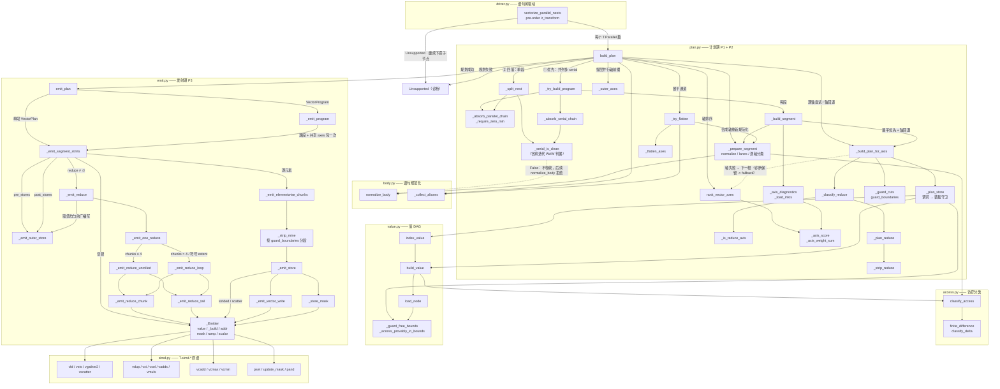
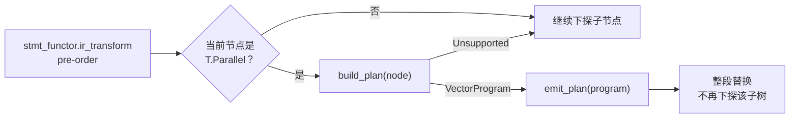
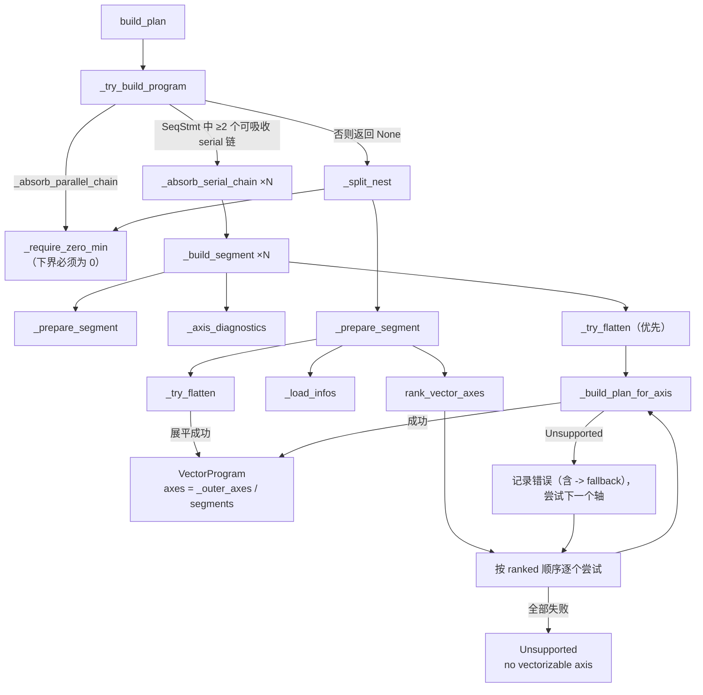
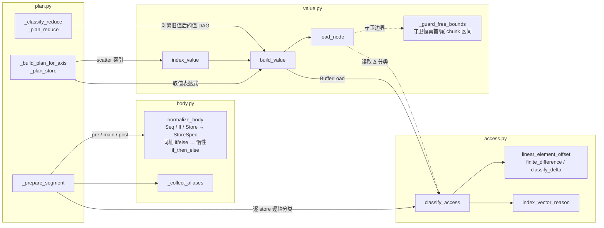
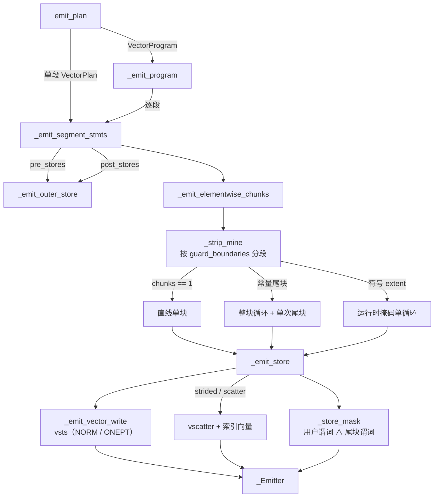
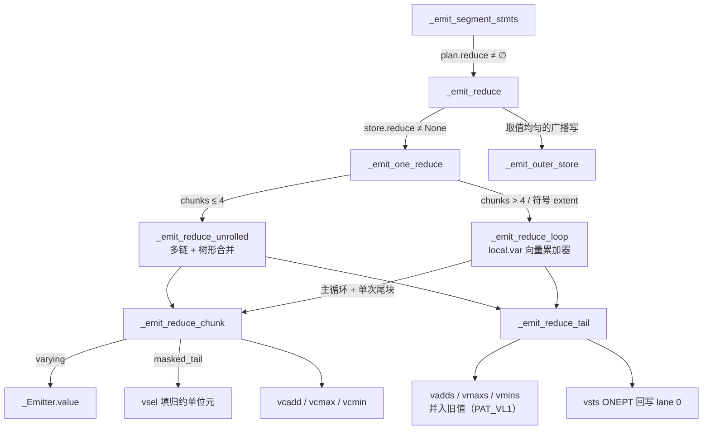
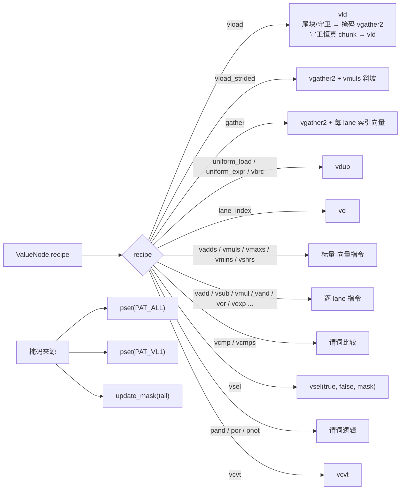

# `T.Parallel` 语句场景目录（Ascend 多面体向量化）

本文档按「`T.Parallel` 体内的语句长什么样」对多面体向量化器的全部已知场景做分类，
每个场景给出：TIR 骨架、规划结果、发射形态、当前状态（支持 / 拒绝）与已知限制。

- 用例来源：`tilelang/ascend/analysis/test_drive_plan.py`（66 个场景）与 `log_poly.log` 的实际发射结果。
- 实现：`tilelang/ascend/analysis/polyhedral/{plan,value,emit,access,body}.py`。
- 配套方案：仓库根目录 `Parallel_ascend.md`（下文 §x 引用其章节号）。
- 状态说明：部分用例在 `CASES` 里的分组注释已过期（`d3*/d4/d6/d6b/d7/d9b` 实际是 OK），
  以本文第 9 节索引表的「实际状态」为准；`r1`–`r7` 是 R1–R7 设计层审计回归，
  `d16`/`d16b` 是 D16 装载守卫与 chunk 边界回退（前缀/后缀两个方向）。

---

## 1. 分类框架

三个**正交**维度。任何一个具体用例都是这三者的组合。

### 维度一：语句结构（主分类）

| 编号 | 结构 | 判定入口 | 计划形态 |
|---|---|---|---|
| **A** | 单语句，逐元素 | `_split_nest` 无 serial | 单段 `VectorPlan` |
| **B** | 单语句，归约 | store 沿轴 `Δ==0` 且取值沿轴变化 | 单段 + `ReduceInfo` |
| **C** | 多语句（同一 nest，无循环） | body 是 `SeqStmt` 且无 serial | 单段、多 store |
| **D** | 控制流 | `IfThenElse` / `Select` | 谓词化 store、惰性 `if_then_else` → `vsel`；臂内访存挂装载守卫（D16） |
| **E** | 单个 `T.serial` 段（pre/main/post） | `_absorb_serial_chain` + `_serial_is_clean` | 单段，向量轴 = serial 轴 |
| **F** | 并列多个 `T.serial` 段 | `_try_build_program` ≥2 段 | `VectorProgram`（多段） |
| **G** | 拒绝类 | 各阶段 `Unsupported` | 无计划，带诊断 |

> 另有**设计层审计回归**（R1–R7）穿插在 A/B/E/G 中：谓词掩码宽度（R1）、均匀 bool 条件（R2）、
> 条件归约（R3）、旧值重复出现（R4）、非 0 下界（R5）、跨迭代 WAW（R6）、归约段 pre/post
> 均匀性（R7）。它们不是新的语句形状，而是横跨各形状的**契约问题**。D16（语句级分支臂内
> 访存越界）同样不是新形状，而是 D 类（控制流）的**语义保真**问题：装载必须挂守卫，且
> 守卫恒真的 chunk 段应回退普通 `vld`。

### 维度二：访存形态（沿候选向量轴的 Δ）

由 `access.classify_access` 唯一决定，决定发射通道：

| 形态 | 条件 | 发射通道 |
|---|---|---|
| `contiguous` | Δ == 1 | `vld` / `vsts`（满 lane） |
| `uniform` | Δ == 0 | 标量读 + `vdup`；写用 `ONEPT` |
| `strided` | Δ == k，\|k\|>1 | 正步长：索引斜坡 + `vgather2`/`vscatter`；负步长：索引向量 |
| `permute` | Δ == -1（逆序双射） | 每 lane 索引向量 + `vgather2` |
| `piecewise` | Δ 非常数但可构造索引向量（2 的幂除法/取模） | 每 lane 索引向量 + `vgather2`/`vscatter` |
| `indirect` | 下标含 `BufferLoad`（`a[b[i]]`） | 先装载索引向量，再 `vgather2` |
| `true_random` | Δ 非常数且索引向量构造不出（非 2 幂除法） | 拒绝 |
| `global` | 操作数在 GM | 拒绝（要求先 staging 到 UB） |

### 维度三：归约形态

- 无归约；
- `Add` / `Max` / `Min`（合法，`vcadd`/`vcmax`/`vcmin`）；
- 其他算子（`Mul` 等）：拒绝；
- 覆写（均匀地址 + 取值不读自身）：拒绝；
- 部分归约（均匀地址 + 取值沿轴变化，但混有逐元素写）：拒绝；
- 尾块 / 长归约 / 符号 extent：三种发射策略（见 §3.2）。

### 规划与发射主流程

```
build_plan
 ├─ _try_build_program           # F：≥2 个可吸收 serial 段 → 多段 program
 ├─ _split_nest                  # A–E：axes + (serial_axis) + pre/main/post
 ├─ _prepare_segment             # normalize_body / elem / lanes / 逐轴分类
 ├─ _try_flatten                 # 合成连续轴（最内层 extent < lanes 时）
 ├─ rank_vector_axes             # 归约轴优先；否则按「写×100 + 读×10 + 序号」打分
 └─ for axis in ranked:          # 轴回退：逐轴尝试，失败记录诊断再试下一个
        _build_plan_for_axis
emit_plan
 ├─ 逐元素：整 chunk 循环 + 单次尾块（掩码）或符号 extent 单循环
 ├─ 归约：短（≤4 chunk）展开 + 多链树合并 / 长（含符号）真实循环 + local.var 累加器
 └─ pre/post：chunk 循环之外的 `ONEPT` 单点写（每个外层迭代一次）
```

---

## 2. 场景 A：单语句、逐元素

共同点：一条 store，无归约，无控制流（控制流见 §5）；计划只含 `axis / lanes / chunks / tail`。

### A1 连续拷贝
```python
for i in T.Parallel(N):
    c[i] = a[i]
```
- 用例：`c0_copy`
- 计划：`axis=i, L=64, Q=2, tail=0`；store `contiguous`，value `vload`
- 发射：`for chunk: vld(a[chunk*64]) → vsts(c[chunk*64])`
- 状态：支持

### A2 广播（lane 内均匀读）
```python
for i in T.Parallel(N):
    c[i] = a[0]
```
- 用例：`c0_broadcast`
- 计划：load `uniform`（`uniform_load`），写 `contiguous`
- 发射：`vdup(a[0]) → vsts`
- 状态：支持（`vdup` 目前在 chunk 循环内重复求值，可外提）

### A3 读写形态不一致（rank/混合）
```python
for i, j in T.Parallel(M, K):
    d[i, j] = g[i] - g[j]
```
- 用例：`c2_rank`
- 计划：选 `j`（写连续、读一均匀一连续），`Q=1, tail=32`
- 发射：`vdup(g[i])`、尾块 `vgather2(g[j])`、`vsub`、掩码 `vsts`
- 状态：支持（`vdup(g[i]) + vsub` 可写成 `vadds(vld, -g[i])`）

### A4 转置写（写主序选轴）
```python
for i, j in T.Parallel(M, M):
    c[j, i] = a[i, j]
```
- 用例：`c2_axis_pick`
- 计划：联合打分选 `i`（写连续 score=830 vs `j` 381）
- 发射：索引斜坡 `vmuls(vci, 64)` 提到循环外 → `vgather2(a) → vsts(c)`
- 状态：支持

### A5 步长读 / 负步长
```python
c[i] = a[2 * i]          # A5a 正步长
c[i] = a[126 - 2 * i]    # A5b 负步长读
c[126 - 2 * i] = a[i]    # A5c 负步长写
```
- 用例：`c4_strided`、`d8_negative_stride`、`d8b_negative_stride_store`
- 计划：`strided`（负步长归到索引向量通道）
- 发射：`vgather2`/`vscatter` + 索引向量；正步长斜坡可复用
- 状态：支持

### A6 逆序置换
```python
c[i] = a[N - 1 - i]
```
- 用例：`c4_reverse`
- 计划：`permute`（Δ=-1）
- 发射：`vci` → `vsub(127, vci)` → `vgather2`
- 状态：支持

### A7 分块/分片下标
```python
for i, j in T.Parallel(BM, BN):
    c[i, j] = cs[i // MX, j // MY, i % MX, j % MY]
```
- 用例：`c4_tiled`
- 计划：`piecewise`；选 `j`，`Q=1, tail=16`
- 发射：`vshrs`/`vand`/`vadds` 构造绝对元素偏移 → `vgather2`
- 状态：支持

### A8 间接下标（gather）
```python
c[i] = a[b[i]]
```
- 用例：`c_gather`
- 计划：`indirect`
- 发射：`vld(b)` 取索引向量 → `vgather2(a[0], idx)`
- 状态：支持

### A9 高维摊平（Δ 化简为 1）
```python
for i_kv in T.Parallel(128):
    c[i_kv] = h[i_kv // 16, i_kv % 16] * d[i_kv // 16, i_kv % 16]
```
- 用例：`c4_flat`
- 计划：`contiguous`（`i//16*16 + i%16` 化简为 `i`）
- 发射：两次 `vld` + `vmul` + `vsts`
- 状态：支持

### A10 值算子 strength-reduction
```python
c[i] = a[i] + i // 4 + i % 8      # 除数必须是 2 的幂
```
- 用例：`c3_value_pow2`
- 计划：`vshrs`（FloorDiv）/ `vand`（FloorMod）
- 状态：支持（非 2 幂除数拒绝，见 G1）

### A11 均匀间接地址
```python
c[i] = a[b[0]] * 2.0
```
- 用例：`d11b_lane_invariant_indirect_load`
- 计划：间接下标 Δ==0 → 归 `uniform`；value 为 `uniform_expr`
- 发射：`vdup(a[b[0]] * 2.0) → vsts`
- 状态：支持（chunk 循环内重复 `vdup`，可外提）

### A12 一维尾块
```python
for i in T.Parallel(100):
    c[i] = a[i]
```
- 用例：`d10_one_dimensional_tail`
- 计划：`Q=2, tail=36`
- 发射：主循环 `range(1)` 用 `vld` + 全 lane；尾块单次循环用 `update_mask(36)` + 掩码 `vgather2`
- 状态：支持（`vld` 无谓词形式，尾块只能退化成掩码 gather）

### A13 符号 extent
```python
n = tirx.Var("n", "int32")
for i in T.Parallel(n):
    c[i] = a[i]
```
- 用例：`d9_symbolic_extent`
- 计划：`Q=None, tail=None`
- 发射：单条 `for chunk in ceildiv(n, 64)`，每轮 `update_mask(min(n - chunk*64, 64))` + 掩码 gather
- 状态：支持（可优化为「整块主循环 + peel 尾块」）

---

## 3. 场景 B：单语句 + 归约

### 3.1 判定链（三层，逐层收紧）

1. `_is_reduce_axis`：**全部** store 沿该轴 `Δ==0`（lane 均匀）且至少一条取值沿该轴变化
   → `rank_vector_axes` **提前返回该轴**（不再排序其它轴）；
2. `_classify_reduce`：逐 store 判定「均匀地址 + 取值变化」；
3. `_plan_reduce`：取值必须是 `dst[...] = dst[...] <op> x`（op ∈ Add/Max/Min），
   拆出 `varying`（逐 lane 部分）与 `accumulate`（是否需要并入旧值）。

### 3.2 三种发射策略

| 策略 | 触发 | 发射 |
|---|---|---|
| 展开 + 树形合并 | `chunks ≤ 4` | 编译期展开；每个 chunk 一条独立链（各一次 `vcadd`），最后两两 `vadd` 合并 |
| 真实循环 + `local.var` | `chunks > 4` | 主循环 `chunks-1` 轮 + 单次尾块；循环携带向量累加器 |
| 符号 extent | `chunks is None` | 单循环，每轮运行时夹紧掩码 + 单位元填充 |

收尾统一：`vadds/vmaxs/vmins` 并入旧值（只有 lane 0 有效，`PAT_VL1`）→ `ONEPT` 单点回写。
单位元由元素 dtype 动态给出（Add→0，Max→dtype 最小值，Min→dtype 最大值）。

> 旧实现里的 `_REDUCE_CHAINS`（=4）与展开阈值相等，「链内累加」分支不可达，已删除；
> 行为不变（每 chunk 一条链 + 树形合并）。
>
> **条件归约**（`if cond: s[0] += a[i]`）**拒绝**：跨 lane 归约掩码只承载尾块谓词，
> 用户谓词会被静默丢弃（R3）。

### B1 短归约
```python
for i, j in T.Parallel(M, K):     # K=256
    acc[i] = acc[i] + a[i, j]
```
- 用例：`c2_reduce`：`axis=j, L=64, Q=4, tail=0, op=vadd, recipe=vcadd`
- 发射：4 条链各一次 `vcadd` → 3 次 `vadd`（VL1）树合并 → `vadds(acc[i])` → `ONEPT`
- 状态：支持

### B2 归约尾块
- 用例：`c2_reduce_tail`（K=32）：`Q=1, tail=32`
- 发射：`vdup(0)` + `update_mask(32)` + 掩码 `vgather2` + `vsel` 填单位元 + `vcadd`
- 状态：支持（Add 下 `vsel` 填充与 `vdup` 可省，`MODE_ZEROING` 已等价）

### B3 长归约
- 用例：`r_long_reduce`（K=512）：`Q=8`
- 发射：`local.var` 累加器；主循环 7 轮 `vld → vcadd → vadd(VL1)`；循环外并入旧值 + `ONEPT`
- 状态：支持（可改 lane-wise 累加 + 末尾一次 `vcadd`）

### B4 长归约 + 尾块
- 用例：`r_long_reduce_tail`（K=552）：`Q=9, tail=40`
- 发射：主循环 8 轮 + 尾块 `range(8,9)`（`update_mask(40)` + `vsel` 单位元）
- 状态：支持

### B5 max / min 归约（含 int32 / f16）
```python
s[i] = T.max(s[i], a[i, j])
```
- 用例：`d3_int_max_reduce`（int32，单位元 `INT_MIN`）、`d3_f16_max_reduce`（f16，单位元 −65504，`L=128`）
- 发射：`vdup(单位元)` → `vsel` 填尾块 → `vcmax` → `vmaxs` 并入旧值 → `ONEPT_B{16,32}`
- 状态：支持

### B6 符号 extent 归约
- 用例：`d9b_symbolic_extent_reduce`
- 发射：`local.var` 累加器 + `range(ceildiv(n, 64))`，每轮运行时掩码 + 单位元填充
- 状态：**支持**（`CASES` 里仍标为拒绝，注释已过期）

### B7 不支持的归约形态
| 形态 | 用例 | 诊断 |
|---|---|---|
| 乘积归约 `*= ` | `d1_product_reduce` | `unsupported reduction operator(s) Mul` |
| 均匀地址覆写 `s[i] = a[i,j]` | `d2_plain_overwrite` | `store ... does not read 's'` → last-write-wins 无向量形式 |
| 非 2 幂除法归约轴 | `c3_im2col`（`kk` 轴） | `FloorDiv by non-power-of-two constant 12` |

---

## 4. 场景 C：多语句（同一 nest，无循环）

计划里 `stores` 按源码顺序逐条发射；同一 chunk 内的 SSA 可复用（目前键失效，见 §10）。

### C1 两条独立 store
```python
for i in T.Parallel(N):
    c[i] = a[i]
    d[i] = a[i] * 2.0
```
- 用例：`c3_multi`
- 计划：两条 `contiguous` store，值分别为 `vload` / `vmuls`
- 状态：支持（同一 `a[i]` 被发了两条 `vld`）

### C2 局部标量中间值
```python
for i, j in T.Parallel(S, K):
    acc: T.float32 = a[i, j] * 2.0
    c[i, j] = acc + 1.0
```
- 用例：`c3_scalars`
- 计划：局部标量被内联进值 DAG（`vmuls → vadds`），不产生额外 store
- 状态：支持（展平到 `k_i_j`）

### C3 多条 strided 写
```python
for i in T.Parallel(BM):
    gates[i, kk] = max_val[i]
    idx[i, kk]   = max_idx[i]
```
- 用例：`c3_topk`
- 计划：两条 `strided` store，共用一条索引斜坡
- 发射：`vld → vscatter` ×2
- 状态：支持

### C4 复杂标量 + 条件 + 分片读
```python
for i, j in T.Parallel(block_M, block_K):
    kk = k_iter * block_K + j
    m = by * block_M + i
    access_h = m % (OH * OW) // OW * S + kk // (KW * C) * D - P
    access_w = m % OW * S + kk // C % KW * D - P
    in_bound = (access_h >= 0) and (access_w >= 0) and (access_h < H) and (access_w < W)
    data_shared[i, j] = T.if_then_else(in_bound, data[...], 0.0)
```
- 用例：`c3_im2col`
- 计划：最优轴 `kk` 被非 2 幂除法卡住 → **轴回退**到 `m`；`Q=1, tail=16`
- 发射：谓词链（`pand`）+ 掩码 `vgather2` + `vscatter`；~37 条指令
- 状态：支持但低效（谓词/地址表达式重复构造 4 次）

### C5 归约 + 逐元素混合
```python
for i in T.Parallel(MS):
    for j in T.serial(KS):
        s[i] = s[i] + a[i, j]     # 归约
        d[i, j] = s[i]            # 逐元素广播当前部分和
```
- 用例：`d7_uniform_store_mixed`
- 计划：因为 `d[i,j]` 不是 lane 均匀，`_is_reduce_axis(j)` 为假 → 排序选 `i`（1290 vs 1001），
  `j` 保留为真实循环
- 发射：`for j`：`vld(s) + gather(a) → vadd → vsts(s) → vld(s) → vscatter(d)`
- 状态：支持（第二次 `vld(s)` 可复用上一步结果）

### C6 部分归约（回退到并行轴）
```python
for i in T.Parallel(M):
    for j in T.serial(K):
        s[2 * i] = s[2 * i] + a[i, j]
        u[i, j] = s[2 * i]
```
- 用例：`d14b_partial_reduce_fallback`
- 计划：`j` 打分更高，但 `_build_plan_for_axis` 的部分归约门禁拒绝 → **轴回退**到 `i`
- 发射：`for j` 保留为真实循环（每轮对 i 的 8 个有效 lane 做向量读写；extent M=8 < 64）
- 状态：支持（语义正确；受并行轴 extent 限制，lane 利用率不高）

---

## 5. 场景 D：控制流

| 场景 | 形态 | 处理 | 用例 | 状态 |
|---|---|---|---|---|
| **D1** if/else 同址两臂 | `if cond: c[i]=x else: c[i]=y` | 合并成**惰性** `if_then_else` → `vsel(x, y, pred)`；两臂访存各挂 `cond` / `¬cond` 守卫（地址可证安全时仍发普通 `vld`） | `c1_ifelse` | 支持 |
| **D2** 三元/`Select` | `c[i] = T.if_then_else(cond, x, y)` | `T.if_then_else` 是惰性内建：两臂按守卫构造（`vcmp` + `vsel`）；`tirx.Select` 是急切求值，两臂都算（源码语义如此） | `c1_ternary` | 支持 |
| **D3** 单臂 if | `if cond: c[i] = x` | 谓词化 store：`vsts(..., mask=pred)`；谓词同时是臂内访存的装载守卫 | `c1_single_arm` | 支持 |
| **D4** if-else-if 嵌套 | `if a: c=1 else: if b: c=2` | 拒绝：`masked branch merging is not supported` | `d12_masked_branch` | 拒绝 |
| **D5** 臂内越界访存 + 守卫恒真 chunk | `if i >= 32: c[i] = a[i-32]`；`if i < 96: c[i] = a[i+32]` | 装载守卫（不可证安全时发带掩码 `vgather2`）；守卫恒真的首/尾 chunk 段回退普通 `vld`，store 谓词同步省掉 `vcmps` | `d16_branch_load_oob`、`d16b_prefix_branch_load` | 支持 |

要点：

- D1/D2 的谓词来源分两种：逐 lane（`vcmp`/`vcmps`，直接用）与循环不变（广播成
  `update_mask(cond ? lanes : 0)`，整 chunk 同真同假）。
- D3 的掩码可以与尾块掩码做 `pand` 合成。
- **语句级 `if/else` 是惰性的**：合并结果必须是 `tirx.op.if_then_else`（`Call`），不能是
  急切 `Select`；单臂的 store 谓词也要传给取值表达式。否则臂内 `a[i-32]` 会被无条件
  发成 `vld a[-32]`（D16，旧实现即如此）。
- 守卫只保证「条件成立时地址合法」；若源程序在条件成立时自身就越界，则不属于向量化
  能修复的范围。
- D5 的分段按**可证边界**做：`predicate_free_until/from` 由 `arith.Analyzer.can_prove`
  在 `[0, u*lanes)` / `[c*lanes, extent)` 上证明，并复核该段地址可证安全；数据相关
  条件与符号 extent 保持整段带掩码 gather（§10 第 17 项）。
- D4 是**过保守**的限制：两条臂都写同一地址时，可以降成两条掩码写
  （`mask1` 写 1.0；`mask2 ∧ ¬mask1` 写 2.0），不需要读回 `c`。

### 5.1 D5 的发射形态（前缀/后缀对称）

```text
# 后缀守卫：if i >= 32: c[i] = a[i-32]   (N=128, L=64, Q=2)
[0,1)  vcmps(vci(0), 32, "ge") → vgather2(a[-32], vci(0), mask) → vsts(c[0], v, mask)
[1,2)  vld(a[32]) → vsts(c[64], v, mask_all)          # 守卫恒真，无 vcmps

# 前缀守卫：if i < 96: c[i] = a[i+32]
[0,1)  vld(a[32]) → vsts(c[0], v, mask_all)
[1,2)  vcmps(vci(64), 96, "lt") → vgather2(a[96], vci(0), mask) → vsts(c[64], v, mask)
```

同段内前后缀守卫共存时（如 512 元素、`i>=32` 写 c 且 `i<480` 写 d），切点为 `[1,7]`：
chunk 0 只有 c 带守卫，chunk 1–6 两条都是 `vld`，chunk 7 只有 d 带守卫。

---

## 6. 场景 E：单个 `T.serial` 段（吸收为额外迭代轴）

### 6.1 吸收条件（`_serial_is_clean`）

- serial 循环必须**直接内嵌**在 `T.Parallel` 体内；
- 循环**下界必须可证为 0**（`_require_zero_min`，R5）：`T.serial(1, K)` 会被拒绝；
- 循环体内沿循环变量 `Δ==0` 的写，只能是「同址回读的累积归约」；
- 不允许跨迭代读（stencil `c[i,j-1]` 拒绝）；
- 不允许共享标量累加器（`cnt[0] += 1` 拒绝）；
- 同一 buffer 的多条写必须**目的地址相同**（R6：`c[i,2*j]` 与 `c[i,j]` 会跨迭代相撞）。

### 6.2 计划形态

`axes = [并行的外层轴..., serial 轴]`，`serial_axis` 单独记录；body 被拆成
`pre / main / post` 三段（`_split_nest`）：

```
pre_stmts   : serial 之前、与外层并行变量相关的语句
main_stmt   : serial 循环本身
post_stmts  : serial 之后、与外层并行变量相关的语句
```

- **plan**：`pre_stores / stores / post_stores`；向量轴由**展平优先 + 打分**决定
  （并行轴与 serial 轴都是候选；serial extent 小于 lanes 时通常选外层并行轴，
  serial 循环保留为真实循环）
- **emit**：`pre → chunk 循环 → post`，pre/post 在 chunk 循环之外、每个外层迭代
  执行一次，写用 `ONEPT`（值 `vdup` 广播）。

### 6.3 场景清单

| 编号 | 骨架 | 用例 | 计划/发射 | 状态 |
|---|---|---|---|---|
| **E1** S1 独立拷贝 | `for i in P: for j in serial: c[i,j]=a[i,j]*2` | `s1_serial_copy` | 展平 `k_i_j`(512)，8 个满 chunk | 支持（最优） |
| **E2** S1 + 谓词 | 同上，体内 `if a[i,j]!=0` | `s1_serial_predicated` | 展平 + 掩码 store | 支持（同一 `a` 被读两次） |
| **E3** S3 归约 | `for i in P: for j in serial: s[i]+=a[i,j]` | `s3_serial_reduce` | `axis=i`；寄存器累加：`vld` 初值 + 8×(gather+vadd) + 一次 `NORM` 回写 | 支持（满 lane） |
| **E4** S2 私有标量 | `acc=0; for j: acc+=a[i,j]; c[i]=acc` | `s2_serial_scalar` | `axis=i`；acc 提升成 `local.var` 向量寄存器 | 支持（满 lane；`vdup(0)` + 8×(gather+vadd) + 回写） |
| **E5** M2 前置 + serial | `s[i]=0; for j: s[i]+=a[i,j]` | `m_serial_after_init` | pre 折叠成 `vdup(0)` 初值 | 支持（满 lane；循环内只剩 `gather+vadd`） |
| **E6** M3 serial + 后置 | `for j: s[i]+=a[i,j]; s[i]*=2` | `m_serial_before_post` | post 在寄存器上算完，一次 `NORM` 回写 | 支持（不再每轮 `vld`/`vsts`） |
| **E7** 夹心 | `s[i]=0; for j: ...; s[i]*=2` | `m_serial_middle` | E5 + E6 | 支持（整段只剩一次 `vsts`） |
| **E8** M1 独立 store 组 | `c[i,0]=1.0; for j: c[i,j]=a[i,j]*2` | `m_serial_indep_group` | pre 均匀写 + 主体沿 j | 支持（pre 被 j=0 覆写 → 死写） |
| **E9** pre 间接地址 | `c[b[0]]=1.0; for j: d[i,j]=a[i,j]*2` | `d11_indirect_pre` | pre 的间接地址 Δ==0 → `UNIFORM`，单次 `ONEPT` | 支持（该写沿 i 循环不变，可整体外提） |
| **E10** 双归约 | 同一 serial 体两条 `s1[i]+=a`、`s2[i]+=b` | `d6_two_reduces` | 每条 store 各自展开、各起一条链 | 支持 |
| **E11** sum + max 混合 | `s1[i]+=a; s2[i]=max(s2[i],b)` | `d6b_sum_max_reduce` | 每条 store 各自的 `recipe`（`vcadd`/`vcmax`） | 支持 |
| **E12** 归约 + 均匀加数 | `s[i] = s[i] + a[i,j] + 1.0` | `d4_uniform_addend` | `varying = vadds(vload, 1.0)`，保留常量 | 支持 |
| **E13** 边界：stencil | `c[i,j] = c[i,j-1] + a[i,j]` | `s_serial_stencil` | 不干净 → 回落单段并拒绝 | 拒绝（顶层消息不精确） |
| **E14** 边界：共享标量 | `cnt[0]=0; for g_i: if ...: cnt[0]+=1; c=...` | `c6_complex` | `_serial_is_clean` 失败 → 拒绝 | 拒绝（未指出 `cnt[0]`） |

> 说明：E1/E2 走「展平」通道（`_try_flatten`），因此没有 8/64 lane 问题；
> E3–E12 现在多数选**外层并行轴**并把 serial 循环保留为真实循环（§12 第 2 项），
> 满 lane 读改写 + 寄存器累加，不再是性能损失来源。

---

## 7. 场景 F：并列多个 `T.serial` 段（`VectorProgram`）

### 7.1 判定

`T.Parallel` 链结束后是 `SeqStmt`，其中**至少 2 个**子节点是可吸收的 serial 链：
每个子链 → 一段；段前语句组归该段 `pre`，末尾剩余语句组归末段 `post`；
否则返回 `None`，整体回落单段路径（保持既有拒绝行为）。

### 7.2 与单段的差异

- 每段**独立**选向量轴（展平优先 + 打分；并行轴与 serial 轴都是候选）、独立 `Q/tail`、独立 SSA 前缀；
- `program.axes` 只含「共享的并行轴前缀」，在**最外层**统一包一次；
- 段按**源码顺序**发射，段间依赖靠这个顺序保证。

### 7.3 场景清单

| 编号 | 骨架 | 用例 | 计划 | 状态 |
|---|---|---|---|---|
| **F1** 两段独立 | 两个互不相关的 serial | `p_two_serial_independent` | `axes=['i'], 2 段`，各自 `axis=j/l, tail=8` | 支持（两段都可展平到 512，未尝试） |
| **F2** 归约段 + 使用段 | `for j: s[i]+=a; for l: c[i,l]=s[i]*2` | `p_serial_reduce_then_use` | 段 0 归约 `vcadd`；段 1 `uniform_expr` 广播 | 支持 |
| **F3** 组合依赖 | `for j: c=a*2; for l: d=c+1` | `p_serial_compose` | 段 1 读段 0 写的 `c`，源序保证正确 | 支持（可融合成单循环） |
| **F4** 前置 + 两段 | `s[i]=0; for j: ...; for l: c=s*2` | `p_serial_leading_stmt` | pre 归段 0 | 支持 |
| **F5** 一段不干净 | 第二段是 stencil | `p_serial_one_unclean` | `_absorb_serial_chain` 返回 None → 回落单段 → 拒绝 | 拒绝（丢失段级原因） |
| **F6** 部分归约段 | 段 0 是部分归约 | `d14_partial_reduce` | 段 0 构造失败 → 记录 `notes` → 回落单段 → 拒绝 | 拒绝（带段级诊断） |

---

## 8. 场景 G：拒绝类（按根因分类）

| 编号 | 根因 | 触发条件 | 用例 | 诊断关键字 |
|---|---|---|---|---|
| **G1** 真随机下标 | 非 2 幂常量除法 / 数据相关索引 | `a[i // 3]` | `c4_true_random` | `non-affine access ... FloorDiv by 3 is not a power of two` |
| **G2** GM 操作数 | `buffer.scope() == "global"` | `c[i] = A[i]`（A 是 GM） | `c_gm` | `global-memory operand ... needs an explicit UB staging copy` |
| **G3** 元素类型不支持 | 无默认谓词宽度 / 位宽映射 | `bool` 输出 | `d15_bool_store` | `store element dtype 'bool' ... Cannot infer default mask width` |
| **G4** 归约算子不支持 | 非 Add/Max/Min | `s[i] *= a[i,j]` | `d1_product_reduce` | `unsupported reduction operator(s) Mul` |
| **G5** 均匀地址覆写 | 取值不读同址目标 | `s[i] = a[i,j]` | `d2_plain_overwrite` | `last-write-wins overwrite and has no vector form` |
| **G6** 嵌套控制流 | else 分支又含 if | `if a: ... else: if b: ...` | `d12_masked_branch` | `masked branch merging is not supported` |
| **G7** 循环携带依赖 | stencil / 共享标量 | `c[i,j-1]`、`cnt[0]+=` | `s_serial_stencil`、`c6_complex` | `nested serial loop ... only directly-nested, dependence-free serial loops` |
| **G8** 部分归约 | 均匀地址 + 变化取值 + 混有逐元素写 | `s[2*i] += a[i,j]; u[i,j] = s[2*i]` | `d14_partial_reduce` | `a partial reduction mixed with element-wise stores has no vector form` |
| **G9** 符号 extent + 归约 | （历史限制，已解除） | — | `d9b_symbolic_extent_reduce` | 现已支持 |

> G7 的顶层消息是泛化的：`_serial_is_clean` 返回了具体原因（跨迭代读 `c`、共享标量），
> 但只有走多段路径的段级失败才会进入 `diagnostics`；单段回落时具体原因丢失。

---

## 9. 全用例索引（66 个）

| # | 用例 | 场景 | 实际状态 |
|---|---|---|---|
| 1 | `c0_copy` | A1 | OK |
| 2 | `c0_broadcast` | A2 | OK |
| 3 | `c1_ifelse` | D1 | OK |
| 4 | `c1_ternary` | D2 | OK |
| 5 | `c1_single_arm` | D3 + 展平 | OK |
| 6 | `c2_rank` | A3 | OK |
| 7 | `c2_reduce` | B1 | OK |
| 8 | `c2_reduce_tail` | B2 | OK |
| 9 | `r_long_reduce` | B3 | OK |
| 10 | `r_long_reduce_tail` | B4 | OK |
| 11 | `c2_axis_pick` | A4 | OK |
| 12 | `c3_multi` | C1 | OK |
| 13 | `c3_scalars` | C2 | OK |
| 14 | `c3_value_pow2` | A10 | OK |
| 15 | `c3_topk` | C3 | OK |
| 16 | `c4_flat` | A9 | OK |
| 17 | `c4_strided` | A5a | OK |
| 18 | `c4_reverse` | A6 | OK |
| 19 | `c4_tiled` | A7 | OK |
| 20 | `c_gather` | A8 | OK |
| 21 | `c3_im2col` | C4（A7/D2 组合 + 轴回退） | OK（低效） |
| 22 | `s1_serial_copy` | E1 | OK（最优） |
| 23 | `s1_serial_predicated` | E2 | OK |
| 24 | `s3_serial_reduce` | E3 | OK（满 lane，寄存器累加） |
| 25 | `s2_serial_scalar` | E4 | OK（满 lane，私有标量提升） |
| 26 | `m_serial_after_init` | E5 | OK（满 lane） |
| 27 | `m_serial_before_post` | E6 | OK（满 lane） |
| 28 | `m_serial_middle` | E7 | OK（满 lane） |
| 29 | `m_serial_indep_group` | E8 | OK（满 lane，死写删除） |
| 30 | `p_two_serial_independent` | F1 | OK（每段展平） |
| 31 | `p_serial_reduce_then_use` | F2 | OK |
| 32 | `p_serial_compose` | F3 | OK |
| 33 | `p_serial_leading_stmt` | F4 | OK |
| 34 | `d8_negative_stride` | A5b | OK |
| 35 | `d8b_negative_stride_store` | A5c | OK |
| 36 | `d9_symbolic_extent` | A13 | OK |
| 37 | `d10_one_dimensional_tail` | A12 | OK |
| 38 | `d14b_partial_reduce_fallback` | C6 | OK（回退到并行轴） |
| 39 | `d11_indirect_pre` | E9 | OK（pre 外提为标量写） |
| 40 | `d11b_lane_invariant_indirect_load` | A11 | OK |
| 41 | `c6_complex` | E14 | REJ |
| 42 | `s_serial_stencil` | E13 | REJ |
| 43 | `p_serial_one_unclean` | F5 | REJ |
| 44 | `c_gm` | G2 | REJ |
| 45 | `c4_true_random` | G1 | REJ |
| 46 | `d9b_symbolic_extent_reduce` | B6 | **OK**（分组注释过期） |
| 47 | `d14_partial_reduce` | G8 | REJ |
| 48 | `d15_bool_store` | G3 | REJ |
| 49 | `d1_product_reduce` | G4 | REJ |
| 50 | `d2_plain_overwrite` | G5 | REJ |
| 51 | `d3_int_max_reduce` | B5 | **OK**（分组注释过期） |
| 52 | `d3_f16_max_reduce` | B5 | **OK**（分组注释过期） |
| 53 | `d4_uniform_addend` | E12 | **OK**（分组注释过期） |
| 54 | `d6_two_reduces` | E10 | **OK**（分组注释过期） |
| 55 | `d6b_sum_max_reduce` | E11 | **OK**（分组注释过期） |
| 56 | `d7_uniform_store_mixed` | C5 | **OK**（分组注释过期） |
| 57 | `d12_masked_branch` | D4 | REJ |
| 58 | `r1_predicate_width_f16` | A + D（条件 + 尾块） | OK（`pand` 用 b16） |
| 59 | `r2_uniform_condition` | D3 + 循环不变条件 | OK（`update_mask`） |
| 60 | `r3_masked_reduce` | B + G（R3） | REJ（条件归约） |
| 61 | `r4_repeated_old_value` | B + G（R4） | REJ（旧值重复） |
| 62 | `r5_serial_nonzero_min` | E + G（R5） | REJ（非 0 下界） |
| 63 | `r6_serial_waw` | E + G（R6） | REJ（跨迭代 WAW） |
| 64 | `r7_reduce_parallel_pre_fallback` | B + E（R7） | OK（轴回退到 `j`） |
| 65 | `d16_branch_load_oob` | D5（后缀守卫） | OK（chunk 0 掩码 gather → chunk 1 `vld`） |
| 66 | `d16b_prefix_branch_load` | D5（前缀守卫） | OK（chunk 0 `vld` → chunk 1 掩码 gather） |

统计：**OK 55 / REJ 11 / ERR 0**，共 **66** 例。

---

## 10. 已知限制与后续优化（按收益）

> 状态：1–11 均已落地（见 §12）；12 起是本轮设计层审计新增的边界。

1. ~~**值层 CSE 键失效**~~ → ✅ `_value_key` 已改用结构化 `_buffer_key`（不再用 `id(buffer)`）。
2. ~~**E 类向量轴写死为 serial 轴**~~ → ✅ `_axis_score` 已乘 lane 利用率，E 类改选外层并行轴 + 寄存器累加。
3. ~~**多段 program 未尝试展平**~~ → ✅ `_build_segment` 复用 `_plan_segment`（展平优先），F1/F3/F4 每段展平。
4. **归约改 lane-wise 累加**（未做）：每 chunk 一次 `vcadd` → 循环内 `vadd` 累加 + 末尾一次
   `vcadd`（短归约 13→10 条，长归约 24→17 条，关键路径约减半）。
5. ~~**循环不变量提升**~~ → ✅ 常量 `vdup` / 常量尾块 `update_mask` 进 prologue；`vci` 按 lane_base 复用。
6. ~~**单次循环展开**~~ → ✅ `chunks == 1`、尾块均发直线代码。
7. ~~**Add 归约跳过单位元填充**~~ → ✅ `MODE_ZEROING` 下 inactive lane 已是 0，尾块掩码直接交给 `vcadd`。
8. ~~**pre/post 走寄存器**~~ → ✅ init 折叠进累加器初值、post 在寄存器里算完只写一次、均匀写用标量 store。
9. ~~**死写/循环不变写**~~ → ✅ `m_serial_indep_group` 的 `c[i,0]` 删除；`d11_indirect_pre` 的 `c[b[0]]` 外提。
10. ~~**符号 extent 拆主循环 + peel 尾块**~~ → ✅ 非归约与归约都改为「整块主循环 + peel 尾块」。
11. ~~**诊断合并**~~ → ✅ `_serial_is_clean` 原因进入顶层消息；成功路径也保留 `-> fallback`。
12. **条件归约**（R3，拒绝）：`if cond: s += ...` 目前无向量形式；实现方式是用
    `vsel(varying, identity, cond)` 把未选中 lane 填成归约单位元，再把用户谓词 ∧ 尾块谓词交给 `vcadd`。
13. **非 0 循环下界**（R5，拒绝）：迭代域只记录 `(var, extent)`；给 `Axis` 增加 `min` 后即可支持
    `T.serial(1, K)`（发射 `For(var, min, extent)`）。
14. **跨迭代 WAW 别名**（R6，保守拒绝）：当前只允许「同 buffer 多写且目的地址相同」；
    更精确的做法是对目的地址做注入性/区间分析（如 `2*j` 与 `2*j+1` 是安全的）。
15. **非仿射 scatter 写的地址碰撞**：`PIECEWISE`/`INDIRECT` 写（`c[b[i]]`、`c[i//2]`）不检查
    每 lane 地址是否互异——这与「同一 `T.Parallel` 内多迭代写同一地址」一样属于未定义行为，
    需使用者保证。
16. **D12（臂内再嵌 `if`）**：`masked branch merging is not supported`，可降级为两条掩码写。
17. **守卫分块只对可证仿射边界生效**（D16）：`predicate_free_until/from` 用
    `arith.Analyzer.can_prove` 在 `[0,u*lanes)` / `[c*lanes,extent)` 上证明，并复核该段
    地址可证安全；数据相关条件（`if a[i] != 0`）、符号 extent 保持整段带掩码 `vgather2`。
    lane 均匀标量读没有掩码形式时仍按 P0-3 在 build 期拒绝。
18. **分块发射的代码膨胀**：每个切点多一段发射体；同段多条语句各有边界时切点数会上升，
    超过上限（6 个）即回退到单一循环——正确性不变，只是重新付 `vgather2`。
    后续可按收益把「切点选择」限制在 `Q` 较大的计划上（小 `Q` 直接展开更划算）。

---

## 11. 整体函数调用关系图

实线 = 调用；边标签是调用条件 / 分支。计划期（`build_plan`）只产出
`VectorProgram`，发射期（`emit_plan`）才落成 `T.simd.*`。



阅读要点：

- **两条 build 路径**：`_try_build_program`（F 类多段）优先；返回 `None` 才走
  `_split_nest` 单段路径。两条路径共用 `_prepare_segment` / `_build_plan_for_axis`，
  因此诊断字段与发射形态完全同构。
- **三个决策点**：`rank_vector_axes`（归约轴提前返回 / 打分排序）、
  `_try_flatten`（最内层 extent < lanes 时合成连续轴）、`_build_plan_for_axis`
  （pre/post 门禁、元素类型、部分归约门禁）——失败时按 `ranked` 列表**轴回退**。
- **归约分叉**：`_classify_reduce` 为每条 store 填 `ReduceInfo`；发射期按
  `chunks ≤ 4` 分成展开 / 真实循环两条，收尾共用 `_emit_reduce_tail`。
- `_Emitter` 是唯一的 `T.simd.*` 出口：计划期的 `build_value` 只建值 DAG，
  真正的指令选择（`vld` / `vgather2` / `vcadd` / `vsel` / 掩码）都发生在发射期。

### 11.1 拆分图：driver（入口与整段替换）



### 11.2 拆分图：plan（两条构建路径）



### 11.3 拆分图：计划期模块协作（plan ↔ body / access / value）



### 11.4 拆分图：emit（逐元素路径）



### 11.5 拆分图：emit（归约路径）



### 11.6 拆分图：值 recipe → simd 指令（`_Emitter._build`）



---

## 12. 优化落地状态（2026-10）

本轮改动后的行为与 §2–§10 的差异（以本节为准）：

| # | 优化 | 状态 | 行为变化 |
|---|---|---|---|
| 1 | `_value_key` 结构键 | 已落地 | 重复 `vld` 消失（c1_ternary 4→2、c3_multi 2→1）；c3_im2col 地址子式按 DAG 复用（44→29 行） |
| 2 | 轴选择加入 lane 利用率 | 已落地 | `(64, 8)` 形态优先选并行轴 i：s3/d3/d4/d6/d6b/m_* 从 8/64 lane 的跨 lane 归约改为满 lane 读改写（约 8–26× 指令差）；S2 经第 8 项的私有标量提升后同样走并行轴（见下行） |
| 3 | 多段路径复用展平 | 已落地 | p_two_serial_independent / p_serial_compose 每段展平到 512（8×）；`program.axes` 在含展平段时置空，各段自包 |
| 5 | 常量/不变量提升 | 已落地 | 常量 `vdup` / 常量尾块 `update_mask` 进 prologue；`vci` 按 lane_base 复用 |
| 6 | 单次循环展开 | 已落地 | `chunks==1`、尾块、`T.grid(n,1)` 均发直线代码 |
| 7 | Add 归约跳过单位元填充 | 已落地 | 尾块掩码直接交给 `vcadd`；仅 Max/Min 保留 `vsel` 填充 |
| 8 | pre/main/post 寄存器化 | 已落地 | ① 同址 `pre` 折叠成寄存器初值（不再写内存）；② 地址沿 serial 轴不变的同址读改写提升成 `local.var` **向量寄存器**：循环内只有 `vadd/vgather2`，循环后一次 `NORM`/`ONEPT` 回写（s3/m_serial_middle/d7/d6b/p_serial_reduce_then_use 段 0 均为「1 次装载 + 每轮 1 条 vadd + 1 次回写」）；③ 回写后 `post` 的同址读直接吃寄存器（`_promoted`），省一次 `ONEPT` 回读 + `vdup`；④ 均匀 pre/post 退化为标量 store；⑤ 同层写后读转发（d7 省一条 `vld`） |
| 8b | S2 私有标量提升 | 已落地 | `_is_promotable_private_accumulator`：私有标量（`local*`）沿并行轴从「拒绝并回退 serial 轴」改为提升成 `local.var` 向量寄存器。条件是地址沿 inner 轴不变、同址读改写、唯一写者、且循环后的消费必须逐 lane（否则末值属 lane 选择语义，仍拒绝）。s2 由 `for i(64): vcadd`（8/64 lane）变为「`vdup(0)` + 8×(gather+vadd) + ONEPT + vsts」 |
| 8c | 发射体 LICM | 已落地 | chunk 体内与 inner 轴无关的纯 SSA（地址分解、只读 buffer 装载）提到 inner 循环外：c3_im2col 12 轮提 4 条、c4_tiled 16 轮提 4 条；累加器寄存器按「本段会写」处理，不参与外提 |
| 9 | 死写 / 循环不变 pre | 已落地 | m_serial_indep_group 的 `c[i,0]` 死写删除；d11 的 `c[b[0]]=1.0` 外提为一次标量写（会被折叠成累加器初值的 pre 除外） |
| 10 | 符号 extent peel | 已落地 | d9/d9b 改为「`E//lanes` 整块主循环 + `if E%lanes` peel 尾块」 |
| 11 | 均匀标量二元 | 已落地 | `uniform - vector` → `vadds(vector, -uniform)`，省 `vdup` |
| 12 | 诊断质量 | 已落地 | `_serial_is_clean` 原因进入顶层消息（c6 指出 `cnt`、stencil 指出 `c`）；d12 消息说明嵌套 else-if 与替代写法 |
| 13 | 测试维护 | 已落地 | 删除与 s1_serial_copy 重复的 d10 探针；d9b/d1/d2/d14 改判为 OK；浮点 Max/Min 单位元改用 ±inf |
| R1 | 谓词运算掩码宽度 | 已落地 | `predicate_combine` / `predicate` 按**数据元素**宽度取 `pand/por/pnot` 的执行掩码；`_build` 的防御性谓词分支用 b8（全 256 lane）。f16 尾块 + 条件不再丢 lane 64–127 |
| R2 | store 条件走 `predicate()` | 已落地 | `_store_mask` / `_emit_outer_store` 不再 `value()` bool 标量；均匀条件 → `update_mask(cond ? lanes : 0)`，不再 emit 期 `ValueError` |
| R3 | 条件归约 | 已落地（拒绝） | `_plan_reduce` 对 `store.mask is not None` 显式拒绝，不再静默对全部 lane 求和 |
| R4 | 归约旧值重复出现 | 已落地（拒绝） | `_strip_reduce` 统计剥离次数，> 1 即拒绝，不再丢一份旧值 |
| R5 | 非 0 循环下界 | 已落地（拒绝） | `_require_zero_min` 在 `_absorb_parallel_chain` / `_split_nest` 检查；`T.serial(1, K)` 不再被错位成 0 基 |
| R6 | 跨迭代 WAW 别名 | 已落地（拒绝） | `_serial_is_clean` 要求同 buffer 多写目的地址相同；`_try_flatten` 额外要求「同一 buffer 只有一条写」 |
| R7 | 归约段 pre/post 均匀性 | 已落地 | 沿并行轴归约时补 build 期门禁，失败即轴回退（不再 build OK / emit Unsupported） |
| R8 | 写后读转发失效 | 已落地 | `note_write` 作废该 buffer 的 `_forward` 项；scatter / 标量写 / 累加器回写之后不会命中陈旧向量值 |
| C1 | 累加器提升决策上移 | 已落地 | `StorePlan.promote` 由 `_build_plan_for_axis` 一次算好；`emit` 不再自带 `arith.Analyzer` 重算（`accumulator_candidates` 删除） |
| C2 | 死代码 / 死参数清理 | 已落地 | 删 `_REDUCE_CHAINS` 与不可达的链内累加分支；删 `is_global_ok`、`is_index_vector`、`rank_vector_axes(stores)`、`_strip_reduce(vector_axis)`；`_split_nest`/`_try_build_program` 共用 `_absorb_parallel_chain`；`_plan_segment` 的两个字符串开关合并为 `single: bool`。注：`_ValueContext.lanes` 曾一并删除，D16 的守卫边界证明与 `[lo,hi)` 地址复核需要它，已重新引入（`_guard_free_bounds` / `_access_provably_in_bounds` 使用） |
| C3 | 段间 prologue 共享 | 已落地 | `_ProgramPrologue`：全 lane / lane0 掩码与步长斜坡在 program 层只绑一次（p_serial_reduce_then_use 由 2×pset + 2×ramp 降为 1+1）；依赖段内尾块掩码的斜坡仍留在段内 |
| C4 | 段间寄存器直通 | 已落地 | 段 k 的累加器回写登记 `(buffer, 下标) -> (向量轴, 寄存器值)`；段 k+1 同址连续读直接复用（p_serial_reduce_then_use 段 1 的 `vld s` 消失）。只在「单 chunk、无尾块/谓词、同一向量轴、无未提层外层轴」时生效，任何写都会作废登记 |
| D16 | 语句级分支的装载守卫 | 已落地 | 单臂 `if` 的 store 谓词作为取值表达式的守卫；同址 `if/else` 合并为**惰性** `tirx.op.if_then_else`（不再是急切 `Select`）。`a[i-32]` 这类不可证安全的臂内访存发带掩码 `vgather2`，不再越界 |
| D16 | 按 chunk 边界回退 `vld` | 已落地 | `_guard_free_bounds` 算 `predicate_free_until/from`（前缀/后缀对称），`_guard_cuts` 汇总 `VectorPlan.guard_boundaries`；`_strip_mine` 分段、`_Emitter.guard_free` 逐段判定，守卫恒真段回退普通 `vld` 并省掉 store 的 `vcmps`。d16：chunk 0 gather / chunk 1 `vld`；d16b：chunk 0 `vld` / chunk 1 gather；前后缀共存时切点 `[1,7]` |

**验证**：`testing/ascend/analysis/test_polyhedral_vectorize.py` **135 passed**；
`test_drive_plan.py` **66 例 → 55 OK / 11 REJ / 0 ERR**。

**修正记录**：多段路径早期版本把共享并行轴 `i` 提到 program 层，但各段的向量轴也是 `i`
（已被吃成 lane 维），于是发出 `for i in range(64)` 把同一组 64-lane 操作重复 64 次
（`p_serial_reduce_then_use`）。现改为只提「第一根被某段用作向量轴的并行轴」之前的轴，
`program.axes=[]`，各段自包，并加了「不得出现 `for i`」的回归断言。

**仍待上板确认**：c3_im2col 的掩码 gather 基址为 `data[0, -1, ...]`（依赖谓词 gather
不访问 inactive lane）；`update_mask` 宽度只支持 b8/b16/b32，f64/int64 的尾块路径尚未验证。
