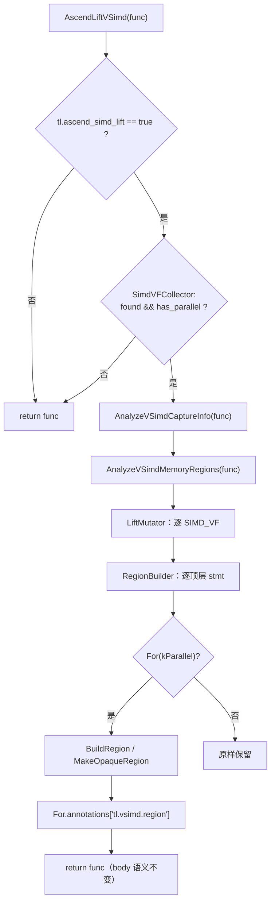

# TileLang Ascend VSIMD（P1）分析链路技术解析（stable-parallel 新 P1 版）

## 文档信息

| 项目 | 内容 |
| --- | --- |
| 分析对象 | 工作树 `/home/cjl/workspace/tilelang_stable-parallel`，分支 `stable-parallel`（跟踪 `voidLitchi/stable-parallel`） |
| 分支尖端 | `64feedf6` `[Ascend] Add the region reconstruction oracle and merge the debug entries (P1 cleanup 5/6)` |
| P1 实现提交 | `c1133a7f` 新 P1 主体；cleanup 1/6–5/6：`168d307f`、`349b2c68`、`5b86b4f2`、`f8f8ca21`、`64feedf6` |
| 对照基线 | `p_123_parallel` @ `a8fe5586`（旧 P1 `tl.vsimd.program` + 完整 P2/P3） |
| 分析方式 | 逐文件源码通读（P1 全部 C++/Python 实现与 6 个测试文件）+ `git diff p_123_parallel...stable-parallel` + 与 P2/P3 现有消费端代码对照 |
| 运行时状态 | 上游工作树未构建；本文结论来自静态阅读。当前开发分支（`p_123_parallel_new_p1`）已构建并复跑测试：P1 相关 97 个用例 + P2/P3 对接 10 个用例；整个 `testing/ascend/transform` 606 passed，`testing/ascend/analysis` 22 passed |

### 三个“P1”必须区分

| 名称 | 位置 | 形态 | 是否是 P2/P3 的输入 |
| --- | --- | --- | --- |
| **旧 P1-A** | `stable-parallel` 之前的 `vsimd_memory_legality` / `vsimd_capture_scope` / 旧 `vsimd_region` | 只读分析库：报告 + 私有结构体，无 pass、无载体 | 否（算法基础） |
| **旧 P1-B** | `p_123_parallel` 的 `lift_vsimd.cc` + `vsimd_program.{h,cc}` + `vsimd_handoff.{h,cc}` | 默认运行的 metadata pass：给 `SIMD_VF` SBlock 挂 `tl.vsimd.program`（Map/items/spans/groups） | 是（当前 P2/P3 的唯一输入） |
| **新 P1** | `stable-parallel` 的 `lift_vsimd.cc` + `vsimd_ir.{h,cc}` + 重写的 `vsimd_region.{h,cc}` | 默认运行的 metadata pass：给**每个顶层 `T.Parallel`** 挂类型化 `tl.vsimd.region` | 是（本分支已对接） |

> 本文后续若无特别说明，“新 P1”均指 `stable-parallel` 的 `AscendLiftVSimd`；“旧 P1”均指 `p_123_parallel` 的 `tl.vsimd.program` 版本。

### 当前开发分支的裁剪（`p_123_parallel_new_p1`）

本分支**不处理 SimdVF 内部的 `T.alloc_fragment` 语句**，已从 P1/P2/P3 中移除全部 fragment 处理：

- P1 **按 Parallel 粒度**拒绝：只有子树（含 `SBlock.alloc_buffers` 与 BufferLoad/BufferStore）触碰到 `local.fragment` buffer 的那个顶层 Parallel 被标记为 OPAQUE（`UNSUPPORTED`，reason 含 `fragment`）；同一 VF 内不接触 fragment 的 Parallel 仍照常 LIFTED 并被 P2/P3 向量化；`tl.vsimd.Region` 没有 `group` 字段，也不生成 `tl.vsimd.fragment` 表；
- P2 对 OPAQUE region 一律跳过，`PlanOptions` 中已无 fragment 相关字段，也不做 fragment 寄存器规划；接触到 fragment 的顶层 copy/reduce 由既有的 UB scope 检查拒绝；
- P3 不构建/重写 fragment 寄存器分配，仍会清理 P1/P2 annotation；
- `src/ascend/transform/vsimd_fragment.{h,cc}` 与 `polyhedral/fragment_plan.{h,cc}` 已删除；
- 因此 **P2/P3 的 pass 代码中不存在任何 fragment 处理逻辑**（`vsimd_group_passes.{h,cc}` / `group_plan.{h,cc}` 无 fragment 引用）；离线 planner（`polyhedral/plan.cc` / `emit.cc` / `model.h` / `value.cc` 等）的 fragment 寄存器文件能力也已一并删除，只保留一条防御性守卫——直接对含 `local.fragment` 操作数的 nest 调用 `build_plan` 会抛 `Unsupported`（否则会生成对寄存器瓦片的 `vld`/`vsts`，无法编译），由 `test_fragment_nest_is_rejected_by_build_plan` 覆盖。

> 下文 §3.9、§4.8、§6.5 等章节描述的是 **stable-parallel 上游形态**（含 fragment 事实/分组），仅用于对照；当前分支不适用。分支实际行为与测试结果见 [p1_region_p2_p3_integration_report.md](p1_region_p2_p3_integration_report.md)。

### 本分支对 P1 放行范围的扩展（在 `p_123_parallel_new_p1` 上）

在上游“只建模 `BufferStore`”的基础上，本分支把两类语句纳入 P1 的分析范围，并让失效域收敛到**单个 nest**：

- **`T.Parallel` 体内的语句级 `if`**：`NestCollector` 允许 `IfThenElse` 并递归两个分支；`BuildRegion` 按语句结构产出 `if` op（`guard` = 条件，`ops`/`else_ops` = 分支 op 列表），参考展开重建 `IfThenElse`，结构 oracle 递归比较条件与两个分支。P2 侧沿用既有 `NormalizeBody`：单臂 → 谓词化 store（mask），同址双臂 → 惰性 `if_then_else`，异址双臂 → `Unsupported`（该 item 回退）。
- **`T.Parallel` 体内的 tile-op**：只放行 planner 能展开的三个 call —— `tl.tileop.copy`、`tl.tileop.ascend_copy`、`tl.tileop.reduce`（与 `body.cc::IsSupportedTileOp` 同一白名单，见 `IsSupportedParallelTileOp`）；P1 把 `tl.region(...)` 参数解码成 `VSimdBufRegion`，产出 `copy`/`reduce` op 并保留 `source_op`，参考展开重新发射原始 call。P2 通过 `BuildPlan` 的 `ExpandParallelTileOps` 展开成循环后照常规划。
- **失效域从 VF 变为 nest**：`NestCollector` 的不支持原因记录在 `ParallelNest.unsupported/reason`，PR-B 为**该 nest** 产出 `status=OPAQUE` 的 capture info，PR-A 为**该 nest** 产出 `UNSUPPORTED` 状态；其余 nest 仍正常分析/规划/发射。只有 manual VF（`local.var` / 手工 `tl.simd.*`）与“VF 内没有顶层 Parallel”仍是 VF 级结论。
- 仍未放行（按 nest 回退）：`T.serial`/`while`、sibling Parallel（非单一矩形 nest）、`tl.tileop.fill`、atomic、opaque `Evaluate`、带 call annotation（如 `transpose`）的 tile-op、if 臂内的嵌套循环。

> 注意：`tilelang/analysis/nested_loop_checker.py` 的前端语义检查仍然禁止用户源码把 tile-op 写进 `T.Parallel`；本节放行的是**到达 P1 的 IR 形态**（例如 target-DSL 前端直接构造的 IR）。

***

## 0. 结论速览（给 P2/P3 适配者）

1. **交接载体彻底变了**：旧 P1 只产出 `SBlock("SIMD_VF").annotations["tl.vsimd.program"]`；新 P1 产出 `For.annotations["tl.vsimd.region"] = tl.vsimd.Region`（挂在每个顶层 `T.Parallel` 上，类型化 FFI 对象）。旧 `tl.vsimd.program` 不再存在，P2 读取 program 的代码必须整体重写。
2. **粒度从 per-VF program 变成 per-Parallel region**：没有 item、没有 span、没有 body fingerprint、没有 program 级 captures/assumptions/attrs。P2/P3 不再需要“按 span 替换”，而是**按携带 annotation 的 `For` 节点就地替换**。
3. **region 是硬件无关的逻辑描述**：`axes` + 有序 `ops` + captures/outer_vars/shape_syms/local_views/assumptions/bindings。P1 不决定 lane、chunk、mask、NZ、寄存器或指令。
4. **lift 产出的 op 取决于语句结构**：每个 `BufferStore` 一个 `store` op；语句级 `if` 一个 `if` op（`guard` + `ops`/`else_ops`）；planner 可展开的 tile-op 一个 `copy`/`reduce` op（详见文首“本分支对 P1 放行范围的扩展”）。`parallel/fill/opaque` 仍只是 schema 能力。
5. **失效域是 per-nest**：`NestCollector` 只把**当前 nest** 记为 unsupported；语法不支持（`while`/串行循环/sibling Parallel/未建模 tile-op/opaque `Evaluate`）不会牵连同 VF 的其他 Parallel。VF 级结论只剩 manual VF 与“无顶层 Parallel”。
6. **（上游形态）只有 fragment 会形成 group**：本分支已移除 fragment 处理，每个 region 都是独立规划单元；`group` 字段与 `GROUP_OPAQUE` 均已删除。
7. **含 `local.fragment` 的 Parallel 不可向量化（按 Parallel 粒度）**：P1 发现某个顶层 Parallel 的子树触碰到 `local.fragment` buffer 时，只把**该 Parallel** 标记为 OPAQUE（`UNSUPPORTED`，reason 含 `fragment`），P2 直接跳过它；同一 VF 内其他不接触 fragment 的 Parallel 仍正常 LIFTED 并被向量化。P2/P3 代码不含任何 fragment 处理逻辑。
8. **P1 不再记录顶层 `T.copy` / `T.reduce_*`**：它们不在任何 region 内。为了不丢失旧的 P2 能力，对接版 P2 会直接扫描 VF body 的顶层 tileop call 并合成 COPY/REDUCE 计划；无法解码的 call 保留给 legacy lowering。
9. **结构 oracle 内建**：成功 lift 前会做 schema 校验、参考展开、展开一致性检查和“重建 vs 原 Parallel body”结构比较；任何不一致都是编译器 bug，region 降级为 OPAQUE/`INTERNAL`，不会把错误语义交给 P3。
10. **P1 默认开启**：`tl.ascend_simd_lift`（默认 True）；结构 oracle 由 `tl.ascend_simd_region_verify`（默认 True）控制，关闭只跳过检查、不改变输出。
11. **P1→P2→P3 仍要连续运行**：P1 不改 body，但 P2/P3 依赖 annotation 与节点的对应关系；任何重建 `For`/删除 annotation 的 pass 都会让 P2 看不到 region。P3 成功后必须清掉 `tl.vsimd.region` / `tl.vsimd.plan`，不能让 P1/P2 元数据泄漏到 codegen。

***

## 1. 背景、目标与阶段边界

### 1.1 为什么要有 P1

`SIMD_VF` 内的 `T.Parallel` 最终要变成寄存器级 `vld/vsts/vsstb/vgather2/...`。P1 的职责被严格限定为：

- 判断并记录“逻辑上是否可向量化”：写映射单射、跨迭代依赖、作用域闭合、区域形状；
- 产出**硬件无关**的类型化交接物，不决定 lane、chunk、掩码、寄存器分配或指令；
- 把“分析”和“发射”解耦，让 P2 做规划、P3 做发射；
- 提供可诊断、可校验、可回退的中间契约。

### 1.2 新 P1 的设计决定（D1–D10）

| 编号 | 决定 | 对 P2/P3 的影响 |
| --- | --- | --- |
| D1 | P1 是完整 pass，但只写 metadata，绝不改 body | legacy lowering 在 P1 之后仍可处理未被消费的 Parallel |
| D2 | 交接单位是**每个顶层 `T.Parallel`**，不是整个 VF | 独立 region 可独立 lift / 独立回退 |
| D3 | 使用 FFI 反射注册的类型化对象（`tl.vsimd.*`），不用手写 Map schema | Python/C++ 读同一份字段，无重复 spec |
| D4 | region 只保留逻辑迭代空间、访问映射、store 值 | P2 必须自己从原 `For` 重建物理计划 |
| D5 | 状态词汇封闭：`LIFTED/OPAQUE` + 5 个 reason code | 消费端可以穷举 switch，新增类别必须改头文件 |
| D6 | 只有 fragment 连接会形成 group | 共享/全局 buffer 依赖不放大回退范围 |
| D7 | fragment 只记录事实，不做策略 | `cross_vf/escapes_vf/definition_scope` 交给 P2 决策 |
| D8 | 内建结构 oracle（schema + 参考展开 + 与原 body 比较） | lift 出错时宁可 OPAQUE，也不产出不可信 region |
| D9 | 单一 debug 入口 `AscendDumpVSimd` | 旧三个 debug pass/包装合并，避免接口分裂 |
| D10 | Python 侧只做类型绑定与构造器，无第二套实现 | P1 语义只有 C++ 一份 |

### 1.3 边界

新 P1 做：

- 每个顶层 `T.Parallel` 的 region 构造与状态判定；
- collapses 单链矩形 nest 的轴；
- capture/scope、内存合法性、layout 元数据的复用；
- OPAQUE footprint；
- schema/展开/原 body 三重自检。

新 P1 不做（括号内为本分支的例外）：

- `while` / 串行 `For` / 内联 `Bind` 的 lift（语句级 `if` 已放行，见文首扩展说明）；
- 除 `tl.tileop.copy` / `tl.tileop.ascend_copy` / `tl.tileop.reduce` 之外的 tile-op 建模
  （`fill`、atomic 等按 nest 回退）；
- 顶层 `T.copy`/`T.reduce_*` 的建模（不属于任何 region；由 P2 解码）；
- 跨 VF fragment 的桥接或拒绝（本分支已完全移除 fragment 处理）；
- lane/chunk/mask/指令/寄存器分配（P2/P3）。

***

## 2. 架构总览

### 2.1 流水线位置

```text
... LayoutInference / AutoSchedule / NormalizeBufferVersion
AscendLiftVSimd            # P1：只挂 metadata，不改 body
AscendSimdVFLowerParallel  # legacy：处理 P1 未消费的 Parallel（stable-parallel 中仍在此）
AscendLowerTileOp
...
```

在 `p_123_parallel` 中对应位置是：

```text
NormalizeBufferVersion
AscendLiftVSimd            # 新 P1
AscendVectorizeVSimd       # P2 PlanVSimd + P3 EmitVSimd
AscendLowerTileOp
```

P1 必须在 P2 之前、且中间不能插入会重建 `T.Parallel` body 或删除 `For.annotations` 的 pass。

### 2.2 数据流

```text
tilelang/ascend/pipeline.py
  NormalizeBufferVersion()
  AscendLiftVSimd()                         ← 新 P1（默认 on）
    ├─ SimdVFCollector                       快速门控：无 SIMD_VF 或无 T.Parallel → 直接返回
    ├─ AnalyzeVSimdCaptureInfo()             PR-B（含 VF-local tl.assume）
    ├─ AnalyzeVSimdMemoryRegions()           PR-A（per-VF/per-nest 状态）
    └─ LiftMutator → RegionBuilder           逐顶层 Parallel 挂 region
         ├─ CollapseAxes                     单链 Parallel 轴折叠
         ├─ BuildRegion / BuildRegion gates  PR-C/D/E + 自检 + 原 body 比较
         └─ MakeOpaqueRegion                 分析级或语法 footprint 的 OPAQUE
       → For.annotations["tl.vsimd.region"]
```

### 2.3 文件清单（stable-parallel @ 64feedf6）

| 文件 | 行数 | 职责 |
| --- | ---: | --- |
| `src/ascend/transform/lift_vsimd.cc` | 448 | P1 pass：门控、region 挂载、OPAQUE 构造 |
| `src/ascend/transform/vsimd_ir.h` | 353 | 类型化 region IR 的对象与不变量声明 |
| `src/ascend/transform/vsimd_ir.cc` | 852 | 对象构造、schema 校验、dump、FFI 构造器 |
| `src/ascend/transform/vsimd_region.h/.cc` | 121 / 772 | region 构建（含 6 道闸门）、参考展开、展开校验、原 body 结构比较 |
| `src/ascend/transform/vsimd_capture_scope.h/.cc` | 109 / 615 | PR-B capture/scope 分析（新增 `root_for` 指针身份） |
| `src/ascend/transform/vsimd_memory_legality.h/.cc` | 57 / 1252 | PR-A 内存合法性（新增 per-nest 状态 + nest root） |
| `src/ascend/transform/vsimd_analysis_common.h` | 346 | 共享只读分析工具（`VFAssumeCollector`、`NestCollector`、`ManualDetector`） |
| `src/ascend/transform/analyze_vsimd.cc` | 91 | 唯一只读 debug 面：3 个分项报告 + 1 个合并 dump |
| `tilelang/ascend/vsimd_ir.py` | 119 | Python 类型绑定 + `region()` 便捷构造器 |
| `tilelang/ascend/pipeline.py` | +2 | 在 `NormalizeBufferVersion` 后调用 P1 |
| `tilelang/ascend/transform/__init__.py` | 改写 | `AscendLiftVSimd` / `AscendDumpVSimd*` / 旧入口删除 |
| `tilelang/transform/pass_config.py` | +10 | `TL_ASCEND_SIMD_LIFT`、`TL_ASCEND_SIMD_REGION_VERIFY` |
| `src/ascend/op/builtin.cc` | +2 | 注册两个 PassContext option |
| `testing/ascend/transform/test_ascend_vsimd_lift.py` | 438 | 14 个 P1 pass 级测试 |
| `testing/ascend/transform/test_ascend_vsimd_ir.py` | 385 | 22 个 schema/verifier/expander 测试 |
| `testing/ascend/transform/test_ascend_vsimd_region.py` | 494 | 21 个 region 报告/oracle 测试 |
| `testing/ascend/transform/test_ascend_vsimd_capture_scope.py` | 327 | 15 个 PR-B 测试 |
| `testing/ascend/transform/test_ascend_vsimd_memory_legality.py` | 511 | 23 个 PR-A 测试 |
| `testing/ascend/transform/test_ascend_vsimd_parallel_fa.py` | 55 | 2 个 FA 回归测试 |

> 上表是 **stable-parallel @ 64feedf6 的上游原始值**。当前开发分支
> `p_123_parallel_new_p1` 在对接 P2/P3 并移除 fragment 处理后的实际值：
> `lift_vsimd.cc` 491、`vsimd_ir.h` 348、`vsimd_ir.cc` 847、`vsimd_region.cc` 771、
> `tilelang/ascend/vsimd_ir.py` 117。测试用例数与上表一致
> （lift 14 / ir 22 / region 21 / capture_scope 15 / memory_legality 23 / parallel_fa 2 = 97）。

### 2.4 模块依赖方向

```text
vsimd_analysis_common.h
   ├─ vsimd_capture_scope.{h,cc}     (PR-B)
   └─ vsimd_memory_legality.{h,cc}   (PR-A)
vsimd_ir.{h,cc}                      (schema + verifier + dump)
vsimd_region.{h,cc}                  (BuildRegion + expander + oracle)
lift_vsimd.cc                        (唯一把以上模块组装成 pass 的地方)
analyze_vsimd.cc                     (只读 debug 入口)
```

`vsimd_ir` 不依赖 `vsimd_region`；`vsimd_region` 依赖 `vsimd_ir`、PR-A、PR-B；`lift_vsimd` 是顶层消费者。这样 schema 可以被 P2 单独读取，而不必链接区域构建逻辑。

***

## 3. 新 P1 pass：`AscendLiftVSimd`

### 3.1 位置与开关

- Pass 名：`tl.AscendLiftVSimd`；Python：`tilelang.ascend.transform.AscendLiftVSimd()`。
- 配置：
  - `tl.ascend_simd_lift`（Bool，默认 True）：pipeline 先判断一次，pass 内部再判断一次；直接调用 `AscendLiftVSimd()(mod)` 也受配置控制。
  - `tl.ascend_simd_region_verify`（Bool，默认 True）：控制结构 oracle 的最后一步（region 重建 vs 原 Parallel body）。关闭只跳过检查，不改变 annotation。
- 配置注册：`src/ascend/op/builtin.cc` 的 `TVM_REGISTER_PASS_CONFIG_OPTION`，避免 `PassContext` 拒绝未知 key。
- 快速门控：module 中不存在 `SIMD_VF`，或不存在任何 `T.Parallel`，直接返回原函数；不跑 Z3、不挂 annotation。

### 3.2 端到端流程



### 3.3 VF 枚举与门控

`LiftMutator` 是 `StmtExprMutator`：

- 遇到 `SBlock(name_hint == "SIMD_VF")` 时，`vf_index` 按遍历顺序自增（只统计被访问到的最外层 VF；进入 VF 后不再递归 mutator，body 由 `RegionBuilder` 单独处理）；
- 非 VF 的 `SBlock` 继续递归；
- 其他节点由 `StmtExprMutator` 默认递归。
- `SimdVFCollector` 只用于快速门控：`found` 表示存在 `SIMD_VF`，`has_parallel` 表示任意位置存在 `T.Parallel`（不要求二者在同一 VF）。

> 嵌套 `SIMD_VF` 不是 P1 的分析单元：`RegionBuilder` 不进入 `SBlock`。现有 DSL/`VFChecker` 不会产生嵌套 VF；若手工构造，内层 VF 的 region 不会被标注。

### 3.4 什么算“顶层 `T.Parallel`”

`RegionBuilder::Build` 只做三件事：

| 输入节点 | 行为 |
| --- | --- |
| `SeqStmt` | 逐个 child 递归，保持顺序 |
| `AttrStmt` 且 key ∈ `{tl.simdvf_scope, simdvf, tl.assume, tilelang_assume, tl.buffer_version, tl.manual_multi_buffer}` | 透明，递归 body |
| `For(kind == kParallel)` | 生成 region，挂 annotation |
| 其他任意节点 | 原样返回，**不进入内部** |

因此“顶层”的精确定义是：**VF body 的直接子语句，或仅被 `SeqStmt` / 上述透明 `AttrStmt` 包裹的 `For(kParallel)`**。

重要的否定情形：

- `for w in T.serial(...): for i in T.Parallel(...)`：内层 Parallel **不会**被标注；
- 未知 `AttrStmt` / `SBlock` / `IfThenElse` 内的 Parallel：不会被标注；
- VF 内完全没有顶层 Parallel：不产生任何 `tl.vsimd.region`（旧 P1 会挂全 OPAQUE program，这是行为变化）。

### 3.5 轴折叠：`CollapseAxes`

从顶层 `For` 开始，沿 body 向下收集连续的 Parallel 循环：

```text
axes = []
cur = loop
while cur != null:
    axes.push(Axis(cur.loop_var, cur.min, cur.extent))
    next = cur.body.as<For>()
    if next == null && cur.body is SeqStmt(size==1):
        next = seq[0].as<For>()
    if next == null || next.kind != kParallel:
        break
    cur = next
```

- 只有“body 恰好是一个 Parallel `For`（允许单元素 `SeqStmt` 包裹）”才继续加深；
- 因此一个单链矩形 nest（`for i in T.Parallel(M): for j in T.Parallel(N): ...`）折叠成 `axes=[i,j]`；
- 如果 body 是 sibling 循环/混合语句，`NestCollector` 会在分析阶段报 `T.Parallel body is not a single rectangular nest`；本分支只把**该 nest** 判 OPAQUE（其余 nest 不受影响）。

### 3.6 分析结果与 region 的匹配

`FindCaptureInfo(facts, vf_index, root)` 用 **`root_for` 指针身份**匹配，而不是 nest 序数：

- PR-B `VSimdCaptureInfo.root_for` 指向该 nest 的最外层 `ForNode`；
- PR-A `VSimdMemoryRegionStatus.root` 同理；
- `RegionBuilder` 处理的 `loop` 指针直接用于查找。

这样避免了“lift 时重新编号 Parallel 序数”与“分析时编号”不一致的问题。

找不到 capture info 的顶层 Parallel 会产生 VF 级 OPAQUE（本分支只在 manual VF 等 VF 级失败时出现；nest 自身的语法不支持会有一条 `status=OPAQUE` 的 per-nest info）：

```text
reason = "VF-level rejection: " + VfMessage(facts, vf_index)
```

其中 `VfMessage` 取该 VF 中 `nest_index < 0` 的分析消息（manual / no nest）。若消息为空，则用 `"no capture info for this Parallel loop"`。

### 3.7 `BuildRegion`：闸门与 op 构造

`BuildRegion(info, memory_status, verify_body)` 的闸门顺序：

| 闸门 | 条件 | 失败 reason |
| --- | --- | --- |
| G1 | `info.status == "CLOSED"` | nest message（语法不支持），否则 `capture/scope is not CLOSED` |
| G2 | `memory_status == "LEGAL"` | `memory legality is <STATUS>` |
| G3 | `!info.domain.empty()` | `region requires at least one T.Parallel axis` |
| G4 | 无 `local.var` 访问 | `local.var access is not liftable` |
| G5 | 每个 access 的 `indices.size() == buffer->shape.size()` | `access rank does not match buffer rank` |
| G6 | 语句结构可建成 ops | 具体语句的拒绝原因（如 `unsupported tile-op inside T.Parallel: ...`） |
| G7 | ops 中至少一个写（store 的写访问或结构化 op 的目标区域） | `nest has no BufferStore` |

通过后：

1. `region->vf_index = info.vf_index`；`region->region_index = info.nest_index`（随后由 `RegionBuilder` 覆盖为挂载序）；
2. `axes` 来自 `info.domain`（外层→内层）；
3. `BuildOpsFromStmt(最内层 body, info.domain, &ops, &reason)` 按**语句结构**生成 op：
   - `BufferStore` → 一个 `store` op：写访问在前，随后是该语句 value/indices 中读到的 load（`LoadCollector` 按访问顺序收集）；
   - `IfThenElse` → 一个 `if` op：`guard = condition`，`ops`/`else_ops` 为两个分支递归生成的 op 列表；
   - `Evaluate(tl.tileop.copy|ascend_copy|reduce)` → 一个 `copy`/`reduce` op：`src`/`dst` 由 `tl.region(BufferLoad(base), access_type, extents...)` 解码，`source_op` 保留原 call 名，reduce 还保留 `reduce_kind`/`reduce_dim`/`clear` 原始 immediate；
   - `Evaluate(0)` 视为空语句；其他 `Evaluate`/语句 → 失败（该 nest 回退）；
   - 每个 access 计算 `dep_axes`：仅由 `indices` 中实际出现过的 domain 轴组成（`value` 中的轴不算）；access/op 的 `guard` 在非 `if` 场景恒为 `true`。
4. `captures` 来自 `info.captures`，`layout` 按 data var 从 `info.layouts` 查找；
5. `outer_vars` / `shape_syms` / `local_views` / `assumptions` / `bindings` 直接搬运；
6. `status = LIFTED`（本分支无 `group` 字段）。

> 关键事实：region 的 op 只是**结构描述**，P2 永远从原始 `For` 重新规划；建模的精细度只影响 `VerifyRegion` 与结构 oracle 能否证明“region 忠实描述了原 body”。

### 3.8 OPAQUE region 的两条构造路径

#### 路径 A：分析级 OPAQUE（有 capture info 但 lift 失败）

`MakeOpaqueRegion(loop, vf, region, reason_code, reason, info)`：

- `axes` 仍然折叠（便于 P2 识别形状）；
- `captures` 来自 `info.captures`（带 kind/layout）；
- 生成一个 `opaque` op，`reads/writes` 来自 `info.accesses` 的读写集合；
- reason code 由 `ReasonCodeFor` 决定：
  - builder 自检/展开/oracle 失败 → `INTERNAL`
  - memory status `ILLEGAL` → `ILLEGAL`
  - memory status `UNPROVEN` → `UNPROVEN`
  - 其余（`MISSING`/`OPAQUE`/`UNSUPPORTED`/`LEGAL` 但 G1/G3–G6 失败）→ `UNSUPPORTED`

#### 路径 B：VF 级拒绝（没有 capture info）

- `reason = "VF-level rejection: <VF message>"`；
- `captures` 来自对 Parallel 子树的**语法 footprint**：
  - 收集所有 `BufferLoad`（reads）和 `BufferStore`（writes）；
  - 遇到 `tirx.call_extern` / `tirx.call_pure_extern` / `tl.simd.*` / `tl.ascend_*` 时标记 `unknown_effects`，把所有 reads 也加入 writes（保守）；
  - capture kind 一律 `"unknown"`（只观察过，不猜 param/alloc/view）；
- 生成一个 `opaque` op，reason 同上。

> OPAQUE region **不携带** `outer_vars/shape_syms/local_views/assumptions/bindings`。P2 不应从 OPAQUE region 读取这些上下文。

### 3.9 （上游形态）fragment 事实与 grouping

> 本分支已删除该模块；以下仅描述 `stable-parallel` 上游，用于对照。当前分支的 region 没有 `group`，也不生成 `tl.vsimd.fragment`。

#### 事实收集 `CollectFragmentFacts`

- `vf_fragments[vf]`：该最外层 VF 内出现过的 `local.fragment` buffer（首次出现顺序，按 data var 去重）。统计范围包括顶层 copy/reduce、串行循环、任何嵌套语句；**不依赖 region 是否 lift**。
- `usages`：每个 fragment 一条：
  - `definition_vf`：在哪个 VF 的 `alloc_buffers` 中分配；VF 外为 `-1`；
  - `use_vfs`：使用它的 VF 列表（升序去重）；
  - `uses_outside_vf`：在任何 VF 之外出现 load/store；
  - `cross_vf`：`use_vfs` 多于一个，或使用了它的 VF 不是其定义 VF；
  - `escapes_vf`：定义在 VF 内，且（被 VF 外使用，或被其他 VF 使用）。
- 嵌套 VF 的使用不会被归属（`FragmentUseCollector` 遇到嵌套 VF 直接返回），但定义收集器会为嵌套 VF 递增编号；因此嵌套 VF 是未支持形态。

#### 分组 `GroupFragmentRegions`

只在**同一 VF** 内、且 region 数 ≥ 2、且该 VF 访问 fragment 时执行：

1. 对每个 region，收集它 touch 的 fragment data var（captures/accesses/src/dst/reads/writes，递归）；
2. 用 DSU 合并共享同一 fragment 的 region；
3. 连通分量大小 < 2 的保持 `group=-1`；
4. 大小 ≥ 2 的分量按“分量内最小 region 序号”排序，依次分配 `0,1,2,...`；
5. 如果分量内存在 OPAQUE region：
   - 根因 region 保留自己的 `reason_code`（如 `ILLEGAL`）；
   - 其他 LIFTED region 被降级为 `OPAQUE` + `reason_code=GROUP_OPAQUE` + reason `"grouped with an OPAQUE fragment-connected region: <root reason>"`；
6. 全组 LIFTED 时，所有成员共享同一非负 group id，P2 必须原子规划。

> 共享/全局 buffer 的依赖**不会**分组。原因是它们总有标量兜底，分组只会让 P2 拒绝更多合法 region。

### 3.10 自检与结构 oracle

`BuildRegion` 在返回成功前依次执行：

1. `VerifyRegion(region)`：schema/字段/捕获覆盖等不变量（见 §4.5）；失败 → `internal_error=true`，reason `internal region verification failed: ...`；
2. `ExpandVSimdRegionToLoops(region)`：参考标量展开；若无法表达（当前：带 transpose 的 copy、opaque op、缺 `source_op` 的结构化 op）→ `internal_error=true`，reason `internal expander failure: ...`；
3. `VerifyExpandedRegion(region, expanded)`：local view 已声明、load 的 buffer 可见、循环层数/域与 axes 一致、store 数量/内容与写访问一致；失败 → `internal_error=true`；
4. 若 `verify_body && info.root_for != nullptr`：`CompareRegionWithOriginal(region, original_for)`：
   - 两侧先归一化：Parallel→Serial、去 `For` annotation、展平 `SeqStmt`、`DeclBuffer` 提取为集合；
   - 结构比较 loop var/min/extent、store buffer/indices/value、`Evaluate` 表达式、语句顺序；
   - 失败 → `internal_error=true`，reason `region does not match the original Parallel body: <path>`。

任何 `internal_error` 都会变成 OPAQUE/`INTERNAL`，并 `LOG(WARNING)`。这是“编译器 bug 信号”，不是用户程序回退。

### 3.11 调试与报告入口

`analyze_vsimd.cc` 提供唯一只读调试面：

| FFI / Python | 作用 |
| --- | --- |
| `AscendAnalyzeSimdVFMemoryReport(func)` | PR-A 文本报告（per-VF/per-nest） |
| `AscendAnalyzeSimdVFCaptureReport(func)` | PR-B 文本报告 |
| `AscendAnalyzeSimdVFCaptureInfo(func)` | PR-B 类型化结果（list of map） |
| `AscendAnalyzeVSimdRegionReport(func)` | per-nest region lift/dump/expand 报告 |
| `AscendDumpVSimdReport(func)` | 三段合并报告（共享一次 PR-A/PR-B 分析） |
| `AscendDumpVSimd()` | 只读 Pass：`LOG(INFO)` 打印合并报告，IR 原样返回 |

旧的 `AscendAnalyzeSimdVFMemory` / `AscendAnalyzeSimdVFCapture` / `AscendAnalyzeVSimdRegion` 三个只读 pass 已被删除；现有代码/测试必须改用 `AscendDumpVSimd`。

***

## 4. 输出契约（新 P1）

### 4.1 annotation 键与位置

```text
For(loop_var, min, extent, kind=kParallel)
  .annotations["tl.vsimd.region"] = tl.vsimd.Region
```

- `tl.vsimd.region` 的值是**类型化 FFI 对象**，不是 `Map<String, Any>`；Python 可直接读属性。
- 本分支**没有** `tl.vsimd.fragment` annotation（fragment 处理已移除）。
- 键不含版本号字段；schema 变更通过类型 key / 字段集合体现。
- 旧 P1 的 `tl.vsimd.program` 不再由 P1 产生；本分支的 P2 产物是挂在同一 `For` 上的 `tl.vsimd.plan`。

### 4.2 对象总览

```text
tl.vsimd.Region
 ├─ axes:        Array<tl.vsimd.Axis>
 ├─ ops:         Array<tl.vsimd.Op>
 ├─ captures:    Array<tl.vsimd.Capture>
 ├─ outer_vars:   Array<tl.vsimd.VarBinding>
 ├─ shape_syms:   Array<Var>
 ├─ local_views:  Array<tl.vsimd.View>
 ├─ assumptions:  Array<PrimExpr>
 └─ bindings:     Array<tl.vsimd.VarBinding>
```

所有对象都通过 `TVM_FFI_DECLARE_OBJECT_INFO` 注册，字段用 `def_ro` 反射；Python 侧 `tilelang.ascend.vsimd_ir` 用 `@tvm_ffi.register_object` 绑定同名类。

### 4.3 `tl.vsimd.Region` 字段

| 字段 | 类型 | 含义 |
| --- | --- | --- |
| `vf_index` | int | 该 region 所属最外层 `SIMD_VF` 的遍历序（0 基） |
| `region_index` | int | 该 VF 内**被挂载的顶层 Parallel** 的顺序（0 基），不是 PR-B 的 `nest_index` |
| `axes` | `Array<Axis>` | 折叠后的并行轴，外层→内层 |
| `ops` | `Array<Op>` | 内层 body 的有序操作：`store` / `if` / `copy` / `reduce`（本分支） |
| `captures` | `Array<Capture>` | 该 region 访问的 buffer（data var 去重） |
| `outer_vars` | `Array<VarBinding>` | 非域变量：`thread` / `outer_loop` / `bind` |
| `shape_syms` | `Array<Var>` | 形状/步长/偏移中的自由符号 |
| `local_views` | `Array<View>` | `T.view` 别名 → base buffer |
| `assumptions` | `Array<PrimExpr>` | 相关且去重的 `tl.assume` 条件 |
| `bindings` | `Array<VarBinding>` | 相关 `Bind` 标量定义；kind 必为 `bind`，value 必有 |
| `status` | String | `LIFTED` / `OPAQUE` |
| `reason_code` | String | OPAQUE 时为 5 个封闭码之一；LIFTED 时为空 |
| `reason` | String | OPAQUE 的人类可读原因；LIFTED 时为空 |
| ~~`group`~~ | int | **本分支已删除**（上游：`-1`=单例；≥0=fragment 连通组 id） |

### 4.4 子对象字段

#### `tl.vsimd.Axis`

| 字段 | 类型 | 含义 |
| --- | --- | --- |
| `var` | `Var` | 循环变量 |
| `min` | `PrimExpr` | 下界 |
| `extent` | `PrimExpr` | 长度 |

#### `tl.vsimd.BufRegion`

| 字段 | 类型 | 含义 |
| --- | --- | --- |
| `buffer` | `Buffer` | 目标 buffer |
| `base` | `Array<PrimExpr>` | 每个维度的起点 |
| `extents` | `Array<PrimExpr>` | 每个维度的长度；rank 必须等于 buffer rank |

#### `tl.vsimd.Access`

| 字段 | 类型 | 含义 |
| --- | --- | --- |
| `buffer` | `Buffer` | 访问的 buffer |
| `indices` | `Array<PrimExpr>` | 逻辑下标；rank 必须等于 buffer rank |
| `value` | `Optional<PrimExpr>` | 仅写访问有值；读访问必须为空 |
| `is_write` | bool | 写/读 |
| `dep_axes` | `Array<Integer>` | `indices` 实际使用的 region 轴下标（升序）；缺轴=广播 |
| `guard` | `PrimExpr` | 逐访问谓词；当前恒为 `true`，保留 |

#### `tl.vsimd.Op`

| 字段 | 适用 kind | 含义 |
| --- | --- | --- |
| `kind` | 全部 | `parallel` / `store` / `reduce` / `copy` / `fill` / `opaque` |
| `axes` | parallel | 嵌套并行轴 |
| `ops` | parallel | 嵌套 body |
| `accesses` | store | 一个写访问 + 其后的读访问；必须恰好一个写 |
| `src` / `dst` | reduce/copy/fill | `BufRegion` |
| `source_op` | reduce/copy/fill | 原始 tileop 名（`tl.tileop.*` 等） |
| `reduce_kind` | reduce | `max` / `min` / `sum` 等 |
| `reduce_dim` | reduce | 归约维 |
| `clear` | reduce | 是否先清空 |
| `fill_value` | fill | 填充值 |
| `transpose` | copy | 可选转置标记；参考展开器当前拒绝 |
| `guard` | 全部 | op 级谓词；当前恒为 `true` |
| `status` | 全部 | `OK` / `OPAQUE`（仅 opaque op 可为 OPAQUE） |
| `reason` | opaque | 非空原因 |
| `reads` / `writes` | opaque | 保守 footprint |

#### `tl.vsimd.Capture`

| 字段 | 类型 | 含义 |
| --- | --- | --- |
| `buffer` | `Buffer` | 捕获 buffer |
| `kind` | String | `param` / `alloc` / `view` / `local` / `unknown` |
| `storage` | String | `GLOBAL` / `SHARED` / `FRAGMENT` / `UNKNOWN` |
| `layout` | `Optional<Layout>` | 该 buffer 的 layout（若有） |

#### `tl.vsimd.VarBinding`

| 字段 | 类型 | 含义 |
| --- | --- | --- |
| `var` | `Var` | 变量 |
| `kind` | String | `outer_vars` 中：`thread` / `outer_loop` / `bind`；`bindings` 中必须为 `bind` |
| `value` | `Optional<PrimExpr>` | `bindings` 必有；`outer_vars` 当前为空 |

#### `tl.vsimd.View`

| 字段 | 类型 | 含义 |
| --- | --- | --- |
| `view` | `Buffer` | `T.view` 别名 buffer |
| `base` | `Buffer` | base buffer；二者必须共享同一 data var |

### 4.5 状态、reason code 与存储分类

| 词汇 | 值 | 含义 |
| --- | --- | --- |
| region status | `LIFTED` | 通过 G1–G6 + 自检 + oracle，可交给 P2 尝试规划 |
| | `OPAQUE` | 不可 lift；P2 应回退 |
| reason code | `ILLEGAL` | PR-A 判定写映射非单射/跨迭代依赖非法 |
| | `UNPROVEN` | PR-A 无法证明安全（Z3 unknown/预算超限等） |
| | `UNSUPPORTED` | 语句形态不支持、capture OPEN、VF 级拒绝、G3–G6 失败等 |
| | `INTERNAL` | builder/schema/展开/oracle 失败（编译器 bug） |
| | ~~`GROUP_OPAQUE`~~ | 上游 fragment 分组连带降级；**本分支已删除** |
| op status | `OK` | 非 opaque op |
| | `OPAQUE` | opaque op |
| capture kind | `param` / `alloc` / `view` / `local` / `unknown` | 分析级捕获或语法 footprint |
| storage | `GLOBAL` / `SHARED` / `FRAGMENT` / `UNKNOWN` | 由 buffer scope 推导：`local.fragment→FRAGMENT`、scope 含 `shared→SHARED`、`global→GLOBAL`、其余 `UNKNOWN` |

### 4.6 region schema 不变量（`VerifyRegion`）

`tl.vsimd.verify_region` 与 lift 内部共用同一实现。失败返回非空错误字符串：

1. region 已定义；`vf_index >= 0`；`region_index >= 0`；
2. `axes` 非空；`ops` 非空（OPAQUE region 也至少一个 opaque op）；
3. `status ∈ {LIFTED, OPAQUE}`；
   - LIFTED：`reason_code` 与 `reason` 都必须为空；
   - OPAQUE：`reason` 非空，`reason_code` 必须属于 4 个已知值；
4. captures：buffer 已定义、kind 非空、storage 属于四值、按 data var 不重复；
5. local_views：view/base 已定义且共享 data var；
6. outer_vars：var 已定义、kind 非空；
7. bindings：var 已定义、kind 必须为 `bind`、value 已定义；
8. shape_syms / assumptions 都已定义；
9. 逐 op 校验（`ctx_axes` 从 region.axes 开始，进入 `parallel` op 时累加其 axes）：
    - kind 属于六种；
    - `guard` 已定义；
    - opaque op 必须 OPAQUE，其他 op 必须 OK；
    - store：accesses 非空、恰好一个写、写有 value、读无 value、indices rank == buffer rank、dep_axes ∈ [0, ctx_axes)；
    - reduce：source_op/reduce_kind/reduce_dim/clear/src/dst 齐全，BufRegion rank 匹配；
    - copy：source_op/src/dst 齐全；
    - fill：source_op/dst/fill_value 齐全；
    - opaque：reason 非空，reads/writes 的 buffer 已定义；
10. **op 使用到的所有 buffer 都必须在 captures 中**（按 data var 匹配）；
11. LIFTED region 不允许包含 OPAQUE op。

`VerifyRegion` **不检查**：capture kind 的枚举合法性、layout 与 capture 的一致性、axes 的 min/extent 是否常量。这些属于生产者/消费者约定。

### 4.7 dump 格式

`tl.vsimd.dump_region`（C++ `DumpRegion`）输出稳定、grep 友好：

```text
region VF#<vf> region#<idx> status=<LIFTED|OPAQUE>
  reason: <reason>                         # 仅 OPAQUE
  axes: i in [0, 64) j in [0, 32)
  captures: c_ub[alloc,SHARED] a_ub[alloc,SHARED]
  outer: w[outer_loop]                     # 仅非空
  shape_syms: E                            # 仅非空
  local_views: v -> base                   # 仅非空
  layouts: a_ub                            # 仅当有 capture 带 layout
  assumptions: E == 64                     # 仅非空
  bindings: tail = ...                     # 仅非空
  ops:
    store
      W c_ub[i] = a_ub[i] + T.float32(1.0) dep={0} layout=none
      R a_ub[i] dep={0} layout=none
    parallel j in [0, 32)
      store
        W c_ub[i, j] = ... dep={0,1} layout=annotated
    reduce S[i, 0] x (1, 128) -> m[i] x (1) kind=max dim=1 clear=T.bool(False)
    copy a[i, 0] x (1, 128) -> c[i, 0] x (1, 128) transpose=...
    fill c[i] x (1) = T.float32(0.0)
    opaque reason=<reason>
```

字段读法：

- `dep={...}` 是 region 轴下标；`{}` 表示常量索引（lane 内广播/常量写）。
- `layout=annotated|none` 按 access buffer 的 data var 在 captures 中查找；`T.view` 与 base 共享 data var，因此能命中 base 的 layout。
- store op 的 dump 先打印写访问，再打印归属的读访问，与 `ops` 构建顺序一致。
- `captures` 顺序是首次访问顺序（写优先，因此写目标通常排第一）。

### 4.8 （上游形态）VF fragment 表格式

> 本分支不生成该 annotation；以下仅用于对照 stable-parallel 上游。

只有该 VF 至少访问一个 `local.fragment` 时才挂：

```text
SBlock("SIMD_VF").annotations["tl.vsimd.fragment"] = {
  "vf_index": <int>,
  "fragments": [
    {
      "buffer": <Buffer>,
      "name": <String>,
      "definition_vf": <int>,            # -1 = VF 外定义
      "definition_scope": <String>,      # "IN_VF" | "OUTSIDE_VF"
      "use_vfs": <Array<int>>,           # 升序去重
      "cross_vf": <bool>,
      "escapes_vf": <bool>,
      "uses_outside_vf": <bool>,
    },
    ...
  ],
}
```

语义：

| 场景 | `definition_scope` | `cross_vf` | `escapes_vf` |
| --- | --- | --- | --- |
| VF 外定义，只在一个 VF 用 | `OUTSIDE_VF` | false | false |
| VF 外定义，两个 VF 用 | `OUTSIDE_VF` | true | false |
| VF 内定义，只在本 VF 用 | `IN_VF` | false | false |
| VF 内定义，被其他 VF 或 VF 外用 | `IN_VF` | 视多 VF | true |

P1 **不拒绝**任何 fragment；P2 负责策略（例如拒绝 `OUTSIDE_VF`）。

### 4.9 Python API

`tilelang.ascend.vsimd_ir`（由 `tilelang/ascend/__init__.py` 自动导入并注册类型）：

```python
from tilelang.ascend import vsimd_ir as ir

# 类型
ir.VSimdAxis, ir.VSimdBufRegion, ir.VSimdAccess, ir.VSimdOp,
ir.VSimdCapture, ir.VSimdVarBinding, ir.VSimdView, ir.VSimdRegion

# 构造器（FFI，C++ 构建相同对象）
ir.make_axis(var, min, extent)
ir.make_buf_region(buffer, base, extents)
ir.make_access(buffer, indices, value, is_write, dep_axes, guard=None)
ir.make_capture(buffer, kind, layout=None)      # storage 由 scope 推导
ir.make_view(view, base)
ir.make_var_binding(var, kind, value=None)
ir.make_op_store(accesses)
ir.make_op_parallel(axes, ops)
ir.make_op_reduce(src, dst, source_op, reduce_kind, dim, clear)
ir.make_op_copy(src, dst, source_op, transpose=None)
ir.make_op_fill(dst, value, source_op)
ir.make_op_opaque(reason, reads, writes)
ir.region(axes, ops, **kwargs)                  # make_region 的便捷包装

# 校验/调试
ir.verify_region(region) -> str                 # "" = 通过
ir.dump_region(region) -> str
ir.expand_region(region) -> (Stmt | None, error)
ir.check_region_against(region, original_for) -> str
```

`ir.region(...)` 的 kwargs 默认值：`vf_index=0, region_index=0, captures=(), outer_vars=(), shape_syms=(), local_views=(), assumptions=(), bindings=(), status="LIFTED", reason_code="", reason=""`；当 `status="OPAQUE"` 且未给 `reason_code` 时自动填 `"UNSUPPORTED"`。

读取已 lift 的模块：

```python
import tvm
from tilelang.ascend import transform as at

mod = at.AscendLiftVSimd()(tvm.IRModule({"main": func}))

def visit(node):
    if isinstance(node, tvm.tirx.For):
        region = dict(node.annotations).get("tl.vsimd.region")
        if region is not None:
            print(region.status, region.reason_code)
            print(ir.dump_region(region))

tvm.tirx.stmt_functor.post_order_visit(mod["main"].body, visit)
```

### 4.10 C++ API

```cpp
#include "vsimd_ir.h"

using namespace tvm::tl::vsimd;

VSimdRegion region;                    // status 默认 LIFTED
std::string error;
bool ok = VerifyRegion(region, &error);
std::string text = DumpRegion(region);

// 参考展开（P3 的语义 oracle，不是物理 emitter）
std::string unsupported;
tirx::Stmt expanded = ExpandVSimdRegionToLoops(region, &unsupported);
```

`lift_vsimd.cc` 暴露的 pass 入口：

```cpp
tvm::transform::Pass AscendLiftVSimd();   // FFI: "tl.transform.AscendLiftVSimd"
```

### 4.11 annotation 生命周期硬约束

1. P1 只写 annotation，不改 body 语义；`For` 对象会因 `CopyOnWrite` 变成新对象，但 body 结构等价。
2. P2 必须读取**同一份 IR** 上的 annotation；中间插入 `Simplify` 若重建了 `For` 且复制 annotation（TVM 的 mutator 通常保留 annotation），仍可用；若丢失 annotation，P2 视为无输入。
3. P3 替换/回退完成后必须删除：
   - 剩余 `For` 上的 `tl.vsimd.region`；
   - 同一 `For` 上的 `tl.vsimd.plan`（本分支的 P2 载体）。
4. P1 的 `For.annotations` 不应进入 codegen；旧测试明确断言最终 IR 不含 `tl.vsimd.*`。

***

## 5. 复用的底层分析（PR-A/B/C/D/E）

### 5.1 PR-A：内存合法性

#### 状态与分类

```cpp
enum class MapClass  { kAffine, kQuasiAffine, kGeneral, kDataDependent }; // 0..3
enum class Legality  { kLegal, kUnproven, kIllegal, kUnsupported, kOpaque }; // 0..4
enum class Relation  { kSafe, kViolation, kUnknown };
```

- `Legality` 整型序用于 per-VF “取最差”聚合；
- 新接口 `AnalyzeVSimdMemoryRegions(func)` 返回 per-nest：

```cpp
struct VSimdMemoryRegionStatus {
  int vf_index;
  int nest_index;
  std::string status;       // LEGAL/UNPROVEN/ILLEGAL/UNSUPPORTED/OPAQUE
  const tirx::ForNode *root; // 身份指针，供 lift 匹配
};
```

- `AnalyzeVSimdMemory(func)` 一次返回 `{report, regions}`，供合并 dump 复用；
- `AnalyzeVSimdMemoryStatuses` 已删除（旧 API）。

#### 访问去重与缓存键

| 键 | 组成 | 用途 |
| --- | --- | --- |
| `AccessKey` | `(data var, indices, is_write)` | nest 内访存去重 |
| `MapKey` | `(data var, indices)`，不含读写 | 单射性缓存 |
| `PairKey` | 两个 `MapKey` | 配对依赖缓存 |

`indices` 用 `tirx::ExprDeepEqual` 比较、`ffi::StructuralHash` 哈希。

#### 映射分类

| 表达式 | 分类 |
| --- | --- |
| `IntImm/FloatImm/Var` | affine |
| `a ± b` | max(子项) |
| `a * b`（一方无循环变量） | max(子项) |
| `a * b`（双方含循环变量） | general |
| `a / C`、`a % C`、floordiv/floormod（C 非零常量） | quasi-affine |
| 同类但除数非常量 | general |
| `Cast` | 递归子项 |
| `BufferLoad/ProducerLoad` | data-dependent |
| `Select/Min/Max` | general |
| 其它 call/intrinsic | general |

#### 位偏移线性化

- 索引维数必须等于 buffer 维数，否则 `kUnknown`（`index/rank mismatch`）；
- 缺省 strides 按 compact 行主序；
- **按 bit 比较**（`off * dtype.bits() * dtype.lanes()`），避免 `T.view` 跨 dtype 重解释的假阴性。

#### 语法快速通道（0 次 Z3）

| 编号 | 条件 | 结论 |
| --- | --- | --- |
| F1 | 单层循环，某索引分量是循环变量的非零仿射式 | SAFE |
| F2 | 单层循环，存在 `(i//C, i%C)` 商余成对分量（同一 C>0） | SAFE |
| F3 | 单层循环，单分量 `i//C` 或 `i%C`，extent/C 常量 | 双向（按 extent 与 C 比较） |
| F4 | 单层循环，所有索引常量 | extent<=1 SAFE，否则 VIOLATION |
| F5 | 索引数 == 循环层数，且索引恰为循环变量排列 | SAFE |

#### Z3 三分判定

```text
域约束:   i ∈ [min, min+extent)          // 原变量与重命名变量各一份
重命名:   i -> i_vsimd_other
violation: (off(i...) == off(i_other...)) ∧ (⋀ i != i_other)
```

配对查询同理，只是比较 `off_a` 与 `off_b(i→i_other)`。

```cpp
if (analyzer->CanProve(Not(violation))) return kSafe;
Var dummy("vsimd_witness", int32);
auto model = analyzer->z3_prover.GetModel(Not(And(violation, EQ(dummy, 0))));
if (!model.empty()) return kViolation;   // 反例
return kUnknown;
```

预算：

| 场景 | RLimit | Timeout |
| --- | ---: | ---: |
| 含 quasi-affine | 20000 | 500 ms |
| 其余 | 50000 | 2000 ms |
| 每 nest 查询上限 | 1024 | 超限后未判定项 `kUnknown` |

#### 别名判定

| a / b | 结论 |
| --- | --- |
| 同一 data var | 同存储，继续配对分析 |
| 都是 alloc | 不别名 |
| 都是 param 且无 `tl.non_restrict_params` | 不别名 |
| param + non_restrict | 可能别名 |
| param vs alloc | 不别名 |
| 两个 DeclBuffer | 可能别名 |
| 其它 | 可能别名 |

`tl.buffer_alias_map` 不用于降低保守性。

#### nest 分析流水线

```text
1. 访问去重
2. 清空本 nest 缓存/计数器
3. 映射分类 + layout_changing 标记
4. 收集相关假设（最多 64 条）
5. 假设一致性检查（Z3）
6. 逐写访问单射性（快速通道 / Z3）
7. 逐对跨迭代依赖（至少一方写、可能别名）
8. 汇总结论
```

#### VF-local assume

`VFAssumeCollector` 在 `LegalityAnalyzer::AnalyzeVF` 之前收集 VF body 内的 `tl.assume` / `tilelang_assume`，临时压入 `assumptions_`，分析后恢复。PR-B 也做同样注入，保证两边结论一致。

#### 报告格式

```text
VF#0 status=LEGAL
  nest 0: domain=i in [0, 64) accesses=2/2 queries=3 cache_hits=1
    W c_ub[i] class=affine layout=none injective=yes
    R a_ub[i] class=affine layout=none injective=yes
```

- 每个 VF 一行 `VF#i status=<overall>`；
- `overall` 是该 VF 所有 nest 状态的最大值（`LEGAL < UNPROVEN < ILLEGAL < UNSUPPORTED < OPAQUE`）；
- `budget=exceeded` 表示该 nest 的查询预算耗尽；
- VF 级 short-circuit：manual → `OPAQUE`；`NestCollector` 不支持 → `UNSUPPORTED`；无 nest → `OPAQUE`。

### 5.2 PR-B：捕获与作用域

`VSimdCaptureInfo` 字段：

| 字段 | 语义 |
| --- | --- |
| `vf_index` / `nest_index` | 定位；`nest_index=-1` 表示整 VF 不可分析 |
| `vf_status` / `status` / `message` | VF 聚合态 / nest 态 / 原因 |
| `root_for` | 该 nest 最外层 `ForNode` 指针（新增，region 匹配身份） |
| `domain` | 并行域（外层→内层） |
| `accesses` | 全部读写（含 store value） |
| `captures` | 去重 buffer + kind（`param/alloc/local/view`） |
| `outer_vars` | 非域变量 + kind（`thread/outer_loop/bind`） |
| `shape_syms` | 形状/步长/偏移中的自由符号 |
| `local_views` | view → base |
| `layouts` | 捕获 buffer 的布局 |
| `assumptions` | 去重后的相关 `tl.assume` |
| `bindings` | 相关 Bind 定义 |
| `errors` | 闭包错误；非空即 `OPEN` |

`CaptureVisitor` 的作用域栈：

| 访问器 | 进入时压入 | 退出时恢复 |
| --- | --- | --- |
| `SBlockNode` | `alloc_buffers→alloc`、`match_buffers→view`、layout 栈；`SIMD_VF` 进入 `AnalyzeVF` 且不递归 | 各栈长度 |
| `SeqStmtNode` | 预扫描 `Bind/AllocBuffer/DeclBuffer` | 各栈长度 |
| `ForNode` | loop var（thread/outer_loop）、min/extent 自由变量 | `vars_` |
| `AttrStmtNode` | `thread_extent→thread`、`tilelang_assume→assumption` | 各栈长度 |
| `AllocBuffer/DeclBuffer` | `alloc/view` | 由外层 SBlock 恢复 |

`AnalyzeVF` 三级短路：

```text
ManualDetector -> OPAQUE（message: manual SIMD / nd2nz / local.var）
NestCollector.unsupported -> OPAQUE（message: 首个不支持原因）
nests.empty() -> OPAQUE（message: no T.Parallel nest）
否则逐 nest AnalyzeNest -> vf_status = all CLOSED ? CLOSED : OPEN
```

`AnalyzeNest` 关键步骤：

1. 继承 domain/accesses/root_for；
2. domain 变量进 relevant；
3. 补登记 local_views；
4. 分类 min/extent 自由变量；
5. 逐访问 Resolve buffer、记录 capture/layout、分类 indices/value 自由变量；
6. 校验 local_views（未定义/不同 data var → error）；
7. 过滤 bindings；
8. 过滤 assumptions（`IsSupportedAssumption` + relevant 交集 + 字符串去重）；
9. `status = errors.empty() ? CLOSED : OPEN`。

变量四分类：域变量 / buffer data var / 已定义外层变量 / 形状符号；其余 → `unbound var` error。

`CaptureInfoToFFI` 的 map 键（Python 可读）：

```text
vf_index, nest_index, vf_status, status, message,
domain, accesses, captures, outer_vars, shape_syms,
local_views, layouts, assumptions, bindings, errors
```

数组元素是字符串（如 `"a_ub[alloc]"`、`"v -> base"`、`"W c[i]"`），不是结构化对象；需要结构化数据请直接读 region。

### 5.3 PR-C/D：region 构建与结构 oracle

`BuildRegion` 的闸门见 §3.7。通过后装配：

```text
axes        ← info.domain
ops         ← BuildOpsFromStmt(最内层 body)   # store / if / copy / reduce
captures    ← info.captures + info.layouts
outer_vars  ← info.outer_vars
shape_syms  ← info.shape_syms
local_views ← info.local_views
assumptions ← info.assumptions
bindings    ← info.bindings (kind="bind")
status      ← LIFTED
```

`BuildOpsFromStmt` 按语句结构装配 ops：每个 `BufferStore` 一个 `store` op（写访问 + 该语句 value/indices 中按访问顺序读到的 load），每个 `IfThenElse` 一个 `if` op，每个受支持 tile-op 一个 `copy`/`reduce` op。`Evaluate(0)` 视为空语句，其余语句让该 nest 回退。

`ExpandVSimdRegionToLoops`：

- store：只重建写（读已嵌在 value 中）；
- if：展开两个分支后重建 `IfThenElse(guard, then, else)`；
- parallel：先展开子 op，再按 axes 逆序包 `For(kSerial)`；
- reduce/copy/fill：重新发射原始 tileop `Call`，区域参数用 `tl.region(BufferLoad(base), access_type, extents...)`；
- copy 带 transpose：拒绝并返回 undefined + 诊断；
- opaque：拒绝并返回 undefined + 诊断；
- 最后按 axes 逆序包 Serial `For`，再在最外层前补 `DeclBuffer(view)`。

`VerifyExpandedRegion` 四项：

| 校验 | 判据 |
| --- | --- |
| V1 | 所有 local_views 在展开结果中 `DeclBuffer` 声明 |
| V2 | load 的 buffer 属于 captures ∪ local_views ∪ 展开内声明 |
| V3 | 循环层数 == region.axes + 所有 nested `parallel` op 的 axes，逐层 var/min/extent 结构相等 |
| V4 | store 数量、每个 store 的 buffer/indices/value 与写访问一致 |

`CompareRegionWithOriginal`：

- 展开结果与原始 `For` 都先归一化（Parallel→Serial、去 For annotations、展平 SeqStmt、提取 DeclBuffer）；
- 比较语句数量、循环变量/范围、store buffer/indices/value、Evaluate 表达式；
- 返回带路径的错误（如 `body[1].value: expression differs ...`）；
- 这是“region 没有丢/换/重排语义”的结构证明，不是数值 oracle。

### 5.4 PR-E：layout-aware access

新 P1 把 layout 放在 `Capture.layout`：

- PR-B 从事先收集的 `layout_map` 注解按 data var 解析；
- `BuildRegion` 为每个 capture 填 `FindLayout(info.layouts, capture.buffer)`；
- dump 的 `layout=annotated|none` 按 access buffer 的 data var 在 captures 中查找；
- P2/P3 用 layout 决定 `vsts` vs `vsstb`（NZ 目标必须 scatter）；
- P1 不物化 NZ，也不 lower store。

### 5.5 `NestCollector` 的语句白名单

`NestCollector` 在 `depth_ > 0` 时只允许：

| 语句 | 行为 |
| --- | --- |
| `BufferStore` | 记录写访问，递归表达式 |
| `SeqStmt` | 递归 |
| `DeclBuffer` | 记录 local view，递归 |
| `Evaluate(tl.tileop.copy / ascend_copy / reduce)` | 递归（受支持 tile-op 的结构化候选） |
| `Evaluate(0)` | 递归（空语句） |
| 其他 `Evaluate` | 拒绝（opaque Evaluate） |
| `For(kParallel)` | 递归；若不是父循环的唯一 body，则报 sibling nest |
| `For(kSerial)` | 拒绝 |
| `IfThenElse` | 递归（`if` 已放行，两个分支按普通语句序列分析） |
| `While` | 拒绝 |
| 其它 | 拒绝（`unsupported statement inside T.Parallel`） |

表达式层面：`tl.tileop.*` 中只有上述三个受支持 call 放行，其余（`fill`、atomic 等）拒绝；`tl.ascend_*`、`tirx.call_extern`、`tirx.call_pure_extern` 在 `depth_ > 0` 时拒绝；`local.var` buffer 的读写拒绝。

`NestCollector` 的不支持状态是 **per-nest** 的（`ParallelNest.unsupported/reason`）：PR-B 只为该 nest 产出一条 `status=OPAQUE` 的 info，PR-A 只为该 nest 产出 `UNSUPPORTED`，同 VF 的其他 nest 仍正常分析、规划与发射。只有 manual VF 与“无顶层 Parallel”仍是 VF 级结论。

***

## 6. P1 放行与拒绝总表

### 6.1 “LIFTED”的精确定义

一个 region 是 `LIFTED` 当且仅当：

1. 它是最外层 `SIMD_VF` 的顶层 `T.Parallel`（允许透明 wrapper）；
2. 该 VF 的 PR-B 结果为 `CLOSED`（不是 VF 级 OPAQUE）；
3. 该 nest 的 PR-A 结果为 `LEGAL`；
4. 满足 G1–G6；
5. schema 校验、参考展开、展开校验通过；
6. 若开启结构 oracle，重建结果与原 Parallel body 结构一致。

`LIFTED` 只表示“逻辑上可重建、可交给 P2 尝试规划”，**不是**“P2 一定可向量化”。

### 6.2 放行场景（LIFTED）

符号：✔ 通常可规划；△ 取决于向量轴/dtype/layout；✘ 当前 P2/P3 无路径。

| # | 场景 | 典型写法 | P1 结果 | P1 依据 |
| ---: | --- | --- | --- | --- |
| 1 | 1-D 连续逐元素 | `for i in P(N): c[i] = a[i] + 1` | LIFTED | F1；CLOSED；G1–G6 |
| 2 | 仿射偏移 | `c[i + off] = a[i]` | LIFTED | F1 |
| 3 | 负步长/逆序写 | `c[N - 1 - i] = a[i]` | LIFTED | Z3 可证单射 |
| 4 | 多维逐元素 | `for i, j in P(M, N): c[i, j] = a[i, j]` | LIFTED，多轴 | F5/域约束 |
| 5 | 广播读 | `c[i, j] = a[i, j] + bias[j]` | LIFTED，`dep_axes` 缺省轴 | 读侧不做单射约束 |
| 6 | 转置/轴换序 | `c[j, i] = a[i, j]` | LIFTED | 下标换序；F5 |
| 7 | 跨步读 | `c[i] = a[2 * i]` | LIFTED | 读侧不做单射约束 |
| 8 | gather 读 | `c[i] = a[idx[i]]` | LIFTED | 读侧不做单射约束 |
| 9 | 计算下标写 | `c[i * 64 + j] = a[i, j]` | LIFTED（可证单射时） | 仿射写 + Z3/快速通道 |
| 10 | 多 store | `c[i] = a[i]; d[i] = a[i] * 2` | LIFTED，多个 store op 保留源序 | 写映射分别单射 |
| 11 | 值级条件 | `c[i] = T.if_then_else(cond, x, y)` | LIFTED | 语句白名单只拒绝语句级 if |
| 12 | 符号 extent + assume | `for i in P(E)` + `T.assume(E == 64)` | 证明成功则 LIFTED | VF-local assume |
| 13 | 尾块 Bind | `tail = T.min(...); for i in P(tail)` | LIFTED；Bind 在 region.bindings 中 | 外层 Bind + PR-A |
| 14 | `T.view` | `v = T.view(base); v[i, 0] = ...` | LIFTED；local_views 保留 | PR-B + 展开补 DeclBuffer |
| 15 | NZ/layout 直接 store | `P_nz[i, j] = cast(P[i, j])` | LIFTED；capture.layout 存在 | PR-E |
| 16 | 外层串行捕获 | `for w in T.serial(4): ... w % 2` | LIFTED；outer_vars 含 `w[outer_loop]` | PR-B 作用域 |
| 17 | fragment 访问 | VF 内 `T.alloc_fragment` 后读写 | 触碰到 fragment 的 Parallel OPAQUE（`UNSUPPORTED`），其余 Parallel 照常 LIFTED；P2 跳过 OPAQUE 的那些 | 本分支不支持 fragment；P1 按 Parallel 粒度直接判不可向量化 |
| 18 | 独立 region 部分 lift | 一个 VF 两个独立 Parallel，一个非法一个合法 | 非法 OPAQUE、合法 LIFTED | per-nest PR-A |
| 19 | `T.Parallel` 体内语句级 `if/else` | `if c: c_ub[i] = ... else: c_ub[i] = ...` | LIFTED；ops 含一个 `if` op（guard + 两个分支） | 本分支扩展；P2 谓词化/惰性 select |
| 20 | `T.Parallel` 体内 copy/reduce | `for i in P(M): T.copy(b[i, :], c[i, :])` / `T.reduce_sum(s[i, :, :], m[i, :], dim=1)` | LIFTED；ops 含 `copy`/`reduce` op | 本分支扩展；P2 `ExpandParallelTileOps` |

补充：

- 第 4/5/6/9 行的多维包括 `T.Parallel(i, j, k)` 单链嵌套；P1 折叠为一个 N 维 region，不产生多个 region。
- 第 12 行的 `T.assume` 必须是纯布尔算术且与 nest 相关，才会进入 PR-A/PR-B。
- 第 17 行表示：P1 发现某个顶层 Parallel 的子树触碰到 `local.fragment` buffer 时，把**该 Parallel** 标记为 OPAQUE（reason 含 `fragment`），P2 对 OPAQUE region 一律跳过，因此这个 nest 交 legacy；同 VF 内其他 Parallel 不受影响，仍可被向量化。P2/P3 代码里没有任何 fragment 处理逻辑。
- 第 18 行中的“非法”可以是内存非法（`ILLEGAL`/`UNPROVEN`）或该 nest 自己的语法不支持；两者都只影响该 nest（本分支已把语法失效域从 VF 收到 nest）。
- 第 19/20 行只保证 P1 放行与结构可重建；P2 是否真正向量化取决于 planner（单臂 → mask、同址双臂 → 惰性 select、异址双臂 → 回退；copy/reduce 需 UB 操作数与可映射维）。

### 6.3 明确拒绝/不建模（OPAQUE 或无 annotation）

| 场景 | P1 结果 | 根因 |
| --- | --- | --- |
| `T.Parallel` 体内串行 `For` | 该 nest OPAQUE，其余 nest 不受影响 | `NestCollector` 拒绝 |
| `T.Parallel` 体内未建模 tile-op（`fill`/atomic…）/ `tl.ascend_*` / `call_extern` | 该 nest OPAQUE | `NestCollector` 拒绝 |
| `T.Parallel` 体内内联 `Bind` | 该 nest OPAQUE | 白名单不含 Bind |
| `T.Parallel` 体内 opaque `Evaluate` | 该 nest OPAQUE | 非受支持 call |
| `T.Parallel` 体内 `While` | 该 nest OPAQUE | 白名单不含 While |
| 同一父循环下 sibling Parallel/混合语句 | 该 nest OPAQUE | `not a single rectangular nest` |
| VF 内 `local.var` / 手工 `tl.simd.*` / nd2nz | 整个 VF OPAQUE；顶层 Parallel 得到 `UNSUPPORTED` + `VF-level rejection` | `ManualDetector`（仍是 VF 级） |
| 写映射 data-dependent/非单射/重叠/常量写 | 该 nest OPAQUE（`ILLEGAL`/`UNPROVEN`） | PR-A |
| 假设集矛盾/无法证明 | 该 nest OPAQUE | PR-A 一致性检查 |
| capture `OPEN`（未绑定 var/buffer、view data var 不一致） | 该 nest OPAQUE（`UNSUPPORTED`） | PR-B errors |
| domain 为空 / local.var / rank 不匹配 / 无 store | 该 nest OPAQUE（`UNSUPPORTED`） | G3–G6 |
| builder/展开/oracle 失败 | 该 nest OPAQUE（`INTERNAL`） | 自检 |
| 只有嵌套在 serial/未知 attr 内的 Parallel | 无 annotation（不是 OPAQUE region） | `RegionBuilder` 不进入 |
| VF 内没有顶层 Parallel | 无 annotation | 同上 |
| VF body 顶层 `T.copy`/`T.reduce_*` | 无 P1 annotation；P2 从 body 扫描并规划，解码失败则交 legacy | P1 只建模 Parallel |
| region/copy/reduce 访问 `local.fragment` | 触碰到 fragment 的 Parallel OPAQUE（`UNSUPPORTED`，reason 含 `fragment`），其余 Parallel 照常 LIFTED；P2 跳过 OPAQUE 的那些 | 本分支不处理 fragment；P1 按 Parallel 粒度直接判不可向量化 |
| region 包含 OPAQUE op | 不允许（LIFTED 不能含 OPAQUE op） | `VerifyRegion` |

### 6.4 P1 放行 ≠ P2 可向量化

以下物理门禁仍可能让 P2 拒绝一个 LIFTED region：

| P1 已放行 | P2 仍可能拒绝 |
| --- | --- |
| 任意 dtype | `MaskBits` / `_ELEM_BITS` 不支持 |
| GM（global）操作数 | `LoadNode` 拒绝 |
| 非 0 下界 | `RequireZeroMin` |
| 读侧 true-random 下标（如 `i // 3`） | `IndexVectorReason` |
| 沿向量轴的 stencil 读 | `CrossAddressRead` |
| 私有标量（`local`） | `AccumulatorCandidate` |
| 混合宽度/tail/谓词 | `SelectSegmentLanes` / `ValidatePartialLaneSegment` |
| NZ 目标 | `ClassifyStoreLayout`（C0、cols%lanes、contiguous、无 tail） |
| 符号 extent/tail | P2 可规划性取决于 analyzer 能否证明 |

> fragment 不在此列：P1 已按 Parallel 粒度把触碰到 `local.fragment` 的 Parallel 标记为 OPAQUE，LIFTED region 不可能访问 fragment，因此 P2 不需要任何 fragment 判断。

### 6.5 item 事务语义（本分支）

- 每个 region / copy / reduce 都是**独立事务**：P2 可单独规划、单独回退；
- P1 不生成 group，P2 也不做 fragment 连通性合并；
- OPAQUE region 跳过；触碰到 `local.fragment` 的 Parallel 在 P1 就已是 OPAQUE，P2 对它不产生任何 plan；
- 顶层 copy/reduce 若接触到 fragment，由 P2 既有的 UB scope 检查拒绝（非 UB 操作数），仍不需要 fragment 专有逻辑；
- 拒绝只影响该项，不会连带同 VF 的其他合法 item——含 fragment 的 Parallel 与不含 fragment 的 Parallel 可以在同一个 VF 内并存。

### 6.6 `region_index` 与 `nest_index` 的区别

| 字段 | 生产者 | 计数对象 | 用途 |
| --- | --- | --- | --- |
| `nest_index` | PR-B/PR-A | VF body 内所有“最外层 Parallel”（包括嵌在 serial/attr 内的） | 分析报告 |
| `region_index` | `RegionBuilder` | 实际被挂载的顶层 Parallel（只含直接/透明 wrapper 下的） | P2/P3 在 region 序列中定位 |

二者在“所有 Parallel 都在顶层”时数值一致；存在 serial 包裹的 Parallel 时会分叉。P2/P3 应以 `For` 节点/`region_index` 为准，不要用 `nest_index` 定位语句。

***

## 7. 与旧 P1 的差异清单

### 7.1 结构性差异

| # | 维度 | 旧 P1（`p_123_parallel`） | 新 P1（`stable-parallel`） | 影响 |
| --- | --- | --- | --- | --- |
| 1 | 交接单位 | per-VF `VSimdProgram` | per-top-level-Parallel `VSimdRegion` | P2/P3 输入模型重写 |
| 2 | 载体 | `SBlock.annotations["tl.vsimd.program"]`（Map/items/spans/groups） | `For.annotations["tl.vsimd.region"]`（类型化对象）+ `SBlock.annotations["tl.vsimd.fragment"]` | 旧 reader 全部失效 |
| 3 | 定位方式 | `span_begin/span_end`（VF body 展平 item 序号） | `For` 节点 + `region_index` | 不再需要 span/fingerprint |
| 4 | item 模型 | REGION/COPY/REDUCE/BIND/ALLOC/DECL/OPAQUE | P1 只产 region；P2 从 VF body 合成 COPY/REDUCE | 旧 item 列表消失，但 copy/reduce 规划能力保留 |
| 5 | group 模型 | 所有 buffer 级 def-use + fragment 的 DSU；group 状态 `P1_LIFTABLE/PRESERVE/OPAQUE` | 仅 fragment 连通；无 group 状态字段，只有 id | P2 自主判定组状态 |
| 6 | per-VF 上下文 | program.captures/assumptions/attrs/fragments | region.captures/assumptions/bindings/local_views + VF fragment 表 | 字段位置变化 |
| 7 | 部分 lift | per-Region（但语法不支持仍 VF 级） | per-Region（语法不支持按 nest 失效，本分支扩展） | 本分支比上游更细 |
| 8 | 自校验 | `ReadVSimdProgram`/`VerifyVSimdProgram` | `VerifyRegion` + 参考展开 + 展开校验 + 原 body 比较 | 更强 |
| 9 | debug 面 | 3 个只读 pass + 3 个 report + typed reader | 1 个只读 pass + 4 个 report + typed FFI 对象 | 入口合并 |
| 10 | Python | 无类型化 region 绑定；有 fragment 报告包装（C++ 未注册） | `tilelang.ascend.vsimd_ir` 类型绑定 + 构造器 | 可直接构造/读取 |

### 7.2 行为变化（按影响排序）

1. **P2/P3 完全无法消费新输出**：必须重写 driver；旧 `tl.vsimd.program` 读取、payload 解码、span 替换、body fingerprint 都不再适用。
2. **顶层 copy/reduce 不再由 P1 记录**：P1 不建模它们；对接版 P2 在 VF body 上直接识别并解码 `tl.tileop.copy` / `tl.tileop.reduce` 调用，恢复旧的 COPY/REDUCE 规划能力（FA 用例依赖）。无法解码的调用保持原样，交 legacy。
3. **嵌套在 serial/attr 内的 Parallel 不再被标注**：旧 P1 会通过 `ParallelOrdinalCollector` 计入 program item；新 P1 只标注顶层 Parallel。
4. **无顶层 Parallel 的 VF 不再产生“全 OPAQUE program”**：新 P1 不挂任何 annotation；诊断只能靠 `AscendDumpVSimdReport`。
5. **group 语义变化**：旧 group 包含所有 buffer 依赖且带状态；新 group 只由 fragment 连接、无状态字段。共享 buffer 的 producer/consumer 可以分开 lift。
6. **group 编号稳定**：按“分量内最小 region 序号”排序，不受 DSU 根/指针哈希/ASLR 影响。
7. **语法失效域**：上游 `NestCollector` 的语法拒绝是 VF 级 Poison；本分支改为 per-nest（`ParallelNest.unsupported`），并放行语句级 `if` 与 planner 可展开的 tile-op。
8. **layout 位置变化**：旧 `VSimdAccess.has_layout/layout`；新 `Capture.layout`，access 的 dump 通过 data var 查 capture。
9. **`BuildMinimalRegion` 改名 `BuildRegion`**，并新增原 body 结构比较；`VSimdRegion` 从私有结构体变成 FFI 对象。
10. **配置新增 `tl.ascend_simd_region_verify`**：关闭只影响诊断，不影响 annotation。

### 7.3 不变的部分

- PR-A 的映射分类、快速通道、Z3 三分与预算；
- PR-B 的 capture/scope 字段与作用域规则（新增 `root_for`/VF assume）；
- `NestCollector` 的语句白名单（本分支新增 `if` 与 copy/reduce）与 `ManualDetector`；
- 参考展开的语义（Serial 循环、tileop 重发、view 声明）；
- `StorageKindOf` 的四类映射；
- P1 与 legacy 的共存方式：P1 不删除/不替换未消费的 Parallel。

***

## 8. P2/P3 对接：现状、缺口与适配方案

> **实现状态说明**：本节记录对接期的分析与方案推演。最终实现已收敛为
> “P1/P2/P3 只处理 `T.Parallel`，plan 挂在同一 `For` 上（`tl.vsimd.plan`），
> Parallel 外的 tile-op 不由本条链路处理”，与下文部分推演（VF 级 plan set、
> 顶层 COPY/REDUCE 规划、span 替换）不同；以
> [p1_p2_p3_implementation_report.md](p1_p2_p3_implementation_report.md) 为准。

### 8.1 当前 P2/P3 的真实输入路径（`p_123_parallel`）

```text
AscendLiftVSimd (旧)
  → SBlock.annotations["tl.vsimd.program"]
AscendVectorizeVSimd = AscendPlanVSimd + AscendEmitVSimd
  P2 (vsimd_group_passes.cc: GroupPlanner)
    ├─ ReadVSimdProgram(program)                     // 旧 schema
    ├─ FlattenVSimdBody(block->body)                 // canonical spans
    ├─ program.item_count / body_fingerprint 校验
    ├─ 逐 program.groups（只处理 P1_LIFTABLE）
    │    ├─ PlanRegionItem: ReadVSimdRegion(item.meta) → BuildPlan(body.stmts[span])
    │    ├─ PlanCopyItem: ReadVSimdCopy(item) → BuildCopyNest → BuildPlan
    │    └─ PlanReduceItem: ReadVSimdReduce(item) → BuildReduceNest → BuildPlan
    ├─ CollectProgramLayouts(program)
    ├─ GroupUsesOutsideFragment(program, group)
    ├─ PlanVfFragmentRegisters(body, programs, planned_spans)
    └─ SBlock.annotations["tl.vsimd.group_plan"] = VSimdGroupPlanSet
  P3 (GroupEmitter)
    ├─ 读取 group_plan
    ├─ FlattenVSimdBody + ReplaceVSimdSpans
    ├─ EmitItem → EmitPlan
    ├─ RewriteFragmentAllocations
    └─ erase tl.vsimd.program / tl.vsimd.group_plan
```

依赖旧 annotation 的组件：

| 组件 | 依赖 | 新 P1 下的状态 |
| --- | --- | --- |
| `vsimd_group_passes.cc` | `kProgramKey`、`ReadVSimdProgram`、`VSimdProgramItem/Group/Fragment` | 全部失效 |
| `vsimd_payload_read.{h,cc}` | 旧 item map 的 `region/src/dst/...` 字段 | 已删除；P2 改为直接解码 VF body 的 `tl.region` 参数 |
| `vsimd_program.{h,cc}` | 旧 program schema reader/verifier | 已删除 |
| `vsimd_handoff.{h,cc}` | canonical flatten/span replace | **已删除**：plan 挂在 `For` 上，不需要 span |
| `fragment_plan.cc` | `FlattenVSimdBody` + `planned_spans` | **本分支已删除**；不再规划 fragment 寄存器 |
| `vsimd_region.{h,cc}`（旧） | 私有 `VSimdRegion` 结构 | 被新 FFI `vsimd::VSimdRegion` 替换 |
| `tilelang/ascend/transform/__init__.py` | 旧 debug 包装 | 需替换为新入口 |

### 8.2 不匹配矩阵

| 需求 | 旧 P1 提供 | 新 P1 提供 | 适配动作 |
| --- | --- | --- | --- |
| 定位 region | item span | `For.annotations["tl.vsimd.region"]` | P2 遍历 VF body 收集 (span, region) |
| 判定可规划 | `item.status == LIFTED` + group `P1_LIFTABLE` | `region.status == LIFTED` | P2 逐项独立判定（无 group） |
| region 参数 | `item.meta["region"]` map | typed `VSimdRegion` | 直接读字段 |
| layout | `region.layouts` | `region.captures[i].layout` | 按 data var 收集 |
| 算术上下文 | `region.assumptions/bindings/shape_syms` | 同名字段 | 直接映射 |
| fragment 策略 | `program.fragments` | 无（本分支不采集 fragment） | P1 按 Parallel 粒度判 OPAQUE，含 fragment 的 Parallel 根本不会进入 P2 |
| COPY/REDUCE | `program.items` 的 COPY/REDUCE | 无 P1 item | P2 从 VF body 的顶层 tileop call 解码并合成 payload |
| body 变更检测 | `item_count`/`body_fingerprint` | 无 | P2 自己计算并存入 group_plan（可选） |
| P3 替换 | span replacement | 按 `For`/span replacement | 复用 `ReplaceVSimdSpans`，span 由 P2 记录 |
| annotation 清理 | erase program/group_plan | 还需 erase `For` 上的 region | P3 增加 body 清理 mutator |

### 8.3 推荐适配方案

#### 8.3.1 P2：region inventory

在 `GroupPlanner::VisitStmt_(SBlockNode)` 中：

1. `FlattenVSimdBody(block->body)` 得到 canonical items；
2. 遍历 items，对 `For` 且带 `tl.vsimd.region` 的项记录：

```text
struct PlanEntry {
  EntryKind kind;            // REGION / COPY / REDUCE
  int span;                  // canonical item index
  int region_index;          // REGION only
  VSimdRegion region;        // REGION only
  ...
};
```

3. 顶层 `Evaluate(Call)` 按 op 名解码为 COPY/REDUCE entry；
4. 按 source order 排序（`FlattenVSimdBody` 天然有序）。

> 不建议把 region 对象再序列化成 Map；直接使用 `vsimd_ir.h` 的 typed API。

#### 8.3.2 P2：逐项规划（本分支无 group）

```text
for entry in inventory:
    if entry.kind == REGION and entry.region.status != "LIFTED": continue
    options = PlanOptions{
        layouts = 该 VF 所有 LIFTED region 的 capture.layout
    }
    REGION: BuildPlan(items[entry.span], std::nullopt, options)
    COPY:   BuildCopyNest + BuildPlan
    REDUCE: BuildReduceNest/Init + BuildPlan
    on Unsupported: 该项 REJECTED（不影响其他项）
```

- 每个 entry 独立成一个 plan group（`group_id` 由 P2 递增分配）；
- OPAQUE region 直接跳过：触碰到 `local.fragment` 的 Parallel 在 P1 就已是 OPAQUE，因此 inventory 里不会出现可规划的 fragment region；
- COPY/REDUCE 的操作数必须是 UB（shared）scope，接触到 fragment 的顶层 tileop 由这条既有检查拒绝；
- 若 inventory 为空：不写 `tl.vsimd.group_plan`（P3 仍会清理 P1 annotation）；
- 若 inventory 非空但全部 OPAQUE：写出 groups 为空的 `tl.vsimd.group_plan`；
- COPY/REDUCE 解码失败只跳过该项（保留给 legacy）；
- layout 汇总用于 COPY/REDUCE 的 `BuildPlan`（NZ 目标不能按 ND 写）。

#### 8.3.3 P3：就地替换与清理

`GroupEmitter`：

1. 读取 `group_plan`；没有则执行清理并返回；
2. `FlattenVSimdBody` 重建 canonical items；
3. 对每个 PLANNED group：
   - 校验 span 仍指向同 kind 语句（REGION/COPY/REDUCE）；
   - 逐 item `EmitPlan`；任一 item 抛 `Unsupported` → 该项不替换；
4. 用 `ReplaceVSimdSpans(block->body, replacements)` 一次性替换；
5. **清理**：
   - 用 `StmtMutator` 删除剩余 `For` 上的 `tl.vsimd.region`；
   - 删除 SBlock 上的 `tl.vsimd.group_plan`；
6. **不做** fragment 寄存器文件构建/分配重写。

> 与旧 P3 的差异：不再 erase `tl.vsimd.program`（不存在），也不再处理 fragment；新增对 For annotation 的清理与 span kind 校验。

#### 8.3.4 P2/P3 代码删改清单

| 文件 | 动作 |
| --- | --- |
| `src/ascend/transform/polyhedral/vsimd_group_passes.cc` | 重写输入为 typed region；逐项规划；内嵌 body 驱动 COPY/REDUCE；移除 fragment 处理 |
| `src/ascend/transform/polyhedral/vsimd_payload_read.{h,cc}` | 删除（解码逻辑已移入 `vsimd_group_passes.cc`） |
| `src/ascend/transform/vsimd_program.{h,cc}` | 删除（旧 schema） |
| `src/ascend/transform/vsimd_fragment.{h,cc}` | 删除（本分支不处理 fragment） |
| `src/ascend/transform/polyhedral/fragment_plan.{h,cc}` | 删除（VF 级 fragment 寄存器校验已移除） |
| `src/ascend/transform/vsimd_handoff.{h,cc}` | 删除（按节点替换后无用户） |
| `src/ascend/transform/vsimd_region.{h,cc}` | 用新 P1 版本替换；P2 不再 include 旧结构 |
| `src/ascend/transform/lift_vsimd.cc` | 用新 P1 版本替换（无 fragment 收集/分组） |
| `src/ascend/transform/analyze_simdvf_*.cc`、`analyze_vsimd_region.cc` | 删除；新增 `analyze_vsimd.cc` |
| `src/ascend/transform/vsimd_ir.{h,cc}` | 新增（无 `group` 字段） |
| `tilelang/ascend/vsimd_ir.py` | 新增（`region()` 无 `group` 参数） |
| `tilelang/ascend/transform/__init__.py` | 删除旧 debug 包装；新增 `AscendDumpVSimd*` |
| `tilelang/ascend/pipeline.py` | 保持 `AscendLiftVSimd → AscendVectorizeVSimd` 顺序 |
| `tilelang/ascend/__init__.py` | 导入 `vsimd_ir` 注册类型 |
| `src/ascend/op/builtin.cc` | 注册两个 config option |
| `testing/ascend/transform/test_ascend_vsimd_*.py` | 用新 P1 测试替换旧测试；删除 fragment/group 用例 |

#### 8.3.5 字段映射：旧 `VSimdRegion` → 新 `tl.vsimd.Region`

| 旧字段（`vsimd_region.h`） | 新字段 | 说明 |
| --- | --- | --- |
| `vf_index` / `nest_index` | `vf_index` / `region_index` | 注意 `region_index` 是挂载序 |
| `domain` | `axes` | `LoopInfo` → `Axis` |
| `accesses`（平铺） | `ops[*].accesses` | 按 store 分组 |
| `captures`（buffer/kind） | `captures`（buffer/kind/storage/layout） | storage/layout 合并进 capture |
| `outer_vars` | `outer_vars` | 同名 |
| `shape_syms` | `shape_syms` | 同名 |
| `local_views` | `local_views` | 同名 |
| `layouts`（buffer/layout 列表） | capture.layout | 按 data var 查找 |
| `assumptions` | `assumptions` | 同名 |
| `bindings` | `bindings` | 同名 |
| 无 | `status/reason_code/reason` | 新增区域级状态（本分支无 `group`） |

### 8.4 测试适配

旧测试中依赖 `tl.vsimd.program` 的断言需要重写：

| 测试文件 | 旧行为 | 新行为 |
| --- | --- | --- |
| `test_ascend_vsimd_lift.py` | 断言 program items/spans/groups | 用新 P1 的 14 个测试替换 |
| `test_ascend_vsimd_group_passes.py` | 8 个旧 program/COPY-REDUCE 用例 | 重写为 10 个：region 规划/发射、partial lift、按 Parallel 粒度的 fragment 回退（2 个）、stale span、copy/reduce、pipeline/config |
| `test_ascend_vsimd_region.py` | 旧私有 region 报告 | 用新报告/DumpRegion 断言 |
| `test_ascend_vsimd_capture_scope.py` | `AscendAnalyzeSimdVFCapture` | 改 `AscendDumpVSimd` |
| `test_ascend_vsimd_memory_legality.py` | `AscendAnalyzeSimdVFMemory` | 改 `AscendDumpVSimd` |
| `test_ascend_polyhedral_vectorize.py` | offline `build_plan/emit_plan` | 不依赖 P1，保持 |

### 8.5 风险与待确认项

| 编号 | 风险 | 影响 | 建议 |
| --- | --- | --- | --- |
| R1 | ~~P1 的 VF 级 Poison~~ | 已改为 per-nest：语法不支持的 nest 只让自己回退 | 已实现（`ParallelNest.unsupported`）；剩余 VF 级拒绝只有 manual VF |
| R2 | P1 不建模嵌套 copy/reduce | FA 的 row-slice reduce 仍 OPAQUE | target-DSL FA 需要 P1.5 扩展；当前用 legacy |
| R3 | 顶层 copy/reduce 失去 P1 item | 旧 COPY/REDUCE 规划能力可能丢失 | 已解决：P2 在 VF body 上直接解码并规划；解码失败时该项交 legacy |
| R4 | `region_index` 与 `nest_index` 分叉 | P2 误用 nest_index 会错位 | P2 只信 `For`/`region_index` |
| R5 | fragment 访问已不支持 | 触碰到 `T.alloc_fragment` 的 Parallel 回退 | 明确不支持；P1 按 Parallel 粒度判 OPAQUE，P2 跳过，P2/P3 无 fragment 代码 |
| R6 | P1 annotation 泄漏到 codegen | 可能触发未知 annotation 行为 | P3 无条件清理所有 P1 annotation |
| R7 | 结构 oracle 关闭 | 失去最后一层语义保护 | 生产默认开启；只在调试/性能敏感时关闭 |
| R8 | `shape_syms`/`bindings` 在 P2 中的使用 | 旧 P2 的 `PlanOptions` 字段曾是死字段 | 新 P2 应真正传入 region 上下文 |

### 8.6 对接后的预期链路

```text
P1  AscendLiftVSimd
      → 每个顶层 Parallel: tl.vsimd.region
P2  AscendPlanVSimd
      → 收集 region/copy/reduce inventory
      → 逐项规划（无 group / 无 fragment）
      → tl.vsimd.group_plan
P3  AscendEmitVSimd
      → 替换 PLANNED item 的 canonical span
      → 清理所有 P1/P2 annotation
legacy
      → 未被 P2 规划的 region、无法解码/被拒绝的 copy/reduce 继续由 legacy 处理
```

***

## 9. 测试覆盖

### 9.1 总量

| 测试文件 | 用例数 | 覆盖 |
| --- | ---: | --- |
| `test_ascend_vsimd_lift.py` | 14 | P1 pass：annotation 位置、状态、门控、配置开关、pipeline |
| `test_ascend_vsimd_ir.py` | 22 | schema、构造器、verifier、dump、参考展开、拒绝路径 |
| `test_ascend_vsimd_region.py` | 21 | region 报告、N-D/广播/转置/view/layout/动态 shape、oracle、合并 dump |
| `test_ascend_vsimd_capture_scope.py` | 15 | PR-B 状态、捕获分类、错误、只读性 |
| `test_ascend_vsimd_memory_legality.py` | 23 | PR-A 状态、快速通道/Z3、别名、去重、只读性 |
| `test_ascend_vsimd_parallel_fa.py` | 2 | FA NZ layout 回归 |
| **合计** | **97** | |

P2/P3 对接测试（本分支新增/重写）：`test_ascend_vsimd_group_passes.py` 10 个，覆盖 region 规划/发射、partial lift、按 Parallel 粒度的 fragment 回退、stale span、COPY/REDUCE 与 pipeline/config。

### 9.2 关键固定行为

- `test_region_attached_to_parallel_and_body_unchanged`：annotation 挂在 For 上，body 结构不变；
- `test_independent_parallels_lift_independently`：非法 region `ILLEGAL`，合法 region `LIFTED`；
- `test_shared_buffer_dependency_does_not_block_the_consumer`：共享 buffer 依赖不影响消费者状态；
- `test_serial_wrapped_parallel_is_not_annotated`：serial 包裹的 Parallel 不标注；
- `test_no_top_level_parallel_means_no_annotation`：没有顶层 Parallel 时零 annotation；
- `test_manual_vf_region_keeps_footprint`：manual VF 的 region 仍有 footprint/未知 capture；
- `test_view_and_base_share_one_capture`：view 与 base 不重复捕获；
- `test_region_verify_switch_is_observable_and_side_effect_free`：verify 开关不改变 annotation；
- `test_combined_dump_report_has_all_sections`：合并报告三段齐全且只读。

### 9.3 覆盖不足

| 缺口 | 说明 |
| --- | --- |
| 嵌套 `SIMD_VF` | 无测试；内层 VF 不会被标注 |
| `T.Parallel` 内 `T.copy`/`T.reduce_*` | 明确 OPAQUE；没有“未来支持”的回归 |
| fragment 回退 | 覆盖两段 fragment kernel（两个 Parallel 均 OPAQUE）与"fragment + 非 fragment Parallel 同 VF"（按 Parallel 粒度）两种；更多 fragment 形态未穷举 |
| 符号 extent + tail 的 P2 规划 | P1 可 LIFTED，P2 可规划性未覆盖 |
| 非零 min 轴 | P1 保留 min；P2 可能拒绝（`RequireZeroMin`） |
| Python 构造各种非法组合 | IR 测试覆盖主要 schema 错误，未穷举 |

***

## 10. 使用与接口速查

### 10.1 Python

```python
import tilelang
import tilelang.ascend.language as T
import tvm
from tilelang.ascend import transform as at
from tilelang.ascend import vsimd_ir as ir

# 默认开启；需要关闭时：
with tvm.transform.PassContext(
    config={tilelang.PassConfigKey.TL_ASCEND_SIMD_LIFT: False}
):
    mod = at.AscendLiftVSimd()(tvm.IRModule({"main": func}))

# 只读诊断（不产生 annotation）：
report = at.AscendDumpVSimdReport(func)
mod2 = at.AscendDumpVSimd()(tvm.IRModule({"main": func}))  # IR 不变

# 分项报告
mem = at.AscendAnalyzeSimdVFMemoryReport(func)
cap = at.AscendAnalyzeSimdVFCaptureReport(func)
cap_info = at.AscendAnalyzeSimdVFCaptureInfo(func)
reg = at.AscendAnalyzeVSimdRegionReport(func)
```

### 10.2 C++

```cpp
#include "vsimd_ir.h"
#include "vsimd_region.h"

using namespace tvm::tl;
using namespace tvm::tl::vsimd;

// 读取 annotation（P2）
for (const auto &entry : for_node->annotations) {
  if (entry.first == "tl.vsimd.region") {
    VSimdRegion region = Downcast<VSimdRegion>(entry.second);
    if (region->status == "LIFTED") {
      // plan region->axes / ops / captures ...
    }
  }
}
```

### 10.3 硬性约束

1. `tl.vsimd.region` 只挂在顶层 Parallel 上；不要假设每个 Parallel 都有 annotation。
2. `region.ops` 的 lift 内容只有 `store`；`parallel/reduce/copy/fill` 是 schema 能力，不是 lift 产物。
3. `dep_axes` 只由 `indices` 推导；`value` 中使用的轴不会出现在写访问的 `dep_axes` 里。
4. `guard` 当前恒为 `true`；不要把它当作条件执行信息。
5. OPAQUE region 不携带 `outer_vars/shape_syms/local_views/assumptions/bindings`。
6. `region_index` 是挂载序，不是 `nest_index`。
7. 本分支不支持 fragment：P1 发现某个顶层 Parallel 的子树触碰到 `local.fragment` 时，把**该 Parallel** 标记为 OPAQUE（reason 含 `fragment`），P2 跳过；同 VF 内其他 Parallel 不受影响。P2/P3 代码不含 fragment 处理逻辑，离线 planner 也只保留一条 `Unsupported` 守卫。
8. P1 的 annotation 不是 P2 的发射许可：LIFTED 仍可能被 P2 拒绝。
9. P3 必须清理 `tl.vsimd.region` / `tl.vsimd.group_plan`。
10. `tl.ascend_simd_region_verify=False` 只跳过结构比较，不改变输出；不要用它规避真实错误。

***

## 附录 A：文件 → 职责 → 行数（stable-parallel @ 64feedf6）

> 行为行数为上游值；`p_123_parallel_new_p1` 分支上 `lift_vsimd.cc` 因新增按 Parallel 粒度的 fragment 拒绝为 491 行，`vsimd_group_passes.cc` 为 975 行，`test_ascend_vsimd_lift.py` 为 438 行、`test_ascend_vsimd_group_passes.py` 为 376 行。fragment 寄存器文件逻辑从离线 planner 中一并删除后，`plan.cc` 为 2543 行、`emit.cc` 为 2469 行、`model.h` 为 293 行、`model.cc` 为 181 行。与 fragment 相关的前置 pass `src/ascend/transform/simdvf_alloc_fragment.cc`（`AscendSimdVFallocFragment`）及其 FFI/Python 包装、`test_ascend_SimdVF_alloc_fragment.py` 已整体删除，不在上表内。

| 文件 | 行数 |
| --- | ---: |
| `src/ascend/transform/lift_vsimd.cc` | 432 |
| `src/ascend/transform/vsimd_ir.h` | 353 |
| `src/ascend/transform/vsimd_ir.cc` | 847 |
| `src/ascend/transform/vsimd_region.h` | 121 |
| `src/ascend/transform/vsimd_region.cc` | 771 |
| `src/ascend/transform/vsimd_capture_scope.h` | 109 |
| `src/ascend/transform/vsimd_capture_scope.cc` | 615 |
| `src/ascend/transform/vsimd_memory_legality.h` | 57 |
| `src/ascend/transform/vsimd_memory_legality.cc` | 1252 |
| `src/ascend/transform/vsimd_analysis_common.h` | 346 |
| `src/ascend/transform/analyze_vsimd.cc` | 91 |
| `tilelang/ascend/vsimd_ir.py` | 119 |
| `testing/ascend/transform/test_ascend_vsimd_lift.py` | 438 |
| `testing/ascend/transform/test_ascend_vsimd_ir.py` | 385 |
| `testing/ascend/transform/test_ascend_vsimd_region.py` | 494 |
| `testing/ascend/transform/test_ascend_vsimd_capture_scope.py` | 327 |
| `testing/ascend/transform/test_ascend_vsimd_memory_legality.py` | 511 |
| `testing/ascend/transform/test_ascend_vsimd_parallel_fa.py` | 55 |

## 附录 B：可复现核查命令

```bash
# 分支关系与 P1 变更规模
git -C /home/cjl/workspace/tilelang_stable-parallel diff --stat p_123_parallel...stable-parallel

# P1 pass 注册
grep -rn "AscendLiftVSimd" /home/cjl/workspace/tilelang_stable-parallel/src/ascend/transform/
grep -rn "AscendLiftVSimd" /home/cjl/workspace/tilelang_stable-parallel/tilelang/ascend/

# config 是否注册
grep -rn "tl.ascend_simd_lift\|tl.ascend_simd_region_verify" \
  /home/cjl/workspace/tilelang_stable-parallel/src /home/cjl/workspace/tilelang_stable-parallel/tilelang

# annotation 键
grep -rn "tl.vsimd.region\|kFragmentAnnotationKey" \
  /home/cjl/workspace/tilelang_stable-parallel/src/ascend/transform

# 测试（需要先构建当前工作树；否则 import 会指向其它工作树）
cd /home/cjl/workspace/tilelang_stable-parallel
PYTHONPATH=$PWD python -m pytest testing/ascend/transform/test_ascend_vsimd_*.py -q
```

## 附录 C：提交增量速查

| 提交 | 内容 |
| --- | --- |
| `c1133a7f` | 新 P1 program annotation pass（旧形态） |
| `168d307f` | P1 cleanup 1/6：删除过时 P1 surface |
| `349b2c68` | P1 cleanup 2/6：用 FFI 对象类型化 region carrier |
| `5b86b4f2` | P1 cleanup 3/6：把 region 挂到外层 Parallel |
| `f8f8ca21` | P1 cleanup 4/6：fragment 支持独立成模块 |
| `64feedf6` | P1 cleanup 5/6：region 重建 oracle + 合并 debug 入口 |

## 附录 D：状态速查

```text
region.status:
  LIFTED  -> P2 可尝试规划
  OPAQUE  -> P2 必须回退；看 reason_code

reason_code:
  ILLEGAL        PR-A 非法
  UNPROVEN       PR-A 无法证明
  UNSUPPORTED    形态/捕获/闸门不支持；含 VF 级拒绝
  INTERNAL       编译器 bug（schema/展开/oracle）

本分支没有 group：每个 region / copy / reduce 都是独立规划单元。
```


