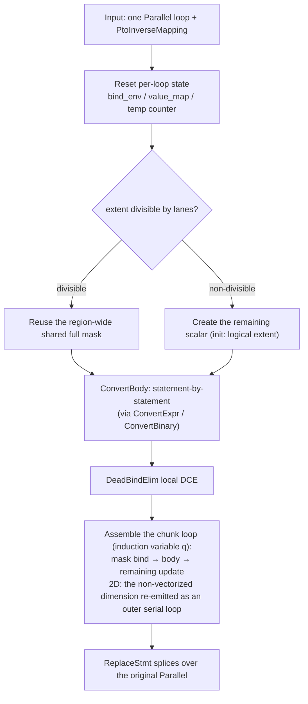
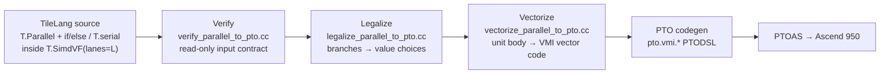

# PR1

> **历史文档**：本文记录写作时的实现/设计状态。后续改动已删除或重命名部分
> 文件、测试与行号；当前实现见 `src/ascend/transform/parallel_vectorize/` 与
> `src/ascend/transform/vsimd_*`，以代码为准。

## Background and Goal

**Goal**: users write scalar-parallel `T.Parallel` element-wise programs inside `T.SimdVF(lanes=L)`; the compiler vectorizes them into PTO VMI instructions, which PTOAS compiles to run correctly on Ascend 950. The full capability lands in tile-ai mainline over several PRs; each PR submission is a milestone. Control flow and reduce support are planned for PR-2 and PR-3, respectively.

**Division of responsibility**:

| | TileLang side | PTOAS / toolchain side |
| --- | --- | --- |
| Responsibilities | Deriving logical lane layouts, the vectorize pass pipeline, VMI instruction generation, Fragment logical mapping | Physical register splitting, mask materialization, Fragment buffer and vector register allocation, mem_bar insertion, etc. |

## Roadmap Milestones

| Milestone | PR | Content | Depends on |
| --- | --- | --- | --- |
| M1 | PR-1 | **T.Parallel vectorization core framework**: element-wise compute; extent divisible / not divisible by lanes | — |
| M2 | PR-2 | **Control flow support**: conditional branches, lane-uniform serial for loops | M1 |
| M3 | PR-3 | **T.reduce tileop support**: max/min/sum reduction | M2 |
| M4 | PR-4 | **Fragment Buffer UB capacity planning & allocation, PTOAS vector register allocation** | M1 + PTOAS |
| M5 | PR-5 | **Non-contiguous T.Parallel/Fragment access and broader PACK data type support**: gather/scatter and FP4 support beyond the hand-written VMI descriptor/codegen support in PR-1 | M4 |
| M6 | PR-6 | **reducer support**: reduction via T.alloc_reducer + T.finalize_reducer | M2 + M4 |

## Scope of This PR (PR-1)

1. **VMI instruction support**: `tl.vmi.*` registration, frontend APIs, and VMI codegen, covering data movement, arithmetic, broadcast and lane index, mask creation, type conversion, etc. Registrations, accessor declarations, and operand-ABI definitions live in `src/ascend/op/builtin.*`, alongside the other Ascend intrinsics; their names, operand layouts, and effect attributes are unchanged. Codegen translates each `tl.vmi.*` call into `pto.vmi.*` PTODSL text for PTOAS, which handles mask materialization, register allocation, and optimization. Each supported memory operation — `vmi.vload`, `vmi.vstore`, `vmi.vgather`, or `vmi.vscatter` — carries a descriptor whose declared range covers its complete physical access. Ordinary loads declare full physical vectors, group accesses declare the envelope of all groups, and block-stride accesses declare the envelope of the accessed 32-byte blocks. Ordinary stores declare the value's lane range; a mask does not shrink it. Packed FP4 descriptors use logical element units before packing. `vload` returns one VMI data value, and `vstore` accepts one VMI data value; neither accepts `dist_mode`. For automatic buffer addresses in hand-written VMI calls, the Python frontend emits raw `BufferLoad`s, and their descriptors are constructed and proven in TIR before scheduling by `LegalizePTOVMIMemoryAccess` (see §2.6). Explicit `T.access_ptr` arguments remain pointer expressions and follow the explicit-descriptor path described below. VMI calls emitted by the Vectorize pass carry their `tl.access_ptr` descriptors from that pass:
   - Ordinary `vload`/`vstore`: the access envelope is computed from the instruction parameters. When it extends below the original start (the negative group-stride case), the descriptor moves to a proven covering base and the VMI instruction offset compensates, so descriptor base + instruction offset always equals the original access address.
   - Indexed accesses (`vgather`/`vscatter`): runtime offsets make the exact range unknowable at compile time, so the descriptor conservatively declares the whole allocation owner — base at the owner origin, extent covering the owner, instruction offset `D = S − O + input_offset`, where `S` is the source address, `O` is the owner origin, and `input_offset` is the caller-provided scalar instruction offset. This is a may-access declaration for dependency analysis, not a proof that arbitrary runtime offsets stay in bounds. The owner layout, capacity, and instruction base must satisfy the proof conditions in §2.6.
   - Explicit `T.access_ptr` descriptors on ordinary `vload`/`vstore` are preserved verbatim and validated, never silently widened; on indexed accesses the owner declaration above replaces the caller-declared extent.
   - When no constructible descriptor provably covers the complete access — dynamic group or group stride, dynamic or negative block-stride control words, unknown element width, an envelope below the view origin, or an insufficient explicit extent — compilation stops with a diagnostic instead of declaring an incomplete range. Proofs use the loop and branch constraints at the access site and the same logical pointer-region analysis the scheduler consumes.
2. **Ascend-owned pass pipeline**: `NormalizePTOAllocMarkers` converts frontend allocation metadata into scoped TIR attributes; `LegalizePTOVMIMemoryAccess` constructs and validates descriptors before scheduling; Ascend layout inference derives PTO lane layouts without extending the common `ParallelOp`; Verify checks the input contract; Legalize reserves the normalization stage; Vectorize converts the SIMD_VF region after scheduling; `ImportPTOAllocMarkers` attaches allocation metadata after common block lowering; and `VerifyPTOCodegenLegality` checks final device TIR before codegen. VMI-specific registration, layout, allocation-metadata helpers, and constants are owned by the Ascend backend rather than backend-neutral source files.
3. **1D/2D Parallel**: both forms require `min = 0`, `step = 1`, and positive compile-time constant extents. 1D maps directly onto lanes; 2D recognizes two tightly nested Parallels as one iteration space, vectorizes the selected dimension, and keeps the other as an outer serial loop.
4. **Divisible and non-divisible extents**: when extent is divisible by lanes, all loops in the region share one constant full mask; otherwise a scalar `remaining` drives a dynamic prefix mask per chunk. Tail masks only guard computation and stores. Vector loads remain full-width, so the UB backing range must remain accessible for the extra lanes.
5. **Element-wise compute**: binary (+, -, *, /), unary (fabs/exp/log/sqrt), type conversion (f32↔fp8, f16/bf16↔f32, integer conversions: same-signed widening in one `vcvt`, cross-signed widening as `vcvt` + `vinterpret_cast`, same-width signedness change as `vinterpret_cast`, narrowing with `vcvt` at NOSAT; unsupported pairs are rejected with a reason).

## 1. Overall Transformation Flow

```mermaid
flowchart LR
    A["TileLang source<br/>T.Parallel inside T.SimdVF(lanes=L)<br/>and VMI calls"] --> N["NormalizePTOAllocMarkers<br/>scoped AttrStmt allocation metadata"]
    N --> E0["LegalizePTOVMIMemoryAccess<br/>proven VMI descriptors"]
    E0 --> U["Early unroll<br/>carrier Vars follow cloned allocations"]
    U -->|"AscendLayoutInference<br/>layout_inference.cc<br/>pto_parallel_layout.cc"| B["TIR with lane-layout annotation<br/>pto_parallel_loop_layout"]
    B -->|"AutoSchedule + InsertSync<br/>dependency analysis reads descriptors"| BS["Scheduled TIR + sync"]
    BS -->|"Verify (read-only)<br/>verify_parallel_to_pto.cc"| C["TIR passing the input contract"]
    C -->|"Legalize (normalize)<br/>legalize_parallel_to_pto.cc"| D["Normalized TIR<br/>(framework init only in this PR)"]
    D -->|"Vectorize (uniform conversion)<br/>vectorize_parallel_to_pto.cc<br/>+ parallel_to_pto_utils.cc"| E["Vectorized TIR<br/>tl.vmi.* calls + chunk loop + mask"]
    E --> L["Common block lowering<br/>preserves allocation AttrStmt carriers"]
    L -->|"ImportPTOAllocMarkers<br/>identity-based import"| M["AllocBuffer annotations<br/>temporary carriers removed"]
    M -->|"VerifyPTOCodegenLegality (read-only)<br/>verify_pto_codegen_legality.cc"| E2["Final TIR<br/>store alignment proven"]
    E2 -->|"PTO codegen<br/>codegen_pto.cc"| F["pto.vmi.* PTODSL text<br/>to PTOAS"]
```



The diagram shows the PTO-specific stages and their relation to scheduling and block lowering; unrelated common passes are omitted.

Flow notes:

1. **Entry and dispatch**. `T.SimdVF(lanes=L)` marks the region in the frontend (writing the `tl.simdvf_lanes` annotation); a kernel built with target=pto enters Verify→Legalize→Vectorize, while anything else takes the original `AscendSimdVFLowerParallel` path, leaving the Ascend compilation path unaffected.
2. **Backend ownership**. VMI intrinsic registration is built as part of the Ascend backend. PTO layout inference and allocation-marker validation/transfer likewise live under `src/ascend`; common `ParallelOp`, shared layout arguments, and `LowerOpaqueBlock` do not interpret PTO-specific contracts. Non-PTO Parallel inference and common block lowering keep their existing routes.
3. **Stage contracts**. Verify checks the input read-only and stops at the first error; Legalize normalizes (framework init only in this PR); Vectorize converts the whole SIMD_VF region uniformly, producing vectorized TIR made of `tl.vmi.*` calls.
4. **Descriptor construction before scheduling**. The VMI frontend emits automatic addresses as raw `BufferLoad`s with a zero instruction offset. `LegalizePTOVMIMemoryAccess` runs early in the pipeline — after `LegalizeNegativeIndex`, `InjectAssumes`, and allocation-marker normalization, before LayoutInference for PTO and AutoSchedule, on PTO targets only and also when AutoSchedule is off — so scheduling and buffer-init verification only ever see final, proven descriptors. This stage covers the hand-written VMI calls present in early TIR, including group, stride, and block_stride address modes. The VMI calls emitted later by VectorizeParallelToPTO carry `tl.access_ptr` descriptors for their own continuous accesses and are not reprocessed here. A raw automatic address that still reaches PTO codegen is a hard error with a source span.
5. **Allocation metadata across lowering**. `T.vmi.alloc_var` and `T.vmi.alloc_local` are restricted to SIMD_VF. Normalize validates the real allocation owner and emits an `AttrStmt` carrier keyed by the allocation's data Var. Early unroll remaps that Var together with each cloned allocation. Common `LowerOpaqueBlock` only materializes allocations and preserves the carrier; immediately afterward, `ImportPTOAllocMarkers` matches carrier and allocation by data-Var identity, writes the final `AllocBuffer` annotation, and removes the carrier.
6. **Final legality check**. VerifyPTOCodegenLegality runs read-only after all layout rewrites settle and before codegen, on PTO-target functions only; an explicit masked `vstore` whose destination alignment fails the backend requirement is diagnosed at compile time.
7. **Emission**. PTO codegen (`codegen_pto.cc`) translates each `tl.vmi.*` call into `pto.vmi.*` PTODSL text, handed to PTOAS for mask materialization, register allocation, and optimization.

## 2. Modules

### 2.1 LayoutInference for PTO

**Role**: pick a lane layout for each Parallel inside a PTO SIMD_VF region and write it back as an IR annotation for Verify/Vectorize to consume.

| Aspect | Content |
| --- | --- |
| Input → output | `T.Parallel` inside a SIMD_VF region with target=pto → `pto_parallel_loop_layout` annotation |
| Ascend-owned inference | `AscendLayoutInference` collects each PTO Parallel root together with its region lane bounds. After collection, its `Run()` stage calls `pto::InferPtoParallelLayout` for every recorded unit, stores the resulting Fragments, and merges them into the pass's `for_map`. The mutator writes the annotation on the original outermost root. This also works when no generic Parallel worklist entries exist |
| Helper and index analysis | `src/ascend/layout/pto_parallel_layout.{cc,h}` owns dimension selection, padding, access proofs, and the annotation key. `src/ascend/layout/pto_index_analysis.{cc,h}` is shared by PTO layout inference, Verify, and Vectorize |
| Non-PTO behavior | PTO roots do not enter the generic `ParallelOp` worklist. Common `ParallelOp` and `LayoutInferArgs` contain no PTO policy or PTO-only state, so non-PTO Parallel inference keeps its existing route |
| Key convention | The Fragment object only expresses the lane-to-iteration mapping; it introduces no Fragment storage. 1D/2D dimension selection is supported; in 2D only the selected dimension is padded. Original loop extents, buffer shapes, and access indices remain unchanged |

Mapping for 1D `T.Parallel(E)` (VL = lanes):

```text
lane = i % VL
q    = i // VL        # i.e. i = q * VL + lane
```

A 2D `T.Parallel(M, N)` appears in TIR as two tightly nested Parallels and is recognized as one 2D iteration space; the layout annotation goes only on the outermost For. Only the selected dimension is vectorized; the other stays as an outer serial loop. With `P_N = ceil(N/VL)×VL` and `P_M = ceil(M/VL)×VL`, `q` below is the per-row chunk index on the vectorized dimension:

| Vectorized dim | Layout input shape | Lane and per-row chunk | Generated loops |
| --- | --- | --- | --- |
| j | (M, P_N) | lane = j % VL, q = j // VL | i = k (outer serial), j = q×VL + lane |
| i | (P_M, N) | lane = i % VL, q = i // VL | j = k (outer serial), i = q×VL + lane |

### 2.2 Shared Implementation Layer (parallel_to_pto_utils + pto_index_analysis)

Verify and Vectorize must make the same judgments over the same program — whether it is convertible, what each address pattern is, how each cast lowers. These capabilities are implemented once in the shared Ascend layer and used by both passes, so the rules and their implementations cannot drift apart. PTO layout inference uses the same index-analysis helpers while keeping its lane-layout policy in `pto_parallel_layout`.

| Group | Function | Role |
| --- | --- | --- |
| Layout inversion | `InvertPtoLaneLayout` | Inverts an annotated Parallel into the lane/chunk/non-vectorized-dimension mapping, producing `PtoInverseMapping` (lanes, `index_expr`, chunk_count, tail_lanes, 2D selection) |
| Access classification | `AnalyzeBufferAccess` | Classifies one Buffer access as continuous / same address on every lane (lane-uniform) / unsupported, producing `MemoryAccess` (address regularity expressed with `ElemOffset` and proven equivalent by the arithmetic analyzer over the given value ranges) |
| Region scan | `ScanPtoRegion` / `DiscoverUnitsShared` | Identifies the Parallel loops to convert in a region, plus shared state |
| Lane use | `AnalyzeLaneUse` | Distinguishes indices used only for addresses from those used as computed values (the latter need `vci`) |
| Cast planning | `PlanValueCast` | Produces a conversion plan per Cast: dispatches lane-uniform scalar (plain `pto.cast`) vs lane-varying VMI vector first, then plans the vector steps (same-signed widening in one `vcvt`; same-width signedness change as `vinterpret_cast`; cross-signed widening as `vcvt` + `vinterpret_cast`; narrowing as `vcvt` at NOSAT), alongside FP8↔f32 and f16/bf16↔f32; the supported set is surveyed against the PTOAS VMI backend, and uncovered pairs are rejected with a reason |
| Whitelists | `IsSupportedElementDType` / `IsSupportedVectorBinaryOp` / `FindUnsupportedExprNode` | Admission sets for element types, binary ops, and expression nodes |

#### pto_index_analysis: Index Substitution and Padding Arithmetic

When the user writes `x = i + 1` and then accesses `A[x]`, judging the address regularity of `A[x]` requires substituting `x` back to `i + 1`. `ResolveIndexAliases` performs exactly this substitution: it walks Bind definition chains and expands index variables layer by layer until the expression contains only loop variables, constants, and BufferLoads, then hands it to the address-regularity check. Whether an address is continuous or lane-uniform decides which vectorization path applies, and real programs often chain several such indirections.

Rules of `ResolveIndexAliases`:

- Recursive substitution with cycle detection and a depth cap of 64 — exceeding the cap rejects rather than silently truncating;
- The expression node count is re-counted after each round and rejected past a budget of 4096 (preventing chains like `x1=i+i; x2=x1+x1; …` from exploding exponentially);
- A Bind whose definition contains a BufferLoad is a *value*, not an index expression, and is never substituted — substituting would duplicate a memory read.

The same file provides `CheckedPtoPadding`: an overflow-guarded version of "pad the logical extent up to a multiple of lanes". The lane loop indexes with int32, so an extent beyond int32 is rejected outright.

### 2.3 Verify: Input Contract Checking

**Role**: read-only checking of the input TIR; accepts forms that Legalize can normalize later; aborts compilation at the first error. Diagnostics carry the `[VerifyParallelToPTO]` prefix with a category and a location.

Main rejection scenarios, grouped by diagnostic category:

| Category | Rejection scenarios (examples) |
| --- | --- |
| lanes | SIMD_VF containing Parallel without the `tl.simdvf_lanes` annotation; annotation not an Int64 constant; illegal lanes value |
| Region admission | Hand-written `tl.vmi.*` mixed with a converting Parallel; `volatile_scope` attribute; region metadata referencing lane-varying values |
| Loop structure | serial/pipelined/while loops, nested blocks, or conditional branches inside a Parallel (this round); ThreadBinding regions or wrappers; Vectorized wrappers |
| Statement forms | Buffer allocation/declaration inside a Parallel; assert statements |
| Expression | Cross-lane reduce; expression nodes outside the whitelist |
| Memory access | Address neither continuous nor lane-uniform; GM (global memory) access; address patterns that cannot be proven regular |
| dtype/cast | Element types outside the whitelist; FP8 casts outside the supported set; lane-uniform scalar FP8 casts |
| Layout | Missing `pto_parallel_loop_layout`; non-invertible layout |

Verify and Vectorize share every analysis function from §2.2, so the two passes cannot disagree on the same input.

### 2.4 Legalize: Normalization

In PR-1 this pass only initializes the pass pipeline framework and rewrites nothing. It is introduced so that PR-2's control-flow support — normalization of IfThenElse/Min/Max→Select, etc. — lands here, keeping Vectorize's input contract unchanged.

### 2.5 Vectorize: Converting the Whole SIMD_VF Region Uniformly

Core class `VectorizeParallelToPTOImpl`. The entry `VisitStmt_(const SBlockNode*)` finds a PTO SIMD_VF region → `ScanPtoRegion` scans it → each Parallel loop is inverted by `InvertPtoLaneLayout` → converted by `ConvertUnit` → spliced back by `ReplaceStmt`.

#### ConvertUnit: the Main Flow for One Parallel Loop



Two key decisions:

- **Mask strategy**: divisible extents share one region-wide constant full mask; non-divisible extents create a `remaining` scalar (initialized to the loop's logical extent, decremented by lanes per chunk), and each chunk binds a dynamic prefix mask via `create_mask(remaining, L)`, runs the body, then updates remaining. The mask variable must exist before the body is converted — the vstore and vector ops in the body reference it.
- **2D Parallel loops**: the selected dimension is vectorized; the other dimension is re-emitted as an outer serial loop wrapping the chunk loop.

After the body is converted, a local DCE (`DeadBindElim`) removes leftover bindings that only served address derivation (dead vci/vbrc/vadd/vload chains).

#### ConvertExpr: Expression Conversion Dispatch

| Input | Path | Product |
| --- | --- | --- |
| BufferLoad, continuous address | Classified by `AnalyzeBufferAccess`; Vectorize emits a plain continuous `vload` and constructs `tl.access_ptr(start, lanes, 1)` for the chunk start. Vectorize does not generate group, stride, or block_stride accesses; §2.6 handles those modes for hand-written VMI calls | `vload` |
| BufferLoad, lane-uniform | Scalar BufferLoad kept (indices substitute lane=0, chunk=q), bound to a scalar Var | `sload`; each textual occurrence binds separately — no cross-access load reuse |
| loop_var used as a value | Substituted through the inverse mapping and simplified | `vci` |
| Cast | Plan taken from `PlanValueCast`; identity casts pass through | Vector `vcvt` with explicit saturate/rounding attributes — backend defaults are never relied on; cross-signed integer widening emits `vcvt` + `vinterpret_cast` as two binds |
| Unary math Call (fabs/exp/log/sqrt) | Table-mapped to the matching VMI unary op | `vabs`/`vexp`/`vln`/`vsqrt` (with mask) |
| Add/Sub/Mul/Div | `ConvertBinary` | See the table below |
| Anything else | Unreachable (already rejected by Verify); reaching it is an internal error | — |

Every intermediate value is materialized through `EmitBind` as a named Bind (`vload_0`, `brc_1`, …), keeping the output in a stable SSA form.

#### ConvertBinary: the Scalar/Vector 2×2 Dispatch

| lhs \ rhs | Scalar | Vector |
| --- | --- | --- |
| **Scalar** | Stays scalar arithmetic; no VMI emitted | Scalar side broadcast with `vbrc`, then `vadd`/`vsub`/`vmul`/`vdiv` (with mask) |
| **Vector** | Scalar side broadcast with `vbrc`, then `vadd`/`vsub`/`vmul`/`vdiv` (with mask) | `vadd`/`vsub`/`vmul`/`vdiv` directly (with mask) |

### 2.6 LegalizePTOVMIMemoryAccess: Descriptor Construction and Coverage Validation

**Role**: build the automatic descriptors of the VMI calls present in early TIR (hand-written through the VMI frontend) and prove that each declaration covers the real access, before the scheduler reads it. The scheduler derives task dependencies from descriptors alone — it never sees the VMI instruction offset — so the declared range, not the executed address, decides whether a DMA→VF dependency is found. Constructing descriptors here keeps that contract in one place, on final coordinates and with the full control-flow context. VMI calls generated later by VectorizeParallelToPTO carry their descriptors from that pass and are not reprocessed here.

| Aspect | Content |
| --- | --- |
| Position | Runs on PTO targets after `LegalizeNegativeIndex`, `InjectAssumes` and the PTO allocation-marker normalization; before `VerifyBufferInit`, schedule-unit materialization and AutoSchedule; also when AutoSchedule is disabled |
| Input contract | An automatic address is a raw `BufferLoad` in the VMI call's address operand (no descriptor yet); an explicit address is the caller's `tl.access_ptr` or one direct handle binding. Negative indices are already normalized, so construction sees final coordinates |
| Ordinary `vload`/`vstore` | Physical envelope `[low, high)` per access mode, relative to the instruction base. `low >= 0` declares from the original start with extent `high`. `low < 0` tries relocation candidates in order — 1-D lowest-address shift, padded-view origin, whole tight buffer — each with its own proof. `descriptor base + instruction offset = original address` is re-proven on every candidate |
| Indexed (`vgather`/`vscatter`) | Finds the unique active allocation owner by data identity and declares the whole owner from its origin. The instruction offset `D = S − O + input_offset` includes the caller-provided scalar instruction offset. Address preservation is proven on the original expressions, and the emitted `D` keeps its original expression and dtype. Owner-layout proofs and the emitted whole-owner capacity use int64 arithmetic where required; only the `D < capacity` comparison losslessly widens `D` to int64. The owner must be provably tight row-major with a stable, positive capacity, and `D` must be provably non-negative and smaller than that capacity |
| Explicit descriptors | Ordinary `vload`/`vstore`: kept verbatim — base, extent and any extra instruction offset; validated like automatic ones and rejected when too small, never widened automatically. Indexed accesses instead follow the owner construction above, and a bound pointer whose offset cannot be rebuilt without re-reading mutable memory is rejected |
| Proof context | The pass walks the real TIR with the analyzer's loop ranges, branch conditions and pure Bind facts. An access guarded by `0 <= k <= 1` is proven inside that branch, so coverage no longer depends on how the address was spelled. While conditions are not registered as proof constraints in this version |
| Validation layers | Physical containment (`0 <= D + low` and `D + high <= E`) plus the logical pointer-region coverage the scheduler will reconstruct. Cross-row or transposed patterns that cannot be proven are rejected with the operation, buffer context and the failing condition |
| Failure behavior | An unprovable declaration stops compilation with a located diagnostic; a raw automatic address that reaches PTO codegen is a hard error with a source span, so an unconstructed address cannot silently emit PTODSL |

### 2.7 VerifyPTOCodegenLegality: Final-TIR Legality Checks

**Role**: read-only legality gate at the end of the PTO pipeline. It consumes the final device TIR, verifies without rewriting the IR, and passes non-PTO targets through unchanged. It currently implements one rule — destination-address alignment for explicit masked `vstore` — turning violations into compile-time diagnostics with a remedy, instead of PTOAS verifier errors. More rules can be added at this IR stage later; the name does not claim that every PTO instruction's legality is already verified, and the pass stays separate from the pre-vectorization `VerifyParallelToPTO` and the rewriting `LegalizeParallelToPTO`.

| Aspect | Content |
| --- | --- |
| Position | Pipeline end (after `LowerDeviceKernelLaunch`, before codegen), PTO-target functions only; runs after `LowerAccessPtr`, version layout rewrites, UB merging, and the final Simplify, so it consumes final addresses — an earlier check would be overturned by later rewrites (version slot padding can repair a start address), and checking only `shape[-1]` would miss flat buffers, column offsets, and `elem_offset` |
| Check target | Ordinary `tl.vmi.vstore(value, pointer, instruction_offset, mask)` with an explicit mask, an 8-, 16-, or 32-bit data element type, and no address-mode annotations. Maskless stores, group/stride/block-stride stores, scatter, and the old SIMD API are not checked |
| Alignment requirement | Normal masked store: 32B-aligned start. 1PT element-wise write-back (1/2/4/8 elements with a full-active mask): natural element alignment (1/2/4B), matching what the backend selects |
| Address normalization | Built on `arith::IRVisitorWithAnalyzer` with the loop ranges, branch conditions, and Bind equations at the store site; descriptor offset, instruction offset, and derived pointer offsets are converted to bytes in their own element units and summed (alias already at +32B, FP32 descriptor offset 6, instruction offset 2 → total 64B) |
| Proof and diagnostics | Three states on `byte_offset % A`: proven 0 passes; proven non-zero reports "destination is misaligned" with the remainder; unprovable reports "cannot prove alignment" with the store location, final offset, dtype, write-back mode, and a remedy (e.g. pad the row stride to a multiple of 32B). Dynamic expressions are not rejected wholesale — an FP32 element offset `8*k` corresponds to a byte offset `32*k` and proves aligned |
| Not done | No automatic padding (it would have to move layout, all readers/writers, tile copy, alias, version, and the UB capacity budget together); no IR rewrite; plain continuous `vload` is not subject to the 32B rule (the backend can lower it to `vldas/vldus`) |

### 2.8 PTO Codegen: Value Categories and Allocation Metadata

TIR distinguishes signed and unsigned integer types, and codegen preserves that distinction with `pto.siN` and `pto.uiN`. The vci/vbrc integer bridge uses a same-width signless `pto.iN` scalar where MLIR requires it: PTOAS materializes the physical vector offset with `arith.constant`, which accepts only signless integers, so a true scalar integer source is cast with `pto.cast` and the result is reinterpreted as the intended signed or unsigned vector type. The bridge is required only for actual scalars — PTODSL scalar operators reject VMI registers.

The ambiguity: a one-lane VMI register (e.g. the `vreg<1xsi32>` result of `vcmax` with the default group) has a scalar TIR dtype, so a dtype test cannot tell it from a true scalar int32, and sending it down the bridge emits an illegal `pto.cast`.

Codegen therefore maintains a Var → defining-expression table: every Bind registers its variable and right-hand expression at the common Bind entry, Let-bound variables are scoped and cleared on exit, and the table resets per function. A consumer classifies a value by chasing its definition — true scalar, VMI data (including one-lane registers), VMI mask, VMI pair, void/handle — instead of trusting the dtype:

- `vbrc`: a VMI data source skips the bridge and is passed as a register, the result type follows the source, and no `vinterpret_cast` wrapper is emitted; a true scalar integer goes through the bridge.
- `vci`: the base must be a true scalar; a VMI value gets a codegen diagnostic instead of illegal PTODSL.
- Other scalar-only consumers (Cast, Select/if-then-else integer adaptation, integer `local.var` stores) consult the same table, so the mistake cannot move from one cast to another.
- A scalar loaded from ordinary memory is a scalar even if that address was written by a VMI store before — the table tracks value definitions, not memory history.

Mutable VMI register slots use a second, backend-owned mechanism:

1. `T.vmi.alloc_var` and `T.vmi.alloc_local` require SIMD_VF scope and classify the allocation as VMI data or a VMI data array. Ordinary scalar allocation APIs are unaffected.
2. `NormalizePTOAllocMarkers` validates kind, scope, shape, dtype, and actual allocation ownership. It consumes the frontend block annotation map and emits a scoped `tl.vmi.alloc_kind` `AttrStmt` whose node is the actual allocation data Var. Matching uses object identity, never names, shapes, or allocation order.
3. Early unroll updates the carrier's data Var through the same Var map used for cloned allocations, so each clone retains the correct marker. Nested scopes and same-name/different-Var allocations remain distinct.
4. Common `LowerOpaqueBlock` preserves the carrier but contains no VMI parsing or validation. `ImportPTOAllocMarkers` runs immediately afterward, matches carriers to materialized `AllocBuffer`s by data-Var identity, transfers the kind to `AllocBuffer.annotations`, and removes the temporary carrier. Orphan or conflicting carriers are diagnosed.
5. Codegen registers the final slot kinds per function before emission. The slot category — not the dtype — drives initialization (a `pto.vmi.vreg(lanes, dtype)` placeholder even at lanes=1), BufferStore (the RHS must classify as VMI data with matching dtype/lanes; a register assignment, never the scalar bridge), and BufferLoad classification. Plain `T.alloc_var` scalars keep the scalar guard and still reject VMI right-hand sides.

This allows a one-lane `vcmax` result stored into a mutable slot and read back through a grouped `vbrc` to lower without touching the scalar integer bridge, while keeping VMI allocation semantics out of backend-neutral lowering.


<!-- This is an auto-generated comment: release notes by coderabbit.ai -->
## Summary

- Added the `T.vmi` API, VMI instruction registration, and PTO code generation.
- Added FP4 handling, signed and unsigned integer support, mutable VMI slots, and value-provenance checks.
- Added a `lanes` parameter to `T.SimdVF`. PTO supports 64, 128, and 256 lanes.
- Added PTO layout inference, verification, legalization, vectorization, and codegen-legality checks.
- Added 1D and selected 2D `T.Parallel` vectorization inside `T.SimdVF`.
- Added element-wise operations, unary math, supported casts, continuous and lane-uniform memory access, and divisible or tail-mask handling.
- Added explicit masked-store alignment validation.
- Kept non-PTO Ascend lowering on the existing path.
- Added hardware-independent and NPU tests for routing, vectorization, casts, FP8 conversion, memory access, tail masks, allocation markers, and value provenance.
- Test execution results were not provided.

## C++ style / lint notes

- The PR changes C++ source and headers covered by `docs/developer_guide/cpp_style.md`. No specific changed style rules or warnings were identified.
- The supplied repository search found no reference to the **C++ API Style Audit (warning only)** step. Its status is unavailable.
- No correctness, build, or test failures were provided.
<!-- end of auto-generated comment: release notes by coderabbit.ai -->


# PR2

## Background and Goal

PR-1 (#3512) vectorized element-wise `T.Parallel` inside `T.SimdVF(lanes=L)`: every lane runs the same
straight-line computation and the unit becomes a chunk loop of full-width VMI operations.

That model has no room for a branch. The PTO/VMI target is **mask-based**, not control-flow-based: a store
is masked, `vsel` selects lane-wise, `create_mask` materializes a mask — but there is no scalar predicate
that could guard an arbitrary statement. Programs written in the natural scalar style therefore had to be
rewritten by hand:

```python
for i in T.Parallel(E):
    if a[i] > 0:                 # per-lane branch
        y[i] = y[i] + 1.0
```

**Goal of this PR**: keep the scalar source style and convert it mechanically.

- An `if` whose condition varies per lane becomes a **value choice**: `dest[i] = Select(cond, then_v, else_v)`.
- The side that does not write **reads the destination back**, so the resulting store is unpredicated and
  no lane loses its previous value.
- A `T.serial` loop inside a unit is kept as a **scalar shell** around the lane work; its trip count may be a
  runtime value.

The lane layout, the chunk loop and the mask plan are untouched: conditional units reuse the machinery PR-1
introduced, so a conditional program costs the same number of loads/stores as its straight-line equivalent.

Only shared-memory destinations are supported in this PR; local.var destinations are rejected for now and will be enabled once local-var support is in place.
## Roadmap Milestones

| Milestone | PR | Content | Depends on |
| --- | --- | --- | --- |
| M1 | PR-1 | **T.Parallel vectorization core framework**: element-wise compute; extent divisible / not divisible by lanes | — |
| M2 | PR-2 | **Control flow support**: conditional branches, lane-uniform serial for loops | M1 |
| M3 | PR-3 | **T.reduce tileop support**: max/min/sum reduction | M2 |
| M4 | PR-4 | **T.alloc_var T.alloc_local support**: local-var support | M1 |
| M5 | PR-5 | **Non-contiguous T.Parallel/Fragment access and broader PACK data type support**: gather/scatter and FP4 support beyond the hand-written VMI descriptor/codegen support in PR-1 | M4 |
| M6 | PR-6 | **reducer support**: reduction via T.alloc_reducer + T.finalize_reducer | M2 + M4 |

## Supported scenarios

Conditions may combine freely — a comparison, a scalar bool, and their `and`/`or`/`not` combines can nest arbitrarily, and operands may be lane-varying loads, lane-uniform scalars, or constants.

### By branch situation

| Branch situation | Example | Result after folding |
| --- | --- | --- |
| Two-sided branch, same destination | `if c: y[i] = x` / `else: y[i] = z` | one value choice: `y[i] = Select(c, x, z)` |
| One-sided branch (then only) | `if c: y[i] = x` | read-back: `y[i] = Select(c, x, y[i])` |
| Nested branches | `if c1: if c2: y[i] = x` | folded bottom-up; one value choice per destination |
| Two-sided branch, different destinations | `if c: y[i] = x` / `else: z[i] = x` | one value choice per destination, each completed by its own read-back |

### By condition kind

| Condition kind | Example | Lowered to |
| --- | --- | --- |
| Lane-varying comparison | `a[i] > b[i]`, `a[i] > 0.0` | a lane mask via `vcmp` (vector vs vector) / `vcmps` (vector vs scalar) |
| Lane-uniform comparison | `k > 0.0` (`k` depends only on the non-vectorized coordinate) | scalar compare kept as-is, widened by `create_mask` into an all-true / all-false mask |
| Bare scalar bool | `flag` (a bool kernel argument) | `create_mask` into an all-true / all-false mask |
| Boolean combine | `a[i] > 0.0 and b[i] < 0.0`, `or`, `not flag` | all-lane-uniform operands stay a scalar bool; otherwise the operands become masks and combine as `vand` / `vor` / `vnot` |
| Bool EQ / NE | `m1 == m2` (mask vs mask, incl. scalar bool operands) | a mask operand keeps a truth table built from `vand` / `vor` / `vnot`; two lane-uniform operands fold to a scalar compare |

Branch or condition shapes outside these tables are rejected with a diagnostic; see the not-supported list below.

## Not supported

Everything here is rejected with a diagnostic before Legalize and Vectorize run. PR-1 already rejects everything outside the element-wise contract — unit shape (`min != 0`, `step != 1`, non-constant extent, `lanes ∉ {64, 128, 256}`), the 1D/2D unit forms, GM and non-UB accesses, volatile allocations, element-dtype limits, and a `T.Parallel` placed under a branch / `while` or wrapped in a thread-bound / vectorized loop. Those diagnostics are unchanged and are not repeated here. Two access-time rules are new in this PR and are described in [Predicate contract](#predicate-contract): an access predicate is admitted only when it provably holds, and a buffer view declared over a `Bind`-ed data pointer is rejected outright. What follows is the control-flow boundary this PR introduces:

| Scenario | Reason | Diagnostic (excerpt) |
| --- | --- | --- |
|  `while` / `T.Pipelined` / any non-`serial` loop inside a unit | only a scalar shell is modelled | `only T.serial loops inside T.Parallel are supported at this stage (pipelined and while loops are rejected)` |
| `break` / `continue` | no representation in the converted form: TIR has no such node, and `T.loop_break()` only means something in the tile-level pipelined schedule; anything else inside a unit fails the statement backstop or the value whitelist | `statement ... inside T.Parallel is not yet supported` |
| a branch body that is not a shared-memory store | the Select-rewritable shape only covers stores | `If then-branch under T.Parallel must be buffer stores, nested conditionals or no-ops (the Select-rewritable shape); other statements are not supported at this stage` |
| a serial shell bound that references the lane variable or a unit-local variable (including a buffer read such as `T.serial(n[0])`) | the shell is copied through verbatim, so the reference would dangle or be re-evaluated against a buffer the conversion may have rewritten | `T.serial shell bounds must not reference the parallel lane variable or a variable bound inside the unit ...` |


## 1. Overall flow



1. **Verify** runs read-only after scheduling and stops at the first violation, so Legalize and Vectorize
   only ever see programs inside the contract (its control-flow edge is the table above; the element-wise
   contract is PR-1's).
2. **Legalize** rewrites control flow into straight-line stores whose values are `Select`s.
3. **Vectorize** converts the resulting unit body into VMI: conditions become lane masks, `Select` becomes
   `vsel`, stores become masked `vstore`s, and a serial shell is copied through.
4. Codegen emits `pto.vmi.*` text; mask materialization, register allocation and memory barriers stay on the
   PTOAS side, as in PR-1.

## 2. Legalize: branches → value choices

For each `if` whose condition varies per lane, the two arms are folded into one straight-line store sequence.
The pass works on **store lists**, not on the statement tree: both arms are collected in program order
(post-order, so a nested `if` has already been folded into stores), and every destination must be a
lane-private address, because the fold writes the destination back.

### The alignment problem

Each output position is one unpredicated store `dest = Select(cond, then_value, else_value)`, so the two arms
must end up with the same destinations in the same order, one-to-one. Two stores correspond only when their
**location** matches — element dtype, data Var, indices, element offset, strides and shape
(`SameArmLocation`).

Sometimes the arms as written do not satisfy that directly: they may list the same destinations in different orders, or one side may lack a destination the other writes. The pass closes the gap in two ways: it reorders the stores of each arm so that same-address stores meet, and it leaves the missing side of a one-sided destination empty. An empty side is materialized as a read-back of the destination at emission time, so the lane keeps its previous value. Each read-back costs a `vload` at vectorization time, so the number of them is kept minimal.

### Emission

The two aligned sequences are zipped: position `k` becomes
`BufferStore(then_k.buffer, Select(cond, then_k.value, else_k.value), then_k.indices)`, so the `if` disappears
from the IR and a predicated store never survives the pass.

```text
(1) one-sided — the missing side is a pad, i.e. a read-back
    before                  after
    if c:                   d[i] = Select(c, x, d[i])
        d[i] = x

(2) two-sided — one position carries both stores
    before                  after
    if c:                   d[i] = Select(c, x, y)
        d[i] = x
    else:
        d[i] = y

(3) RAW inside both arms, opposite order — no position can carry both stores
    before                          after
    if c:
        y1[i] = y0[i]               y1[i] = Select(c, y0[i], y1[i])   # then: old y0
        y0[i] = 1.0                 y0[i] = Select(c, 1.0, 2.0)      # paired by address
    else:                           y1[i] = Select(c, y1[i], y0[i])   # else: new y0
        y0[i] = 2.0
        y1[i] = y0[i]
```

Two expression rewrites run in the same pass: `T.min` / `T.max` become `Select(a < b, a, b)` /
`Select(a > b, a, b)` (keeping IEEE `NaN` and `±0` behaviour), and the `-T.infinity()` sentinel becomes a
`FloatImm`.

## 3. Vectorize: unit body → VMI

The unit is still converted chunk by chunk through the lane layout from PR-1; what is new is how a statement
becomes vector code:

| Source construct | Vectorized form |
| --- | --- |
| lane-varying comparison | `vcmp` / `vcmps` producing a lane mask |
| scalar bool | `create_mask` with all lanes active (true) or none (false) |
| `and` / `or` / `not` on masks | `vand` / `vor` / `vnot` |
| `Select(cond, t, f)` | fully lane-uniform: the scalar `Select` survives (codegen emits `pto.select`); otherwise `vsel(mask, t, f)`, with a scalar arm broadcast by `vbrc` first |
| store | `vstore(value, access_ptr(dest, L, write), 0, mask)` with the region mask from PR-1 |
| `T.serial` inside the unit | the shell is emitted around the lane work unchanged; only its body is converted |

The tail-mask plan is inherited unchanged: a divisible extent uses one shared full mask, otherwise the
scalar `remaining` counter drives a per-chunk `create_mask`, so a conditional store never writes past the
end of the buffer.

## 4. Testing

Structural (`pytest` on the lowered IR, no device) — 68 nodes on the two control-flow files, 96 on the four PTO files this PR touches, 414 in the full PTO suite with device tests excluded (405 passing, 7 skipped, the remaining 2 need a device):

- `test_simdvf_parallel_control_flow.py` (63 nodes) — folding shapes (two-sided / one-sided / nested / multi-way / divergent destinations / arm-local RAW and WAR / compound conditions / scalar bool / explicit padding), the read-back contract, condition snapshots, 2D leading-index destinations, predicate admission and rejection, the parameter alias contract, bound-pointer view rejection, and the rejection paths that must stay rejected (including `T.alloc_var` inside a unit).
- `test_simdvf_parallel_loop_shell.py` (5 nodes) — shell preservation for divisible and tail extents, runtime trip counts, and the undefined-bound rejection.

Device (Ascend 950, numeric comparison against a NumPy golden) — 11 nodes, all 11 passing:

- `test_simdvf_parallel_single_sided_store_run.py` — all conditional shapes in one kernel (including behind a UB polluter, which proves the destination is read back rather than left stale), plus a carried update inside a serial loop.
- `test_simdvf_parallel_minmax_semantics_run.py` — `NaN` operand position and `±0` ordering for `Min`/`Max`.
- `test_simdvf_parallel_loop_shell_run.py` — runtime trip counts (including zero iterations) and `step = 2`.

## 5. Commit layout

| Commit | Content |
| --- | --- |
| 1 | refactor: share the unary VMI mapping, the lane broadcast and the region-body conversion |
| 2 | fold `T.Parallel` control flow into value choices (Verify contract + Legalize fold + Vectorize `vsel`) |
| 3 | admit a `T.serial` shell inside `T.Parallel` |
| 4 | snapshot a conditional entry value when its condition aliases a write |
