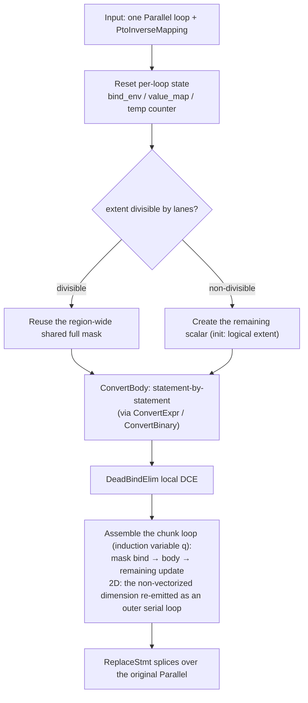

## Background and Goal

**Goal**: users write scalar-parallel `T.Parallel` programs (element-wise, control flow, reduce) inside `T.SimdVF(lanes=L)`; the compiler vectorizes them into PTO VMI instructions, which PTOAS compiles to run correctly on Ascend 950. The full capability lands in tile-ai mainline over several PRs; each PR submission is a milestone.

**Division of responsibility**:

| <br />           | TileLang side                                                                                                    | PTOAS / toolchain side                                                                                                      |
| ---------------- | ---------------------------------------------------------------------------------------------------------------- | --------------------------------------------------------------------------------------------------------------------------- |
| Responsibilities | Deriving logical lane layouts, the vectorize pass pipeline, VMI instruction generation, Fragment logical mapping | Physical register splitting, mask materialization, Fragment buffer and vector register allocation, mem\_bar insertion, etc. |

## Roadmap Milestones

| Milestone | PR   | Content                                                                                                      | Depends on |
| --------- | ---- | ------------------------------------------------------------------------------------------------------------ | ---------- |
| M1        | PR-1 | **T.Parallel vectorization core framework**: element-wise compute; extent divisible / not divisible by lanes | —          |
| M2        | PR-2 | **Control flow support**: conditional branches, lane-uniform serial for loops                                | M1         |
| M3        | PR-3 | **T.reduce tileop support**: max/min/sum reduction                                                           | M2         |
| M4        | PR-4 | **Fragment Buffer UB capacity planning & allocation, PTOAS vector register allocation**                      | M1 + PTOAS |
| M5        | PR-5 | **Non-contiguous access and PACK data types**: gather/scatter, fp4 packed data type support                  | M4         |
| M6        | PR-6 | **reducer support**: reduction via T.alloc\_reducer + T.finalize\_reducer                                    | M2 + M4    |

## Scope of This PR (PR-1)

1. **VMI instruction support**: `tl.vmi.*` instruction-entry registration and VMI codegen, covering data movement, arithmetic, broadcast and lane index, mask creation, type conversion, etc.; codegen translates each `tl.vmi.*` call into `pto.vmi.*` PTODSL text for PTOAS, which handles mask materialization, register allocation, and optimization.
2. **Pass pipeline**: LayoutInference for PTO (lane-layout inference and annotation), Verify (input-contract checking), Legalize (normalization; framework init only in this PR), Vectorize (uniform conversion of the whole SIMD\_VF region).
3. **1D/2D Parallel**: 1D maps directly onto lanes; 2D recognizes two tightly nested Parallels as one iteration space, vectorizes the selected dimension, and keeps the other as an outer serial loop.
4. **Divisible and non-divisible extents**: when extent is divisible by lanes, all loops in the region share one constant full mask; otherwise a scalar `remaining` drives a dynamic prefix mask per chunk.
5. **Element-wise compute**: binary (+, -, \*, /), unary (fabs/exp/log/sqrt), type conversion (f32↔fp8, f16/bf16↔f32, integer width changes).

1\. **VMI指令支持**：\`tl.vmi.*\`指令条目注册和VMI代码生成，涵盖数据移动、算术、广播和通道索引、掩码创建、类型转换等；代码生成将每个\`tl.vmi.*\`调用转换为\`pto.vmi.\*\` PTODSL文本，用于PTOAS，该模块处理掩码实例化、寄存器分配和优化。\
2\. **流水线传递**：PTO的LayoutInference（通道布局推理和注释）、Verify（输入合约检查）、Legalize（规范化；本PR中仅框架初始化）、Vectorize（整个SIMD\_VF区域的统一转换）。\
3\. **1D/2D并行**：1D直接映射到通道；2D识别两个紧密嵌套的Parallels作为一个迭代空间，对选定的维度进行向量化，并将另一个作为外部的串行循环。\
4\. **可分割和不可分割的范围**：当范围可被通道分割时，该区域内的所有循环共享一个常数完整掩码；否则，一个标量\`remaining\`驱动每个块的一个动态前缀掩码。\
5\. **逐元素计算**：二元运算（+、-、\*、/）、一元运算（fabs/exp/log/sqrt）、类型转换（f32↔fp8、f16/bf16↔f32、整数宽度变化）。

## 1. Overall Transformation Flow

```mermaid
flowchart LR
    A["T.Parallel source<br/>inside T.SimdVF(lanes=L)"] -->|"LayoutInference for PTO<br/>layout_inference.cc · parallel.cc"| B["TIR with lane-layout annotation<br/>pto_parallel_loop_layout"]
    B -->|"Verify (read-only)<br/>verify_parallel_to_pto.cc"| C["TIR passing the input contract"]
    C -->|"Legalize (normalize)<br/>legalize_parallel_to_pto.cc"| D["Normalized TIR<br/>(framework init only in this PR)"]
    D -->|"Vectorize (uniform conversion)<br/>vectorize_parallel_to_pto.cc<br/>+ parallel_to_pto_utils.cc"| E["Vectorized TIR<br/>tl.vmi.* calls + chunk loop + mask"]
    E -->|"PTO codegen<br/>codegen_pto.cc"| F["pto.vmi.* PTODSL text<br/>to PTOAS"]
```



Flow notes:

1. **Entry and dispatch**. `T.SimdVF(lanes=L)` marks the region in the frontend (writing the `tl.simdvf_lanes` annotation); a kernel built with target=pto enters Verify→Legalize→Vectorize, while anything else takes the original `AscendSimdVFLowerParallel` path, leaving the Ascend compilation path unaffected.
2. **Stage contracts**. Verify checks the input read-only and stops at the first error; Legalize normalizes (framework init only in this PR); Vectorize converts the whole SIMD\_VF region uniformly, producing vectorized TIR made of `tl.vmi.*` calls.
3. **Emission**. PTO codegen (`codegen_pto.cc`) translates each `tl.vmi.*` call into `pto.vmi.*` PTODSL text, handed to PTOAS for mask materialization, register allocation, and optimization.

## 2. Modules

### 2.1 LayoutInference for PTO

**Role**: pick a lane layout for each Parallel inside a PTO SIMD\_VF region and write it back as an IR annotation for Verify/Vectorize to consume.

| Aspect              | Content                                                                                                                                                                                                                                                                                                                       |
| ------------------- | ----------------------------------------------------------------------------------------------------------------------------------------------------------------------------------------------------------------------------------------------------------------------------------------------------------------------------- |
| Input → output      | `T.Parallel` inside a SIMD\_VF region with target=pto → `pto_parallel_loop_layout` annotation                                                                                                                                                                                                                                 |
| Core implementation | `parallel.cc` adds a PTO branch to Parallel's layout candidates (builds a lane layout with vectorize\_size=1 when `in_pto_simd_vf`); `layout_inference.cc` recognizes PTO regions and writes the annotation; the annotation key is independent of SIMT's `parallel_loop_layout`, so the two backends never misread each other |
| Key convention      | The Fragment object only expresses the lane-to-iteration mapping; it introduces no Fragment storage. 1D/2D dimension selection is supported; in 2D only the selected dimension is padded                                                                                                                                      |

Mapping for 1D `T.Parallel(E)` (VL = lanes):

```text
lane = i % VL
q    = i // VL        # i.e. i = q * VL + lane
```

A 2D `T.Parallel(M, N)` appears in TIR as two tightly nested Parallels and is recognized as one 2D iteration space; the layout annotation goes only on the outermost For. Only the selected dimension is vectorized; the other stays as an outer serial loop. With `P_N = ceil(N/VL)×VL` and `P_M = ceil(M/VL)×VL`:

| Vectorized dim | Layout input shape | Flattened coordinate t | lane and chunk             | Generated loops                       |
| -------------- | ------------------ | ---------------------- | -------------------------- | ------------------------------------- |
| j              | (M, P\_N)          | t = i×P\_N + j         | lane = t % VL, q = t // VL | i = k (outer serial), j = q×VL + lane |
| i              | (P\_M, N)          | t = j×P\_M + i         | lane = t % VL, q = t // VL | j = k (outer serial), i = q×VL + lane |

### 2.2 Shared Implementation Layer (parallel\_to\_pto\_utils + pto\_index\_analysis)

Verify and Vectorize must make the same judgments over the same program — whether it is convertible, what each address pattern is, how each cast lowers. These capabilities are implemented once in the shared layer and used by both passes, so the rules and their implementations cannot drift apart.

| Group                 | Function                                                                            | Role                                                                                                                                                                                                                                                         |
| --------------------- | ----------------------------------------------------------------------------------- | ------------------------------------------------------------------------------------------------------------------------------------------------------------------------------------------------------------------------------------------------------------ |
| Layout inversion      | `InvertPtoLaneLayout`                                                               | Inverts an annotated Parallel into the lane/chunk/non-vectorized-dimension mapping, producing `PtoInverseMapping` (lanes, `index_expr`, chunk\_count, tail\_lanes, 2D selection)                                                                             |
| Access classification | `AnalyzeBufferAccess`                                                               | Classifies one Buffer access as continuous / same address on every lane (lane-uniform) / unsupported, producing `MemoryAccess` (address regularity expressed with `ElemOffset` and proven equivalent by the arithmetic analyzer over the given value ranges) |
| Region scan           | `ScanPtoRegion` / `DiscoverUnitsShared`                                             | Identifies the Parallel loops to convert in a region, plus shared state                                                                                                                                                                                      |
| Lane use              | `AnalyzeLaneUse`                                                                    | Distinguishes indices used only for addresses from those used as computed values (the latter need `vci`)                                                                                                                                                     |
| Cast planning         | `PlanValueCast`                                                                     | Produces a conversion plan per Cast (target dtype, saturate, rounding), covering the supported conversions such as FP8↔f32 and f16/bf16↔f32; gives a reason when not convertible                                                                             |
| Whitelists            | `IsSupportedElementDType` / `IsSupportedVectorBinaryOp` / `FindUnsupportedExprNode` | Admission sets for element types, binary ops, and expression nodes                                                                                                                                                                                           |

#### pto\_index\_analysis: Index Substitution and Padding Arithmetic

When the user writes `x = i + 1` and then accesses `A[x]`, judging the address regularity of `A[x]` requires substituting `x` back to `i + 1`. `ResolveIndexAliases` performs exactly this substitution: it walks Bind definition chains and expands index variables layer by layer until the expression contains only loop variables, constants, and BufferLoads, then hands it to the address-regularity check. Whether an address is continuous or lane-uniform decides which vectorization path applies, and real programs often chain several such indirections.

Rules of `ResolveIndexAliases`:

- Recursive substitution with cycle detection and a depth cap of 64 — exceeding the cap rejects rather than silently truncating;
- The expression node count is re-counted after each round and rejected past a budget of 4096 (preventing chains like `x1=i+i; x2=x1+x1; …` from exploding exponentially);
- A Bind whose definition contains a BufferLoad is a *value*, not an index expression, and is never substituted — substituting would duplicate a memory read.

The same file provides `CheckedPtoPadding`: an overflow-guarded version of "pad the logical extent up to a multiple of lanes". The lane loop indexes with int32, so an extent beyond int32 is rejected outright.

### 2.3 Verify: Input Contract Checking

**Role**: read-only checking of the input TIR; accepts forms that Legalize can normalize later; aborts compilation at the first error. Diagnostics carry the `[VerifyParallelToPTO]` prefix with a category and a location.

Main rejection scenarios, grouped by diagnostic category:

| Category         | Rejection scenarios (examples)                                                                                                                              |
| ---------------- | ----------------------------------------------------------------------------------------------------------------------------------------------------------- |
| lanes            | SIMD\_VF containing Parallel without the `tl.simdvf_lanes` annotation; annotation not an Int64 constant; illegal lanes value                                |
| Region admission | Hand-written `tl.vmi.*` mixed with a converting Parallel; `volatile_scope` attribute; region metadata referencing lane-varying values                       |
| Loop structure   | serial/pipelined/while loops, nested blocks, or conditional branches inside a Parallel (this round); ThreadBinding regions or wrappers; Vectorized wrappers |
| Statement forms  | Buffer allocation/declaration inside a Parallel; assert statements                                                                                          |
| Expression       | Cross-lane reduce; expression nodes outside the whitelist                                                                                                   |
| Memory access    | Address neither continuous nor lane-uniform; GM (global memory) access; address patterns that cannot be proven regular                                      |
| dtype/cast       | Element types outside the whitelist; FP8 casts outside the supported set; lane-uniform scalar FP8 casts                                                     |
| Layout           | Missing `pto_parallel_loop_layout`; non-invertible layout                                                                                                   |

Verify and Vectorize share every analysis function from §2.2, so the two passes cannot disagree on the same input.

### 2.4 Legalize: Normalization

In PR-1 this pass only initializes the pass pipeline framework and rewrites nothing. It is introduced so that PR-2's control-flow support — normalization of IfThenElse/Min/Max→Select, etc. — lands here, keeping Vectorize's input contract unchanged.

### 2.5 Vectorize: Converting the Whole SIMD\_VF Region Uniformly

Core class `VectorizeParallelToPTOImpl`. The entry `VisitStmt_(const SBlockNode*)` finds a PTO SIMD\_VF region → `ScanPtoRegion` scans it → each Parallel loop is inverted by `InvertPtoLaneLayout` → converted by `ConvertUnit` → spliced back by `ReplaceStmt`.

#### ConvertUnit: the Main Flow for One Parallel Loop



Two key decisions:

- **Mask strategy**: divisible extents share one region-wide constant full mask; non-divisible extents create a `remaining` scalar (initialized to the loop's logical extent, decremented by lanes per chunk), and each chunk binds a dynamic prefix mask via `create_mask(remaining, L)`, runs the body, then updates remaining. The mask variable must exist before the body is converted — the vstore and vector ops in the body reference it.
- **2D Parallel loops**: the selected dimension is vectorized; the other dimension is re-emitted as an outer serial loop wrapping the chunk loop.

After the body is converted, a local DCE (`DeadBindElim`) removes leftover bindings that only served address derivation (dead vci/vbrc/vadd/vload chains).

#### ConvertExpr: Expression Conversion Dispatch

| Input                               | Path                                                                               | Product                                                                                         |
| ----------------------------------- | ---------------------------------------------------------------------------------- | ----------------------------------------------------------------------------------------------- |
| BufferLoad, continuous address      | Classified by `AnalyzeBufferAccess`, pointer via `tl.access_ptr` (extent=VL)       | `vload`                                                                                         |
| BufferLoad, lane-uniform            | Scalar BufferLoad kept (indices substitute lane=0, chunk=q), bound to a scalar Var | `sload`; each textual occurrence binds separately — no cross-access load reuse                  |
| loop\_var used as a value           | Substituted through the inverse mapping and simplified                             | `vci`                                                                                           |
| Cast                                | Plan taken from `PlanValueCast`; identity casts pass through                       | Vector `vcvt` with explicit saturate/rounding attributes — backend defaults are never relied on |
| Unary math Call (fabs/exp/log/sqrt) | Table-mapped to the matching VMI unary op                                          | `vabs`/`vexp`/`vln`/`vsqrt` (with mask)                                                         |
| Add/Sub/Mul/Div                     | `ConvertBinary`                                                                    | See the table below                                                                             |
| Anything else                       | Unreachable (already rejected by Verify); reaching it is an internal error         | —                                                                                               |

Every intermediate value is materialized through `EmitBind` as a named Bind (`vload_0`, `brc_1`, …), keeping the output in a stable SSA form.

#### ConvertBinary: the Scalar/Vector 2×2 Dispatch

| lhs \ rhs  | Scalar                                                                          | Vector                                                                          |
| ---------- | ------------------------------------------------------------------------------- | ------------------------------------------------------------------------------- |
| **Scalar** | Stays scalar arithmetic; no VMI emitted                                         | Scalar side broadcast with `vbrc`, then `vadd`/`vsub`/`vmul`/`vdiv` (with mask) |
| **Vector** | Scalar side broadcast with `vbrc`, then `vadd`/`vsub`/`vmul`/`vdiv` (with mask) | `vadd`/`vsub`/`vmul`/`vdiv` directly (with mask)                                |

<!-- This is an auto-generated comment: release notes by coderabbit.ai -->

## Summary

- Added the `T.vmi` API and PTO code generation for VMI instructions, including packed FP4 handling, register buffers, and signed and unsigned integer types.
- Added `lanes` to `T.SimdVF`, with support for 64, 128, and 256 lanes.
- Added PTO lane-layout inference for 1D and 2D `T.Parallel` regions.
- Added a PTO pipeline with Verify, Legalize, and Vectorize passes. Legalize currently preserves the input IR.
- Added vectorization for supported element-wise operations, casts, and buffer accesses. Divisible extents use a shared full-lane mask; tail extents use per-chunk prefix masks.
- Kept non-PTO Ascend parallel lowering on the existing path.
- Added hardware-independent contract, routing, and vectorization tests, plus NPU tests for element-wise operations, FP8 conversion, and tail masks. Test execution results were not provided.

## C++ style / lint notes

- The PR changes C++ source and headers. Whether it touches rules documented in `docs/developer_guide/cpp_style.md` is not established by the supplied evidence.
- The “C++ API Style Audit (warning only)” CI step was not mentioned in the supplied evidence, so its relevance and results are unknown.
- No specific style warnings were provided. No correctness, build, or test failures were provided either.

<!-- end of auto-generated comment: release notes by coderabbit.ai -->
